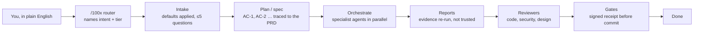

# 100x-engineer

A Claude Code plugin that turns a plain-English request into planned, tested and verified
work: one router, eleven specialist agents, built-in engineering defaults, and gates that
block "done" without evidence.

## Contents

| # | section | what it answers |
|---|---------|-----------------|
| 1 | [How a request flows](#how-a-request-flows) | what happens between typing a request and "done" |
| 2 | [Start here](#start-here) | install, update, and the one command to type |
| 3 | [Agents](#agents) | the 11 specialists, and which of them write code |
| 4 | [Skills by phase](#skills-by-phase) | the 40 skills, grouped by when they fire |
| 5 | [Gates by phase](#gates-by-phase) | the check that blocks each phase, and how |
| 6 | [Built-in defaults](#built-in-defaults) | what is applied without asking, what is asked, with three examples |
| 7 | [Where records go](#where-records-go) | the records root and its layout |
| 8 | [The commit gate](#the-commit-gate) | modes, signed receipts and their limit, the hooks |
| 9 | [Does it actually work?](#does-it-actually-work) | the measured numbers, and the claim it does **not** make |
| 10 | [Tools](#tools) | the 38 command-line tools, grouped |
| 11 | [Honest limitations](#honest-limitations) | what it misses, measured not guessed |
| 12 | [Research](#research) | the evidence every skill cites |

## How a request flows



Small tasks skip the agents: the router decides when one person in one session is enough.

## Start here

| step | do | note |
|---|---|---|
| 1. install | `claude plugin marketplace add ./100x-engineer` then `claude plugin install 100x-engineer@100x-local` | needs `python3` on the PATH; no other dependency |
| 1b. update | `claude plugin update 100x-engineer@100x-local` | `.claude-plugin/plugin.json`'s `version` pins installs, so an update only arrives after that version is bumped |
| 2. ask | `/100x-engineer:100x <what you want>` | e.g. `/100x-engineer:100x Add tagging to albums` |
| 3. answer | at most five questions, each with a recommendation | or reply "go with your recommendations" |

Everything after that is chosen for you. `docs/PLAYBOOK.md` lists the commands behind
each task if you want one step rather than the pipeline.

## Agents

**11 agents**, defined in `agents/`. The main session talks to you; agents never do. Their
questions come back through their reports. Full contract: `docs/OPERATING-MODEL.md`.

| agent | job | writes code? |
|---|---|---|
| requirements-analyst | plain English → requirements, assumptions, ≤5 questions | no |
| solution-architect | reviews specs and plans before build, and every diff for design fit | no |
| backend-engineer | implements server-side tasks | yes |
| frontend-engineer | implements web UI tasks | yes |
| mobile-engineer | implements mobile tasks | yes |
| qa-engineer | test plan, acceptance-criteria traceability, automated tests | tests only |
| code-reviewer | independent review of someone else's diff | no |
| security-reviewer | application security review of a diff or design | no |
| independent-verifier | re-runs every evidence command itself; trusts no report | no |
| comprehension-mapper | maps an unfamiliar codebase into a durable architecture note | docs only |
| rca-investigator | incident timeline, hypotheses, root cause, action items | docs only |

## Skills by phase

**40 skills**. The phase map and every trigger are generated into
[`skills/INDEX.md`](skills/INDEX.md) by `100x check_index --gen-collections`.

| phase | count | skills |
|---|--:|---|
| 0 start here | 3 | 100x, orchestrate, requirements-intake |
| 1 before code | 7 | api-contract, approach-selection, data-modeling, decision-records, feature-planning, scale-appropriateness, solution-architecture |
| 2 while writing | 19 | accessibility, app-security, code-craft, data-lifecycle, dependency-vetting, diagramming, distributed-correctness, frontend-architecture, language-verification, legacy-change, minimal-diff, mobile-release-safety, observability-design, performance-budgets, qa-strategy, stack-reviewer, test-design, ui-baseline, web-vitals |
| 3 before shipping | 5 | diff-review, release-rollout, review-gates, security-baseline, verification-gate |
| 4 when broken | 2 | bug-fix, root-cause-analysis |
| 5 understanding | 1 | codebase-comprehension |
| 6 meta | 3 | agent-instructions, project-learning, untrusted-agent-config |

Plus 7 stack reviewers in [`reviewers/`](reviewers/INDEX.md): NestJS, Next.js/React,
React Native + Expo, Flutter, native Android/iOS, Kubernetes, cloud IaC.

## Gates by phase

| phase | blocks unless | command |
|---|---|---|
| intake | every requirement has a source; must-ask items are answered or marked `ASSUMED` | `100x prd audit`, `100x plan_feature audit` |
| plan | every `AC-<n>` is canonical, maps to scope and the PRD, and is covered by a verification row | `100x plan_feature audit` |
| choices | every option declares fit pass/fail; the chosen one passes and tops the scores or says why | `100x decide lint` |
| task graph | acyclic, known owners, disjoint files in parallel, every defined AC owned by a task | `100x plan_dag lint --spec` |
| per agent | the report is valid and its evidence replays with the same exit codes | `100x agent_report lint` + `replay --yes` |
| QA | every AC has a tagged test | `100x testplan trace` |
| review | no blocking item from architect, code or security review; diff not bloated | `100x agent_report lint`, `100x bloat_check`, `100x review_scope` |
| commit / push / PR / publish | a fresh, signed receipt covers every required check | `PreToolUse` hook |
| end of turn | no stop with changes and no matching receipt (block mode only) | `Stop` hook |

## Built-in defaults

The router applies what a senior engineer would without being told, from
`scripts/data/baseline.json`, keyed by three axes:

| axis | values |
|---|---|
| work type | web-ui, mobile, api, worker, data-pipeline, cli, iac |
| tier (required) | prototype, small, growth, scale |
| risk | none, elevated, regulated (auth, payment and PII kinds raise it to at least elevated) |

| class | meaning | action |
|---|---|---|
| A | always-on (authz on every endpoint, input validation, 320px reflow) | applied silently, listed as an assumption |
| B | on from a tier (rate limiting from `growth`, multi-region at `scale`) | applied per tier, listed |
| C | your call (data residency, retention, compliance, SLO numbers, cost) | asked, never defaulted |

| example | command | A / B / C |
|---|---|---|
| a prototype web screen | `100x baseline show --work web-ui --tier prototype` | 15 / 0 / 1 |
| a small-team API | `100x baseline show --work api --tier small` | 20 / 0 / 4 |
| a regulated API and worker at growth | `100x baseline show --work api,worker --tier growth --risk regulated` | 30 / 6 / 8 |

## Where records go

PRDs, specs, decisions, RCAs, lessons, reviews and test plans go under one **records
root**, resolved first match wins:

| order | source | example |
|---|---|---|
| 1 | `.100x.json` at the git root | `{"root": "docs/engineering"}` |
| 2 | env `HUNDREDX_ROOT_DIR` | one-off runs, CI |
| 3 | default | `docs/engineering` |

Layout: `<root>/{prds,specs,decisions,rca,lessons,reviews,ledger,testplans}/` plus
`<root>/INDEX.md`. A root outside the repo is refused. A repo that already has top-level
record directories keeps them, with a warning. This repo commits `{"root": "."}`, so its
own examples are `specs/login` and `decisions/ADR-0001-…`.

## The commit gate

Run your real checks through a wrapper that records the result, **signed and bound to a
hash of the exact content it verified**:

```bash
100x verified --name test -- npm test
```

A `PreToolUse` hook gates `git commit`, `git push`, tag creation, `gh pr create|merge|ready`,
`gh release create` and package publishes. Editing anything after the run invalidates the
receipt, so *test → edit → commit* is caught.

| repository state | gate |
|---|---|
| no `.claude/verification-policy.json` | **warn**: passes, says the gate is not configured |
| policy present | **block**: denied without a fresh signed receipt for every required check, run with the command the policy binds to it |
| policy `{"mode": "off"}` | silent |
| the worktree policy differs from the committed one | the committed one is enforced, so an agent cannot switch the gate off by editing the file |

```json
{ "required_checks": { "test": "npm test", "typecheck": "npx tsc --noEmit" }, "max_age_minutes": 120 }
```

| mechanism | behaviour |
|---|---|
| `--no-verify`, `commit -n`, `-c core.hooksPath=` | denied |
| `[skip-verify]` in the commit message | a human is asked to approve; the agent cannot approve its own bypass |
| `Stop` hook | in block mode, stops the turn ending once if there are changes and no matching receipt |
| `SessionStart` hook | adds five lines naming `/100x-engineer:100x` and `100x list`, so the router stays reachable when many skills are installed |
| an internal hook error, or no `python3` | **fails open**: no decision, the gate goes quiet |

**Signing has a limit.** Receipts are HMAC-signed with a key in `~/.config/100x/`, so a
hand-written receipt is rejected. The agent runs as you, so an agent that deliberately
reads the key can still sign. If that matters, add a deny rule for `~/.config/100x/**`
(Read and Bash) or run sandboxed. Details: [`docs/SAFETY.md`](docs/SAFETY.md).

## Does it actually work?

Two separate questions, answered separately.

**Do the checks catch what they claim?**

```bash
100x run_evals
```

| measure | result |
|---|---|
| seeded defects, one per class the plugin claims to catch | **19/19 caught** |
| clean controls | **0/4 false positives** |
| defect classes recorded as **not** caught | 6, kept as eval cases so the scope claim is testable |

**Does the router pick the right skill?** `100x skill_triggers --all-modes`, top-3:

| fixture | full descriptions | first 100 chars + 17 competitor skills |
|---|--:|--:|
| main (66 prompts, gated at ≥85%) | 100% | 97% |
| holdout (20 prompts, not gated) | 60% | 45% |

The main fixture was visible while descriptions were rewritten, so its numbers are partly
fit to it; the holdout is the honest one. History: [`evals/GRADER-CHANGELOG.md`](evals/GRADER-CHANGELOG.md).

**Does using this make someone dramatically more productive?** Unknown. Nothing here
measures that, and "100x" is a name, not a claim.

## Tools

**38 tools**, each run as `100x <tool>` (`100x list` prints them). Python standard library
and git only.

| group | tools |
|---|---|
| plan and trace | `prd`, `plan_feature`, `baseline`, `decide`, `testplan`, `ledger`, `check_index` |
| orchestrate | `plan_dag`, `agent_report`, `agents_lint` |
| verify | `verified`, `verify_fingerprint`, `audit_ci_gates`, `run_evals` |
| diff checks | `bloat_check`, `craft_check`, `schema_check`, `perf_check`, `test_design_check`, `a11y_check`, `ui_baseline_check`, `appsec_check`, `fe_layers_check`, `vet_dep`, `review_scope` |
| design and diagrams | `design_drift`, `diagram_from_code`, `check_diagrams` |
| understand and learn | `repo_map`, `stack_audit`, `rca`, `learn` |
| this repo's own discipline | `lint_skills`, `skill_triggers`, `check_claims`, `check_agents_md`, `audit_agent_config`, `safety_audit` |

```bash
bash tests/run_all.sh    # 39 test suites, the seeded-defect evals and the lints
```

## Honest limitations

- **Trigger routing is a lexical proxy.** 100% / 97% on the main fixture, about 60% on the
  holdout. Misses are word-form gaps (golang/go, crashes/crash) a bag-of-words scorer cannot
  close.
- **The signing key is readable by the agent**, which runs as you. See
  [The commit gate](#the-commit-gate) for the mitigation.
- **Checkers are heuristic diff scanners, not CodeQL.** Python checks parse the syntax
  tree; TS/JS checks are regex and brace counting. They catch the shapes in the evals, not
  everything.
- **Hooks fail open.** An internal error or a missing `python3` means no decision, not a
  block. A quiet gate is not evidence.
- **The receipt proves a command exited zero against specific content**, not that the
  command was worth running. Mutation testing would; it was absent in 0/72 JS and 0/50
  Python corpus repos.
- **Six defect classes have no mechanical detection anywhere**: semantic duplication,
  redundant comments, unnecessary dependencies, tests that assert the bug, missing
  authorization, check-then-act races. `review_scope` turns them into questions.
- **`prd align` proves a link was declared**, not that the AC satisfies the requirement.
- **Intent classification is judgement.** A mixed request must be split into two
  pipelines, which the router has to notice.
- **The corpus is a snapshot**, screened 2026-09-28, and mobile evidence is thinner (11 of
  a 30 target).

## Research

Built from measurement: **1,431 repositories screened to a 223-repo corpus** of production
software (≥20k stars, ≥250 commits/year, ≥2 years old, licensed, tested). Their CI, test,
lint, type, security and agent configurations were read and counted.

15 documents in [`research/`](research/INDEX.md), each with its own `## Contents` table:
`00` the screening contract · `01` the skill contract · `10` the corpus and funnel ·
`2x` skills ecosystem, agent-instruction corpus, agent-tool internals, anti-bloat tooling ·
`3x` per-cluster deep reads: JS, Python, Go, mobile, agentic, security, anti-bloat,
governance.

## Licence

MIT. Adapted material is attributed per skill under `## Sources`, with upstream licences
recorded in `research/20-findings-ecosystem-skills.md`. `hesreallyhim/awesome-claude-code`
is CC BY-NC-ND and therefore **not** adapted here; it is referenced as a discovery index
only.
