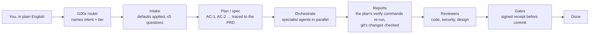

# 100x-engineer

A Claude Code plugin that turns a plain-English request into planned, tested and verified
work: one router, eleven specialist agents, built-in engineering defaults, and gates that
block "done" without evidence.

## Contents

| # | section | what it answers |
|---|---------|-----------------|
| 1 | [How a request flows](#how-a-request-flows) | what happens between typing a request and "done" |
| 2 | [Start here](#start-here) | install from GitHub, update, and the one command to type |
| 3 | [Agents](#agents) | the 11 specialists, and which of them write code |
| 4 | [Skills by phase](#skills-by-phase) | the 48 skills, grouped by when they fire |
| 5 | [Gates by phase](#gates-by-phase) | the check that blocks each phase, and how |
| 6 | [Built-in defaults](#built-in-defaults) | what is applied without asking, what is asked, with three examples |
| 7 | [Where records go](#where-records-go) | the records root and its layout |
| 8 | [The commit gate](#the-commit-gate) | modes, signed receipts and their limit, the hooks |
| 9 | [Does it actually work?](#does-it-actually-work) | the measured numbers, and the claim it does **not** make |
| 10 | [Tools](#tools) | the 51 command-line tools, grouped |
| 11 | [Honest limitations](#honest-limitations) | what it misses, measured not guessed |
| 12 | [Research](#research) | the evidence every skill cites |
| 13 | [Migrating from 0.1](#migrating-from-01) | the new install id, renamed skills and changed commands |

## How a request flows



Small tasks skip the agents: the router decides when one person in one session is enough.

## Start here

| step | do | note |
|---|---|---|
| 1. install | in a session: `/plugin marketplace add gauravprwl14/100x-engineer`, then `/plugin install 100x@100x-engineer` | needs `git`, and `python3` 3.9 or newer on the PATH; no other dependency |
| | or from a shell: `claude plugin marketplace add gauravprwl14/100x-engineer`, then `claude plugin install 100x@100x-engineer` | the install id is `<plugin>@<marketplace>`, and both are named `100x-engineer` |
| 1b. update | `claude plugin marketplace update 100x-engineer`, then `claude plugin update 100x@100x-engineer` (in a session: `/plugin marketplace update 100x-engineer`) | see the update table below |
| 1c. optional | `claude plugin install learn@100x-engineer` (in a session: `/plugin install learn@100x-engineer`) | a second, independent plugin in the same marketplace: `/learn:guide` builds visual learning guides from RFCs, design docs and transcripts. Not loaded by `100x` and not counted in its skills; see `plugins/learn/README.md` |
| 2. ask | `/100x:100x <what you want>` | e.g. `/100x:100x Add tagging to albums` |
| 3. answer | at most five questions, each with a recommendation | or reply "go with your recommendations" |

Everything after that is chosen for you. `docs/PLAYBOOK.md` lists the commands behind
each task if you want one step rather than the pipeline.

Upgrading from 0.1? The marketplace was renamed from `100x-local` to `100x-engineer`,
which changes the install id: see [Migrating from 0.1](#migrating-from-01).

How updates reach you:

| situation | what happens |
|---|---|
| installed from GitHub | you keep the cached copy until `.claude-plugin/plugin.json`'s `version` changes; new commits without a version bump do not arrive |
| background auto-update | off by default; turn it on under **Marketplaces** in `/plugin`, select `100x-engineer`, **Enable auto-update** |
| hold one branch or tag | add the marketplace as `gauravprwl14/100x-engineer#<ref>`; `marketplace update` then follows that ref only |
| installed from a local clone (`claude plugin marketplace add ./100x-engineer`) | files load in place: edits apply at the next session or after `/reload-plugins`, and `version` plays no part |

## Agents

**11 agents**, defined in `agents/`. The main session talks to you; agents never do. Their
questions come back through their reports. Full contract: `docs/OPERATING-MODEL.md`.

| agent | job | writes code? |
|---|---|---|
| requirements-analyst | plain English → requirements, assumptions, ≤5 questions | no |
| solution-architect | reviews specs and plans before build, and every diff for design fit | no |
| backend-engineer | implements server-side tasks | yes |
| frontend-engineer | implements web UI tasks | yes |
| mobile-engineer | implements mobile tasks | yes |
| qa-engineer | test plan, acceptance-criteria traceability, automated tests | tests only |
| code-reviewer | independent review of someone else's diff | no |
| security-reviewer | application security review of a diff or design | no |
| independent-verifier | re-runs each task's declared verify commands itself; trusts no report | no |
| comprehension-mapper | maps an unfamiliar codebase into a durable architecture note; on request, a visual walkthrough | docs only |
| rca-investigator | incident timeline, hypotheses, root cause, action items | docs only |

## Skills by phase

**48 skills**. The phase map and every trigger are generated into
[`skills/INDEX.md`](skills/INDEX.md) by `100x check_index --gen-collections`.

| phase | count | skills |
|---|--:|---|
| 0 start here | 3 | 100x, orchestrate, requirements-intake |
| 1 before code | 7 | api-contract, approach-selection, data-modeling, decision-records, feature-planning, scale-appropriateness, solution-architecture |
| 2 while writing | 19 | accessibility, app-security, code-craft, data-lifecycle, dependency-vetting, diagramming, distributed-correctness, frontend-architecture, language-verification, legacy-change, minimal-diff, mobile-release-safety, observability-design, performance-budgets, qa-strategy, stack-reviewer, test-design, ui-baseline, web-vitals |
| 3 before shipping | 8 | diff-review, pr-description, pr-review, recheck, release-rollout, review-gates, security-baseline, verification-gate |
| 4 when broken | 2 | bug-fix, root-cause-analysis |
| 5 understanding | 3 | codebase-comprehension, explain, explain-sync |
| 6 meta | 6 | agent-instructions, project-learning, prompt-bench, session-find, untrusted-agent-config, work-doctor |

Plus 11 stack reviewers in [`reviewers/`](reviewers/INDEX.md): NestJS, Next.js/React,
React Native + Expo, Flutter, native Android/iOS, Kubernetes, cloud IaC, Rails,
Django/FastAPI, Express/Node, Go services.

## Gates by phase

| phase | blocks unless | command |
|---|---|---|
| intake | every requirement has a source; must-ask items are answered or marked `ASSUMED` | `100x prd audit`, `100x plan_feature audit` |
| plan | every `AC-<n>` is canonical, maps to scope and the PRD, and is covered by a verification row; `covered`/`applied` evidence cites a test, file, `<feature>/AC-<n>` tag, command, ADR or `V<n>` row; a linked PRD passes its own audit (an error from `growth`, a warning below) | `100x plan_feature audit` |
| choices | every option declares fit pass/fail; the chosen one passes and tops the scores or says why | `100x decide lint` |
| task graph | the spec passes its audit, is `ready` and still hashes to what the plan was stamped against; acyclic, known owners, no unknown fields, `feature` set, disjoint files in parallel, every defined AC owned by a task and no undefined AC claimed, every verify command replayable without a shell and never a commit, push, tag or publish | `100x plan_dag stamp plan.json`, then `100x plan_dag lint plan.json` |
| per agent | the report is valid (`"schema": 1`, no unknown keys) and comes from the task's owner; git's changed files since the task's base (plan.json's `"base"`, else the worktree's fork point) stay inside the task's files and match its claimed changes; `done` carries every declared verify command at exit 0 and every other evidence entry at its `expect_exit` (default 0); those commands, and only those, replay with the same exit codes | `100x agent_report lint <report> --graph plan.json --cwd <wt>` + `100x agent_report replay <report> --graph plan.json --cwd <wt> --yes` |
| QA | every AC has a live test tagged `<feature>/AC-<n>` (`test('tagging/AC-1 …')`); bare `AC-1` tags and skipped tests do not count | `100x testplan trace` |
| review | no blocking finding, question or plan issue from architect, code or security review (each reports its `findings` under its own `task_id`); diff not bloated | `100x agent_report lint`, `100x agent_report summary`, `100x bloat_check`, `100x review_scope` |
| commit / push / PR / publish | a fresh, signed receipt covers every required check | `PreToolUse` hook |
| end of turn | no stop with changes and no matching receipt (block mode only) | `Stop` hook |

## Built-in defaults

The router applies what a senior engineer would without being told, from
`scripts/data/baseline.json`, keyed by three axes:

| axis | values |
|---|---|
| work type | web-ui, mobile, api, worker, data-pipeline, cli, iac |
| tier (required) | prototype, small, growth, scale |
| risk | none, elevated, regulated (auth, payment and PII kinds raise it to at least elevated) |

| class | meaning | action |
|---|---|---|
| A | always-on (authz on every endpoint, input validation, 320px reflow) | applied silently, listed as an assumption |
| B | on from a tier (rate limiting from `growth`, multi-region at `scale`) | applied per tier, listed |
| C | your call (data residency, retention, compliance, SLO numbers, cost) | asked, never defaulted |

| example | command | A / B / C |
|---|---|---|
| a prototype web screen | `100x baseline show --work web-ui --tier prototype` | 15 / 0 / 1 |
| a small-team API | `100x baseline show --work api --tier small` | 20 / 0 / 4 |
| a regulated API and worker at growth | `100x baseline show --work api,worker --tier growth --risk regulated` | 30 / 6 / 8 |

## Where records go

PRDs, specs, decisions, RCAs, lessons, reviews and test plans go under one **records
root**, resolved first match wins:

| order | source | example |
|---|---|---|
| 1 | `.100x.json` at the git root | `{"schema": 1, "root": "docs/engineering"}`; both keys optional, any other key refused |
| 2 | env `HUNDREDX_ROOT_DIR` | one-off runs, CI |
| 3 | default | `docs/engineering` |

Layout: `<root>/{prds,specs,decisions,rca,lessons,reviews,ledger}/` plus
`<root>/INDEX.md`. A feature's files sit together: `<root>/specs/<feature>/` holds
`spec.md`, `plan.json`, `testplan.md` and `reports/<task>.json`. A root outside the repo is refused. A repo that already has top-level
record directories keeps them, with a warning. This repo commits `{"root": "."}`, so its
own examples are `specs/login` and `decisions/ADR-0001-…`.

## The commit gate

Run your real checks through a wrapper that records the result, **signed and bound to a
hash of the exact content it verified**:

```bash
100x verified --name test -- npm test
```

A `PreToolUse` hook gates `git commit`, `git push`, tag creation, `gh pr create|merge|ready`,
`gh release create` and package publishes (`npm`/`pnpm`/`yarn publish`, `twine upload`,
`uv`/`poetry`/`hatch`/`cargo publish`, `gem push`). Editing anything after the run
invalidates the receipt, so *test → edit → commit* is caught. Commit and push are
separate commands: a push after a commit in the same line is denied, because that commit
has not happened when the gate judges.

The receipt lives in the per-worktree git directory, at
`git rev-parse --git-path 100x/verification-receipt.json`: never a change in the worktree,
so `git add -A` cannot commit it and no `.gitignore` line is needed. Each linked worktree
has its own. A `.claude/verification-receipt.json` left by 0.1 is ignored, with a note.

| repository state | gate |
|---|---|
| no `.claude/verification-policy.json` | **warn**: passes, says the gate is not configured |
| policy present | **block**: denied without a fresh signed receipt for every required check, run with the command the policy binds to it |
| policy `{"mode": "off"}` | silent |
| the worktree policy differs from the committed one | the committed one is enforced, so an agent cannot switch the gate off by editing the file |

```json
{ "required_checks": { "test": "npm test", "typecheck": "npx tsc --noEmit" }, "max_age_minutes": 120 }
```

| mechanism | behaviour |
|---|---|
| `--no-verify`, `commit -n`, `-c core.hooksPath=` | denied |
| `git commit … && git push` in one command | the push is denied; commit, then push |
| `git push origin other-branch`, or a `remote.<name>.push` refspec that makes the refs sent unknown | denied: each ref sent must be HEAD, and HEAD's tree the verified content |
| `[skip-verify]` in the commit message | a human is asked to approve; the agent cannot approve its own bypass |
| `Stop` hook | in block mode, stops the turn ending once if there are changes and no matching receipt |
| `SessionStart` hook | adds six lines naming `/100x:100x` and `100x list`, so the router stays reachable when many skills are installed |
| `PostToolUse` hook (Write, Edit, MultiEdit) | after a `.md` write, adds a warning (never blocks) when a long multi-section file has no `## Contents`, or its folder's `INDEX.md` is missing or does not list it (OPERATING-MODEL §9) |
| an internal hook error, or no `python3` | **fails open**: no decision, the gate goes quiet |

**Signing has a limit.** Receipts are HMAC-signed with a key in `~/.config/100x/`, so a
hand-written receipt is rejected. The agent runs as you, so an agent that deliberately
reads the key can still sign. If that matters, add a deny rule for `~/.config/100x/**`
(Read and Bash) or run sandboxed. Details: [`docs/SAFETY.md`](docs/SAFETY.md).

## Does it actually work?

Two separate questions, answered separately.

**Do the checks catch what they claim?**

```bash
100x run_evals
```

| measure | result |
|---|---|
| seeded defects, one per class the plugin claims to catch | **19/19 caught** |
| clean controls | **0/4 false positives** |
| defect classes recorded as **not** caught | 6, kept as eval cases so the scope claim is testable |

**Does the router pick the right skill?** `100x skill_triggers --all-modes`, top-3:

| fixture | full descriptions | first 100 chars + 17 competitor skills |
|---|--:|--:|
| main (78 prompts, gated at ≥85%) | 100% | 96% |
| holdout (21 prompts, not gated) | 52% | 43% |

The holdout fell from 57% when `pr-description` was added: its "commit message" outranks
`requirements-intake` on "turn this slack message … into a spec" (rank 3 → 4).

The main fixture was visible while descriptions were rewritten, so its numbers are partly
fit to it; the holdout is the honest one. History: [`evals/GRADER-CHANGELOG.md`](evals/GRADER-CHANGELOG.md).

**Does using this make someone dramatically more productive?** Unknown. Nothing here
measures that, and "100x" is a name, not a claim.

## Tools

**51 tools**, each run as `100x <tool>`. Python standard library and git only; the `pr-review`
skill's own steps also call `gh` (`decisions/ADR-0002-gh-cli-for-pr-review-confined-to-skill-steps.md`).
`100x list` prints the ones for your project; `100x list --all` adds the 5 maintainer tools,
which check this plugin itself rather than your code. Every tool runs by name either way.

| group | tools |
|---|---|
| plan and trace | `prd`, `plan_feature`, `baseline`, `decide`, `testplan`, `ledger`, `check_index` |
| orchestrate | `plan_dag`, `agent_report` |
| verify | `verified`, `verify_fingerprint`, `audit_ci_gates` |
| diff checks | `bloat_check`, `craft_check`, `fails_without_fix`, `pr_scope`, `schema_check`, `perf_check`, `test_design_check`, `a11y_check`, `ui_baseline_check`, `appsec_check`, `fe_layers_check`, `vet_dep`, `review_scope` |
| design and diagrams | `design_drift`, `diagram_from_code`, `check_diagrams` |
| understand and learn | `repo_map`, `flow`, `code_ref`, `explain_sync`, `stack_audit`, `rca`, `learn`, `check_claims`, `session_find` |
| writing (`docs/WRITING.md`, the `pr-description` skill) | `prose_check` |
| PR review (the `pr-review` skill) | `pr_review`, `pr_review_gate`, `pr_snapshot`, `pr_suggest` |
| prompt evaluation (the `prompt-bench` skill) | `prompt_bench` |
| agent configuration | `check_agents_md`, `audit_agent_config` |
| work continuity (private record outside every repo) | `work` |
| maintainer only (`100x list --all`) | `agents_lint`, `lint_skills`, `run_evals`, `safety_audit`, `skill_triggers` |

```bash
bash tests/run_all.sh    # 55 test suites, the seeded-defect evals and the lints
```

How the diff checkers behave, whichever one runs:

| situation | behaviour |
|---|---|
| run from a subfolder | the git root is resolved; paths are repo-relative |
| cannot inspect the input (outside a repo, an unreadable changed file, a bad `--base`) | exit 2, never a silent pass |
| renamed or non-ASCII file names | scanned |
| a repo with no commits yet | diffed against the empty tree |
| a11y_check on a file over 2MB | skipped with an advisory |
| fe_layers_check's server-component exemption | only in a Next.js project, for an `app/` file with no client-only hook (or an `async` component) |
| craft_check's bare-except rule | waived by `# fail-open: <reason>` on the `except` line or the next |
| vet_dep on Python 3.9 | works, or exits 2; never drops dependencies silently |

## Honest limitations

- **Trigger routing is a lexical proxy.** Top-3 on the main fixture (69 prompts, visible
  while descriptions were written): 100% full, 97% truncated with competitors. On the
  holdout (21 prompts): 62% full, 48% truncated with competitors. Misses are word-form
  gaps (golang/go, crashes/crash) a bag-of-words scorer cannot close.
- **The commit gate is an integrity aid, not a security boundary.** It catches every
  natural phrasing of a commit, push, PR or publish, denies an edit chained into the same
  command line before a commit and a push chained after one, binds a push to HEAD's verified tree, needs a fresh
  receipt after a policy change, and refuses runner-altering variables
  (`PYTEST_ADDOPTS`, `NODE_OPTIONS`, …). It does not close: deliberate forgery with the
  signing key (readable by the agent, which runs as you; see
  [The commit gate](#the-commit-gate)); code run from a script file, `npm run`,
  `python -c` or `eval` of a variable set elsewhere; and anything its parser does not model
  (rc-file aliases and functions, a fake `HOME`, `source file`, a push target set through
  `include.path` config). Full list: `docs/SAFETY.md`.
- **Checkers are heuristic diff scanners, not CodeQL.** Python checks parse the syntax
  tree; TS/JS checks are regex and brace counting. They catch the shapes in the evals, not
  everything.
- **Hooks fail open on internal errors.** An internal error or a missing `python3` means no
  decision, not a block. A quiet gate is not evidence: check the receipt.
- **`agent_report replay` checks exit codes, not meaning.** A plan that declares `true` as
  a verify command replays fine; the plan's `verify` list is what needs review.
- **The receipt proves a command exited zero against specific content**, not that the
  command was worth running. Mutation testing would; it was absent in 0/72 JS and 0/50
  Python corpus repos.
- **Six defect classes have no mechanical detection anywhere**: semantic duplication,
  redundant comments, unnecessary dependencies, tests that assert the bug, missing
  authorization, check-then-act races. `review_scope` turns them into questions.
- **`prd align` proves a link was declared**, not that the AC satisfies the requirement.
- **Intent classification is judgement.** A mixed request must be split into two
  pipelines, which the router has to notice.
- **The corpus is a snapshot**, screened 2026-09-28, and mobile evidence is thinner (11 of
  a 30 target).

## Research

Built from measurement: **1,431 repositories screened to a 223-repo corpus** of production
software (≥20k stars, ≥250 commits/year, ≥2 years old, licensed, tested). Their CI, test,
lint, type, security and agent configurations were read and counted.

15 documents in [`research/`](research/INDEX.md), each with its own `## Contents` table:
`00` the screening contract · `01` the skill contract · `10` the corpus and funnel ·
`2x` skills ecosystem, agent-instruction corpus, agent-tool internals, anti-bloat tooling ·
`3x` per-cluster deep reads: JS, Python, Go, mobile, agentic, security, anti-bloat,
governance.

## Migrating from 0.1

Three things break silently if you upgrade without reading this: the install id, skill
names, and the commands your notes or `CLAUDE.md` call. The full list is in
[`CHANGELOG.md`](CHANGELOG.md).

**1. The install id changed.** The marketplace is now named `100x-engineer`, so the plugin
is `100x@100x-engineer`, not `100x-engineer@100x-local`. Re-register it from a
shell:

```bash
claude plugin marketplace remove 100x-local        # also uninstalls 100x-engineer@100x-local
claude plugin marketplace add gauravprwl14/100x-engineer
claude plugin install 100x@100x-engineer
```

| if you | then also |
|---|---|
| installed with `--scope project` | run the add and install with `--scope project`, and commit the `.claude/settings.json` they rewrite |
| listed `100x-engineer@100x-local` under `enabledPlugins` in any settings file by hand | change the key to `100x@100x-engineer`; the `renames` map Claude Code reads covers plugin names, not a marketplace name |
| worry about losing state | removing the marketplace deletes the plugin's saved options and data directory, and this plugin keeps neither: receipts live in your repository's git directory and the signing key in `~/.config/100x/` |

**2. Seven skills became three.** References by the old name (`/100x:scoped-review`,
an agent's `skills:` list, a note in `CLAUDE.md`) stop resolving, and a subagent's unknown
`skills:` entry is skipped with only a debug-log warning.

| 0.1 skill | 0.2 skill |
|---|---|
| `decision-log` | `decision-records` |
| `engineering-ledger` | `decision-records` |
| `typescript-verification` | `language-verification` |
| `python-verification` | `language-verification` |
| `go-verification` | `language-verification` |
| `scoped-review` | `diff-review` |
| `reviewing-others-code` | `diff-review` |

**3. Commands changed.**

| 0.1 | 0.2 |
|---|---|
| `python3 scripts/<tool>.py …` (worked only inside this repo) | `100x <tool> …` from any project |
| `plan_feature new` and `prd new` fell back to a default tier when `--scale` was omitted | `--tier <prototype\|small\|growth\|scale>` is required; `--scale` is still accepted as its alias |
| records at the top level (`specs/`, `decisions/`, …) | under the records root, `docs/engineering/` by default; set it with `.100x.json` `{"root": "<dir>"}`. Existing top-level collections keep working, with a warning |
| `.claude/verification-policy.json` `"required_checks": ["test"]` | `"required_checks": {"test": "npm test"}`; the list form still works but checks labels, not commands |
| an unsigned receipt from 0.1 | rejected; re-run your checks through `100x verified` once |
| `.claude/verification-receipt.json` in the worktree, listed in `.gitignore` | the receipt is written to the git directory (`git rev-parse --git-path 100x/verification-receipt.json`); the old file is ignored with a note saying to delete it, and no `.gitignore` entry is needed |
| `plan_dag lint plan.json --spec <spec>` | `plan_dag stamp plan.json` once the spec audits `ready`, then `plan_dag lint plan.json`; an unstamped plan fails against a spec |
| `plan_feature new` required `--kind` | `--kind` is optional (default `universal`) |
| `testplan new --out` wrote `<root>/testplans/<feature>.md` | it writes `<root>/specs/<feature>/testplan.md`, beside the spec; an old file there stops it until moved or `--force` |
| no policy file: the gate was silent | no policy file: the gate warns; `{"mode": "off"}` silences it |

## Licence

MIT. Adapted material is attributed per skill under `## Sources`, with upstream licences
recorded in `research/20-findings-ecosystem-skills.md`. `hesreallyhim/awesome-claude-code`
is CC BY-NC-ND and therefore **not** adapted here; it is referenced as a discovery index
only.
