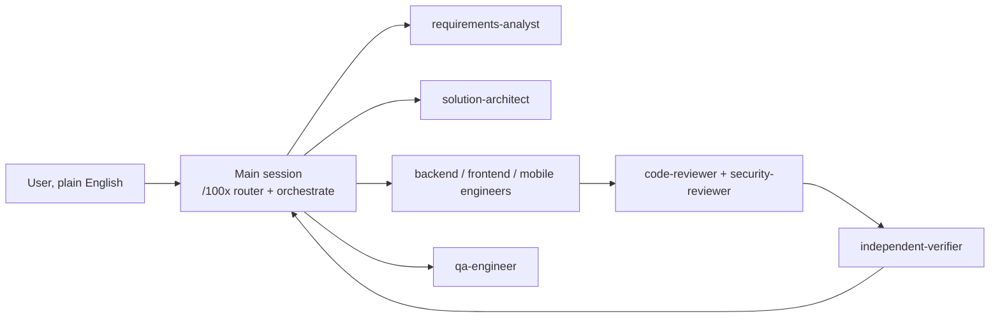

# Operating model

How the main session and the plugin's agents turn a plain-English request into verified
work. Every agent in `agents/` and every orchestration skill follows this file; when an
agent definition and this file disagree, this file wins.

## Contents

| § | section | answers | size |
|---|---|---|---|
| 1 | [Roles](#1-roles) | who does what, and why orchestration stays in the main session | ~35 lines |
| 2 | [Agent protocol](#2-agent-protocol) | the seven steps every specialist follows, and when it must stop | ~25 lines |
| 3 | [Report contract](#3-report-contract) | the exact shape of an agent's result (findings, expected exits, the context card, behaviour evidence), which base lint diffs against, how reviewers report without a task, how replay runs only declared commands, and what makes a report valid | ~115 lines |
| 4 | [Decision policy](#4-decision-policy) | which decisions an agent may take alone, and the tie-break order | ~35 lines |
| 5 | [Question policy](#5-question-policy) | when to ask the user, how many questions, in what form, and which wait for the next batch | ~20 lines |
| 6 | [Orchestration](#6-orchestration) | the AC-<n> format and the `<feature>/AC-<n>` test tag, how a plan is stamped against an approved spec, where a feature's files live, and how a plan becomes parallel tasks without two agents colliding | ~90 lines |
| 7 | [Verification ladder](#7-verification-ladder) | which gate proves each phase, mechanically | ~10 lines |
| 8 | [Indexing](#8-indexing) | where records live (the records root and `.100x.json`'s keys), how record arguments resolve, and how every written artifact stays findable | ~40 lines |
| 9 | [Generated documents: index first, then detail](#9-generated-documents-index-first-then-detail) | how any generated doc opens with its answer, when it needs a Contents table, and when a folder needs an `INDEX.md` | ~25 lines |
| 10 | [Re-check pass](#10-re-check-pass) | when a turn gets one automatic skeptical second pass, how to turn it off, what it costs, and which subagents get it | ~20 lines |
| 11 | [Human-facing output](#11-human-facing-output) | which standard PR text, commits, review comments, reports and chat answers follow | ~10 lines |

## 1. Roles



The main session owns the user conversation, the task graph and every merge. Agents own one
task each and return a report (§3); they never talk to the user directly, and their
questions travel back through the main session. Orchestration lives in the main session
even though subagents can start subagents: the spawn depth is configurable and may be one
(https://code.claude.com/docs/en/sub-agents), and only the main session holds the user
conversation that questions must reach. `SOURCE: original`

| agent | job | writes code? | preloaded skills |
|---|---|---|---|
| requirements-analyst | plain English → requirements, assumptions, ≤5 questions | no | requirements-intake, scale-appropriateness |
| solution-architect | reviews specs and plans before build, and every diff for design fit | no | solution-architecture, approach-selection, api-contract, data-modeling, distributed-correctness |
| backend-engineer | implements server-side tasks | yes | api-contract, data-modeling, distributed-correctness, observability-design, data-lifecycle, code-craft, test-design |
| frontend-engineer | implements web UI tasks | yes | ui-baseline, accessibility, web-vitals, frontend-architecture, code-craft, test-design |
| mobile-engineer | implements mobile tasks | yes | ui-baseline, accessibility, mobile-release-safety, code-craft, test-design |
| qa-engineer | test plan, acceptance-criteria traceability, automated tests | tests only | qa-strategy, test-design |
| code-reviewer | independent review of someone else's diff | no | diff-review, code-craft, minimal-diff |
| security-reviewer | application security review of a diff or design | no | app-security, security-baseline |
| independent-verifier | re-runs each task's declared verify commands itself; trusts no report | no | verification-gate |
| comprehension-mapper | maps an unfamiliar codebase into a durable architecture note; on request, a visual walkthrough (`scenario.json`) | docs only | codebase-comprehension, diagramming, explain |
| rca-investigator | incident timeline, hypotheses, root cause, action items | docs only | root-cause-analysis |

## 2. Agent protocol

Every specialist runs these steps in order and may not skip one.

1. **Understand.** Restate the goal in at most three sentences, and list every input read
   (spec sections, files) by path.
2. **Gap report.** List what is missing, ambiguous or contradictory, each classified by the
   question policy (§5) as A (default), B (tier-dependent) or C (must ask).
3. **Challenge the plan.** Check the task is executable as written: missing contract,
   wrong owner, hidden dependency, a cheaper approach, a risk nobody named. Record each as a
   `plan_issue`.
4. **Stop if blocked.** Only a blocking item ends the task with `status: needs-decision`:
   an unanswered C item on data residency, compliance regime, retention or money (cost
   ceiling), or any blocking `plan_issue`. Any other unanswered C item proceeds on its
   recommendation as a non-blocking question marked `ASSUMED`. Assuming past a blocking
   item is the failure this protocol exists to prevent.
5. **Execute the thinnest slice first**, then widen. Stay inside the task's owned files.
6. **Verify.** Run the task's verify commands and record each with its exit code, the
   command as `plan.json` writes it. Evidence matches a declared command when their argvs are
   equal (`shlex.split`), so quoting and spacing may differ, and `100x verified [--name X] --
   <cmd>` counts as `<cmd>`. A reviewer records a gate that fails as its finding says with
   `expect_exit` set to that exit code.
7. **Report** in the §3 shape. Prose outside the report is optional; the report is not.

## 3. Report contract

The last fenced `json` block of an agent's final message is its report. The main session
saves it and runs two checks against the task's worktree:

```bash
100x agent_report lint   T1.json --graph plan.json --cwd ../wt-T1 [--base <task's start commit>]
100x agent_report lint   R-T1.json                 # a reviewer's report: report-level checks only
100x agent_report replay T1.json --graph plan.json --cwd ../wt-T1 --yes
```

| check | what it trusts | what it does |
|---|---|---|
| `lint --graph --cwd` | git, not the report | lists the files git says changed since the task's base (committed, staged, unstaged and untracked all count, a rename counts as both paths) and compares them with the task's `files` and the report's `changes`; the report's `agent` must be the task's `owner` |
| `lint` without `--graph` | the report | the report-level checks only: shape, findings, the rejection table rows that need no plan |
| `replay --graph` | the plan, not the report | re-runs **only** the task's declared `verify` commands that the report has evidence for, and fails on any exit code that differs from the one claimed |

The base, first match wins (each lint run prints `NOTE base <rev> — from <source>`):

| order | base | note |
|---|---|---|
| 1 | `--base <rev>` | |
| 2 | plan.json's top-level `"base"` | `plan_dag stamp` records HEAD there |
| 3 | the worktree's fork point: the merge-base of its HEAD with the main checkout's HEAD | linked worktrees only |
| 4 | `HEAD` | uncommitted work only; when the base equals HEAD, a "claimed change is not there" error adds the hint `did the agent commit? pass --base <fork point>, or set "base" in plan.json` |

A read-only role (requirements-analyst, solution-architect, code-reviewer, security-reviewer,
independent-verifier: §1's "writes code? no" rows) reviews a task rather than owns one. Its
report may use its own `task_id` (`R-T3`): linted without `--graph`, or with `--graph` and a
`task_id` not in the plan, it gets a `NOTE` and the report-level checks only. Any other agent
whose `task_id` is not a plan task is an error.

How `replay` runs a command:

| rule | why |
|---|---|
| argv via `shlex.split`, never a shell; a plan that needs shell syntax writes `sh -c '…'`, and the script is printed before it runs | evidence text another agent wrote is never executed |
| evidence matches a declared command by argv equality; `100x verified [--name X] -- <cmd>` evidence matches `<cmd>`, and replay runs the plan's plain form, never the wrapper | the plan, not the report, decides what runs |
| evidence for a command the plan does not declare is listed `not replayed (undeclared)`; exit 3 | a report cannot widen what gets run |
| a declared command with no evidence entry is `MISSING`; exit 1 | done owes every declared check |
| anything the verification hook classes as a commit, push, tag or publish is refused; the screen reads the exact argv replay executes, and an `sh -c` script with `#` as a literal character | a replay proves work, never ships it; `env A=1#x git tag v9` must not hide the tag behind a comment |
| a timeout (`--timeout`, default 600s) kills the command's whole process group | a test runner's workers must not outlive the replay |
| without `--yes` it only prints what it would run, and exits 3 | nothing runs by accident |

| exit | lint | replay |
|---|---|---|
| 0 | clean | every declared command reproduced |
| 1 | findings | a mismatch, or a declared command with no evidence |
| 2 | unreadable input, `--cwd` outside git, a base that does not resolve (from any source), `--graph` without `--cwd` | unreadable input, no `--graph`, a task not in the plan |
| 3 | — | nothing ran (no `--yes`), or some evidence was undeclared or refused |

```json
{
  "schema": 1,
  "agent": "backend-engineer",
  "task_id": "T1",
  "status": "done | needs-decision | blocked | failed",
  "understanding": "one to three sentences",
  "inputs_read": ["docs/engineering/specs/tagging/spec.md#api", "backend/src/album/album.service.ts"],
  "assumptions": [{"id": "A1", "text": "...", "class": "A | B", "basis": "baseline:api.authz-every-endpoint"}],
  "questions": [{"id": "Q1", "question": "...", "why_it_matters": "...",
                 "options": ["...", "..."], "recommendation": "...", "blocking": true}],
  "plan_issues": [{"id": "P1", "issue": "...", "impact": "...", "proposal": "...", "blocking": false}],
  "decisions": [{"id": "D1", "decision": "...", "door": "two-way", "basis": "precedent:backend/src/album/"}],
  "changes": [{"path": "backend/src/tagging/tag.service.ts", "summary": "..."}],
  "evidence": [{"cmd": "pnpm run test tagging", "exit_code": 0, "output_tail": "Tests: 14 passed"}],
  "follow_ups": []
}
```

**Context card.** An engineer fills it before its first edit, inside the existing fields, because
lint rejects any new top-level key. `inputs_read` carries one entry per item, prefixed:

| prefix | what it names |
|---|---|
| `analog:` | the closest existing example in the repo, which the change follows (§4 precedent) |
| `instructions:` | the repo `AGENTS.md` and every nested `CLAUDE.md`/`AGENTS.md` on the touched paths |
| `spec:` | the PRD/spec section and the mock behind each AC |
| `naming:` | the precedent for env vars, modules and files the change adds |
| `lessons:` | what `100x learn relevant <path>` returned for the touched paths |
| `decisions:` | what `100x decide trace <path>` returned for the touched paths |

An empty item is written as `none` (`"lessons: none"`), so a skipped step shows. `understanding`
states in one line what the card changed about the approach.

Optional fields: `findings` at the top level, `kind` and `expect_exit` on an evidence entry. Any
other top-level key is an error with a did-you-mean (`"evidance"` → `"evidence"`).

| field | shape | rule |
|---|---|---|
| `findings` | `[{"id", "severity": "critical\|major\|minor\|trivial", "confidence": "definite\|probable\|possible", "location", "issue", "fix", "blocking": true\|false}]` | how reviewers report; `id`, `location`, `issue`, `fix` non-empty; a blocking finding unblocks `needs-decision` and `blocked` like a blocking question; `agent_report summary` merges findings across reports, blocking first, then by severity |
| `kind` on an evidence entry | `build`, `test` or `behaviour` | `behaviour` is a proof that the feature works as a user sees it: an HTTP transcript, an e2e run, a screenshot path or a log line from the running app. `done` on a user-visible change needs one; type checks and unit tests alone leave the work partial, said in `understanding` with the owed check in `follow_ups`. A report never says "verified" without an evidence entry behind it |
| `expect_exit` on an evidence entry | integer, default 0 | `done` needs `exit_code == expect_exit`; a reviewer records a failing gate as `"exit_code": 1, "expect_exit": 1`. A declared `verify` command still needs exit 0 |

Lint rejects a report when any of these hold:

| condition | why |
|---|---|
| `status: done` with no evidence, or any evidence whose exit code ≠ its `expect_exit` (default 0) | done without proof is a claim |
| a `decision` with `door: one-way` | one-way doors are questions (§4), never decisions |
| `status: needs-decision` with no blocking question, plan issue or finding | a stop must say what unblocks it |
| `status: done` with a blocking question, plan issue or finding still listed | contradictory |
| an assumption with class C | C items are asked, never assumed; an unanswered C item proceeding on its recommendation stays a non-blocking question marked `ASSUMED` |
| a change outside the task's owned files: claimed in `changes`, or (with `--graph --cwd`) present in git's changed files whatever the report says | collisions break parallel work |
| a claimed change git does not show since `--base` (with `--graph --cwd`) | the report describes work that is not there |
| `status: done` without every declared `verify` command in the evidence (argv-equal, bare or via `100x verified`) with exit 0 (with `--graph`) | done owes the checks the plan asked for, not ones the agent picked |
| `agent` is not the task's `owner` (with `--graph`, `task_id` a plan task) | a task's report comes from the agent the plan assigned |
| `task_id` not in the plan, from a role that writes files (with `--graph`) | a writer needs a task that owns its files |
| an unknown top-level key, or a malformed `findings` entry or `expect_exit` | a misspelt key would otherwise be ignored |
| `"schema"` present and not `1` | a reader of schema 1 cannot judge a different shape; a missing `schema` is read as 1, with a warning |
| `status: blocked` with no blocking question, plan issue or finding | a block must say what unblocks it |
| `status: failed` with no evidence | a failure must show what failed |

## 4. Decision policy

One policy for the main session and every agent. Classify by how hard the choice is to undo
and how far it reaches, the reversible/irreversible ("two-way door / one-way door") split
from Amazon's 2015 shareholder letter
(https://www.aboutamazon.com/news/company-news/2015-letter-to-shareholders).

| class | examples | rule |
|---|---|---|
| two-way, local | a name, a private helper, internal structure, a test layout | decide; record in `decisions` |
| two-way, cross-cutting | a new shared utility, a new pattern other code will copy | follow repo precedent; if none exists, decide and record the basis |
| one-way | DB schema or migration, public API shape, a new dependency, deleting or rewriting data, an auth or tenancy boundary, user-visible behaviour the spec does not state, recurring cost | never decide alone: raise a question with options and a recommendation |

When sources disagree, the higher row wins. Two sources on the **same** row that disagree
are a question, not a coin toss.

| order | basis | example |
|---|---|---|
| 1 | explicit user instruction or approved spec | "pagination is cursor-based" |
| 2 | repo precedent (the closest existing analog) | `album.service.ts` already scopes by `companyId` |
| 3 | the baseline (`scripts/data/baseline.json`) | `api.authz-every-endpoint` |
| 4 | a cited industry standard | WCAG 2.2, OWASP API Top 10 2023 |
| 5 | the simplest option that meets the declared tier | no cache at the prototype tier |

A fact the agent could not verify is labelled `inferred`, never stated as observed.

## 5. Question policy

| class | meaning | action |
|---|---|---|
| A, always-on | a default any senior engineer applies (responsive layout, authz, input validation) | apply silently; list as an assumption |
| B, tier-dependent | on only at the declared tier (load tests, multi-region) | apply per tier; list as an assumption |
| C, must ask | genuinely the user's call (data residency, retention, compliance regime, SLO numbers, money, unusual device targets) | ask; never default |

Questions are asked in one batch of at most five, ordered by impact; any beyond five wait for
the next batch, blocking ones first. Each carries why it matters, two or three options, and a
recommendation. `plan_feature new` seeds a spec's §6 the same way: at most five of the
baseline's class C asks, blocking first, then one-way doors (`"door"` in
`scripts/data/baseline.json`), then catalogue order; the rest are listed under "Deferred to
next batch" and stay `ASK` rows in §0b. A C item with `"when_any"` is asked only for the
kinds, work types, tier or risk it names, so an irrelevant ask does not take a slot. An unanswered C question may proceed
on the recommendation marked `ASSUMED`, except residency, compliance, retention and money,
which block the `ready` audit until answered.

## 6. Orchestration

The orchestrate skill turns an approved spec into a task graph, `plan.json`, stamps it, and
`100x plan_dag lint` must pass before any task starts.

```bash
100x plan_feature audit tagging           # passes, then set | status | ready |
100x plan_dag stamp <root>/specs/tagging/plan.json
100x plan_dag lint  <root>/specs/tagging/plan.json   # --spec defaults to the plan's "spec"
```

| step | does | refuses |
|---|---|---|
| `plan_dag stamp` | writes `"spec"` (its path from the repository root), `"spec_sha256"` and `"base"` (HEAD) into plan.json; the spec is `--spec`, else the plan's `"spec"`, else its `"feature"` resolved like a record name | a spec that fails `plan_feature audit` or is not `ready` (exit 1); a plan outside a git repository, or a repository with no commit (exit 2) |
| `plan_dag lint` | checks the plan against the stamped spec, or `--spec` | a spec that fails the audit or is not `ready`; an unstamped plan; a spec whose sha256 changed since stamping ("re-plan or re-approve", then stamp again); a `--spec` other than the stamped one |

A plan with no `"spec"` and no `--spec` lints with a warning that coverage and approval were
not checked. A feature's files live together in its directory:

| file | written by |
|---|---|
| `<root>/specs/<feature>/spec.md` | `plan_feature new` |
| `<root>/specs/<feature>/plan.json` | the orchestrate skill, then `plan_dag stamp` |
| `<root>/specs/<feature>/testplan.md` | `testplan new <spec> --out` (bare `--out`) |
| `<root>/specs/<feature>/reports/<task>.json` | the main session, one saved report per task |

Acceptance ids are the join key from PRD to test. A spec defines them in its `## 2b.
Acceptance criteria` section, one line each, and nowhere else: a line elsewhere that
mentions `AC-4` (a verification row, "AC-4 was dropped") is a mention, not a definition.

```text
AC-<n>: <observable outcome> (R<k>, S<k>)
```

Tests tag the namespaced form, because AC ids are unique only within one spec:

| where | form | example |
|---|---|---|
| spec, §2b | `AC-<n>` | `AC-1: A member can tag up to 10 people on a photo. (R1, S1)` |
| test name or comment | `<feature>/AC-<n>` | `test('tagging/AC-1 tags ten people', …)`, `# tagging/AC-2`, `@tagging/AC-3` |

`<feature>` is the spec's `| feature |` header field, else its directory name
(`<root>/specs/<feature>/`). `100x testplan trace` counts only its own feature's tags,
ignores other features' tags, and lists bare `AC-<n>` tags as not counted. A tag inside a
skipped test, or a skipped `describe`/`xdescribe`/`context` block or skipped Python class,
does not count.

`R<k>` is the PRD requirement it satisfies (required when the spec's `| prd |` header
field or `<root>/prds/<feature>/` names a PRD); `S<k>` is the in-scope row it delivers.
Ids are unique and never renumbered. The verification plan's `covers` column names the
ACs each row proves. `100x plan_feature audit` enforces all of it; `100x prd align` traces
R ↔ AC ↔ S by id, which proves a link was declared, not that the AC satisfies the
requirement.

```json
{
  "schema": 1,
  "feature": "tagging",
  "tier": "small",
  "spec": "docs/engineering/specs/tagging/spec.md",
  "spec_sha256": "<written by plan_dag stamp>",
  "base": "<HEAD when stamped>",
  "tasks": [
    {"id": "T0", "title": "API + DB contract", "owner": "backend-engineer",
     "depends_on": [], "files": ["backend/src/tagging/dto/**", "docs/engineering/specs/tagging/contract.md"],
     "acceptance": ["AC-1", "AC-2"], "verify": ["pnpm run lint"], "contract": true},
    {"id": "T1", "title": "tagging service", "owner": "backend-engineer",
     "depends_on": ["T0"], "consumes": ["T0"], "files": ["backend/src/tagging/services/**"],
     "acceptance": ["AC-1"], "verify": ["pnpm run test tagging"]}
  ]
}
```

| rule | enforced by |
|---|---|
| the graph is acyclic and every owner is a known agent | `plan_dag lint` |
| `feature` is present (the spec directory name, and the namespace tests tag with); `tier`, when given, is one of `scripts/data/scale_tiers.json`; `schema`, when given, is 1 | `plan_dag lint` |
| no unknown field at the top level or in a task; the error suggests the nearest known name (`depend_on` → `depends_on`) | `plan_dag lint` |
| every task has `files`, `verify` and at least one acceptance id | `plan_dag lint` |
| `files` globs follow `scripts/_globs.py`: `**` spans directories, `{a,b}` braces are rejected, and a bare final segment with no wildcard and no `.` (`src/auth`) is a directory | `plan_dag lint` |
| each `verify` command replays without a shell (shell syntax is written `sh -c '…'`) and is never a commit, push, tag or publish | `plan_dag lint` |
| two tasks with no dependency path between them own disjoint files | `plan_dag lint` |
| shared contracts (types, API schema, DB schema) are `contract: true` tasks; a task names the contracts it builds on in `consumes`, must depend on them, and must not own their files | `plan_dag lint` |
| every acceptance id the spec **defines** is covered by some task; a spec that defines none fails | `plan_dag lint` with a stamped spec or `--spec` |
| a task claims only acceptance ids the spec defines; an undefined one (`AC-12` for `AC-2`) is an error | `plan_dag lint` with a stamped spec or `--spec` |
| the spec passes `plan_feature audit`, is `ready`, and hashes to `spec_sha256`; `spec`, `spec_sha256` and `base`, when present, are a repo-relative path with no `..`, a sha256 hex digest and a commit id | `plan_dag lint` |
| each running task gets its own git worktree; the main session merges and re-verifies | review |

`100x plan_dag waves` prints the tasks that can run together. A task that returns
`needs-decision` pauses only its dependents; independent tasks keep running, and the main
session batches all open questions into one message to the user.

## 7. Verification ladder

| phase | gate | mechanism |
|---|---|---|
| intake | requirements have a source and C items are answered or `ASSUMED` | `100x prd audit` / `100x plan_feature audit` |
| plan | the spec is audited and `ready`, the plan is stamped against its exact bytes, and the task graph is valid | `100x plan_dag stamp` then `100x plan_dag lint` |
| per task | the report is valid, git's changed files stay inside the task's `files`, and the task's declared verify commands replay with the claimed exit codes | `100x agent_report lint --graph plan.json --cwd <wt>` + `100x agent_report replay --graph plan.json --cwd <wt> --yes` |
| integration | full suite on the merged result | the project's verify commands, via `100x verified` |
| review | solution-architect, code-reviewer and security-reviewer reports carry their findings in `findings` and have no blocking finding, question or plan issue | `100x agent_report lint` (no `--graph` needed for a reviewer's own `task_id`), `100x agent_report summary` |
| commit / push / PR / publish | a fresh, signed receipt | `PreToolUse` hook |
| done | no stop while the receipt is stale | `Stop` hook |

## 8. Indexing

Everything the plugin writes stays findable the way a book is: a contents table at the
front of a long document, a catalogue per collection, and a term index at the back.

| layer | what | generated by |
|---|---|---|
| contents | a `## Contents` table in any long, multi-section document | written by hand, checked by `100x check_index` |
| catalogue | an `INDEX.md` per collection listing every record | `100x check_index --gen-collections`, `100x ledger index` |
| term index | `TERMS.md`: each defined term → every file and section that uses it | `100x check_index --gen-terms` |

In a user's project, every record the plugin writes lives under one records root, `<root>`,
resolved by `scripts/_paths.py`, first match wins:

| order | source | example |
|---|---|---|
| 1 | `.100x.json` at the git root, committed | `{"schema": 1, "root": "docs/engineering"}` |
| 2 | env `HUNDREDX_ROOT_DIR` | a one-off run or CI |
| 3 | default | `docs/engineering` |

Both `.100x.json` keys are optional: without `"root"` the default applies, and `"schema"`,
when given, must be 1. Any other key is refused (exit 2) with a did-you-mean, because a
misspelt `"rot"` would otherwise fall back to the default silently.

A record argument to `plan_feature audit`, `prd align`, `testplan` and `plan_dag --spec`
resolves the same way, first match wins: the path as given, then from the git root, then
under the records root (`specs/login`), then as a bare feature name (`login` →
`<root>/specs/login/spec.md`).

Every record write is contained: the target's symlinks are resolved, and a write that
would land outside the repository is refused.

Layout: `<root>/{prds,specs,decisions,rca,lessons,reviews,ledger}/` plus `<root>/INDEX.md`
(`100x check_index --register`). A feature's spec, `plan.json`, `testplan.md` and
`reports/` sit together in `<root>/specs/<feature>/` (§6). When a test plan exists at the
old `<root>/testplans/<feature>.md`, `testplan new --out` stops (exit 2) and says to `git mv`
it beside the spec, or to pass `--force` to write a fresh one. A root that is absolute or uses `..` is
refused. A repo with legacy top-level record directories and no config keeps using them,
with a warning. This plugin's own repo commits `{"root": "."}`, so its examples sit at
`specs/`, `decisions/` and `ledger/`.

## 9. Generated documents: index first, then detail

Applies to any markdown/doc you generate (reports, specs, reviews, plans, research, notes).

1. **Top of every file = the answer.** Open with a 2–5 line summary or a summary table of
   the key insights/decisions/status — what a reader needs if they read nothing else.
2. **Long file → Contents table.** A file over ~150 lines with 4+ sections gets a
   `## Contents` table right after the summary: one row per section, saying what the
   section *answers* (not its heading restated), linked by anchor.
3. **Multiple files → one INDEX.md.** When a task produces 2+ files in a folder, write or
   update that folder's `INDEX.md`: a table of every file with one line on what it answers,
   and a "start here" pointer. Every child file links back to `INDEX.md` on its first line.
4. **Nested folders → nested indexes.** A parent `INDEX.md` lists child folders and links
   to their `INDEX.md`; never list grandchildren directly.
5. **Prefer** diagram (mermaid) > table > bullets > prose for anything enumerable or flow-shaped.
6. **Skip it when trivial.** Under ~150 lines, a single file, or a generated file — no
   Contents table, no INDEX. Ceremony on short files is what gets the rule ignored.
7. If a tool or skill already generates an index (e.g. `100x pr_review index`,
   `check_index --gen-collections`), run it instead of hand-writing one.

## 10. Re-check pass

A substantive turn — one that edited a file, or ended in a final answer of at least 1500
characters — gets one skeptical second pass before it stops: the `Stop` hook
`hooks/recheck_gate.py` blocks once with the prompt in
`skills/recheck/references/recheck-prompt.md`, and the answer ends with a `Re-check:` line.
In blind A/B runs a second pass turned 0/8 safe answers to a silent money bug into 7/8; the
wording mattered far less ([evidence](../skills/recheck/references/evidence.md)).

| mode | effect | set with |
|---|---|---|
| `auto` (default) | one pass per substantive turn, never twice per stop | — |
| `manual` | only `/100x:recheck` | `HUNDREDX_RECHECK=manual` or `~/.config/100x/recheck.json` `{"mode": "manual"}` |
| `off` | never | `HUNDREDX_RECHECK=off` or `{"mode": "off"}` |

| subagents | the same hook on `SubagentStop`; by default only `backend-engineer`, `frontend-engineer` and `mobile-engineer` (bare or `100x:`-prefixed); `"subagents": "off"`, `"all"` or a list of agent types replaces that default | `HUNDREDX_RECHECK_SUBAGENTS=off\|all\|<a,b>` or `~/.config/100x/recheck.json` |

Cost: ~1.5–2 minutes and a few thousand tokens per substantive turn — and per substantive run
of a subagent it covers, so every such agent finishes that much later. On by default only for
the engineers, whose edits ship; reviewers and mappers are already checked by the main session's
review of their reports.

## 11. Human-facing output

Everything a person reads — PR descriptions, commit messages, review comments and replies,
markdown docs and specs, READMEs, reports, chat answers and inline code comments — follows
[`docs/WRITING.md`](WRITING.md). PR text is always English. §9 adds the index rules for
generated documents.
