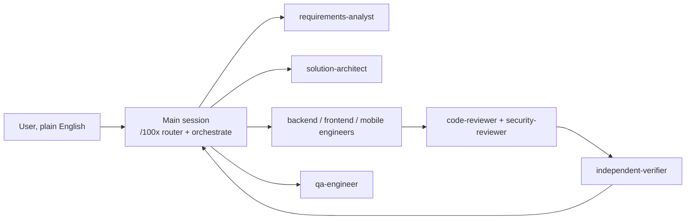

# Operating model

How the main session and the plugin's agents turn a plain-English request into verified
work. Every agent in `agents/` and every orchestration skill follows this file; when an
agent definition and this file disagree, this file wins.

## Contents

| § | section | answers | size |
|---|---|---|---|
| 1 | [Roles](#1-roles) | who does what, and why orchestration stays in the main session | ~25 lines |
| 2 | [Agent protocol](#2-agent-protocol) | the seven steps every specialist follows, and when it must stop | ~25 lines |
| 3 | [Report contract](#3-report-contract) | the exact shape of an agent's result and what makes it valid | ~45 lines |
| 4 | [Decision policy](#4-decision-policy) | which decisions an agent may take alone, and the tie-break order | ~35 lines |
| 5 | [Question policy](#5-question-policy) | when to ask the user, how many questions, and in what form | ~20 lines |
| 6 | [Orchestration](#6-orchestration) | how a plan becomes parallel tasks without two agents colliding | ~45 lines |
| 7 | [Verification ladder](#7-verification-ladder) | which gate proves each phase, mechanically | ~20 lines |
| 8 | [Indexing](#8-indexing) | how every written artifact stays findable, like a book | ~20 lines |

## 1. Roles



The main session owns the user conversation, the task graph and every merge. Agents own one
task each and return a report (§3); they never talk to the user directly, and their
questions travel back through the main session. Orchestration lives in the main session
because a subagent's ability to start further subagents is not documented, and a design
that depends on it would fail silently where it is unavailable. `SOURCE: original`

| agent | job | writes code? | preloaded skills |
|---|---|---|---|
| requirements-analyst | plain English → requirements, assumptions, ≤5 questions | no | requirements-intake, scale-appropriateness |
| solution-architect | reviews specs and plans before build, and every diff for design fit | no | solution-architecture, approach-selection, api-contract, data-modeling, distributed-correctness |
| backend-engineer | implements server-side tasks | yes | baseline-aware build skills for APIs, data, jobs |
| frontend-engineer | implements web UI tasks | yes | ui-baseline, accessibility, web-vitals, frontend-architecture |
| mobile-engineer | implements mobile tasks | yes | ui-baseline, accessibility, mobile-release-safety |
| qa-engineer | test plan, acceptance-criteria traceability, automated tests | tests only | qa-strategy, test-design |
| code-reviewer | independent review of someone else's diff | no | diff-review, code-craft, minimal-diff |
| security-reviewer | application security review of a diff or design | no | app-security, security-baseline |
| independent-verifier | re-runs every evidence command itself; trusts no report | no | verification-gate |
| comprehension-mapper | maps an unfamiliar codebase into a durable architecture note | docs only | codebase-comprehension, diagramming |
| rca-investigator | incident timeline, hypotheses, root cause, action items | docs only | root-cause-analysis |

## 2. Agent protocol

Every specialist runs these steps in order and may not skip one.

1. **Understand.** Restate the goal in at most three sentences, and list every input read
   (spec sections, files) by path.
2. **Gap report.** List what is missing, ambiguous or contradictory, each classified by the
   question policy (§5) as A (default), B (tier-dependent) or C (must ask).
3. **Challenge the plan.** Check the task is executable as written: missing contract,
   wrong owner, hidden dependency, a cheaper approach, a risk nobody named. Record each as a
   `plan_issue`.
4. **Stop if blocked.** Any unresolved C item or any blocking `plan_issue` ends the task
   with `status: needs-decision`. Assuming past it is the failure this protocol exists to
   prevent.
5. **Execute the thinnest slice first**, then widen. Stay inside the task's owned files.
6. **Verify.** Run the task's verify commands and record each with its exit code.
7. **Report** in the §3 shape. Prose outside the report is optional; the report is not.

## 3. Report contract

The last fenced `json` block of an agent's final message is its report. The main session
saves it and runs `100x agent_report lint` on it, then `100x agent_report replay`, which
re-runs every evidence command and fails if any exit code differs from the one claimed.

```json
{
  "agent": "backend-engineer",
  "task_id": "T3",
  "status": "done | needs-decision | blocked | failed",
  "understanding": "one to three sentences",
  "inputs_read": ["specs/tagging/spec.md#api", "backend/src/album/album.service.ts"],
  "assumptions": [{"id": "A1", "text": "...", "class": "A | B", "basis": "baseline:api.authz-every-endpoint"}],
  "questions": [{"id": "Q1", "question": "...", "why_it_matters": "...",
                 "options": ["...", "..."], "recommendation": "...", "blocking": true}],
  "plan_issues": [{"id": "P1", "issue": "...", "impact": "...", "proposal": "...", "blocking": false}],
  "decisions": [{"id": "D1", "decision": "...", "door": "two-way", "basis": "precedent:backend/src/album/"}],
  "changes": [{"path": "backend/src/tagging/tag.service.ts", "summary": "..."}],
  "evidence": [{"cmd": "pnpm run test tagging", "exit_code": 0, "output_tail": "Tests: 14 passed"}],
  "follow_ups": []
}
```

Lint rejects a report when any of these hold:

| condition | why |
|---|---|
| `status: done` with no evidence, or any evidence exit code ≠ 0 | done without proof is a claim |
| a `decision` with `door: one-way` | one-way doors are questions (§4), never decisions |
| `status: needs-decision` with no blocking question or plan issue | a stop must say what unblocks it |
| `status: done` with a blocking question or plan issue still listed | contradictory |
| an assumption with class C | C items are asked, never assumed |
| a change outside the task's owned files (when the task graph is supplied) | collisions break parallel work |

## 4. Decision policy

One policy for the main session and every agent. Classify by how hard the choice is to undo
and how far it reaches, the reversible/irreversible ("two-way door / one-way door") split
from Amazon's 2015 shareholder letter
(https://www.aboutamazon.com/news/company-news/2015-letter-to-shareholders).

| class | examples | rule |
|---|---|---|
| two-way, local | a name, a private helper, internal structure, a test layout | decide; record in `decisions` |
| two-way, cross-cutting | a new shared utility, a new pattern other code will copy | follow repo precedent; if none exists, decide and record the basis |
| one-way | DB schema or migration, public API shape, a new dependency, deleting or rewriting data, an auth or tenancy boundary, user-visible behaviour the spec does not state, recurring cost | never decide alone: raise a question with options and a recommendation |

When sources disagree, the higher row wins. Two sources on the **same** row that disagree
are a question, not a coin toss.

| order | basis | example |
|---|---|---|
| 1 | explicit user instruction or approved spec | "pagination is cursor-based" |
| 2 | repo precedent (the closest existing analog) | `album.service.ts` already scopes by `companyId` |
| 3 | the baseline (`scripts/data/baseline.json`) | `api.authz-every-endpoint` |
| 4 | a cited industry standard | WCAG 2.2, OWASP API Top 10 2023 |
| 5 | the simplest option that meets the declared tier | no cache at the prototype tier |

A fact the agent could not verify is labelled `inferred`, never stated as observed.

## 5. Question policy

| class | meaning | action |
|---|---|---|
| A, always-on | a default any senior engineer applies (responsive layout, authz, input validation) | apply silently; list as an assumption |
| B, tier-dependent | on only at the declared tier (load tests, multi-region) | apply per tier; list as an assumption |
| C, must ask | genuinely the user's call (data residency, retention, compliance regime, SLO numbers, money, unusual device targets) | ask; never default |

Questions are asked in one batch of at most five, ordered by impact. Each carries why it
matters, two or three options, and a recommendation. An unanswered C question may proceed
on the recommendation marked `ASSUMED`, except residency, compliance, retention and money,
which block the `ready` audit until answered.

## 6. Orchestration

The orchestrate skill turns an approved spec into a task graph, `plan.json`, and
`100x plan_dag lint` must pass before any task starts.

```json
{
  "feature": "album-tagging",
  "tier": "small",
  "tasks": [
    {"id": "T0", "title": "API + DB contract", "owner": "solution-architect",
     "depends_on": [], "files": ["backend/src/tagging/dto/**", "docs/engineering/specs/tagging/contract.md"],
     "acceptance": ["AC-1", "AC-2"], "verify": ["pnpm run lint"], "contract": true},
    {"id": "T1", "title": "tagging service", "owner": "backend-engineer",
     "depends_on": ["T0"], "files": ["backend/src/tagging/services/**"],
     "acceptance": ["AC-1"], "verify": ["pnpm run test tagging"]}
  ]
}
```

| rule | enforced by |
|---|---|
| the graph is acyclic and every owner is a known agent | `plan_dag lint` |
| every task has `files`, `verify` and at least one acceptance id | `plan_dag lint` |
| two tasks with no dependency path between them own disjoint files | `plan_dag lint` |
| shared contracts (types, API schema, DB schema) are `contract: true` tasks that every consumer depends on | `plan_dag lint` |
| every acceptance id in the spec is covered by some task | `plan_dag lint --spec` |
| each running task gets its own git worktree; the main session merges and re-verifies | review |

`100x plan_dag waves` prints the tasks that can run together. A task that returns
`needs-decision` pauses only its dependents; independent tasks keep running, and the main
session batches all open questions into one message to the user.

## 7. Verification ladder

| phase | gate | mechanism |
|---|---|---|
| intake | requirements have a source and C items are answered or `ASSUMED` | `100x prd audit` / `100x plan_feature audit` |
| plan | task graph valid | `100x plan_dag lint --spec` |
| per task | agent report valid and its evidence replays | `100x agent_report lint` + `replay` |
| integration | full suite on the merged result | the project's verify commands, via `100x verified` |
| review | solution-architect, code-reviewer and security-reviewer reports have no blocking items | `100x agent_report lint` |
| commit / push / PR / publish | a fresh, signed receipt | `PreToolUse` hook |
| done | no stop while the receipt is stale | `Stop` hook |

## 8. Indexing

Everything the plugin writes stays findable the way a book is: a contents table at the
front of a long document, a catalogue per collection, and a term index at the back.

| layer | what | generated by |
|---|---|---|
| contents | a `## Contents` table in any long, multi-section document | written by hand, checked by `100x check_index` |
| catalogue | an `INDEX.md` per collection listing every record | `100x check_index --gen-collections`, `100x ledger index` |
| term index | `TERMS.md`: each defined term → every file and section that uses it | `100x check_index --gen-terms` |

In a user's project, everything the plugin writes lives under one root, `docs/engineering/`
(configurable), with one `INDEX.md` and one `TERMS.md` at that root.
