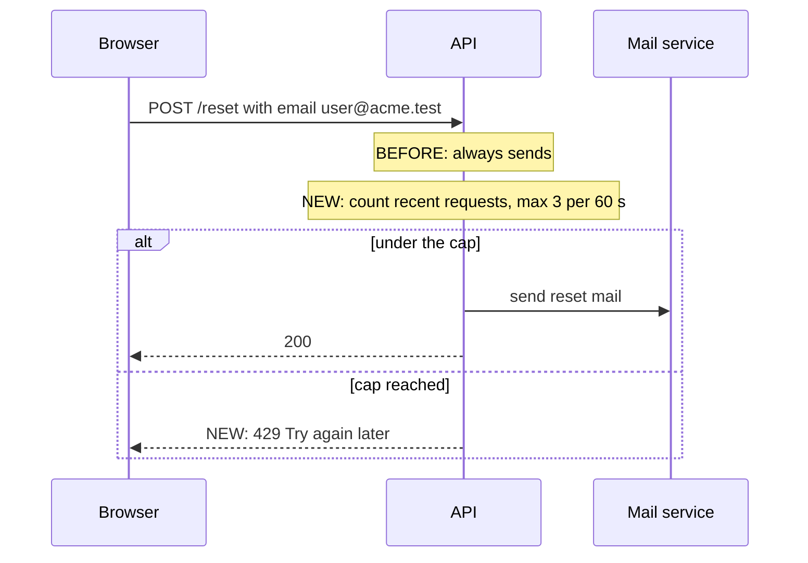

<!-- ILLUSTRATIVE ONLY — PR 9999 in acme/widgets on git.example.com is fictional. Copy the shape, never the facts. HAND-WRITTEN file. -->
# PR 9999 — context

> **In 10 seconds:** Anyone could ask for unlimited password-reset mails to any address. This PR caps it at 3 per minute so inboxes can't be flooded.

## Problem

| Field | Value |
|---|---|
| In one line | `POST /reset` now refuses a 4th mail within 60 s and answers `429`. |
| Why now | Issue 9990: a support ticket showed 400 reset mails sent to one customer in 10 minutes. |
| Part of | Issue 9990, slice 1 of 2: backend cap only; the UI message comes later. |
| Who is affected | Only people who ask more than 3 times a minute see a change. |

## Before → after

**Reading this diagram**
- A sequence diagram: one column per system, time flows top to bottom; the `alt` box shows the two possible answers.
- `NEW:` marks what this PR adds; everything else already happened before.

## Terms

| Term | Meaning here | Example |
|---|---|---|
| Sliding window | Count only requests from the last 60 s | Calls at 0 s, 20 s, 50 s → a 4th at 55 s is refused; at 61 s the 0 s call drops out |
| Instance | One running copy of the API; the load balancer spreads requests across them | 4 instances → each sees about 1 in 4 requests |

## Author's decisions

| Decision | Why (author's reason) | Rejected alternative |
|---|---|---|
| In-memory counter | No Redis in this service yet | Redis `INCR` counter |
| `429` with no wait time | Smallest change | `Retry-After` header (slice 2) |

## Not in this PR

| Deferred | Tracked in |
|---|---|
| "Try again in N s" message in the UI | Issue 9990 slice 2 |
