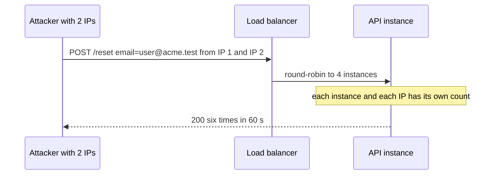

<!-- ILLUSTRATIVE ONLY — PR 9999 in acme/widgets on git.example.com is fictional. Copy the shape, never the facts. HAND-WRITTEN file; the findings themselves live in review.json. -->
# PR 9999 — security notes

> **In 10 seconds:** 4 attacks tried against the reset cap; 2 still work (both are action items in README.md), 2 are verified safe.

## Threat model

| Attacker move | Entry point | Control today |
|---|---|---|
| Flood one inbox from several IPs | `POST /reset` | key is the IP → "per sender IP" action item |
| Spread calls over instances | load balancer | none → "how many instances" action item |
| Spoof the IP header | `X-Forwarded-For` | IP comes from the socket, header ignored |

## Request path

**Reading this diagram**
- A sequence diagram: one column per system, time flows top to bottom.
- The attacker controls the source IP and the email; everything after the load balancer is ours.

## Verified safe

| Attack | Result | How we know |
|---|---|---|
| Forged `X-Forwarded-For: 1.2.3.4` | ignored: key uses `req.socket.remoteAddress` | Ran `curl -H 'X-Forwarded-For: 1.2.3.4'` locally → same key |
| Upper-case email to dodge the key | n/a today (key is the IP); the suggested fix lower-cases it | Read in the code |
