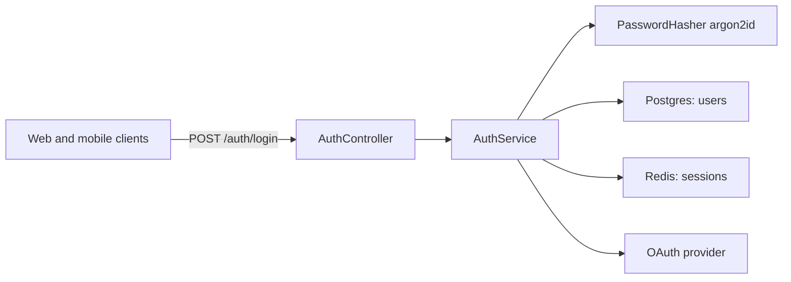

# login — PRD

| field | value |
|---|---|
| kind | auth |
| stack | NestJS, Postgres, Redis |
| scale tier | small |
| risk | elevated |
| linked spec | [specs/login/spec.md](../../specs/login/spec.md) |
| created | 2026-09-29 |
| status | **ready** |

Worked example for `100x prd`. It shows what a complete PRD looks like above
`specs/login/spec.md`, and is the fixture `100x prd align` scores against. Every table
below is machine-audited by `100x prd audit examples/login`. At the `small` tier a PRD is
optional; this one exists to demonstrate the format.

Every number and constraint names its `source`: `user` (stated by the requester — in this
worked example, the fictional product owner), `code` (observable in the spec, an ADR or
the source), `default` (a cited plugin default) or `assumed`. A `ready` PRD may not rest
on an `assumed` target or constraint.

## 1. Problem

| field | answer |
|---|---|
| who has this problem | returning users of the product who already have an account |
| what they do today | nothing — there is no authenticated session; every request is anonymous, so any per-user feature (saved data, personalization, admin controls) is blocked on this shipping first |
| what "better" means, measurably | see Success metrics below |

Today the app cannot tell one visit from the next, so nothing that requires "this is
the same user as last time" can ship. Login is the smallest thing that unblocks all
of it, which is also why it is easy to over-scope — see Options analysis for what
this PRD deliberately does not try to solve at the same time.

## 2. Users

| # | segment | current workaround | why they would adopt this |
|---|---|---|
| U1 | returning users with an account | none — they cannot return to per-user state today | it is the only way to access anything tied to their account |
| U2 | on-call / security response | manually rotating credentials or taking the service down | immediate session revocation (password change, admin ban) instead of a full incident |

## 3. Goals

| # | goal | measured by |
|---|---|---|
| G1 | a returning user can sign in and stay signed in across requests | M1 |
| G2 | a compromised or banned account loses access immediately | M2 |
| G3 | the login endpoint cannot be brute-forced | M3 |

## 4. Success metrics

| # | metric | target (must include a number) | baseline | measurement method | source |
|---|---|---|---|---|---|
| M1 | Login endpoint latency | p95 <= 300ms end to end | N/A — new feature | integration suite against real redis and postgres (spec V4), then the production p95 on the golden-signals dashboard (spec §12) | default |
| M2 | Session revocation — logout, password change, or admin ban takes effect on the next request | 100% of revocations, zero misses | N/A — new feature | `decide.py verify` re-checks the revocation assumption (spec V7, ADR-0001 A1); covered end to end by the e2e suite (spec V5) | code |
| M3 | Brute-force throttling on the login endpoint | the 6th failed attempt within 60s returns 429; lockout decays after 15 minutes | N/A — new feature | throttle cases in the e2e suite (spec V5, edge cases E9 and E21) | code |

M1 is the `small` tier's starting-point budget (`scripts/data/scale_tiers.json`); M2 and
M3 restate behaviour the spec and its tests already fix. Product adoption metrics (login
success rate, OAuth completion rate) were removed: no one has supplied a number for them,
and an invented target is worse than none. They are open question OQ1.

## 5. Constraints

| constraint | value | source |
|---|---|---|
| team size and skills | 2 backend engineers who already ship NestJS services; no dedicated security engineer | user |
| existing stack | NestJS, Postgres, Redis — Redis is assumed present in every deploy target (ADR-0001 assumption A2) | code |
| deadline | none hard-stated; product wants it ahead of a competitor's OAuth-only push | user |
| budget | existing infrastructure only — no new paid service; reuse the existing Redis cluster | user |
| compliance / regulatory | none named; password storage is still built to current practice (argon2id, nothing secret in logs — spec E24/E25) | user |
| data residency | single region: the region the existing Postgres and Redis already run in | user |
| data retention | session rows deleted at expiry; failed-login counters expire after 15 minutes | user |
| what cannot change | the `/auth/*` route prefix is already referenced by the mobile client; the `users` table's primary key type | code |

## 6. Requirements

What the recommended solution must satisfy. This is what `prd.py align` checks
against `specs/login/spec.md`'s in-scope table.

| # | requirement | why it matters |
|---|---|---|
| R1 | Returning users can sign in with email and password and receive a session | the core ask — nothing else in this PRD matters if this does not work |
| R2 | A signed-in user can request logout on a single device or on all devices without affecting the others | single-device mental models under-serve anyone with two devices, which is most users |
| R3 | Session revocation is immediate on password change or an admin ban | a revocation that takes minutes is a security incident window, not a feature |
| R4 | Failed login attempts trigger throttling and temporary account lockout, matching brute-force protections | credential stuffing is the single most common attack on a login endpoint |
| R5 | Users can sign in via at least one OAuth provider in addition to local credentials | a meaningful fraction of the target users expect "sign in with Google" and will bounce without it |

## 7. Options analysis

`fit` is applied first as a pass/fail filter; fit-passing options are then scored with the
`approach-selection` weights. This section answers **build vs. buy vs. do nothing** — it
does NOT re-decide session mechanism, password hashing, or session storage; those are
spec-level decisions in `specs/login/spec.md` §5 and
[ADR-0001](../../decisions/ADR-0001-session-strategy-for-login.md).

| # | option | pros | cons | reversibility x3 | blast radius x3 | moving parts x2 | already-in-use x2 | exit cost x1 | fit (pass/fail) | weighted score |
|---|---|---|---|---|---|---|---|---|---|---|
| O1 | Do nothing / smallest possible change | zero new moving parts; zero new blast radius; ships today | does not solve the problem: every per-user feature stays blocked | 5 | 5 | 5 | 5 | 5 | fail | 55 |
| O2 | Build first-party session-based login in NestJS (opaque server session + Redis) | reuses the existing NestJS/Postgres/Redis stack; full control over UX, throttling, and revocation timing | the team owns the password-storage security surface (hashing, lockout tuning, breach response) forever | 3 | 3 | 2 | 4 | 2 | pass | 32 |
| O3 | Delegate identity to a third-party provider (e.g. a hosted auth service) | no password-storage liability; MFA/SSO available later with no extra build | a new paid vendor outside the "existing infrastructure only" budget; adds a moving part (network hop, webhook sync) nobody on the team has operated | 2 | 4 | 1 | 1 | 1 | pass | 23 |

## 8. Recommendation

| field | answer |
|---|---|
| chosen option | O2 — build first-party session-based login in NestJS |
| single deciding factor | already-in-use: the team ships NestJS and Redis today, and the budget rules out a new paid identity vendor |
| what would change it | if compliance later requires enterprise SSO/SAML the team cannot reasonably build in-house (Non-goal X4), O3 or a hybrid re-scores higher — a constraints-table change, not a re-litigation of this analysis |
| override reason (if not the top fit-passing score) | none |

## 9. Design overview

An opaque session id in an httpOnly cookie, stored in Redis so any request can be
revoked on the next lookup (ADR-0001). The sequence-level design is `specs/login/spec.md` §4.

## 10. Risks

| # | risk | likelihood (1-5) | impact (1-5) | L x I | mitigation | source |
|---|---|---|---|---|---|---|
| RI1 | Throttling or lockout blocks legitimate users (false positives) | 2 | 3 | 6 | ship behind the `auth.v2_login` flag to a 5% cohort first; watch lockout events (spec §12) before widening rollout | assumed |
| RI2 | Implementation estimate is wrong because the spec's 31 edge cases surface more OAuth/session issues than scoped | 3 | 2 | 6 | phase 1 ships email+password only; OAuth and lockout are separate phases with independent kill criteria | assumed |
| RI3 | The existing codebase has undocumented auth assumptions (e.g. a dev-only bypass) that make O2 more expensive than scored | 2 | 4 | 8 | run `100x decide trace` and grep for the current bypass before starting; §23 records what was found | assumed |

## 11. Phasing

| # | phase | ships | proves | kill criteria | source |
|---|---|---|---|---|---|
| P1 | Phase 1 — core session (R1-R3) | `POST /auth/login`, `POST /auth/logout`, immediate revocation on password change / admin ban | that an opaque server session with Redis-backed revocation (ADR-0001) is fast and simple enough in production | p95 above the 300ms budget (M1) or any revocation miss (M2) after two weeks at a 5% cohort, or Redis not reliably present in the deploy target (falsifies ADR-0001 A2) | default |
| P2 | Phase 2 — throttling and lockout (R4) | per-account and per-IP throttling, temporary lockout | that lockout stops credential stuffing without locking out real users | any confirmed lockout of a legitimate user who was not under attack, from support tickets in the first week | assumed |
| P3 | Phase 3 — OAuth (R5) | Google sign-in | that the "identity source: both" decision (spec D5) is worth the provider-adapter complexity | OAuth share of new logins below the threshold product sets in OQ1 after a month — deprioritize further providers | assumed |

## 12. Non-goals (out of scope)

| # | explicitly out of scope |
|---|---|
| X1 | registration / signup |
| X2 | password reset and email verification |
| X3 | MFA / TOTP |
| X4 | SSO / SAML for enterprise tenants |
| X5 | device / session management UI |

## 13. Security

Covered in `specs/login/spec.md` §10: credential stuffing, user enumeration, session theft,
OAuth replay and open redirect, each with its control and test.

## 14. Privacy

Email and password hash in `users`; user id, IP and user agent in `sessions`. Single
region, deleted at expiry (Constraints: data residency, data retention). Detail in
`specs/login/spec.md` §11.

## 15. Observability

Golden signals and the `auth.*` log events in `specs/login/spec.md` §12; M1 is read from
that dashboard.

## 16. Rollout / rollback

`auth.v2_login` flag to a 5% cohort, then widened per P1's kill criteria. Rollback is the
flag (instant) plus `npm run migrate:down -- 1`; `specs/login/spec.md` §9.

## 17. Migration

Expand/contract on `users`, additive `sessions` table; `specs/login/spec.md` §13.

## 18. Test plan

Unit, integration against real Redis and Postgres, and e2e for sign-in, sign-out and
revocation; commands and gates in `specs/login/spec.md` §8.

## 19. Cost

N/A because it adds no recurring spend: sessions reuse the existing Redis cluster
(Constraints: budget).

## 20. Dependencies

The existing Redis cluster (ADR-0001 A2), the mobile client's use of `/auth/*`, and a
Google OAuth client registration for phase 3.

## 21. Open questions / assumptions

| # | question or assumption | recommendation |
|---|---|---|
| OQ1 | What login-success and OAuth-completion targets does product commit to? Removed from Success metrics because no one supplied a number | instrument `auth.login_succeeded` / `auth.login_failed` in phase 1 and set targets from two weeks of baseline data |
| OQ2 | Risk likelihood and impact scores (RI1-RI3) are the authors' judgement | revisit after phase 1 |
| OQ3 | P2 and P3 kill criteria are assumed | confirm with product before phase 2 starts |

## 22. Approvers

Product owner for the auth area, and the backend lead who owns the NestJS service (roles,
not named people, in this worked example).

## 23. Existing-code note

This PRD was written **after** `specs/login/spec.md` and `examples/login/src/*.ts`
already existed — reverse-engineered from the shipped spec and code rather than
preceding them, which is the common case in an existing codebase (see
`skills/solution-architecture/SKILL.md`, "Reverse-engineering a PRD from existing
code"). Each section traces to something observable: the constraints marked `code`
reflect what `examples/login/src/session.store.ts` and ADR-0001 already assume about
Redis; the requirements restate `specs/login/spec.md` §2's in-scope table in product
terms; Options O2/O3 reflect the stack actually running (NestJS, no identity vendor
integration anywhere in the codebase).

The success metrics are the gap. An earlier version of this example carried adoption
targets (a login success rate and an OAuth completion rate) that nobody had sourced; the
`source` column made that visible, so they moved to OQ1. What remains is measurable today
from the spec's own tests and the tier's default budget. `prd.py align` still cannot tell
whether a measurement method has real telemetry behind it — only running it and finding
no data source would — and that limitation is stated here rather than hidden.
