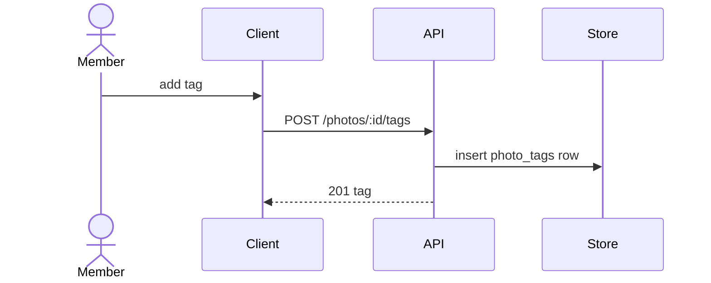

# album-tagging — spec

| field | value |
|---|---|
| feature | album-tagging |
| kinds | universal |
| stack | nestjs, react |
| prd | none |
| baseline | 1 |
| created | 2026-10-05 |
| status | **ready** |

Minimal approved spec for the orchestration examples and tests. It passes
`100x plan_feature audit examples/orchestration`, and `plan.json` beside it is stamped
against it (`100x plan_dag stamp examples/orchestration/plan.json`), so
`100x plan_dag lint examples/orchestration/plan.json` checks every AC below is owned by
a task. Paths name the plan's files; the code itself is not in this repository.

## 0. Non-functional requirements

| field | value |
|---|---|
| scale tier | small |
| risk | none |
| work types | none (cross-cutting baseline only) |
| expected users / requests | < 10,000 users; low tens of requests/sec at peak |
| data volume | up to low millions of tag rows |
| p95 latency budget | 300ms — starting point, not an SLO |
| availability target | single-region uptime |
| required at this tier | an index on (photo_id, created_at); paginated tag lists; basic error-rate monitoring |
| explicitly NOT required at this tier | multi-region; a cache layer; a search index |

## 0b. Implicit requirements

8 baseline item(s) for work="", tier=small, risk=none (`100x baseline show --work "" --tier small --risk none`).

| id | default | status | evidence |
|---|---|---|---|
| all.no-secrets-in-code | no secrets in code or config files; secrets come from the environment or a secret manager, and secret scanning runs on every push | deferred | FOLLOW-UP-1 — repo-wide secret scanning, not specific to this feature |
| all.sast-deps-pinned-actions | SAST in CI, automated dependency update PRs, and third-party CI actions pinned by commit SHA | deferred | FOLLOW-UP-2 — repo-wide CI hardening |
| all.threat-model-paragraph | the spec's security section names the assets, the trust boundaries crossed and the top abuse cases | covered | §10 Security, checked by `100x plan_feature audit examples/orchestration` |
| all.tests-in-same-change | tests ship in the same change as the code, and they are deterministic (no sleeps, no wall-clock, no network) | covered | T3 `backend/test/tagging.e2e-spec.ts` ships in the same plan |
| all.small-changes | work lands as small, self-contained changes | applied | four tasks in `plan.json`, each with disjoint files |
| all.readme-adrs | the README states how to run and test; architecturally significant choices are recorded as ADRs | accepted | no architecturally significant choice: tags reuse the album's existing access rules |
| all.time-unicode | timestamps stored in UTC (RFC 3339 on the wire), zones from the IANA tz database, DST transitions tested, text handled as Unicode with normalisation where compared | covered | album-tagging/AC-2 orders by a UTC `created_at`; E8 covers unicode tag text |
| all.copyleft-review | a dependency under a copyleft licence (GPL, AGPL, LGPL, MPL, EPL family) is flagged for licence review before adoption | n/a(no new dependency) | — |

## 1. Outcome

A member can label the people and things in an album's photos, see those labels on the
photo, and remove a label they added.

## 2. In scope / out of scope

| # | in scope | | # | explicitly OUT of scope |
|---|---|---|---|---|
| S1 | add a tag to a photo | | O1 | tag suggestions or face recognition |
| S2 | list a photo's tags | | O2 | searching photos by tag |
| S3 | remove a tag | | O3 | tags on albums (only photos) |

## 2b. Acceptance criteria

AC-1: A member can add a tag to a photo in an album they can view. (S1)
AC-2: Tags are listed on the photo detail view, newest first. (S2)
AC-3: A tag can be removed by its author or an album admin. (S3)
AC-4: Adding, listing and removing tags are covered by automated tests. (S1, S2, S3)

## 3. Interfaces touched

| # | surface | change | backward compatible? |
|---|---|---|---|
| I1 | `POST /photos/:id/tags`, `GET /photos/:id/tags`, `DELETE /tags/:id` | new endpoints | yes — additive |
| I2 | `photo_tags` table | new table | yes — new table, no existing column changes |
| I3 | photo detail screen | new tag list | yes — additive |

## 4. Sequence

## 5. Decisions required

| # | decision | options | deciding factor | default (recommended) | chosen | ADR |
|---|---|---|---|---|---|---|
| D1 | Tag list order | newest first \| alphabetical | what the photo view shows first | newest first | default | — |

## 6. Open questions

| # | type | question | why it matters | recommendation (proceeding with this) | answered |
|---|---|---|---|---|---|
| Q1 | default | Is there a cap on tags per photo? | bounds the list and the request size | 50 per photo, enforced in the service | no |

## 7. Edge cases

| # | source | edge case | why it gets missed | status | test / reference |
|---|---|---|---|---|---|
| E1 | universal | Concurrent duplicate request (double-click, retried POST) | happy path is single-threaded in the author's head | covered | `backend/test/tagging.e2e-spec.ts` duplicate add returns the existing tag |
| E2 | universal | Partial failure mid-operation | multi-step writes are written as if atomic | n/a(one insert or one delete per request) | — |
| E3 | universal | Downstream dependency times out | local dev is always fast | n/a(no downstream call) | — |
| E4 | universal | Downstream returns malformed or unexpected shape | the type says it cannot happen | n/a(no downstream call) | — |
| E5 | universal | Empty, single-item, and very large collections | examples always have 3 items | covered | album-tagging/AC-2 tests 0, 1 and 51 tags |
| E6 | universal | Unauthorized and wrong-tenant access | only the authorized path is exercised | covered | album-tagging/AC-3 tests a non-author, non-admin delete is refused |
| E7 | universal | Clock skew, DST boundary, timezone of the caller | the author's machine is UTC | accepted | ordering uses the server's UTC insert time only |
| E8 | universal | Input at boundary sizes and with unicode/emoji/RTL | tests use ascii names | covered | `backend/test/tagging.e2e-spec.ts` max-length and emoji tag text |
| E9 | universal | Rate limit or quota exhausted | quota is never hit in dev | accepted | the service-wide rate limit applies |
| E10 | universal | Rollback path actually works | rollback is written, never run | deferred | FOLLOW-UP-3 — run the `photo_tags` down migration in staging |

## 8. Verification plan

| # | check | command | gate | covers |
|---|---|---|---|---|
| V1 | lint | `pnpm run lint` | pre-commit | — |
| V2 | service | `test -f plan.json` | pre-PR | AC-1, AC-3 |
| V3 | UI | `pnpm run test TagList` | pre-PR | AC-2 |
| V4 | end-to-end | `test -f backend/test/tagging.e2e-spec.ts` | pre-PR | AC-4 |

## 9. Rollout and reversal

| aspect | plan |
|---|---|
| feature flag | `album.tagging`, default off |
| migration | expand only: a new `photo_tags` table |
| rollback | turn the flag off; drop the table with the down migration |
| blast radius if wrong | members of albums with the flag on |

## 10. Security

Assets: tags and the photo they attach to. Trust boundary: the API. Abuse cases: tagging
a photo in an album the caller cannot view (refused by the album's existing view check),
and deleting someone else's tag (refused unless author or album admin, AC-3).

## 11. Privacy

A tag may name a person. Tags are stored with the photo and deleted with it.

## 12. Observability

Error rate and p95 latency on the three tag endpoints, on the existing API dashboard.

## 13. Migration

Adds the `photo_tags` table; the down migration drops it.

## 14. Cost

N/A because no new service or recurring spend.
