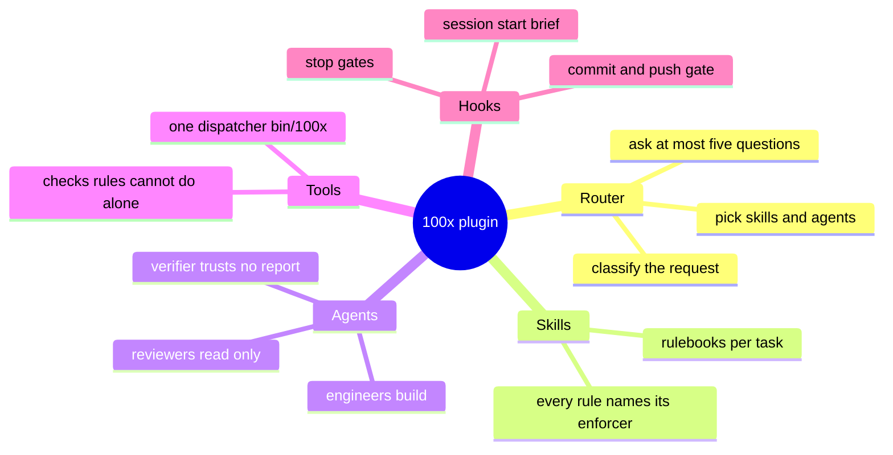
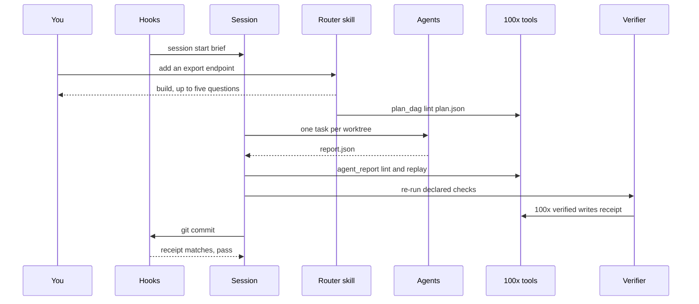
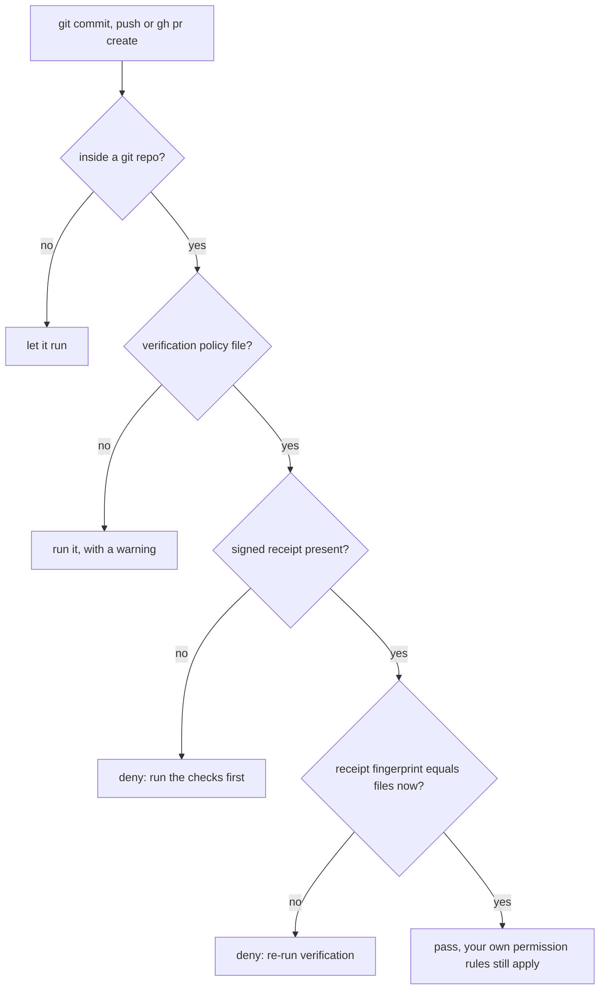
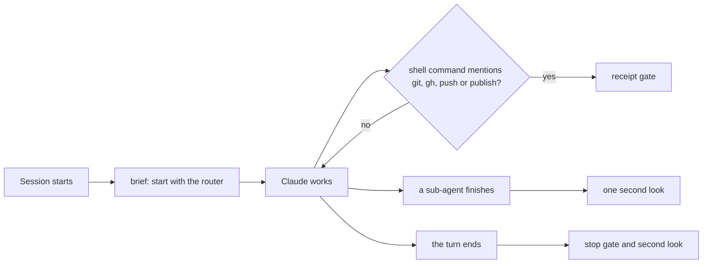

# How the 100x plugin works, end to end

> **What:** It routes any engineering request to the right rulebooks and specialist agents, and refuses to call work done until a check has really passed.
>
> **How:** A front-door skill picks the plan, agents do the work, a separate verifier re-runs the checks and signs a receipt, and guards at commit time read that receipt.
>
> **Watch out:** The guards only block in a repository that turns them on; everywhere else they just warn.

100x is a Claude Code plugin that turns a plain-English request into verified work. Think of it as a building with a front desk: the router skill is the receptionist who works out what you need, skills are the rulebooks each department follows, agents are the specialists who do the work in parallel, tools are the measuring instruments, and hooks are the security guards at the doors who check a signed receipt before anything leaves the building.

| | |
|---|---|
| subject | concept · repo `gauravprwl14/100x-engineer` |
| tier | heavy |
| generated | `100x flow build` from `scenario.json`; regenerate it, do not edit |

## Contents

| section | answers |
|---|---|
| [Before you watch](#before-you-watch) | what the change does for a user, what it covers and where it starts |
| [Terms](#terms) | the words a reader outside the module needs |
| [Diagrams](#diagrams) | the flow at a glance, as diagrams |
| [Workflow outline](#workflow-outline) | the code path as pseudocode, each line linked to its step |
| [Map](#map) | which boxes the scenarios use, their role and where they live in the code |
| [A build request, from typing it to committing it](#a-build-request-from-typing-it-to-committing-it) | happy scenario `happy`: each step, what it changes and its evidence |
| [What if the session believed the agent's report?](#what-if-the-session-believed-the-agents-report) | issue scenario `issue-claim`: each step, what it changes and its evidence |
| [Fix: check the report against git, then replay the declared checks](#fix-check-the-report-against-git-then-replay-the-declared-checks) | fix scenario `fix-replay`: each step, what it changes and its evidence |
| [What if the receipt were only a "tests passed" flag?](#what-if-the-receipt-were-only-a-tests-passed-flag) | issue scenario `issue-stale`: each step, what it changes and its evidence |
| [Fix: the receipt is tied to a fingerprint of the files](#fix-the-receipt-is-tied-to-a-fingerprint-of-the-files) | fix scenario `fix-receipt`: each step, what it changes and its evidence |
| [Decision](#decision) | which option was chosen, against what, and when to revisit it |
| [Numbers](#numbers) | every number on the page and what backs it |

## Before you watch

**Anyone joining the project, or using the plugin for the first time, can see what each part is for and follow one request from the moment it is typed to the moment it is committed.**

Why now: The plugin has grown to 47 skills, 11 agents and 44 tools; a newcomer needs the map before the parts make sense.

In this PR:

- The five kinds of parts: router, skills, agents, tools and hooks, and how they talk
- A build request end to end, with parallel agents
- Why an agent's own report is never trusted, and what checks it instead
- Why a receipt goes stale the moment a file changes after verifying

Not in this PR:

- How each part works on its own: one page per part, listed in explain/INDEX.md (work-doctor first)
- The learn sub-plugin and the research pipeline scripts
- Fork guard, work record and markdown index nudges: other hooks, same pattern
- Function-by-function detail: each part page has a Code reference

| entry point | kind | animated in | note | evidence |
|---|---|---|---|---|
| /100x:100x <request> | command | `happy` (A build request, from typing it to committing it) |  | `skills/100x/SKILL.md:103` |
| bin dispatcher: <tool> [args] | command | not animated | every tool runs through one dispatcher; the build walkthrough calls several | `bin/100x:2` |
| git commit / push / gh pr create | command | `fix-receipt` (Fix: the receipt is tied to a fingerprint of the files) |  | `hooks/require_verification.py:6` |
| agent report (report.json) | event | `fix-replay` (Fix: check the report against git, then replay the declared checks) |  | `scripts/agent_report.py:4` |

## Terms

| term | means | example |
|---|---|---|
| `skill` | A rulebook in skills/<name>/SKILL.md that Claude loads for one kind of task. Each rule says what enforces it. | bug-fix: reproduce first, commit the failing test, then fix. |
| `router` | The front-door skill, invoked by the plugin's own name as a slash command. It names the kind of request, asks only questions that change the plan, and picks the skills and agents. | "add an export endpoint" is a build. |
| `agent` | A specialist sub-session defined in agents/<name>.md, with its own tools and preloaded skills. | backend-engineer, code-reviewer, independent-verifier. |
| `tool` | A Python script in scripts/ run through the single dispatcher in bin/. Tools check things a rule can only ask for. | plan_dag lint plan.json |
| `hook` | A script Claude Code runs on an event (session start, before a shell command, at the end of a turn). It can add context, ask, or block. | Before git commit, check the receipt. |
| `task graph` | plan.json: the tasks of one feature, who owns which files, what each depends on, and which commands verify it. | T1 backend owns src/api/**; T2 frontend depends on T1. |
| `wave` | A group of tasks with no ordering between them and no shared files, so they can run at the same time. |  |
| `report` | The JSON block an agent ends with: what it changed, the commands it ran and their exit codes, and its status. |  |
| `replay` | Re-running the verify commands the plan declared for a task, instead of believing the exit codes in the report. |  |
| `receipt` | A file written by the verified tool after a check passes, signed with a private key and tied to the exact content of your files. |  |
| `fingerprint` | A hash of every tracked file's content. Change one byte and it changes, so an old receipt no longer matches. |  |
| `worktree` | A second checkout of the same repository in its own folder, so two agents edit files without stepping on each other. |  |

## Diagrams

### What is inside the plugin



Five kinds of parts. Skills and the router are text Claude reads; agents are specialists it starts; tools and hooks are code that checks what the text asks for.

Evidence: `.claude-plugin/plugin.json:4`, `hooks/hooks.json:3`, `bin/100x:2`, `scripts/lint_skills.py:26`

### A build request, end to end



The same journey the animated build walkthrough plays, one arrow per hand-off.

Animated in `happy`. Evidence: `hooks/session_start.py:33`, `skills/100x/SKILL.md:103`, `skills/100x/SKILL.md:91`, `scripts/agent_report.py:4`, `agents/independent-verifier.md:5`, `hooks/require_verification.py:1300`

### How the commit gate decides



Why this repository only warns: it has no policy file, so the second question answers no.

Animated in `fix-receipt`. Evidence: `hooks/require_verification.py:1223`, `hooks/require_verification.py:1229`, `hooks/require_verification.py:1263`, `hooks/receipts.py:251`, `hooks/require_verification.py:1300`

### Which hook fires when



Five events, each guarded by a small script that fails open: a broken guard must never lock you out of your shell.

Evidence: `hooks/hooks.json:3`, `hooks/hooks.json:25`, `hooks/hooks.json:121`, `hooks/require_verification.py:25`, `hooks/stop_gate.py:5`, `hooks/recheck_gate.py:4`

## Workflow outline

`route(request): the router skill, as pseudocode`, animated in `happy`:

```
intent, tier = classify(request)   # build, fix, incident, understand, …  # step 3
  ask(questions, max=5, only_if_plan_changes=True)  # step 3
skills, agents, gates = PIPELINE[intent]  # step 4
if needs_parallel_specialists:  # step 5
  plan = stamp(plan_json); plan_dag.lint(plan)   # cycles, shared files, unowned ACs  # step 5
  for wave in waves(plan): run one agent per task, own worktree  # step 6
for report in reports:  # step 8
  agent_report.lint(report, git_diff(worktree)); replay(plan.verify)  # step 8
independent_verifier.rerun(); 100x verified -- <check>  # step 9, 10
done only if receipt.fingerprint == fingerprint(files)  # step 11
```

`require_verification(command): the commit gate, as pseudocode`, animated in `fix-receipt`:

```
if not in_a_git_repo: return allow            # nothing to gate
policy = load(.claude/verification-policy.json)
  if policy is None: return warn("not configured")
if no receipt: return deny("run the checks first")
fresh = [c for c in receipt if c.fingerprint == fingerprint(files)]  # step 3
if required check not fresh: return deny("re-run verification")  # step 3
return pass                                   # no 'allow': your own ask rules still apply  # step 5
```

## Map

| node | role | code |
|---|---|---|
| You | client |  |
| Hooks (guards on events) | edge | `hooks/hooks.json` |
| Main Claude session | service |  |
| Router skill | service | `skills/100x/SKILL.md` |
| Skills (rulebooks) | service | `skills/` |
| Tools (bin dispatcher) | service | `bin/100x` |
| Task graph (plan.json) | queue | `scripts/plan_dag.py` |
| Specialist agents | worker | `agents/` |
| Independent verifier | service | `agents/independent-verifier.md` |
| Your files | store |  |
| Signed receipt | cache | `scripts/verified.py` |
| git and GitHub | external |  |

## A build request, from typing it to committing it

`happy` · happy


| # | what happens | state after | evidence |
|---|---|---|---|
| 1 | **The session starts and a hook points Claude at the router** With dozens of skills installed the menu gets cut off, so a hook injects a short reminder to start with the router. | no change | `hooks/session_start.py:33`, `hooks/session_start.py:4` |
| 2 | **You type a request in plain English** Any wording works; the example request is made up. | no change | *inferred* |
| 3 | **The router names the kind of work and asks a few questions** It says "this is a build", the scale tier, and asks at most 5 questions, only ones whose answer changes the plan, each with a recommendation. | no change | `skills/100x/SKILL.md:103`, `skills/100x/SKILL.md:41` |
| 4 | **The router loads the skills for a build, in order** Requirements intake, feature planning, then per-area rulebooks such as API contract and data modelling, then code craft and review. | no change | `skills/100x/SKILL.md:72` |
| 5 | **The plan becomes a task graph and a tool checks it** Before any agent starts, the graph is checked for loops, two tasks owning the same file, and requirements nobody owns. | tasks: 2 waiting | `scripts/plan_dag.py:4`, `scripts/plan_dag.py:393`, `bin/100x:54` |
| 6 | **Two agents pick up a wave in parallel, each in its own worktree** Each agent is a specialist with its own preloaded skills; separate worktrees keep their edits apart. | tasks: 0 waiting; agents: 2/3 busy | `skills/100x/SKILL.md:91`, `agents/backend-engineer.md:10` |
| 7 | **The agents edit files and send their reports** A report lists the files changed and the commands run with exit codes. It is a claim, not proof. | worktree[files] = `"v2"`; agents: 0/3 busy | `scripts/agent_report.py:4` |
| 8 | **The main session checks each report against git and replays the checks** It asks git which files really changed, rejects any outside the task's owned files, and re-runs only the verify commands the plan declared. | no change | `scripts/agent_report.py:11`, `scripts/agent_report.py:18`, `skills/100x/SKILL.md:120` |
| 9 | **A separate verifier agent re-runs everything itself** It trusts no report and never fixes what it finds, so the party doing the work is not the party grading it. | no change | `agents/independent-verifier.md:5`, `agents/independent-verifier.md:7` |
| 10 | **The check passes and a signed receipt is written for these exact files** The receipt holds a fingerprint of the file contents, signed with a key only this machine has. | receipt[fingerprint] = `"v2"`; holds read = `"v2"` | `scripts/verified.py:42`, `hooks/receipts.py:86` |
| 11 | **You commit, and the commit guard reads the receipt** The receipt's fingerprint matches the files, so the guard steps aside. It never says allow, so your own permission rules still apply. | cache hit | `hooks/receipts.py:251`, `hooks/require_verification.py:1300` |
| 12 | **The turn ends and a stop hook asks for one second look** Blind runs found a second skeptical pass catches defects the first missed, so a long or file-editing turn is held once with a re-check prompt. | no change | `hooks/recheck_gate.py:4`, `hooks/hooks.json:121` |

Step 1:

```
on SessionStart: print(brief)
```

Step 3:

```
intent = classify(request)
ask(max=5, only_plan_changing)
```

Step 4:

```
skills = PIPELINE["build"]
```

Step 5:

```
plan_dag lint plan.json
waves = topo_levels(tasks)
```

Step 8:

```
agent_report lint report.json --graph plan.json --cwd wt
agent_report replay report.json
```

Step 10:

```
fp = fingerprint(files)
receipt = sign(key, {check, exit: 0, fp})
```

## What if the session believed the agent's report?

`issue-claim` · issue · origin: what-if · severity high

> What-if: this is not in the code. It shows why the real design is the way it is.

Fixed by: `fix-replay`.

Steps 1–6 are the same as `happy`; this table starts where it diverges.

| # | what happens | state after | evidence |
|---|---|---|---|
| 7 | **One agent also edits a shared file it does not own, and skips the tests** Its report still says done, tests pass. Nothing in the report itself is false-looking. | worktree[files] = `"v2-shared-edit"`; agents: 0/3 busy | *inferred* |
| 8 | **The session takes the report at its word and merges** | nobody ran the tests on this content | *inferred* |
| 9 | **A broken change lands, and it collides with the other agent's work** | **git failed** (untested change merged) | *inferred* |

## Fix: check the report against git, then replay the declared checks

`fix-replay` · fix


Steps 1–7 are the same as `issue-claim`; this table starts where it diverges.

| # | what happens | state after | evidence |
|---|---|---|---|
| 8 | **The report is compared with what git says changed** The shared file is outside the task's owned files, so the report is rejected before anything runs. | no change | `scripts/agent_report.py:11`, `scripts/agent_report.py:4` |
| 9 | **The plan's own verify commands are re-run, not the report's** Commands in a report are text another agent wrote, so only the plan's declared ones run. | no change | `scripts/agent_report.py:18` |
| 10 | **The task goes back to its agent with the reason** | agents: 1/3 busy; nothing merged; the agent sees the failing command | `skills/100x/SKILL.md:120` |

## What if the receipt were only a "tests passed" flag?

`issue-stale` · issue · origin: what-if · severity high

> What-if: this is not in the code. It shows why the real design is the way it is.

Fixed by: `fix-receipt`.

| # | what happens | state after | evidence |
|---|---|---|---|
| 1 | **Checks pass and a receipt is recorded** | receipt[fingerprint] = `"v1"`; holds read = `"v1"` | `scripts/verified.py:42` |
| 2 | **Claude makes one more small edit after verifying** A typo fix, a renamed variable: the kind of change nobody re-tests. The receipt now describes content that no longer exists. | receipt[fingerprint] = `"v1"` (stale); worktree[files] = `"v2"` | `scripts/verified.py:45` |
| 3 | **The commit only asks whether a receipt exists** A pass or fail flag cannot tell old content from new. The real receipt stores a fingerprint with each check, which is what the fix compares. | cache hit | `hooks/receipts.py:251` |
| 4 | **Code nobody tested is committed** | **git failed** (untested edit committed) | *inferred* |

## Fix: the receipt is tied to a fingerprint of the files

`fix-receipt` · fix


Steps 1–2 are the same as `issue-stale`; this table starts where it diverges.

| # | what happens | state after | evidence |
|---|---|---|---|
| 3 | **The commit guard compares the receipt's fingerprint with the files now** They differ, so the guard denies the commit and prints the command to re-run. | holds now = `"v2"` | `hooks/receipts.py:251`, `hooks/require_verification.py:6` |
| 4 | **Claude re-runs the check, which writes a fresh receipt** | receipt[fingerprint] = `"v2"`; holds read = `"v2"` | `scripts/verified.py:42` |
| 5 | **The commit is tried again and goes through** | cache hit | `hooks/require_verification.py:1300` |

Step 3:

```
fresh = receipt.fp == fingerprint(files)
if not fresh: deny(rerun_hint)
```

## Decision

| option | solves it | pros | cons |
|---|---|---|---|
| Instructions only: tell the model to verify before saying done | fail | Nothing to install<br>Works in every repository | A model can talk itself past prose<br>No proof the check ran on the content that ships |
| Rely on CI after push | pass | Runs on a clean machine<br>Teams already have it | Feedback comes after the push, not before<br>Does not stop a turn that just says done |
| Signed, content-bound receipt checked by hooks at commit, push and stop **(chosen)** | pass | Editing after verifying invalidates the proof<br>Agents cannot hand-write a receipt<br>Fails open, so a broken guard never locks the shell | Only blocks where a policy file turns it on<br>Not a defence against an agent set on defeating it |

**Deciding factor:** The check has to happen before the work leaves the machine and be tied to the exact content, which only a fingerprinted, signed receipt read by a hook gives.
**Revisit when:** Claude Code gains a built-in, tamper-evident verification step, or CI becomes fast enough to run before every commit.
**Source:** hooks/require_verification.py docstring; docs/SAFETY.md

## Numbers

| name | value | tag | backed by |
|---|---|---|---|
| `skills` | 47 skills | measured | ls -d skills/*/ \| wc -l (at f2aebfc) |
| `agents` | 11 agents | measured | ls agents/*.md \| wc -l (at f2aebfc) |
| `tools` | 44 tools | measured | 100x list \| grep -c '^  ' (user-facing tools, at f2aebfc) |
| `questions` | 5 questions | verified | `skills/100x/SKILL.md:41` |
| `events` | 5 events | measured | keys of hooks/hooks.json "hooks" (at f2aebfc) |
| `slots` | 3 slots | estimated | illustrative: one backend, one frontend and one QA agent in a wave; the real count is the wave's width |
