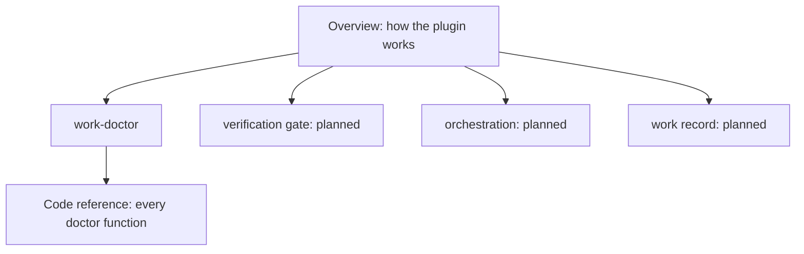

# Explain pages

Animated walkthroughs of this plugin, built by the `explain` skill. **Start here:
[100x-plugin](100x-plugin/index.html)**, the overview of how the router, skills, agents, tools
and hooks fit together. Then go one level down: one page per part, each ending in a **Code
reference** that lists every function in the files behind it, read from the code.

| page | what it answers | level |
|---|---|---|
| [100x-plugin](100x-plugin/index.html) ([md](100x-plugin/explain.md)) | What the five kinds of parts are, how one build request flows from typing to commit, and why reports and receipts are checked rather than trusted | overview |
| [work-doctor](work-doctor/index.html) ([md](work-doctor/explain.md)) | How the work-doctor skill finds why the session brief is missing: its seven checks, the hook dry run, what Claude may fix alone, and every doctor function | part |
| [work-continuity](work-continuity/index.html) ([md](work-continuity/explain.md)) | Why the work record exists and where it lives (the plan, from PR #10) | plan |

Each folder holds `scenario.json` (the only hand-written file), `index.html` and `explain.md`
(both generated: rebuild, never edit). Rebuild one with
`100x flow build explain/<page>/scenario.json --repo . --out explain/<page>`.

## Planned part pages

Each is one subsystem with real code behind it. Skills that are rulebooks with no code of their
own are covered by [`skills/INDEX.md`](../skills/INDEX.md) instead.

| part | code behind it |
|---|---|
| Verification gate: receipts and the commit, push and stop guards | `scripts/verified.py`, `hooks/receipts.py`, `hooks/require_verification.py`, `hooks/stop_gate.py` |
| Orchestration: task graphs, agent reports, the independent verifier | `scripts/plan_dag.py`, `scripts/agent_report.py`, `agents/independent-verifier.md` |
| Work record: start, decide, hold, handoff, the session brief and fork guard | `scripts/work.py`, `hooks/work_brief.py`, `hooks/work_fork_guard.py` |
| Re-check: the second skeptical pass at the end of a turn | `hooks/recheck_gate.py`, `skills/recheck/` |
| Explain engine: checker, reducer, player, code reference | `scripts/flow.py`, `scripts/code_ref.py`, `skills/explain/assets/` |
| PR review: SHA-pinned comments, posted only after a yes | `scripts/pr_review.py`, `scripts/pr_snapshot.py`, `skills/pr-review/` |
| Decision records: record, trace, drift, verify | `scripts/decide.py`, `skills/decision-records/` |
| Session find | `scripts/session_find.py`, `skills/session-find/` |
