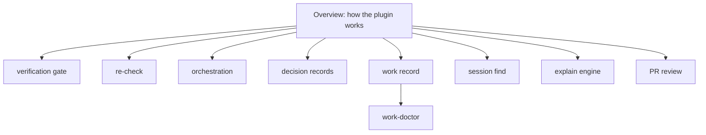

# Explain pages

Animated walkthroughs of this plugin, built by the `explain` skill. **Start here:
[100x-plugin](100x-plugin/index.html)**, the overview of how the router, skills, agents, tools
and hooks fit together. Then go one level down: one page per part, each ending in a **Code
reference** that lists every function in the files behind it, read from the code.

| page | what it answers | level |
|---|---|---|
| [100x-plugin](100x-plugin/index.html) ([md](100x-plugin/explain.md)) | What the five kinds of parts are, how one build request flows from typing to commit, and why reports and receipts are checked rather than trusted | overview |
| [verification-gate](verification-gate/index.html) ([md](verification-gate/explain.md)) | How a signed, content-bound receipt is written and read at commit, push and stop; what an edit after verifying, a shortcut around the gate, or a forged receipt runs into | part |
| [recheck](recheck/index.html) ([md](recheck/explain.md)) | When the end-of-turn second look fires, which stops it skips, and why it can never loop | part |
| [orchestration](orchestration/index.html) ([md](orchestration/explain.md)) | How a task graph runs agents in parallel waves, and how plan lint, report lint and replay catch overlapping files and false reports | part |
| [decision-records](decision-records/index.html) ([md](decision-records/explain.md)) | How a decision is recorded with checkable assumptions, traced to a file, and flagged when its files drift | part |
| [work-record](work-record/index.html) ([md](work-record/explain.md)) | How the private work record stores decisions and holds, builds the session brief, refuses secrets, and guards forks | part |
| [work-doctor](work-doctor/index.html) ([md](work-doctor/explain.md)) | How the work-doctor skill finds why the session brief is missing: its seven checks, the hook dry run, what Claude may fix alone | part |
| [session-find](session-find/index.html) ([md](session-find/explain.md)) | How a past session is found by keyword across transcripts, ranked, and where the search misses | part |
| [explain-engine](explain-engine/index.html) ([md](explain-engine/explain.md)) | How these pages are checked against the code and built: anchors, absences, the reducer, the code reference | part |
| [pr-review](pr-review/index.html) ([md](pr-review/explain.md)) | How a PR becomes SHA-pinned comments posted as a draft only after a yes, and why gh stays in the skill's steps | part |
| [work-continuity](work-continuity/index.html) ([md](work-continuity/explain.md)) | Why the work record exists and where it lives (the plan, from PR #10) | plan |

Each folder holds `scenario.json` (the only hand-written file), `index.html` and `explain.md`
(both generated: rebuild, never edit). Rebuild one with
`100x flow build explain/<page>/scenario.json --repo . --out explain/<page>`.

## Keeping them current

After merges to main, run the `explain-sync` skill (`/explain-sync`). `explain/.sync.json` holds
the last main commit the pages were synced to; `100x explain_sync status` lists the merges since
then and the pages citing what they changed, and only those are updated. Skills that are
rulebooks with no code of their own are covered by [`skills/INDEX.md`](../skills/INDEX.md).
