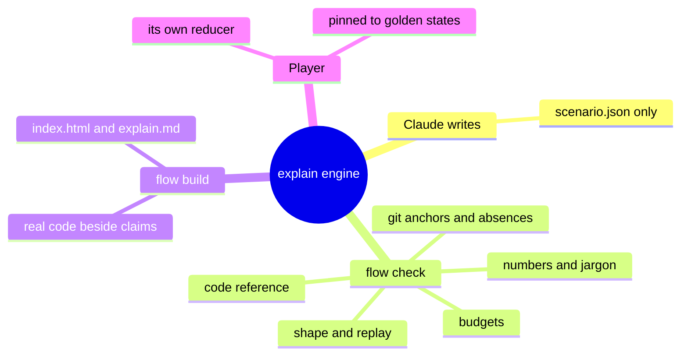
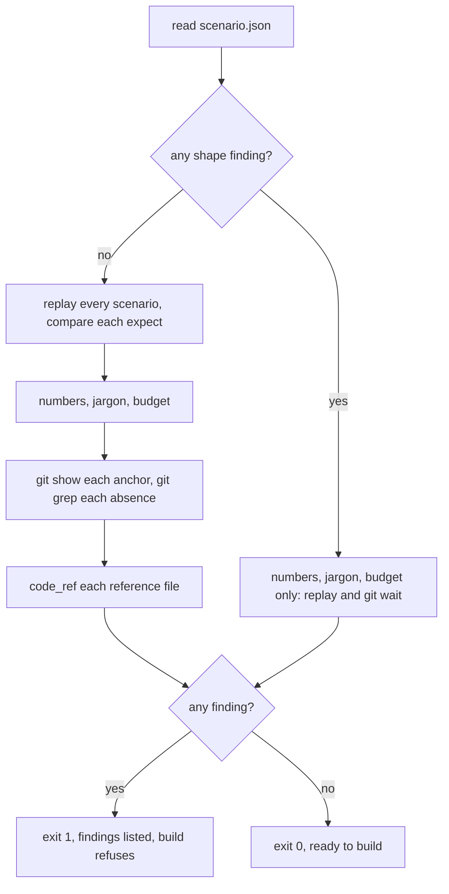
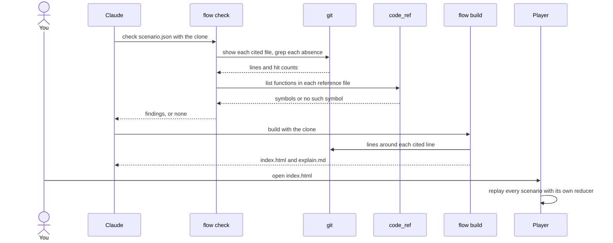

# How the explain engine works

> **What:** Turns a structured description of a flow into an animated page whose every claim was checked against the code before the page was built.
>
> **How:** Claude writes only scenario.json; flow check replays it and resolves each citation with git; flow build adds the real code and writes the page.
>
> **Watch out:** Build checks citations only when you pass it the clone: without it the page still builds, with pseudocode and no proof.

Part of the 100x plugin overview (explain/100x-plugin). Think of a newspaper with a fact-checking desk. The reporter (Claude) files the story only as structured data, scenario.json. The fact-checker (flow check) calls every source: it opens each cited line in git, re-runs each search that claims something is missing, and replays the timeline step by step. Only a story with no findings goes to the printing press (flow build), which sets the real code beside each claim. The reader's copy (the player in the browser) replays the timeline itself, and a test keeps its copy of the rules identical to the checker's.

| | |
|---|---|
| subject | concept · repo `gauravprwl14/100x-engineer` |
| tier | heavy |
| generated | `100x flow build` from `scenario.json`; regenerate it, do not edit |

## Contents

| section | answers |
|---|---|
| [Before you watch](#before-you-watch) | what the change does for a user, what it covers and where it starts |
| [Terms](#terms) | the words a reader outside the module needs |
| [Diagrams](#diagrams) | the flow at a glance, as diagrams |
| [Workflow outline](#workflow-outline) | the code path as pseudocode, each line linked to its step |
| [Map](#map) | which boxes the scenarios use, their role and where they live in the code |
| [From a request to a checked, animated page](#from-a-request-to-a-checked-animated-page) | happy scenario `happy`: each step, what it changes and its evidence |
| [Three wrong claims, and how check catches each](#three-wrong-claims-and-how-check-catches-each) | failure scenario `caught`: each step, what it changes and its evidence |
| [Building without the clone: the page builds, unproven](#building-without-the-clone-the-page-builds-unproven) | edge scenario `no-repo`: each step, what it changes and its evidence |
| [What if the player's reducer drifted from the checker's?](#what-if-the-players-reducer-drifted-from-the-checkers) | issue scenario `issue-drift`: each step, what it changes and its evidence |
| [Fix: both reducers must reproduce the same golden states](#fix-both-reducers-must-reproduce-the-same-golden-states) | fix scenario `fix-golden`: each step, what it changes and its evidence |
| [Decision](#decision) | which option was chosen, against what, and when to revisit it |
| [Numbers](#numbers) | every number on the page and what backs it |
| [Code reference](#code-reference) | every function and class in the files behind the page: lines, purpose, who uses it |

## Before you watch

**When you ask Claude to explain a PR or a part of this plugin, you get a page you can step through where every line it cites, every absence it claims and every function it lists was checked against the code, instead of a confident summary nobody verified.**

Why now: Part pages now end in a code reference, so the checker reads the files behind a page as well as the lines it cites.

In this PR:

- The one file Claude writes, and why it writes nothing else
- flow check: its checks in the order they run, and what each one rejects
- The reducer: how steps are replayed and compared with what each step expects
- How citations, absences and the code reference are resolved with git and the parse tree
- flow build: real code beside each claim, the page and the markdown export
- The player's own reducer, and the test that pins it to the checker's
- Every checker and builder function in the Code reference

Not in this PR:

- How to research a page (the research recipe)
- How the player draws and animates (layout, themes, the compare tab)
- The mermaid checker's internals (the diagramming skill)

| entry point | kind | animated in | note | evidence |
|---|---|---|---|---|
| flow check <scenario.json> --tier --repo | command | `happy` (From a request to a checked, animated page) |  | `scripts/flow.py:1398` |
| flow build <scenario.json> --tier --out --repo | command | `happy` (From a request to a checked, animated page) |  | `scripts/flow.py:1938` |
| flow reduce <scenario.json> --json | command | not animated | prints the state after every step; the golden states file is its output | `tests/test_flow.sh:387` |
| code_ref build <file> --md | command | not animated | the same function list flow build puts on a page, for any Python file | `scripts/code_ref.py:97` |
| explain skill ("walk me through this PR") | command | `happy` (From a request to a checked, animated page) |  | `skills/explain/SKILL.md:42` |

## Terms

| term | means | example |
|---|---|---|
| `evidence` | The proof behind one claim: a file and line plus a word that must be on it, or a search with the number of hits it must return. | scripts/flow.py at the line of run_checks, anchor def run_checks |
| `anchor` | The word that must appear on the cited line, or within 2 lines of it. If the code moved, the word is no longer there and check says so. |  |
| `absence` | A claim that something is not in the code, written as a git grep with its expected hit count, so it is counted rather than asserted. |  |
| `reducer` | A small function that replays a scenario's steps in order and works out the state after each: which job a worker holds, what a store contains. |  |
| `expect` | What a step says the state will be afterwards. Check compares it with the reducer's answer and reports any difference. |  |
| `finding` | One problem flow check reports, with where it sits in the file. Any finding fails the check and makes build refuse. |  |
| `bare number` | A digit typed straight into prose. It must be a named placeholder in double braces, backed by a number with a source, so no figure is made up. |  |
| `jargon rule` | A step title or TL;DR line may not hold a code-shaped word (camelCase, snake_case, a dotted call) unless a term or a box on the map explains it. |  |
| `code reference` | The table of functions at the bottom of a part page, read from the code at the page's revision, never typed by hand. |  |
| `parse tree` | Python's own reading of a file into functions and classes (the ast module), so the list cannot skip or invent one. |  |
| `golden states` | The saved replay output for a set of test scenarios. The checker's reducer and the player's reducer must both reproduce it exactly. |  |
| `tier` | light (static step cards, small budgets) or heavy (animated player, more boxes, scenarios and steps). |  |

## Diagrams

### What the explain engine is made of



Read outward from the centre: one file goes in, a checker and a builder work on it, and the page replays it with its own copy of the rules.

Evidence: `skills/explain/SKILL.md:25`, `scripts/flow.py:1398`, `scripts/flow.py:1857`, `skills/explain/assets/flow-player.js:8`, `tests/flow/reduce.test.mjs:22`

### The order flow check runs its checks



A shape mistake anywhere holds back the replay and every git lookup, so a wrong citation can hide behind a typo until the typo is fixed.

Animated in `happy`. Evidence: `scripts/flow.py:1405`, `scripts/flow.py:1407`, `scripts/flow.py:1412`, `scripts/flow.py:1435`

### Check, build and open, call by call



Top to bottom: check reads git and the parse tree, build reads git again for the real code, and the page needs neither once it is written.

Animated in `happy`. Evidence: `scripts/flow.py:1362`, `scripts/flow.py:1343`, `scripts/flow.py:832`, `scripts/flow.py:1866`, `scripts/flow.py:1541`, `skills/explain/assets/flow-player.js:2649`

## Workflow outline

`flow check: prepare, then run_checks, as pseudocode`, animated in `happy`:

```
doc = load(path); ctx = validate(doc, f)      # shape: keys, nodes, actions, ids  # step 4
structural = bool(f.items)  # step 4
if not structural:
  states = reduce_all(ctx, f)                  # replay every scenario  # step 5
  check_expectations(ctx, states, f)  # step 5
check_prose(doc, numbers, f)                 # bare numbers, unknown {{name}}  # step 6
check_jargon(doc, ctx, f)  # step 6
check_budget(ctx, states, tier, f)  # step 7
if repo is not None and not structural:  # step 8
  check_evidence(ctx, repo, rev, f)          # git show, git grep  # step 8
  collect_reference(doc, repo, rev, f)       # code_ref at the revision  # step 9
return 1 if f.items else 0  # step 10
```

`flow build: run_build, as pseudocode`, animated in `happy`:

```
states = run_checks(doc, ctx, f, tier, repo)  # repo is None unless --repo  # step 11
if f.items: refuse, exit 1  # step 11
snippets = collect_snippets(doc, repo)        # real lines around each citation  # step 11
reference = collect_reference(doc, repo)  # step 11
build(): shell + player JS + CSS + data -> index.html  # step 11
write explain.md = render_markdown(doc, ctx, states, tier, reference)  # step 11
```

## Map

| node | role | code |
|---|---|---|
| You | client |  |
| Claude with the explain skill | service | `skills/explain/SKILL.md` |
| scenario.json (the one hand-written file) | store |  |
| Checks, in the order flow check runs them | queue | `scripts/flow.py:1398` |
| flow check | worker | `scripts/flow.py:1418` |
| Reducer (replays the steps) | service | `scripts/flow.py:1186` |
| git, at the page's revision | external |  |
| code_ref (reads the parse tree) | service | `scripts/code_ref.py:92` |
| flow build | service | `scripts/flow.py:1857` |
| index.html and explain.md | store |  |
| Player in the browser | client | `skills/explain/assets/flow-player.js` |
| Golden states file (tests/flow/states.json) | store |  |

## From a request to a checked, animated page

`happy` · happy


| # | what happens | state after | evidence |
|---|---|---|---|
| 1 | **You ask Claude to walk you through a part of the plugin** That is one of the skill's triggers; Claude loads the explain rules and researches the code first. | no change | `skills/explain/SKILL.md:42` |
| 2 | **Claude writes scenario.json and nothing else** Boxes, steps, citations and numbers, all as data. The page and the markdown are build output, never edited by hand. | scenario[file] = `"written"` | `skills/explain/SKILL.md:25`, `skills/explain/SKILL.md:122` |
| 3 | **Claude runs flow check; the checks line up in a fixed order** Check and build share one function, so given the same clone, build never accepts what check rejects at the same tier. | checks: 7 waiting | `scripts/flow.py:1398`, `scripts/flow.py:1418` |
| 4 | **Shape: every key, box, action and evidence id must exist** An unknown key gets a did-you-mean. A shape finding also holds back the replay and every git lookup, so fix shape first. | holds doc = `"written"`; checks: 6 waiting | `scripts/flow.py:227`, `scripts/flow.py:172`, `scripts/flow.py:1405` |
| 5 | **Replay: the reducer runs every scenario and compares each expect** Jobs leave a queue first in, first out; freeing a job the worker does not hold is an error. A step whose expect differs from the replay is a finding. | checks: 5 waiting | `scripts/flow.py:1407`, `scripts/flow.py:1186`, `scripts/flow.py:1113`, `scripts/flow.py:1118`, `scripts/flow.py:1242` |
| 6 | **Numbers and jargon: no bare digit in prose, no unexplained code word in a title** Every figure is a placeholder with a tagged source. A word of the repo name, such as 100x, is allowed; a code-shaped word in a step title must be a term or a box label. | checks: 3 waiting | `scripts/flow.py:983`, `scripts/flow.py:1001`, `scripts/flow.py:1047` |
| 7 | **Budget: a heavy page stays within its limits** At most 12 boxes, 5 scenarios and 12 steps in each scenario, inherited steps included. | checks: 2 waiting | `scripts/flow.py:51`, `scripts/flow.py:1411` |
| 8 | **Evidence: git opens each cited line and re-runs each absence search** The anchor word must sit within 2 lines of the cited line at the page's revision; an absence's hit count must equal what git grep finds now. | checks: 1 waiting | `scripts/flow.py:1362`, `scripts/flow.py:1372`, `scripts/flow.py:1343`, `scripts/flow.py:1349` |
| 9 | **Reference: code_ref lists the functions in each named file** It parses the file at the same revision, so a named function or a note on a function the file does not hold is a finding, with a did-you-mean. | checks: 0 waiting | `scripts/flow.py:832`, `scripts/flow.py:844`, `scripts/code_ref.py:97`, `scripts/code_ref.py:80` |
| 10 | **Check reports no findings and exits clean** | no change | `scripts/flow.py:1435` |
| 11 | **flow build adds the real code and writes the page** Build re-runs every check, then reads 3 lines above and 5 lines below each cited line from git, and inlines the player, styles and data into one file next to the markdown export. | page[index] = `"written"` | `scripts/flow.py:1860`, `scripts/flow.py:1866`, `scripts/flow.py:1505`, `scripts/flow.py:1541`, `scripts/flow.py:1877` |
| 12 | **You open the page; the player replays every scenario itself** The player carries its own reducer and needs no network for it. When it has drawn, it marks the page ready. | holds html = `"written"` | `skills/explain/assets/flow-player.js:8`, `skills/explain/assets/flow-player.js:2649`, `skills/explain/assets/flow-player.js:2657`, absent: a fetch, XMLHttpRequest or WebSocket call in the player script (`git grep` finds 0 in `skills/explain/assets/flow-player.js`) |

Step 3:

```
doc = load(path); ctx = validate(doc, f)
run_checks(doc, ctx, f, tier, repo, rev)
```

Step 5:

```
states = reduce_all(ctx, f)
check_expectations(ctx, states, f)
```

Step 8:

```
lines = git show <rev>:<path>
anchor in lines[line-2 .. line+2]
hits = count(git grep -n -E <pattern> <rev> -- <path>)
```

## Three wrong claims, and how check catches each

`caught` · failure


Steps 1–7 are the same as `happy`; this table starts where it diverges.

| # | what happens | state after | evidence |
|---|---|---|---|
| 8 | **A cited line moved: the anchor word is no longer near it** Someone added lines above the function since the page was written. Git shows the file at the revision and the word is not within 2 lines. | checks: 1 waiting; checker: 1/1 busy; findings = 1 | `scripts/flow.py:1362`, `scripts/flow.py:1372`, `scripts/flow.py:1368` |
| 9 | **An absence the page asserts, but git grep finds hits** The page says there is no lock; the search it wrote down finds some. Check believes the count, not the sentence. | checker: 0/1 busy; findings = 2 | `scripts/flow.py:1343`, `scripts/flow.py:1349` |
| 10 | **The reference names a function the file does not have** code_ref reads the real function list from the parse tree, so an invented or renamed function is a finding with the nearest real name. | checks: 0 waiting; findings = 3 | `scripts/flow.py:844`, `scripts/code_ref.py:97` |
| 11 | **Check fails, and build would refuse the same file** | flow build: refused | `scripts/flow.py:1435`, `scripts/flow.py:1864` |
| 12 | **Claude re-reads each line, corrects the claim, and re-runs check until clean** The rule is to fix what the page says, never to paste in whatever word sits on the line now. | scenario[file] = `"claims corrected"`; findings = 0 | `skills/explain/SKILL.md:90` |

## Building without the clone: the page builds, unproven

`no-repo` · edge


| # | what happens | state after | evidence |
|---|---|---|---|
| 1 | **Claude runs flow build without naming the clone** Check defaults to the current folder as the clone; build defaults to none. | no change | `scripts/flow.py:1938`, `scripts/flow.py:1930` |
| 2 | **Build runs shape, replay, numbers and budget, but skips every git lookup** With no clone there is nothing to resolve citations or the reference against, so a moved line would pass. | evidence and reference not checked | `scripts/flow.py:1860`, `scripts/flow.py:1412` |
| 3 | **The page shows pseudocode only and has no code reference** Build says so on stderr: real code for none of the cited lines, and no code reference. | page[index] = `"pseudocode only"` | `scripts/flow.py:1870`, `scripts/flow.py:1874` |
| 4 | **The fix is to run check first, then build with the same clone** | no change | `scripts/flow.py:1930`, `scripts/flow.py:1938` |

## What if the player's reducer drifted from the checker's?

`issue-drift` · issue · origin: what-if · severity high

> What-if: this is not in the code. It shows why the real design is the way it is.

Fixed by: `fix-golden`.

| # | what happens | state after | evidence |
|---|---|---|---|
| 1 | **Someone changes how freeing a worker behaves, in the Python reducer only** The player is a separate copy of the same rules, written in JavaScript. | Python reducer changed, player unchanged | *inferred* |
| 2 | **flow check passes the page: its reducer agrees with every expect** | no change | *inferred* |
| 3 | **The player replays the same steps and draws a different state** A worker slot shows busy on the page that the checker computed as free. | **player failed** (state differs from the checked one) | *inferred* |
| 4 | **You trust a picture the checker never saw** | no change | *inferred* |

## Fix: both reducers must reproduce the same golden states

`fix-golden` · fix


Steps 1–1 are the same as `issue-drift`; this table starts where it diverges.

| # | what happens | state after | evidence |
|---|---|---|---|
| 2 | **The golden states file holds the Python reducer's output for every test case** The flow test suite regenerates the replay and compares it with the saved file; any change shows up as drift. | holds saved = `"flow.py output"` | `tests/test_flow.sh:387` |
| 3 | **A node test runs the player's reducer on the same cases and compares** | **player failed** (parity test fails) | `tests/flow/reduce.test.mjs:22`, `skills/explain/assets/flow-player.js:8` |
| 4 | **The change cannot land until both reducers agree again** On this commit the suite passes 345 passing checks, the node parity test among them. | no change | `tests/flow/reduce.test.mjs:22`, `tests/test_flow.sh:387` |

## Decision

| option | solves it | pros | cons |
|---|---|---|---|
| Claude writes only data; a tested engine checks and renders it **(chosen)** | pass | Every citation, absence and function name is checked against git before a page exists<br>One tested renderer, so every page behaves the same | A fixed action vocabulary: a flow it cannot express is told in prose<br>Two reducers to keep in step, held together by a test |
| Claude writes the HTML page directly | fail | Any layout or animation is possible | Nothing can check that a cited line says what the page claims<br>Each page is new code to trust |
| A markdown walkthrough with diagrams, no checker | fail | Quick to write, renders on GitHub | Claims and numbers go unverified<br>No step-by-step state, so races cannot be replayed |

**Deciding factor:** A page is only worth reading if a wrong claim fails a check before anyone sees it, and only data can be checked that way.
**Revisit when:** Pages regularly need flows the action vocabulary cannot express, or the second reducer costs more to maintain than the animation is worth.
**Source:** skills/explain/SKILL.md rule 1 and Sources (SOURCE: original)

## Numbers

| name | value | tag | backed by |
|---|---|---|---|
| `anchor_window` | 2 lines | verified | `scripts/flow.py:54` |
| `heavy_nodes` | 12 boxes | verified | `scripts/flow.py:51` |
| `heavy_scenarios` | 5 scenarios | verified | `scripts/flow.py:51` |
| `heavy_steps` | 12 steps | verified | `scripts/flow.py:51` |
| `max_ref_files` | 8 files | verified | `scripts/flow.py:121` |
| `snippet_before` | 3 lines | verified | `scripts/flow.py:70` |
| `snippet_after` | 5 lines | verified | `scripts/flow.py:70` |
| `flow_tests` | 345 passing checks | measured | bash tests/test_flow.sh at 4bdb47e: 'flow: 345 passed, 0 failed', with the node parity test run |

## Code reference

Read from the code by `100x code_ref`: names, lines and docstrings are the code's own; a note is the page author's one-line summary.

### `scripts/flow.py`

Check, reduce and build an explain-skill `scenario.json` (schema 1).

| symbol | lines | what it does | used by | branches |
|---|---|---|---|---|
| `validate` | 227–251 | Structural checks. Returns a context dict the reducer and later checks use. | `prepare` | 5 |
| `check_keys` | 163–173 | Reports missing required keys and unknown keys for one object, suggesting the nearest real key. | `index_scenarios`, `validate`, `validate_context`, `validate_diagrams`, `validate_evidence`, `validate_expect`, `validate_extras`, `validate_initial`, `validate_nodes`, `validate_numbers`, `validate_outline`, `validate_outline_line`, `validate_reference`, `validate_scenario`, `validate_step`, `validate_subject`, `validate_terms`, `validate_tldr` | 4 |
| `validate_reference` | 773–808 | Shape only; whether each file parses and holds each named symbol is collect_reference. | `validate` | 19 |
| `effective_steps` | 1056–1070 | [(step, origin_scenario_id, origin_index)] for a scenario, branches expanded. | `reduce_scenario` | 5 |
| `apply` | 1095–1183 | Applies one action to the state: messages, queue and worker slots, cache and store values, the clock, counters and failures. | `reduce_scenario` | 44 |
| `reduce_scenario` | 1186–1208 | States after each effective step. Raises ReduceError naming the failing step. | `reduce_all` | 4 |
| `check_expectations` | 1223–1243 | Compares each step's expect and declared hazard with the replayed state; inherited steps are checked once, where they are owned. | `run_checks` | 12 |
| `bare_numbers` | 983–994 | Digits that should be a {{name}}. Exempt: ids such as C3, an HTTP class such as 5xx, | `check_prose` | 5 |
| `check_prose` | 997–1012 | Runs the bare-number rule and the unknown-placeholder rule over every prose field, allowing words of the repo name and the PR number. | `run_checks` | 12 |
| `check_jargon` | 1022–1038 | A step title is read before anything else on the card, and the TL;DR before anything | `run_checks` | 10 |
| `jargon_in` | 1041–1047 | Flags each code-shaped word in one title or TL;DR line that no term, box label or box id explains. | `check_jargon` | 5 |
| `check_budget` | 1271–1304 | Enforces the tier's limits on boxes, scenarios, steps, outlines and diagrams, and that outline and check step indexes exist. | `run_checks` | 20 |
| `check_evidence` | 1314–1373 | Resolves each anchor with git show and the window around the cited line, and re-counts each absence with git grep. | `run_checks` | 25 |
| `collect_reference` | 816–848 | The code_ref inventory of every reference file at the page's revision, narrowed to the | `run_build`, `run_checks` | 17 |
| `run_checks` | 1398–1415 | Every check `flow check` runs, shared with `flow build`. Evidence needs a clone | `run_build`, `run_check` | 4 |
| `run_check` | 1418–1435 | The check command: prepares the file, runs every check, prints findings or JSON, and exits with failure on any finding. | `main` | 8 |
| `collect_snippets` | 1484–1513 | Real code around every cited line, read from git at the revision check resolves: | `run_build` | 15 |
| `build` | 1516–1543 | Inline the engine assets and the scenario into <out_dir>/index.html. | `collect_reference`, `run_build` | 8 |
| `render_markdown` | 1752–1820 | Writes the explain.md export: TL;DR, lede, contents, context, terms, diagrams, outlines, map, a table per scenario, decision, numbers, code reference. | `run_build` | 39 |
| `run_build` | 1857–1879 | The build command: runs every check (git ones only with a clone), refuses on any finding, then writes the page and the markdown export. | `main` | 12 |

### `scripts/code_ref.py`

Code reference: every function and class in a file, read from the code, not written.

| symbol | lines | what it does | used by | branches |
|---|---|---|---|---|
| `read_source` | 38–51 | Reads a Python file from the working tree, or at a revision with git show; anything else is unsupported. | `build`, `check` | 6 |
| `symbols_of` | 80–89 | Top-level functions and classes, and the methods directly inside a class. | `build` | 4 |
| `names_used` | 68–77 | Every bare name and attribute name referenced in the body: what this uses. Decorators | `build` | 5 |
| `build` | 92–116 | Parses each file and lists its functions, classes and methods with lines, signature, docstring, branch count and who uses each. | `main` | 13 |
| `check` | 119–130 | Paths whose content no longer matches the reference: (path, reason) pairs. | `main` | 4 |
| `to_markdown` | 133–149 | Prints the inventory as one table per file: symbol, lines, what it does, used by, branches. | `main` | 7 |
