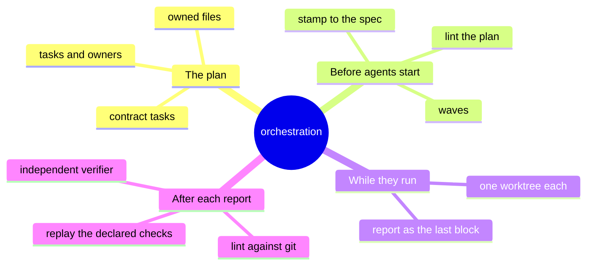
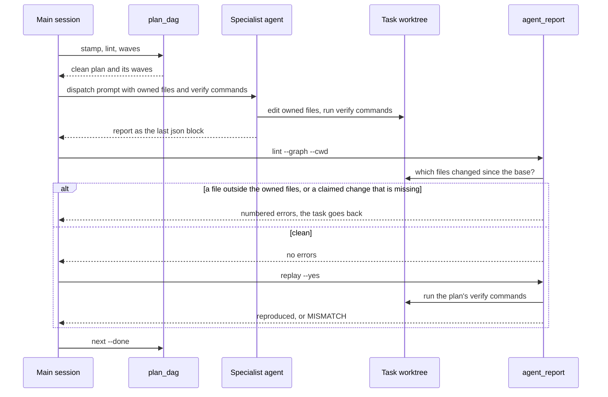
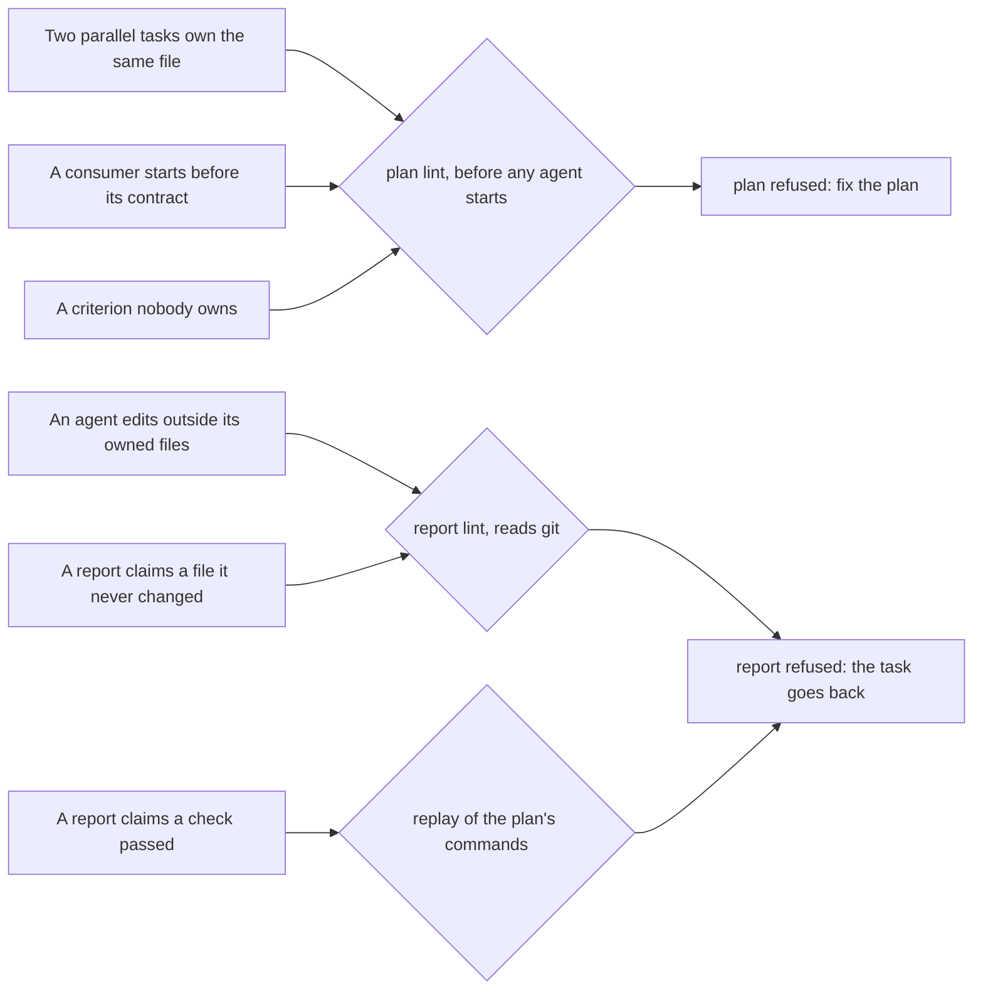
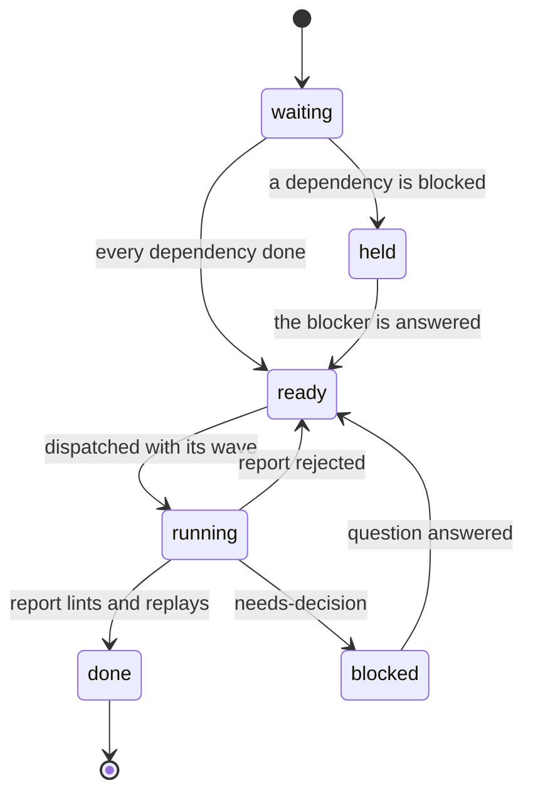

# How orchestration runs parallel agents safely

> **What:** Lets several specialist agents build one feature at the same time without editing the same files, and merges nobody's work on their word.
>
> **How:** A checker refuses a bad plan before any agent starts; then each agent's report is compared with what git says changed, and its checks are re-run from the plan.
>
> **Watch out:** Replay proves a command gave the claimed result, not that the command tests anything, so the plan's verify list must be reviewed before dispatch.

Think of a building site with several crews. Before anyone starts, the site manager checks the work orders: no two crews get the same wall at the same time, foundations go in before walls, and every item in the client's brief has a crew. When a crew says "finished", the inspector does not read their note: he walks the site to see which walls really changed, and re-runs the tests the work order named. In 100x the work orders are a task graph (the plan file), the manager is plan_dag, the crews are specialist agents each in their own worktree, and the inspector is agent_report plus the independent verifier. One level down from the 100x-plugin overview page.

| | |
|---|---|
| subject | concept · repo `gauravprwl14/100x-engineer` |
| tier | heavy |
| generated | `100x flow build` from `scenario.json`; regenerate it, do not edit |

## Contents

| section | answers |
|---|---|
| [Before you watch](#before-you-watch) | what the change does for a user, what it covers and where it starts |
| [Terms](#terms) | the words a reader outside the module needs |
| [Diagrams](#diagrams) | the flow at a glance, as diagrams |
| [Workflow outline](#workflow-outline) | the code path as pseudocode, each line linked to its step |
| [Map](#map) | which boxes the scenarios use, their role and where they live in the code |
| [One feature, three waves: plan, run in parallel, check, merge](#one-feature-three-waves-plan-run-in-parallel-check-merge) | happy scenario `happy`: each step, what it changes and its evidence |
| [What if two parallel tasks owned the same file?](#what-if-two-parallel-tasks-owned-the-same-file) | issue scenario `issue-overlap`: each step, what it changes and its evidence |
| [Fix: plan lint refuses the overlap before any agent starts](#fix-plan-lint-refuses-the-overlap-before-any-agent-starts) | fix scenario `fix-overlap`: each step, what it changes and its evidence |
| [What if a report were merged on its word?](#what-if-a-report-were-merged-on-its-word) | issue scenario `issue-report`: each step, what it changes and its evidence |
| [Fix: lint compares the report with git, and replay re-runs the plan's check](#fix-lint-compares-the-report-with-git-and-replay-re-runs-the-plans-check) | fix scenario `fix-report`: each step, what it changes and its evidence |
| [Decision](#decision) | which option was chosen, against what, and when to revisit it |
| [Numbers](#numbers) | every number on the page and what backs it |
| [Code reference](#code-reference) | every function and class in the files behind the page: lines, purpose, who uses it |

## Before you watch

**When one feature needs several specialist agents at once (backend, frontend, tests), this is how the main session splits the work so they never edit the same file, and how it checks each agent's "done" before merging instead of taking its word.**

Why now: Parallel agents fail in three predictable ways: two edit the same shared file, a consumer starts before the contract it builds on exists, and a "tests pass" is merged on trust. Each is visible before or after an agent runs, so each gets a mechanical check.

In this PR:

- The plan file: tasks, owners, owned files, dependencies, acceptance criteria, verify commands
- Stamping the plan to the approved spec, and linting it before any agent starts
- Waves: which tasks run together, and what can start next
- The report every agent ends with, and the two checks it must pass: lint against git, and a replay of the plan's commands
- The independent verifier, which repeats the checks and never fixes
- Every plan_dag and agent_report function behind it, in the Code reference

Not in this PR:

- Writing the spec and its acceptance criteria (the feature-planning skill)
- Signed receipts and the commit guard (the verification gate, a planned part page)
- The review agents that read the merged diff after the last wave
- Batching open questions into one message: the summary command is listed in the Code reference, not animated

| entry point | kind | animated in | note | evidence |
|---|---|---|---|---|
| orchestrate skill (main session only) | command | `happy` (One feature, three waves: plan, run in parallel, check, merge) |  | `skills/orchestrate/SKILL.md:19` |
| plan_dag stamp \| lint \| waves \| next | command | `happy` (One feature, three waves: plan, run in parallel, check, merge) |  | `scripts/plan_dag.py:672` |
| agent_report extract \| lint \| replay | command | `fix-report` (Fix: lint compares the report with git, and replay re-runs the plan's check) |  | `scripts/agent_report.py:652` |
| agent_report summary | command | not animated | merges every report's open questions into one batch of at most 5 questions, blocking first; not animated | `scripts/agent_report.py:81` |
| independent-verifier agent | command | `happy` (One feature, three waves: plan, run in parallel, check, merge) |  | `agents/independent-verifier.md:7` |

## Terms

| term | means | example |
|---|---|---|
| `main session` | The Claude session you talk to. Only it plans, dispatches agents and merges their work; agents never orchestrate. |  |
| `task graph` | The plan file: each task's id, its owner agent, the files it may edit, what it depends on, the acceptance criteria it delivers and the commands that prove it. | T1 is the backend engineer's, owns the tagging services folder, and depends on T0. |
| `owned files` | The file patterns a task may edit. Two tasks that can run at the same time must own different files. |  |
| `contract task` | A task that owns what others build on: shared types, an API or database schema. Its consumers depend on it and never edit its files. |  |
| `acceptance criterion` | One observable outcome the spec defines, numbered AC-something. Every one must be owned by a task, and a task may claim only ones the spec defines. | The photo page lists its tags, written as one AC line in the spec's acceptance section. |
| `stamp` | Writing the approved spec's path, a hash of its exact bytes and the current commit into the plan. If the spec is edited later, lint fails until someone re-plans. |  |
| `wave` | A group of tasks whose dependencies are all finished, so they run at the same time. |  |
| `worktree` | A second checkout of the repository in its own folder. Each running task gets one, so agents never share a working copy. |  |
| `report` | The JSON block an agent's final message ends with: status, what it understood, what it changed, the commands it ran with their exit codes, and its questions. |  |
| `lint` | A mechanical check that refuses a bad file with numbered errors: here, of the plan before work starts, and of each report after. |  |
| `replay` | Re-running the verify commands the plan declared for a task, and comparing their exit codes with the ones the report claimed. |  |
| `independent verifier` | A read-only agent that re-runs every check itself, tries to make one new test fail, and reports what it finds without fixing anything. |  |

## Diagrams

### What orchestration is made of



Read outward from the centre: what the plan holds, what is checked before any agent starts, how agents run, and what is checked after each one reports.

Evidence: `skills/orchestrate/SKILL.md:50`, `skills/orchestrate/SKILL.md:54`, `scripts/plan_dag.py:286`, `skills/orchestrate/SKILL.md:65`, `docs/OPERATING-MODEL.md:84`, `docs/OPERATING-MODEL.md:95`, `docs/OPERATING-MODEL.md:97`, `agents/independent-verifier.md:7`

### One task, from plan to merge



Top to bottom: the plan is checked once, then every report is checked twice, first against git and then by re-running the plan's own commands.

Animated in `happy`. Evidence: `scripts/plan_dag.py:681`, `skills/orchestrate/SKILL.md:68`, `scripts/agent_report.py:149`, `scripts/agent_report.py:423`, `scripts/agent_report.py:428`, `scripts/agent_report.py:564`, `scripts/plan_dag.py:750`

### What catches each failure, and when



Left, the failure; middle, the check that finds it. Plan problems are caught before anyone works; report problems are caught before anything merges.

Evidence: `scripts/plan_dag.py:396`, `scripts/plan_dag.py:411`, `scripts/plan_dag.py:438`, `scripts/agent_report.py:423`, `scripts/agent_report.py:428`, `scripts/agent_report.py:652`, `skills/orchestrate/SKILL.md:39`

### A task's states, as plan next sees them



A blocked task pauses only the tasks that depend on it; everything else keeps running.

Evidence: `scripts/plan_dag.py:736`, `scripts/plan_dag.py:750`, `skills/orchestrate/SKILL.md:79`, `skills/orchestrate/SKILL.md:39`, `docs/OPERATING-MODEL.md:328`

## Workflow outline

`plan_dag lint(plan, spec): the plan gate, as pseudocode`, animated in `happy`:

```
for t in tasks: reject unknown fields, an unknown owner, empty files / verify / acceptance  # step 2
for c in t.verify: reject shell syntax outside sh -c, and any commit, push, tag or publish  # step 2
if find_cycle(by_id): error dependency cycle  # step 2
for a, b in every pair of tasks:
  if a in anc[b] or b in anc[a]: continue   # ordered pairs may share
  if any owned glob overlaps: error 'can run in parallel but both own files'  # step 2
for each consumer of a contract: must depend on it, must not own its files
every AC the spec defines has a task; no task claims an undefined AC  # step 2
spec_gate: audit passes, status ready, sha256(spec) == stamped spec_sha256  # step 2
return 1 if errors else 0  # step 2
```

`agent_report lint --graph --cwd: the report gate, as pseudocode`, animated in `fix-report`:

```
base = --base or plan.base or fork_point(worktree) or HEAD  # step 3
actual = git diff --name-only base  +  git ls-files --others --exclude-standard  # step 3
if report.agent != task.owner: error
for p in actual: if not path_owned(p, task.files): error 'the worktree changed p, outside'  # step 3
for p in report.changes: if p not in actual: error 'claimed but no change'  # step 4
if status == done: every declared verify command is in evidence with exit 0
```

`agent_report replay --graph --yes: re-run, never believe`, animated in `fix-report`:

```
declared = {argv(v): v for v in task.verify}
for e in report.evidence:
  if argv(e.cmd) not in declared: list 'not replayed (undeclared)'
  else: run the plan's command as argv, no shell, its own process group  # step 5
  if actual exit != e.exit_code: MISMATCH, print both output tails  # step 5
return 1 on a mismatch or a missing command; 3 if anything was not replayed  # step 5
```

## Map

| node | role | code |
|---|---|---|
| Main session (orchestrator) | client | `skills/orchestrate/SKILL.md` |
| Approved spec | store |  |
| Plan file (task graph) | store |  |
| plan_dag (plan checker) | service | `scripts/plan_dag.py:305` |
| Ready tasks (this wave) | queue | `scripts/plan_dag.py:719` |
| Specialist agents | worker |  |
| Task worktrees (git) | store |  |
| agent_report (report checker) | service | `scripts/agent_report.py:246` |
| Independent verifier (read-only) | service | `agents/independent-verifier.md` |
| Merged branch | store |  |

## One feature, three waves: plan, run in parallel, check, merge

`happy` · happy


| # | what happens | state after | evidence |
|---|---|---|---|
| 1 | **The main session stamps the plan against the approved spec** Stamp refuses a spec that has not passed its audit, then writes the spec's path, a hash of its exact bytes and the current commit into the plan. | plan[stamp] = `"spec hash + base commit"`; holds approved = `"ready"` | `skills/orchestrate/SKILL.md:54`, `scripts/plan_dag.py:672`, `scripts/plan_dag.py:681`, `scripts/plan_dag.py:682` |
| 2 | **Lint checks the whole plan before any agent starts** It re-hashes the spec (an edit since the stamp fails), looks for dependency cycles, checks that tasks able to run at the same time own different files, and that every acceptance criterion has an owner. | holds stamp = `"spec hash + base commit"` | `scripts/plan_dag.py:552`, `scripts/plan_dag.py:382`, `scripts/plan_dag.py:396`, `scripts/plan_dag.py:438`, `skills/orchestrate/SKILL.md:110` |
| 3 | **Waves: the plan splits into groups that can run together** A wave is every task whose dependencies are all finished. Here the contract task T0 runs alone, then T1 and T2 together, then the end-to-end tests in T3. | ready: 1 waiting | `scripts/plan_dag.py:286`, `scripts/plan_dag.py:710` |
| 4 | **Wave one: the contract task runs alone and merges** The shared types and API shape land first, so neither consumer builds against a contract that does not exist yet. Its report passes the same two checks shown later for T1. | merged[contract] = `"T0 merged"`; ready: 0 waiting | `skills/orchestrate/SKILL.md:50`, `scripts/plan_dag.py:411` |
| 5 | **Plan next: T1 and T2 are ready now** | ready: 2 waiting | `scripts/plan_dag.py:750`, `skills/orchestrate/SKILL.md:79` |
| 6 | **Both wave-two tasks are dispatched in one message, each with its own worktree** Each agent gets the dispatch prompt: its goal, its worktree, the files it may edit, the criteria it delivers and the verify commands it must run. | ready: 0 waiting; agents: 2/2 busy | `skills/orchestrate/SKILL.md:65`, `skills/orchestrate/SKILL.md:68`, `skills/orchestrate/SKILL.md:97` |
| 7 | **Each agent edits only its owned files, then runs its verify commands** The protocol every specialist follows: understand, list gaps, challenge the plan, stop if blocked, do the thinnest slice, verify, report. | worktrees[wt-T1] = `"services + module edited"`; worktrees[wt-T2] = `"tag list page edited"` | `docs/OPERATING-MODEL.md:60`, `docs/OPERATING-MODEL.md:74` |
| 8 | **Each agent ends with its report as the last JSON block** Earlier JSON blocks in the message are treated as drafts or examples; only the last one is the report. | agents: 0/2 busy | `docs/OPERATING-MODEL.md:84`, `scripts/agent_report.py:104` |
| 9 | **Report lint asks git which files changed, not the report** Committed, staged, unstaged and new files all count, measured from the commit the plan was stamped at. Each must sit inside the task's owned files, and each file the report claims must really have changed. | holds changed = `"services + module edited"` | `scripts/agent_report.py:149`, `scripts/agent_report.py:164`, `scripts/agent_report.py:210`, `docs/OPERATING-MODEL.md:95` |
| 10 | **Replay re-runs only the verify commands the plan declared** Each runs as a plain argument list with no shell, in its own process group, with a time limit of 600 s. A command only the report mentions is never run. | no change | `scripts/agent_report.py:564`, `scripts/agent_report.py:525`, `docs/OPERATING-MODEL.md:97`, absent: a shell run (shell=True or os.system) anywhere in the report checker (`git grep` finds 0 in `scripts/agent_report.py`) |
| 11 | **The independent verifier repeats the checks and tries to break one test** It trusts no report: it re-runs the declared commands itself, breaks the behaviour one new test covers to prove that test can fail, and never repairs what it finds. | no change | `agents/independent-verifier.md:7`, `agents/independent-verifier.md:30`, `agents/independent-verifier.md:37` |
| 12 | **Merge the wave, verify the whole, and T3 becomes ready** Only the main session merges. The project's full checks run on the merged result before the next wave starts. | merged[wave two] = `"T1 + T2 merged"`; ready: 1 waiting | `skills/orchestrate/SKILL.md:77`, `skills/orchestrate/SKILL.md:135`, `scripts/plan_dag.py:750` |

Step 1:

```
refuse unless audit_spec(spec) is clean and ready
plan.spec, plan.spec_sha256 = rel, file_sha256(spec)
plan.base = git rev-parse HEAD
```

Step 6:

```
git worktree add ../wt-T1 -b wt/<feature>-T1
git worktree add ../wt-T2 -b wt/<feature>-T2
dispatch T1 and T2 in one message
```

## What if two parallel tasks owned the same file?

`issue-overlap` · issue · origin: what-if · severity high

> What-if: this is not in the code. It shows why the real design is the way it is.

Fixed by: `fix-overlap`.

| # | what happens | state after | evidence |
|---|---|---|---|
| 1 | **The plan gives T1 and T2 the same module file, with no order between them** T1 owns every module file in the tagging folder; T2 also lists the one module file it wants to register its page in. | plan[tasks] = `"T1 and T2 both own the module file"` | *inferred* |
| 2 | **Nothing checks the plan, so both are dispatched at once** | agents: 2/2 busy | *inferred* |
| 3 | **Both agents edit the same module file, each in its own worktree** Separate worktrees hide the clash while they work; it surfaces only when the branches meet. | worktrees[wt-T1] = `"module registers the service"`; worktrees[wt-T2] = `"module registers the page"` | *inferred* |
| 4 | **At merge the two edits conflict, or one silently replaces the other** | agents: 0/2 busy; **merged failed** (conflict in the module file) | *inferred* |

## Fix: plan lint refuses the overlap before any agent starts

`fix-overlap` · fix


Steps 1–1 are the same as `issue-overlap`; this table starts where it diverges.

| # | what happens | state after | evidence |
|---|---|---|---|
| 2 | **Lint refuses the plan: T1 and T2 can run in parallel but both own files** Pairs with a dependency path between them are skipped; every other pair has its file patterns compared. The comparison can over-report, never under-report. | no change | `scripts/plan_dag.py:396`, `scripts/plan_dag.py:391`, `skills/orchestrate/SKILL.md:194` |
| 3 | **The fix goes in the plan: one task depends on the other, or the shared file moves to a contract task** | plan[tasks] = `"module file owned by T1 only"` | `scripts/plan_dag.py:397` |
| 4 | **Lint is clean again, and only then do agents start** | ready: 2 waiting | `skills/orchestrate/SKILL.md:110`, `scripts/plan_dag.py:631` |

## What if a report were merged on its word?

`issue-report` · issue · origin: what-if · severity critical

> What-if: this is not in the code. It shows why the real design is the way it is.

Fixed by: `fix-report`.

| # | what happens | state after | evidence |
|---|---|---|---|
| 1 | **T3's agent writes no test file, and edits T1's service file instead** T3 owns only the end-to-end test file. Its edit is outside that, and nothing in the report will mention it. | worktrees[wt-T3] = `"service file edited; no test file"` | *inferred* |
| 2 | **Its report claims the test file and says the check passed, all green** | no change | *inferred* |
| 3 | **Merged on its word: no tests exist, and T1's service changed behind its back** | merged[wave three] = `"T3 merged"`; **merged failed** (untested, and the service was overwritten) | *inferred* |

## Fix: lint compares the report with git, and replay re-runs the plan's check

`fix-report` · fix


Steps 1–2 are the same as `issue-report`; this table starts where it diverges.

| # | what happens | state after | evidence |
|---|---|---|---|
| 3 | **Lint asks git: the service file changed, outside T3's owned files** The report never mentions that file; git does. Whatever the report says, a changed file outside the task's owned files fails it. | holds changed = `"service file edited; no test file"` | `scripts/agent_report.py:423`, `scripts/agent_report.py:149`, `docs/OPERATING-MODEL.md:95` |
| 4 | **Lint also finds the claimed test file is not there** | no change | `scripts/agent_report.py:428`, `docs/OPERATING-MODEL.md:186` |
| 5 | **Replay re-runs the declared check: claimed success, actual failure** It runs the command the plan declared for T3, not the text in the report, and prints both output tails side by side. | no change | `scripts/agent_report.py:652`, `scripts/agent_report.py:653`, `scripts/agent_report.py:564` |
| 6 | **Rejected: the task goes back to its agent, and nothing merges** | no change | `skills/orchestrate/SKILL.md:39` |

## Decision

| option | solves it | pros | cons |
|---|---|---|---|
| Check the plan before work, and each report against git and a replay after **(chosen)** | pass | Collisions are refused before any agent spends time<br>A report's claims are tested, not believed: git for files, the plan for commands | Replay checks exit codes, not that a command means anything: a plan that declares true replays fine<br>File-overlap checks can over-report; split the patterns |
| Merge each agent's report on its word | fail | Fastest | A claimed pass ships untested<br>An edit outside the task's files is never seen |
| Run one agent at a time in one checkout | fail | No two agents ever touch the same file at once | Wall time grows with every task<br>Still merges each report on its word |
| Re-run whatever commands the report lists | fail | No plan needed | Executes text another agent wrote<br>A report could prove done with a command that always succeeds |

**Deciding factor:** A report is written by the party being judged, so every claim in it is re-derived from the plan, git and a real run.
**Revisit when:** A task needs proof an exit code cannot give, such as a screenshot or a live response, and that proof becomes common.
**Source:** docs/OPERATING-MODEL.md §3 and §6; skills/orchestrate/SKILL.md rules 2, 4 and 5

## Numbers

| name | value | tag | backed by |
|---|---|---|---|
| `tasks_n` | 4 tasks | measured | 100x plan_dag lint examples/orchestration/plan.json (at 4bdb47e): 4 tasks, 0 errors |
| `waves_n` | 3 waves | measured | 100x plan_dag waves examples/orchestration/plan.json (at 4bdb47e) |
| `widest` | 2 tasks | measured | 100x plan_dag waves examples/orchestration/plan.json: widest wave runs 2 in parallel |
| `reproduced` | 2 commands | measured | 100x agent_report replay examples/orchestration/messages/done-valid.md --graph plan.json --cwd wt-T1 --yes, in a scratch repo built from the example plan |
| `max_q` | 5 questions | verified | `scripts/agent_report.py:81` |
| `timeout_s` | 600 s | verified | `scripts/agent_report.py:770` |

## Code reference

Read from the code by `100x code_ref`: names, lines and docstrings are the code's own; a note is the page author's one-line summary.

### `scripts/plan_dag.py`

Task-graph checker for orchestrated work: lint a plan.json, print its waves, pick what runs next.

| symbol | lines | what it does | used by | branches |
|---|---|---|---|---|
| `load_plan` | 217–229 | Reads the plan file; prints why and returns nothing when it is missing, not JSON, or has no task list. | `cmd_lint`, `cmd_next`, `cmd_stamp`, `cmd_waves` | 5 |
| `graph` | 236–251 | id -> task, and id -> set of ids it transitively depends on (cycle-safe). | `cmd_next`, `cmd_waves`, `lint` | 6 |
| `find_cycle` | 254–278 | Depth-first walk over the dependency edges; returns the first cycle as a list of task ids, or nothing. | `cmd_waves`, `lint` | 8 |
| `levels` | 281–294 | Topological levels; None when the graph has a cycle. | `cmd_next`, `cmd_waves` | 6 |
| `lint` | 305–447 | The plan gate: field shapes, owners, verify commands, cycles, file overlap between unordered tasks, contract rules and acceptance coverage against the spec. | `cmd_lint` | 66 |
| `replay_argv_problems` | 178–209 | Why a verify command cannot be replayed as written; [] when it can. | — | 12 |
| `stamp_field_errors` | 450–470 | Shape of the fields `plan_dag stamp` writes; whether they still hold is | `lint`, `recorded_spec` | 11 |
| `file_sha256` | 480–481 | The sha256 of a file's exact bytes: what stamp records and lint compares. | `cmd_stamp`, `spec_gate` | 0 |
| `audit_spec` | 497–529 | (errors, warnings, status) from plan_feature's audit of `path`. | `cmd_stamp`, `spec_gate` | 16 |
| `spec_gate` | 532–556 | Errors when `spec` is not an approved spec, or not the one the plan was made | `cmd_lint` | 6 |
| `cmd_lint` | 597–631 | The lint command: finds the stamped spec (or the one given), runs lint and the spec gate, prints numbered errors, fails on any. | `main` | 13 |
| `cmd_stamp` | 637–690 | The stamp command: refuses a spec that fails its audit or is not ready, then writes the spec path, its hash and the current commit into the plan. | `main` | 19 |
| `cmd_waves` | 693–712 | The waves command: prints each wave's tasks, owners and titles, and how many run at once in the widest wave. | `main` | 7 |
| `cmd_next` | 719–757 | The next command: given finished and blocked tasks, lists what is ready now, what is held behind a blocked task, and what is still waiting. | `main` | 16 |

### `scripts/agent_report.py`

Agent report checker: extract, lint, replay and merge the reports specialist agents return.

| symbol | lines | what it does | used by | branches |
|---|---|---|---|---|
| `extract_json` | 103–111 | The LAST fenced json block, per §3. Earlier blocks are examples or drafts. | `cmd_extract`, `load_report` | 3 |
| `load_report` | 119–133 | Accept either a bare JSON report or a whole agent message containing one. | `cmd_lint`, `cmd_replay`, `cmd_summary` | 6 |
| `actual_changes` | 149–171 | (paths changed in the worktree since `base`, None) or (None, why not). | `cmd_lint` | 7 |
| `cmd_key` | 174–186 | A command's comparison key: its argv, with a `100x verified [--name X] --` | `_plan_checks`, `plan_replay` | 7 |
| `fork_point` | 194–207 | The merge-base of a linked worktree's HEAD with the main checkout's HEAD, or | `resolve_base` | 6 |
| `resolve_base` | 210–220 | (base revision, where it came from). | `cmd_lint` | 5 |
| `lint` | 246–373 | Every row of the §3 rejection table, plus shape checks. Returns (errors, warns). | `cmd_lint` | 73 |
| `_plan_checks` | 411–443 | The plan-aware rows: every claimed and every real changed file inside the owned files, every claimed change present, every declared verify command in the evidence. | `lint` | 17 |
| `quality_warnings` | 376–408 | Advisory gaps that do not make a report invalid. `changed` is git's list when | `cmd_lint` | 21 |
| `run_argv` | 520–538 | (exit code \| "timeout", combined output). No shell. The command gets its own | `cmd_replay` | 9 |
| `argv_problems` | 541–561 | Screen the argv replay is about to execute, not the text plan_dag linted. The | `plan_replay` | 4 |
| `plan_replay` | 564–586 | Sort every evidence entry into run / undeclared / refused, and list declared | `cmd_replay` | 8 |
| `cmd_extract` | 446–470 | The extract command: saves the message's last JSON block as the report file, refusing a write a planted symlink would redirect. | `main` | 7 |
| `cmd_lint` | 473–513 | The lint command: with a plan it requires the worktree, resolves the base, asks git for the real changes, then prints notes, warnings and numbered errors. | `main` | 14 |
| `cmd_replay` | 589–666 | The replay command: sorts evidence into declared, undeclared and refused, runs only the declared commands after a yes, and prints each mismatch with both output tails. | `main` | 30 |
| `cmd_summary` | 669–745 | The summary command: merges questions (deduplicated), plan issues and findings across reports, blocking first, capped at one batch. | `main` | 31 |
