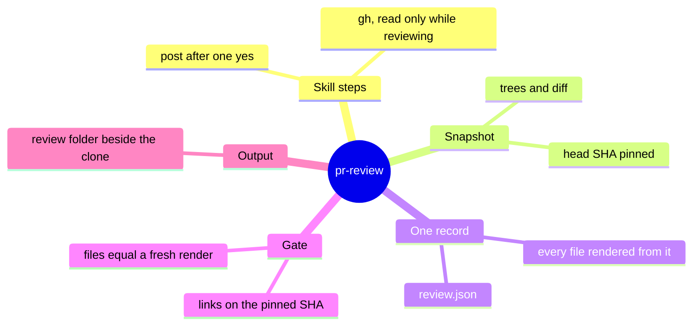
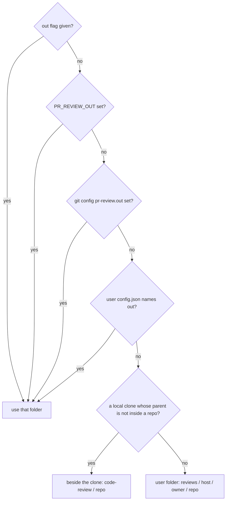
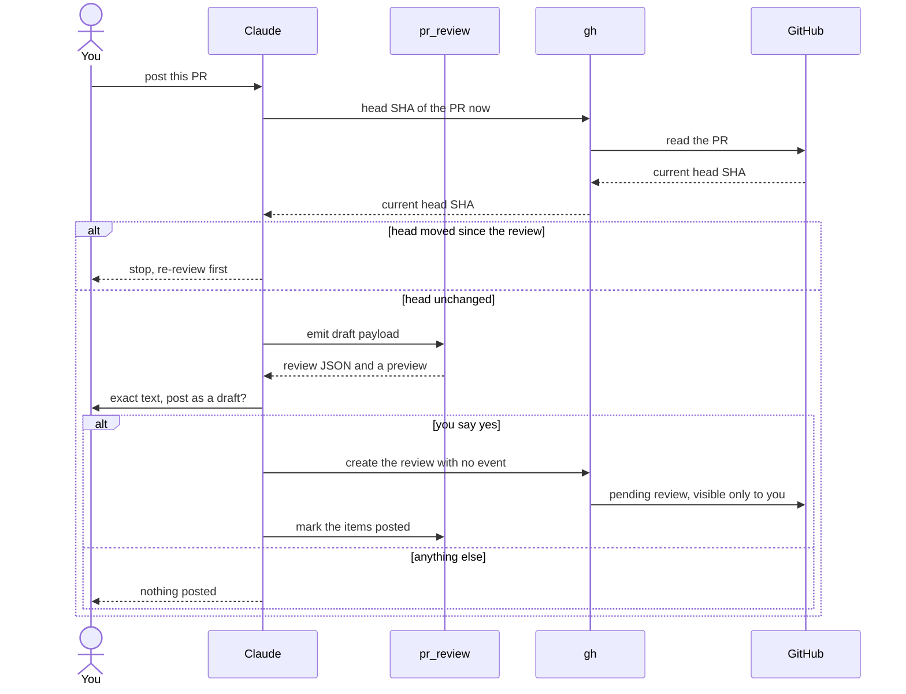

# How the pr-review skill works

> **What:** Turns a pull request link into review comments you read and adjust, then posts them to GitHub as a draft only after you say yes.
>
> **How:** A snapshot pins the reviewed commit, agents write findings into one record, every file is rendered from it, a gate checks it, and posting re-checks the commit first.
>
> **Watch out:** The rule that nothing posts without your yes lives in the skill's steps, not in code; the draft default is what limits a mistake.

Part of the 100x plugin overview (explain/100x-plugin). Think of a building inspector with a camera. First the inspector photographs the site exactly as it stands (the snapshot, pinned to one commit), so every note says "this beam, in this photo" and a later change to the site cannot make a note point at the wrong beam. The notes go into one logbook (review.json), and every report anyone reads is printed from it. A clerk (the gate) checks the paperwork before anything goes out. Nothing is mailed to the builder until you have read the exact letter and said yes, and even then it goes as a draft only you can see. Only one door in the building opens onto GitHub, and it is the skill's own written steps, not the tools.

| | |
|---|---|
| subject | concept · repo `gauravprwl14/100x-engineer` |
| tier | heavy |
| generated | `100x flow build` from `scenario.json`; regenerate it, do not edit |

## Contents

| section | answers |
|---|---|
| [Before you watch](#before-you-watch) | what the change does for a user, what it covers and where it starts |
| [Terms](#terms) | the words a reader outside the module needs |
| [Diagrams](#diagrams) | the flow at a glance, as diagrams |
| [Workflow outline](#workflow-outline) | the code path as pseudocode, each line linked to its step |
| [Map](#map) | which boxes the scenarios use, their role and where they live in the code |
| [From a PR link to a draft review on GitHub](#from-a-pr-link-to-a-draft-review-on-github) | happy scenario `happy`: each step, what it changes and its evidence |
| [The author pushed after the review: post stops](#the-author-pushed-after-the-review-post-stops) | failure scenario `head-moved`: each step, what it changes and its evidence |
| [What if the tools called gh themselves?](#what-if-the-tools-called-gh-themselves) | issue scenario `issue-gh-in-tools`: each step, what it changes and its evidence |
| [Fix: the tools only read and render; gh runs only from the skill's steps](#fix-the-tools-only-read-and-render-gh-runs-only-from-the-skills-steps) | fix scenario `fix-confined`: each step, what it changes and its evidence |
| [No code stops an agent that ignores the skill from posting](#no-code-stops-an-agent-that-ignores-the-skill-from-posting) | issue scenario `issue-gap`: each step, what it changes and its evidence |
| [Decision](#decision) | which option was chosen, against what, and when to revisit it |
| [Numbers](#numbers) | every number on the page and what backs it |
| [Code reference](#code-reference) | every function and class in the files behind the page: lines, purpose, who uses it |

## Before you watch

**Give Claude a pull request link and get review comments you can read, change and then post to GitHub as a draft only you see, each pointing at the exact commit that was reviewed, with nothing sent until you say yes.**

Why now: This is the one part of the plugin allowed to write to GitHub, so where that door is, and what guards it, is worth seeing step by step.

In this PR:

- The three commands, in order: review, adjust, post
- Where the output lands, and why never inside the reviewed repo
- How the snapshot pins the head commit, and how the gate holds links to it
- One record per PR, and every readable file rendered from it
- The post flow: the commit check, the exact payload, one explicit yes, a draft
- Why gh runs only from the skill's steps (the decision record on gh in decisions/)
- The snapshot, review and gate functions in the Code reference

Not in this PR:

- How reviewers judge the code (diff-review and stack-reviewer)
- The adjust command's edit rules in detail
- Checking that a suggested change applies (pr_suggest)
- Filling the review folder's CONTEXT.md

| entry point | kind | animated in | note | evidence |
|---|---|---|---|---|
| /pr-review <pr-url> | command | `happy` (From a PR link to a draft review on GitHub) |  | `skills/pr-review/SKILL.md:80` |
| /pr-review post <pr-url> [draft\|submit] | command | `happy` (From a PR link to a draft review on GitHub) |  | `skills/pr-review/references/adjust-and-post.md:45` |
| /pr-review adjust <pr-url> | command | not animated | edits only the user blocks in review.json, then renders and gates again; not animated | `skills/pr-review/SKILL.md:120` |
| /pr-review init | command | not animated | scaffolds the review folder without reviewing a PR; the review command runs it first | `skills/pr-review/SKILL.md:35` |
| pr_review_gate <run-root> --snap <snap> | command | not animated | the check run before reporting and again before posting | `scripts/pr_review_gate.py:499` |

## Terms

| term | means | example |
|---|---|---|
| `head SHA` | The exact commit at the tip of the PR when it was reviewed, 40 hex characters long. Every link and line claim points at it, so a later push cannot shift them. |  |
| `snapshot` | Copies of the PR's files at the head, at the merge-base and on the default branch, plus the diff, exported from git into a scratch folder. | <snap>/<n>/, <snap>/base-<n>/, <snap>/<n>.diff, PINS.md |
| `item` | One point in review.json: what is wrong, where, how sure the reviewer is, what to change and who should answer. |  |
| `render` | Writing a file a person reads (README, comments to post, questions, the GitHub payload) from review.json by code, never by hand. |  |
| `gate` | The checker for a review folder: shape, links, evidence labels and rendered files. It must pass before the review is reported and again before posting. |  |
| `review folder` | Where every review of one repo lives: by default beside your clone, never inside it. Called CR in the skill. | <parent of the clone>/code-review/<repo>/ |
| `run root` | One review run's folder inside the review folder; a re-review of the same PR gets a new dated one. |  |
| `reviewer agent` | A separate Claude agent that reviews the PR from one angle (security, design, missed scenarios) and returns its findings for merging. |  |
| `gh` | GitHub's own command-line tool. It keeps your login per host, so GitHub Enterprise works the same as github.com. |  |
| `SHA guard` | Before posting, the PR's current head commit is compared with the reviewed one; any difference stops the post. |  |
| `explicit yes` | The only answer that posts. Anything else, a question back or silence included, posts nothing. |  |
| `draft review` | A GitHub review sent without an event: it stays pending, visible only to you, until you submit it on the PR. |  |

## Diagrams

### What the pr-review skill is made of



Read outward from the centre: the skill's steps are the only part that talks to GitHub; the tools pin, record, render and check.

Evidence: `decisions/ADR-0002-gh-cli-for-pr-review-confined-to-skill-steps.md:102`, `scripts/pr_snapshot.py:116`, `scripts/pr_review.py:37`, `scripts/pr_review_gate.py:177`, `scripts/pr_review_gate.py:310`, `skills/pr-review/SKILL.md:35`

### Where the review folder lands, first match wins



Every branch ends outside the reviewed repo: the fallback is the user's own folder, so a review is never written into someone else's working tree.

Evidence: `scripts/pr_review.py:792`, `scripts/pr_review.py:812`, `scripts/pr_review.py:814`, `skills/pr-review/SKILL.md:35`

### Posting, call by call



Two stops guard the one write: a moved head ends it before the payload is built, and anything short of a yes ends it before gh is called.

Animated in `happy`. Evidence: `skills/pr-review/references/adjust-and-post.md:42`, `skills/pr-review/references/adjust-and-post.md:43`, `skills/pr-review/references/adjust-and-post.md:45`, `skills/pr-review/references/adjust-and-post.md:46`, `scripts/pr_review.py:488`, `skills/pr-review/references/adjust-and-post.md:47`

## Workflow outline

`snapshot(a) in pr_snapshot, as pseudocode`, animated in `happy`:

```
remote = pick_remote(repo, --remote, --url)  # step 4
git fetch --quiet remote                     # the only call that changes the clone  # step 4
export(remote/default) -> <dest>/<default>/  # step 4
for n in prs:  # step 4
  git fetch remote pull/<n>/head; sha = FETCH_HEAD  # step 4
  mb = merge-base(base, sha)
  export(sha) -> <dest>/<n>/; export(mb) -> <dest>/base-<n>/
  write <dest>/<n>.diff = diff base...sha
write PINS.md: base, head SHA, merge-base, commits, files, behind  # step 4
```

`/pr-review post <pr-url>: the steps, as pseudocode`, animated in `happy`:

```
pr_review_gate(run_root, snap) must pass  # step 10
if gh head SHA != review.json pr.head_sha: stop, re-review  # step 10
payload = pr_review emit <pr-dir> draft      # no event -> pending  # step 11
show every inline comment and the general ones; ask once  # step 11
if answer is not an explicit yes: post nothing  # step 11
gh api --hostname HOST -X POST .../pulls/<n>/reviews --input payload  # step 12
pr_review mark-posted <pr-dir> <html_url> draft; render; gate  # step 12
```

## Map

| node | role | code |
|---|---|---|
| You | client |  |
| Claude with the pr-review skill | service | `skills/pr-review/SKILL.md` |
| gh, run only from the skill's steps | edge |  |
| GitHub (the PR and its draft review) | external |  |
| Your local clone (fetched into, never checked out) | store |  |
| pr_snapshot (pins the head SHA) | service | `scripts/pr_snapshot.py:101` |
| Reviewer agents to start | queue |  |
| Reviewer agents (in the background) | worker |  |
| review.json (one record per PR) | store |  |
| pr_review (render, find, emit, mark posted) | service | `scripts/pr_review.py:1010` |
| pr_review_gate (the review's checks) | service | `scripts/pr_review_gate.py:482` |
| Review folder, beside the clone | store |  |

## From a PR link to a draft review on GitHub

`happy` · happy


| # | what happens | state after | evidence |
|---|---|---|---|
| 1 | **You give Claude a pull request link** Any github.com or GitHub Enterprise PR URL; host, owner and repo are read from it, never typed. | no change | `skills/pr-review/SKILL.md:80` |
| 2 | **Claude works out the review folder, outside the reviewed repo** First match wins: a flag, an environment variable, git config, your config file, else beside the clone. The answer says which rule chose it. | no change | `scripts/pr_review.py:792`, `scripts/pr_review.py:814`, `skills/pr-review/SKILL.md:35` |
| 3 | **Claude reads the PR's details through gh, read only** While reviewing, gh only reads: the PR, its checks, linked issues and existing comments. | no change | `skills/pr-review/references/workflow.md:14`, `skills/pr-review/SKILL.md:91` |
| 4 | **pr_snapshot pins the head SHA and exports the trees** It fetches the PR's head from the remote, records its exact commit, and exports the head, the merge-base and the default branch, plus the diff. The clone is fetched into, never checked out. | cr[pins] = `"head SHA pinned"` | `scripts/pr_snapshot.py:115`, `scripts/pr_snapshot.py:116`, `scripts/pr_snapshot.py:133`, `scripts/pr_snapshot.py:6`, absent: a git checkout or push in the snapshot tool (`git grep` finds 0 in `scripts/pr_snapshot.py`) |
| 5 | **Claude starts every reviewer agent in one message** Up to 10 agents, all in the background, each reading the snapshot rather than the moving branch. | agents: 3/3 busy | `skills/pr-review/references/workflow.md:20`, `skills/pr-review/references/workflow.md:15` |
| 6 | **The agents finish and their findings merge into review.json** Each point becomes one item. A lens with more than 5 new items per lens is refused, with nothing written. | record[items] = `"merged"`; agents: 0/3 busy | `scripts/pr_review.py:538`, `scripts/pr_review.py:552`, `scripts/pr_review.py:553`, `skills/pr-review/SKILL.md:97` |
| 7 | **pr_review renders every file a person reads from review.json** README, the comments to post, the questions and the GitHub payload all come from the one record, so they cannot disagree. | cr[files] = `"rendered"`; holds items = `"merged"` | `scripts/pr_review.py:495`, `scripts/pr_review.py:37` |
| 8 | **The gate checks links, the snapshot and the rendered files** Every link must sit on this repo at the pinned commit, every cited line must exist in the snapshot, and every rendered file must equal a fresh render. | no change | `scripts/pr_review_gate.py:177`, `scripts/pr_review_gate.py:255`, `scripts/pr_review_gate.py:310`, `scripts/pr_review_gate.py:499`, `skills/pr-review/references/workflow.md:25` |
| 9 | **Claude reports and stops: a review run never posts** It ends with the loop: read the README and the comments, adjust anything, then post. | no change | `skills/pr-review/SKILL.md:117`, `skills/pr-review/references/workflow.md:26` |
| 10 | **Later you say post; the head SHA must not have moved** Claude runs the gate again, then asks gh for the PR's current head and compares it with the reviewed one. | no change | `skills/pr-review/references/adjust-and-post.md:41`, `skills/pr-review/references/adjust-and-post.md:42` |
| 11 | **Claude shows the exact payload and asks once** The payload has no event, so GitHub keeps it pending. A summary over 3,000 characters gets a warning. Anything but an explicit yes posts nothing. | no change | `scripts/pr_review.py:606`, `scripts/pr_review.py:488`, `scripts/pr_review.py:612`, `skills/pr-review/references/adjust-and-post.md:45` |
| 12 | **gh creates the draft review and the record marks each item posted** The draft is visible only to you until you submit it on GitHub; posted items are never sent again. | record[posted] = `"draft"` | `skills/pr-review/references/adjust-and-post.md:46`, `skills/pr-review/references/adjust-and-post.md:47`, `scripts/pr_review.py:587`, `skills/pr-review/SKILL.md:189`, `decisions/ADR-0002-gh-cli-for-pr-review-confined-to-skill-steps.md:104` |

Step 4:

```
git fetch remote pull/<n>/head
sha = FETCH_HEAD
write PINS.md
```

Step 10:

```
pr_review_gate(run_root, snap) must pass
if gh head SHA != pr.head_sha: stop
```

## The author pushed after the review: post stops

`head-moved` · failure


Steps 1–9 are the same as `happy`; this table starts where it diverges.

| # | what happens | state after | evidence |
|---|---|---|---|
| 10 | **You say post, but the PR's head is a newer commit than the reviewed one** | no change | `skills/pr-review/references/adjust-and-post.md:42` |
| 11 | **Claude stops; no payload is built and nothing is posted** A comment pinned to the old commit could point at lines that have since changed. | no change | `skills/pr-review/references/adjust-and-post.md:42`, `skills/pr-review/SKILL.md:123` |
| 12 | **A re-review gets a new dated run, carrying your edits forward** Your skips and rewordings, and anything already posted, are copied into the new record unchanged. | no change | `skills/pr-review/references/workflow.md:13`, `scripts/pr_review.py:675`, `skills/pr-review/SKILL.md:120` |

## What if the tools called gh themselves?

`issue-gh-in-tools` · issue · origin: what-if · severity high

> What-if: this is not in the code. It shows why the real design is the way it is.

Fixed by: `fix-confined`.

| # | what happens | state after | evidence |
|---|---|---|---|
| 1 | **The agents' findings are merged and ready to render** | record[items] = `"merged"` | `scripts/pr_review.py:553` |
| 2 | **The render tool calls gh and posts as soon as the files are written** | no change | *inferred* |
| 3 | **The author sees comments you never read** | no change | *inferred* |
| 4 | **Every test of the tools now needs a fake gh and a login per host** | a network write inside the tools, and a gh mock in every test | `decisions/ADR-0002-gh-cli-for-pr-review-confined-to-skill-steps.md:60` |

## Fix: the tools only read and render; gh runs only from the skill's steps

`fix-confined` · fix


Steps 1–1 are the same as `issue-gh-in-tools`; this table starts where it diverges.

| # | what happens | state after | evidence |
|---|---|---|---|
| 2 | **pr_review only renders: no gh call and no HTTP code in any pr-review script** | cr[files] = `"rendered"` | `scripts/pr_review.py:6`, absent: a gh call in any pr-review script (`git grep` finds 0 in `scripts/pr_*.py`), absent: an HTTP library (urllib, http.client, requests) in any pr-review script (`git grep` finds 0 in `scripts/pr_*.py`) |
| 3 | **gh is a dependency of the skill's steps only, and writes in exactly one place** That place is post, after you have seen the exact payload and said yes. | gh: read-only while reviewing; one write, in post | `decisions/ADR-0002-gh-cli-for-pr-review-confined-to-skill-steps.md:102`, `decisions/ADR-0002-gh-cli-for-pr-review-confined-to-skill-steps.md:104` |
| 4 | **The review run ends with you reading it** | no change | `skills/pr-review/SKILL.md:117`, `skills/pr-review/references/adjust-and-post.md:45` |

## No code stops an agent that ignores the skill from posting

`issue-gap` · issue · origin: in-code · severity medium

Open: no fix is shown yet.

| # | what happens | state after | evidence |
|---|---|---|---|
| 1 | **An agent that skips the skill's rules runs the post command itself** | no change | `decisions/ADR-0002-gh-cli-for-pr-review-confined-to-skill-steps.md:119` |
| 2 | **Nothing intercepts it: the boundary is a written rule, not code** The safety audit scans the tools, not the skill's steps, and the command guard does not watch review posts. | no hook or audit sees gh posting a review | `decisions/ADR-0002-gh-cli-for-pr-review-confined-to-skill-steps.md:111` |
| 3 | **The draft default limits the damage: only you see it until you submit** | no change | `decisions/ADR-0002-gh-cli-for-pr-review-confined-to-skill-steps.md:119`, `skills/pr-review/SKILL.md:123`, `skills/pr-review/SKILL.md:189` |

## Decision

| option | solves it | pros | cons |
|---|---|---|---|
| gh, called only from the skill's written steps **(chosen)** | pass | The tools stay standard-library Python and git, testable offline<br>gh already owns the login per host, so GitHub Enterprise needs no token handling | The skill does not work without gh and a login per host<br>No code can check that post waited for a yes |
| Call the GitHub API from the tools with the standard library | pass | No gh needed | Re-implements tokens and Enterprise API addresses<br>Puts a network-writing path inside the tools the safety audit promises never send anything |
| Run gh from inside the tools | pass | One place for every GitHub call | A hidden runtime dependency in tools that must run anywhere<br>Every test needs a fake gh |
| Never post; you paste comments by hand | fail | Nothing can ever post by mistake | Drops the draft review and the lost-summary recovery the workflow exists for |

**Deciding factor:** The tools promise to use only the standard library and git and to send nothing, so the one GitHub write had to be admitted deliberately in the skill, where you see it, not leak into the tools.
**Revisit when:** A tool needs GitHub data a skill step cannot pass it as a file or argument, or a request to post automatically is accepted.
**Source:** decisions/ADR-0002-gh-cli-for-pr-review-confined-to-skill-steps.md

## Numbers

| name | value | tag | backed by |
|---|---|---|---|
| `sha_len` | 40 hex characters | verified | `scripts/pr_review_gate.py:41` |
| `max_agents` | 10 agents | verified | `skills/pr-review/references/workflow.md:20` |
| `lens_cap` | 5 new items per lens | verified | `scripts/pr_review.py:109` |
| `body_max` | 3,000 characters | verified | `scripts/pr_review.py:604` |

## Code reference

Read from the code by `100x code_ref`: names, lines and docstrings are the code's own; a note is the page author's one-line summary.

### `scripts/pr_snapshot.py`

Pin and export the trees a PR review reads: head, merge-base, diff, default branch.

| symbol | lines | what it does | used by | branches |
|---|---|---|---|---|
| `GitError` | 28–29 | The one error the tool raises: a named git failure, printed and turned into exit code one. | `default_branch`, `export`, `git`, `git_ok`, `main`, `pick_remote`, `snapshot` | 0 |
| `git` | 32–36 | Runs one git command in the clone and returns its output, raising a named error on failure. | `export`, `git_ok`, `snapshot` | 2 |
| `git_ok` | 39–43 | The same git call, returning nothing instead of raising when it fails. | `default_branch`, `pick_remote`, `snapshot` | 2 |
| `norm_url` | 46–53 | Comparable form of a remote or PR URL: host/owner/repo, lower case. | `pick_remote` | 0 |
| `pick_remote` | 56–70 | Chooses the remote: the one named, else the one whose URL matches the PR, else the only one, else upstream, else origin. | `snapshot` | 11 |
| `default_branch` | 73–81 | Finds the remote's default branch from its HEAD ref, then from the server, then main or master; otherwise fails and asks for a base. | `snapshot` | 5 |
| `export` | 84–98 | git archive <rev> into dest, refusing members that would escape it. | `snapshot` | 9 |
| `snapshot` | 101–134 | Fetches, then for each PR records the head commit and merge-base, exports the head, base and default trees and the diff, and writes PINS.md. | `main` | 6 |
| `main` | 137–152 | Parses the flags, runs the snapshot, prints PINS.md, and exits with failure on a git error. | — | 2 |

### `scripts/pr_review.py`

Render, find and index read-only PR reviews (the /pr-review skill's engine).

| symbol | lines | what it does | used by | branches |
|---|---|---|---|---|
| `resolve_cr` | 792–814 | (CR, rule) — see the module docstring for the order. | `cmd_init`, `cmd_out_dir` | 14 |
| `find` | 655–668 | Prints every earlier review of a PR in the review folder, newest first; exits with failure when there is none. | `main` | 10 |
| `next_run` | 675–682 | Prints the next dated run folder for a re-review, adding a counter when one already exists today. | `main` | 1 |
| `merge` | 538–554 | Adds reviewer fragments' items to review.json, skipping duplicates of another item and refusing a lens over its cap. | `main` | 10 |
| `section_of` | 147–153 | A line comment · B general PR comment · C ask someone else · D reply in an existing thread. | `github_review`, `mark_posted`, `numbered`, `post_state`, `posting_ids`, `preview`, `quick_index`, `render_comments`, `render_index`, `render_readme`, `where_text` | 5 |
| `numbered` | 155–167 | [(number, [items])] in posting order: section A → B → C → D (see section_of), then blocks merge → rollout → none, | `github_review`, `number_of`, `posting_ids`, `preview`, `render_comments`, `render_feature`, `render_index`, `render_readme` | 7 |
| `render_pr` | 493–496 | Renders README, comments to post, questions and the GitHub payload from one review record. | `write_pr` | 0 |
| `write_pr` | 498–505 | Writes those rendered files into the PR folder and refreshes the rendered regions of the findings file. | `render_target` | 2 |
| `github_review` | 467–489 | Builds the GitHub review payload: inline comments on diff lines, general ones in the body, pinned to the head commit; an event only when asked. | `emit`, `mark_posted`, `render_pr` | 15 |
| `posting_ids` | 556–559 | IDs that the next `post` would send: sections A + B (+ praise), not skipped, not yet posted. | `emit`, `mark_posted`, `preview` | 5 |
| `preview` | 561–572 | Prints what post would send, item by item, and what is skipped or left for you to send by hand. | `main` | 10 |
| `emit` | 606–616 | Prints the payload for a draft or a submit, a preview on stderr, and a warning when the summary is long; exits early when nothing is new. | `main` | 7 |
| `mark_posted` | 577–592 | Records a successful post on each sent item and in the run's post list, keeping the summary in case a draft loses it. | `main` | 7 |
| `followup_text` | 594–602 | The general comments of an earlier post, as one PR comment — for a draft whose summary was lost on submit. | `main` | 4 |

### `scripts/pr_review_gate.py`

Gate for a pr-review folder: every review rule plus GitHub-safe mermaid. Exit 0 only when both pass.

| symbol | lines | what it does | used by | branches |
|---|---|---|---|---|
| `check_schema` | 63–118 | Checks the record's shape: summary, run, item ids, kinds, severities, statuses, and the user and posted blocks. | `check_pr` | 55 |
| `check_items` | 122–199 | Checks each item reads plainly, holds a real value, links only to this repo at the pinned commit, and that existing PR comments were read first. | `check_pr` | 94 |
| `check_pr_meta` | 229–233 | The PR URL must be a real pull URL whose number matches, and the head must be a full commit hash. | `check_pr` | 3 |
| `check_snapshot` | 245–279 | Against the snapshot: each cited file and line exists at the head, the in-diff flag is right, a suggestion sits on a diff line and changes something, a diff removes only real lines. | `check_pr` | 33 |
| `check_rendered` | 305–322 | Every rendered file must equal a fresh render of review.json; a hand edit fails. | `check_pr` | 12 |
| `check_readme` | 324–341 | The README's who-reviewed table is complete and its action table lists exactly the open, not-skipped items. | `check_pr` | 12 |
| `check_pr` | 368–381 | Runs every rule on one PR folder, stopping after the shape check if the shape is wrong. | `check_root`, `main` | 7 |
| `check_root` | 383–391 | Checks a run root: its pins file, each PR folder, and that the feature README equals a fresh render. | `main` | 7 |
| `main` | 482–499 | Picks a PR folder or a run root, runs the rules and the mermaid check, and passes only when both pass. | — | 13 |
