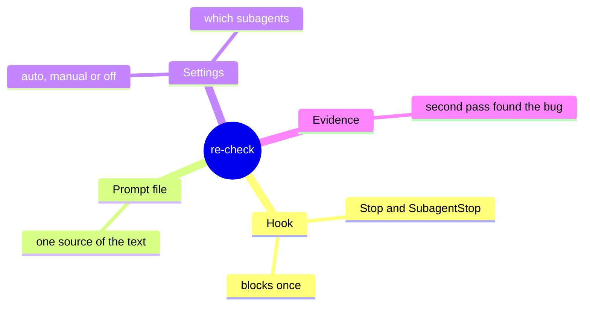
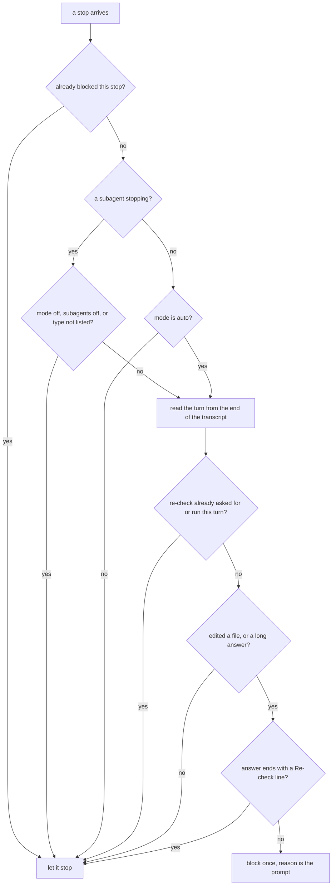
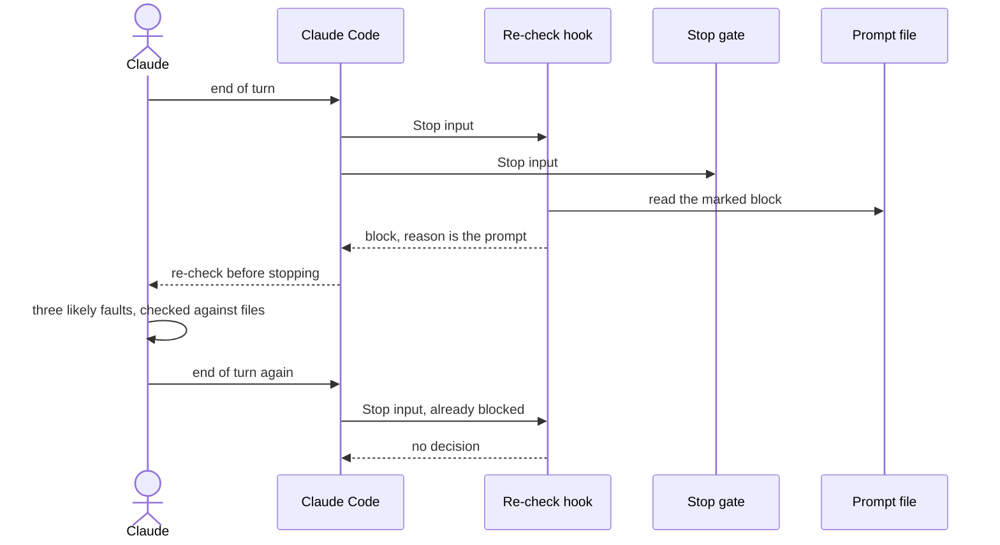

# How the re-check pass works

> **What:** After a turn that edited files or gave a long answer, Claude is made to look again once, assuming it made a mistake, before the turn ends.
>
> **How:** A Stop hook reads the end of the transcript, decides whether the turn was substantive and not yet re-checked, and blocks once with the prompt file's text as the reason.
>
> **Watch out:** It is the same model checking itself, so it only helps when it actually opens the files; and manual mode still re-checks the engineer subagents.

Part page of the 100x plugin overview (explain/100x-plugin). Think of a writer who reads the draft once more before sending it, on purpose looking for the mistake they assume is there. When Claude finishes a turn that changed files or gave a long answer, a Stop hook holds the turn once and hands Claude a short prompt: assume this answer still has a mistake, name the three likeliest, check each against the files, fix or cut, then answer with one Re-check line. In blind runs that one extra pass is what caught a silent money bug no first answer caught. The hook never holds the same stop twice, and on any error it gets out of the way.

| | |
|---|---|
| subject | concept · repo `gauravprwl14/100x-engineer` |
| tier | heavy |
| generated | `100x flow build` from `scenario.json`; regenerate it, do not edit |

## Contents

| section | answers |
|---|---|
| [Before you watch](#before-you-watch) | what the change does for a user, what it covers and where it starts |
| [Terms](#terms) | the words a reader outside the module needs |
| [Diagrams](#diagrams) | the flow at a glance, as diagrams |
| [Workflow outline](#workflow-outline) | the code path as pseudocode, each line linked to its step |
| [Map](#map) | which boxes the scenarios use, their role and where they live in the code |
| [An edit turn is held once for a second look](#an-edit-turn-is-held-once-for-a-second-look) | happy scenario `happy`: each step, what it changes and its evidence |
| [Which stops get a re-check, and which pass quietly](#which-stops-get-a-re-check-and-which-pass-quietly) | edge scenario `which`: each step, what it changes and its evidence |
| [Manual mode still re-checks the engineer subagents](#manual-mode-still-re-checks-the-engineer-subagents) | issue scenario `subagent`: each step, what it changes and its evidence |
| [What if the hook blocked every stop?](#what-if-the-hook-blocked-every-stop) | issue scenario `loop`: each step, what it changes and its evidence |
| [Fix: block once per stop, and treat a Re-check line as done](#fix-block-once-per-stop-and-treat-a-re-check-line-as-done) | fix scenario `fix-once`: each step, what it changes and its evidence |
| [Decision](#decision) | which option was chosen, against what, and when to revisit it |
| [Numbers](#numbers) | every number on the page and what backs it |
| [Code reference](#code-reference) | every function and class in the files behind the page: lines, purpose, who uses it |

## Before you watch

**When Claude has just edited code or written a long answer, you get a second, skeptical look at it without having to ask for one, and short questions stay fast.**

Why now: Blind A/B runs found that the second pass, not its wording, is what turns a confident wrong answer into a right one; making it automatic means nobody has to remember it.

In this PR:

- The hook on Stop and SubagentStop: what makes a turn substantive, and how it reads the turn
- Modes auto, manual and off, the minimum answer length, and which subagents are covered
- Why it never loops, and why it fails open
- The prompt, kept in one file, and what Claude must do with it
- The measurements behind it, and every function in the hook, in the Code reference

Not in this PR:

- Proving work is done before commit or push (the verification gate, explain/verification-gate)
- Reviewing a PR or someone else's diff (the diff-review skill)
- Comparing prompt wordings (the prompt-bench skill)

| entry point | kind | animated in | note | evidence |
|---|---|---|---|---|
| Stop hook: recheck_gate.py | event | `happy` (An edit turn is held once for a second look) |  | `hooks/hooks.json:131` |
| SubagentStop hook: recheck_gate.py | event | `subagent` (Manual mode still re-checks the engineer subagents) |  | `hooks/hooks.json:115` |
| /100x:recheck typed by you | command | not animated | the same prompt applied by hand; the hook then skips that turn | `hooks/recheck_gate.py:43` |

## Terms

| term | means | example |
|---|---|---|
| `re-check` | A second, skeptical pass over the answer Claude just gave: assume a mistake, name the likeliest ones, check each against the files, fix what is real, cut what is not needed. |  |
| `Stop hook` | A script Claude Code runs when the main session tries to end its turn. It may block the stop once, with a reason Claude must act on. |  |
| `SubagentStop` | The same moment for a subagent, a helper agent working on one task, when it finishes. |  |
| `substantive turn` | A turn that edited a file, with an edit tool or a shell command that writes one, or that ended in an answer at least 1,500 characters long. |  |
| `mode` | auto, the default, holds substantive turns; manual leaves the main session alone; off turns it off everywhere, subagents included. | HUNDREDX_RECHECK=manual |
| `subagents setting` | Which subagent types are re-checked: off, all, or a list. Unset, it is the backend, frontend and mobile engineer agents. | HUNDREDX_RECHECK_SUBAGENTS=all |
| `stop_hook_active` | A flag Claude Code sets when a stop hook already blocked this stop. Seeing it, the hook lets the stop through, so it can never loop. |  |
| `Re-check line` | The one line that ends a re-checked answer. The hook reads it as proof the pass already ran. | Re-check: fixed the comma case in the parser |
| `prompt file` | The only copy of the prompt text, between two marker comments. The hook and the manual command both use it unchanged. | skills/recheck/references/recheck-prompt.md |
| `transcript` | The session's log file, one JSON entry per message. The hook reads only its end. |  |
| `sidechain` | Entries in the main transcript that belong to a subagent; the main session's turn leaves them out. |  |
| `fail open` | On any error, make no decision rather than block. A Stop hook that crashed into a block would stop every session from ending. |  |

## Diagrams

### What the re-check pass is made of



Read outward from the centre: the hook decides when, the prompt file says what, the settings say for whom, and the evidence is why.

Evidence: `hooks/recheck_gate.py:251`, `hooks/recheck_gate.py:222`, `skills/recheck/references/recheck-prompt.md:4`, `hooks/recheck_gate.py:22`, `hooks/recheck_gate.py:28`, `skills/recheck/references/evidence.md:5`

### When the hook holds a stop



Every exit but one lets the stop through. Note the subagent branch: manual mode does not appear on it, only off does.

Animated in `which`. Evidence: `hooks/recheck_gate.py:222`, `hooks/recheck_gate.py:226`, `hooks/recheck_gate.py:214`, `hooks/recheck_gate.py:232`, `hooks/recheck_gate.py:139`, `hooks/recheck_gate.py:238`, `hooks/recheck_gate.py:248`, `hooks/recheck_gate.py:251`

### One held stop, call by call



Both Stop hooks run side by side; when both block, their reasons arrive together, and on the next stop neither blocks again.

Animated in `happy`. Evidence: `hooks/hooks.json:131`, `skills/recheck/SKILL.md:38`, `hooks/recheck_gate.py:91`, `hooks/recheck_gate.py:251`, `hooks/recheck_gate.py:222`

## Workflow outline

`main(payload): the re-check hook, as pseudocode`, animated in `happy`:

```
if stop_hook_active: return {}             # never block one stop twice  # step 3, 10
mode, min_chars, subagents = config()      # env beats ~/.config/100x/recheck.json  # step 3
if SubagentStop: skip if mode or subagents is off, or type not listed
else: skip unless mode == auto  # step 3
turn, asked = current_turn(transcript tail)  # step 4
if asked or the recheck skill ran: return {}  # step 6
final = last_assistant_message or the turn's last text
if not (edited or len(final) >= min_chars): return {}  # step 5
if a "Re-check:" line is in final: return {}  # step 6
return block(reason = prompt file's marked block)  # step 7
```

`scan(turn): did this turn edit anything?`, animated in `which`:

```
for each tool call Claude made in the turn:
  if it is the recheck skill: already ran  # step 3
  edited |= tool in {Write, Edit, MultiEdit, NotebookEdit}
  edited |= Bash matching sed -i, tee, git commit, > path  # step 2
  final = only the text after the last tool call
```

## Map

| node | role | code |
|---|---|---|
| You | client |  |
| Claude (main session) | service | `skills/recheck/SKILL.md` |
| Engineer subagent | service |  |
| Other subagent (code-reviewer) | service |  |
| Claude Code (runs the stop hooks) | edge | `hooks/hooks.json:121` |
| Re-check hook (recheck_gate.py) | edge | `hooks/recheck_gate.py:217` |
| Stop gate (stop_gate.py) (outside the diff) | edge | `hooks/stop_gate.py` |
| Mode settings (env var or recheck.json) | store | `hooks/recheck_gate.py:61` |
| Session transcript (read from the end) | store | `hooks/recheck_gate.py:99` |
| Prompt file (recheck-prompt.md) | store | `skills/recheck/references/recheck-prompt.md:13` |
| Your repo files | external |  |

## An edit turn is held once for a second look

`happy` · happy


| # | what happens | state after | evidence |
|---|---|---|---|
| 1 | **You ask for a fix; Claude edits a file and answers in one line** | transcript[edited] = `true`; transcript[answer] = `"Fixed."` | *inferred* |
| 2 | **Claude stops, and Claude Code runs both Stop hooks side by side** The verification gate's Stop hook and this one run in parallel; if both block, both reasons arrive together. | no change | `hooks/hooks.json:131`, `skills/recheck/SKILL.md:38` |
| 3 | **The hook checks this stop was not already blocked, and reads the mode** The environment variable wins over the settings file; with neither, the mode is auto. | holds mode = `"auto"` | `hooks/recheck_gate.py:222`, `hooks/recheck_gate.py:74`, `hooks/recheck_gate.py:23` |
| 4 | **It reads this turn from the end of the transcript** Only the last 2 MiB of the file is read. The turn is everything after your last real message; tool results and loaded skill text do not count as messages. | holds edited = `true` | `hooks/recheck_gate.py:32`, `hooks/recheck_gate.py:139`, `hooks/recheck_gate.py:10` |
| 5 | **The turn edited a file, so it counts as substantive** An edit alone is enough, however short the answer; without one, the answer must reach 1,500 characters. | edited: yes; answer length does not matter | `hooks/recheck_gate.py:159`, `hooks/recheck_gate.py:248`, `hooks/recheck_gate.py:24` |
| 6 | **No re-check has run yet: no command, no pasted prompt, no Re-check line** | holds final = `"Fixed."` | `hooks/recheck_gate.py:238`, `hooks/recheck_gate.py:43`, `hooks/recheck_gate.py:45` |
| 7 | **The hook blocks the stop, with the prompt file's text as the reason** The prompt lives in one file between two markers, so the hook and the manual command can never drift apart. | holds p = `"present"` | `hooks/recheck_gate.py:91`, `hooks/recheck_gate.py:251`, `skills/recheck/references/recheck-prompt.md:4`, `skills/recheck/references/recheck-prompt.md:15` |
| 8 | **Claude names the likeliest faults and checks each against the files** The prompt asks for 3 faults, each settled from a file or a command run in this pass, never from memory. | no change | `skills/recheck/references/recheck-prompt.md:18`, `skills/recheck/references/recheck-prompt.md:19`, `skills/recheck/SKILL.md:76` |
| 9 | **Claude gives the corrected answer only, then one Re-check line** No essay on what changed: graders marked that down, and the line is what tells the hook the pass already ran. | transcript[answer] = `"Fixed, both input shapes. Re-check: fixed the comma case"` | `skills/recheck/SKILL.md:85`, `skills/recheck/references/recheck-prompt.md:24`, `skills/recheck/SKILL.md:81` |
| 10 | **Claude stops again, and this time the hook lets it through** Claude Code marks this stop as already blocked, so the hook returns no decision. | no change | `hooks/recheck_gate.py:222`, `skills/recheck/SKILL.md:90` |

Step 3:

```
if stop_hook_active: return {}
mode = env or recheck.json or auto
```

Step 5:

```
if not (edited or len(final) >= min_chars): return {}
```

Step 7:

```
reason = prompt_text()
return {decision: block, reason}
```

## Which stops get a re-check, and which pass quietly

`which` · edge


| # | what happens | state after | evidence |
|---|---|---|---|
| 1 | **A short answer with no edits passes quietly** Below 1,500 characters and nothing edited: short questions cost nothing. | transcript[answer] = `"one short paragraph"` | `hooks/recheck_gate.py:248`, `hooks/recheck_gate.py:24` |
| 2 | **A shell command that writes a file counts as an edit** In-place editors, tee, git commit, a Python file write, or output redirected to a path all count. | transcript[edited] = `true` | `hooks/recheck_gate.py:36`, `hooks/recheck_gate.py:159` |
| 3 | **A turn that already ran the re-check passes** You typed the command, the prompt was pasted, the recheck skill was loaded, or the answer has a Re-check line. | no change | `hooks/recheck_gate.py:43`, `hooks/recheck_gate.py:238`, `hooks/recheck_gate.py:156`, `hooks/recheck_gate.py:45` |
| 4 | **The last message comes straight from Claude Code, since the transcript can lag** The file is written in the background and can miss the final message, so the length and Re-check line tests use the copy Claude Code passes in. | last message from the hook input wins over the transcript | `hooks/recheck_gate.py:245` |
| 5 | **In manual or off mode, the main session is never held** | settings[mode] = `"manual"`; holds mode = `"manual"` | `hooks/recheck_gate.py:232`, `skills/recheck/SKILL.md:31` |
| 6 | **Bad input or an internal error: the hook makes no decision** It starts no subprocess, and any exception prints an empty answer, so a broken hook cannot stop a session from ending. | **recheck failed** (unreadable input) | `hooks/recheck_gate.py:257`, absent: any subprocess the re-check hook starts (`git grep` finds 0 in `hooks/recheck_gate.py`) |

Step 2:

```
edited |= Bash and BASH_WRITE.search(command)
```

## Manual mode still re-checks the engineer subagents

`subagent` · issue · origin: found-in-review · severity low

Open: no fix is shown yet.

| # | what happens | state after | evidence |
|---|---|---|---|
| 1 | **You switch re-check to manual** | settings[mode] = `"manual"` | `hooks/recheck_gate.py:74` |
| 2 | **Your own turns now end without a re-check** | no change | `hooks/recheck_gate.py:232` |
| 3 | **A backend-engineer subagent finishes an edit, and its stop is held** On a subagent stop only off, for the mode or the subagents setting, skips the check; manual is not tested there. The 3 agent types engineer types are covered by default. | holds mode = `"manual"` | `hooks/recheck_gate.py:226`, `hooks/recheck_gate.py:214`, `hooks/recheck_gate.py:28` |
| 4 | **A subagent type not on the list, such as code-reviewer, is let through** | no change | `hooks/recheck_gate.py:214`, `hooks/recheck_gate.py:28` |
| 5 | **The code says this on purpose; the skill's mode table reads otherwise** The hook's own description says manual and off never block a Stop and that off also disables subagents. The skill's table says manual runs only when you type the command. One of the two should change; until then, set subagents to off as well if you want no automatic passes at all. | for no automatic passes: mode manual and subagents off | `hooks/recheck_gate.py:15`, `hooks/recheck_gate.py:18`, `skills/recheck/SKILL.md:31` |

Step 3:

```
if mode == off or subagents == off: return {}
if not allowed(subagents, agent_type): return {}
```

## What if the hook blocked every stop?

`loop` · issue · origin: what-if · severity high

> What-if: this is not in the code. It shows why the real design is the way it is.

Fixed by: `fix-once`.

Steps 1–9 are the same as `happy`; this table starts where it diverges.

| # | what happens | state after | evidence |
|---|---|---|---|
| 10 | **Claude stops again, and the hook blocks again** | extra_passes = 1 | *inferred* |
| 11 | **And again: each pass costs another minute or two** | extra_passes = 2 | *inferred* |
| 12 | **The turn can never end on its own** | **host failed** (turn cannot end) | *inferred* |

## Fix: block once per stop, and treat a Re-check line as done

`fix-once` · fix


Steps 1–9 are the same as `loop`; this table starts where it diverges.

| # | what happens | state after | evidence |
|---|---|---|---|
| 10 | **Claude stops again; Claude Code marks the stop as already blocked** One pass is what was measured to help; a third was never measured. | no change | `hooks/recheck_gate.py:222`, `skills/recheck/SKILL.md:90` |
| 11 | **The hook lets it through; the Re-check line alone would have too** | no change | `hooks/recheck_gate.py:45`, `hooks/recheck_gate.py:248` |
| 12 | **The verification gate's Stop hook follows the same once rule** On the first stop both hooks may block together; on the next, neither does. | no change | `hooks/stop_gate.py:26`, `skills/recheck/SKILL.md:38` |

## Decision

| option | solves it | pros | cons |
|---|---|---|---|
| Hold each substantive turn once, automatically **(chosen)** | pass | The pass that caught the bug happens without anyone remembering it<br>Short questions pay nothing | Each held turn takes 91 s to 118 s longer<br>The same model checks itself, so it helps only when it opens the files |
| Only when you type the command | pass | No cost unless asked | The second look happens only if someone thinks to ask, which is when it is least needed |
| Every turn, however short | fail | Nothing slips through | Pays the cost on questions where nothing in code can be wrong |
| Repeat until an answer comes back unchanged | fail | Might catch a second mistake | A third pass was never measured<br>A Stop hook that loops stops the session from ending |

**Deciding factor:** On a silent money bug, 0 of eight first answers were safe and 7 of eight after one more pass were, while the wording barely mattered, so one routine pass on turns that change things is the cheapest win.
**Revisit when:** A measured third pass beats the second, or the time a held turn costs pushes people to manual.
**Source:** skills/recheck/references/evidence.md; skills/recheck/SKILL.md (How it runs, Rules); SOURCE: original

## Numbers

| name | value | tag | backed by |
|---|---|---|---|
| `min_chars` | 1,500 characters | verified | `hooks/recheck_gate.py:24` |
| `tail_mib` | 2 MiB | verified | `hooks/recheck_gate.py:32` |
| `hook_timeout` | 10 s | verified | `hooks/hooks.json:117` |
| `faults` | 3 faults | verified | `skills/recheck/references/recheck-prompt.md:18` |
| `engineers` | 3 agent types | verified | `hooks/recheck_gate.py:28` |
| `first_safe` | 0 of eight first answers | measured | skills/recheck/references/evidence.md, Round 2, H3 table (blind A/B, answers' code run) |
| `second_safe` | 7 of eight after one more pass | measured | skills/recheck/references/evidence.md, Round 2, H3 table (blind A/B, answers' code run) |
| `followup_min` | 91 s | measured | skills/recheck/references/evidence.md, Round 2 table, follow-up time column (fastest arm) |
| `followup_max` | 118 s | measured | skills/recheck/references/evidence.md, Round 2 table, follow-up time column (slowest arm) |

## Code reference

Read from the code by `100x code_ref`: names, lines and docstrings are the code's own; a note is the page author's one-line summary.

### `hooks/recheck_gate.py`

Stop / SubagentStop hook: one skeptical second pass on a substantive turn.

| symbol | lines | what it does | used by | branches |
|---|---|---|---|---|
| `subagent_setting` | 48–58 | "off" \| "all" \| a set of agent types; None when the value is not understood. | `config` | 6 |
| `config` | 61–80 | Reads mode, min_chars and subagents from the settings file, then lets the two environment variables override them; anything unreadable falls back to the defaults. | `main` | 11 |
| `prompt_text` | 83–96 | Returns the text between the prompt file's two markers, without its code fence, from the plugin root; None when the file or a marker is missing. | `main` | 7 |
| `tail_entries` | 99–117 | Transcript entries passing keep(), newest first, from the last TAIL_BYTES of the file. | `current_turn` | 8 |
| `blocks` | 120–124 | The content blocks of a transcript entry; a plain string becomes one text block. | `current_turn`, `scan` | 4 |
| `current_turn` | 127–142 | Entries after the last real user prompt (oldest first), and whether it asked to re-check. | `main` | 9 |
| `scan` | 145–165 | (edited a file?, final assistant text, recheck skill already ran?) for the turn. | `main` | 13 |
| `is_file` | 168–169 | True when the value is a path to an existing file. | `main_transcript`, `subagent_transcript` | 1 |
| `main_transcript` | 172–175 | The main session's transcript; subagent (sidechain) entries are not its turn. | `main` | 1 |
| `subagent_transcript` | 178–206 | The stopping subagent's transcript, and its agent type when one can be found. | `main` | 13 |
| `allowed` | 209–214 | True when subagents is all, or the agent type matches a listed name exactly or without its plugin prefix. | `main` | 4 |
| `main` | 217–251 | The hook: skips an already-blocked stop, applies the mode and the subagent list, reads the turn, and blocks once with the prompt when the turn is substantive and not yet re-checked. | `subagent_transcript` | 18 |
