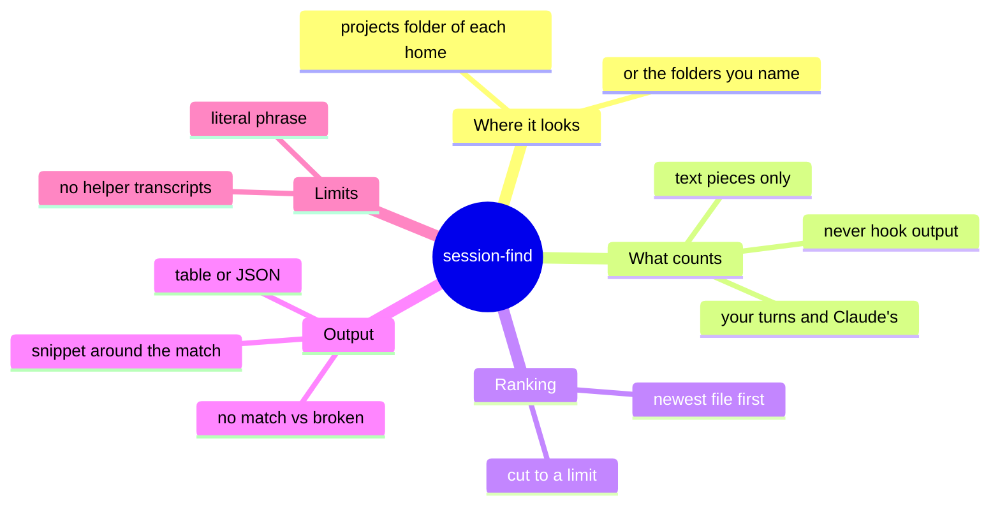
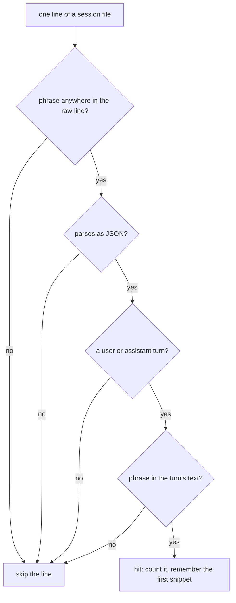
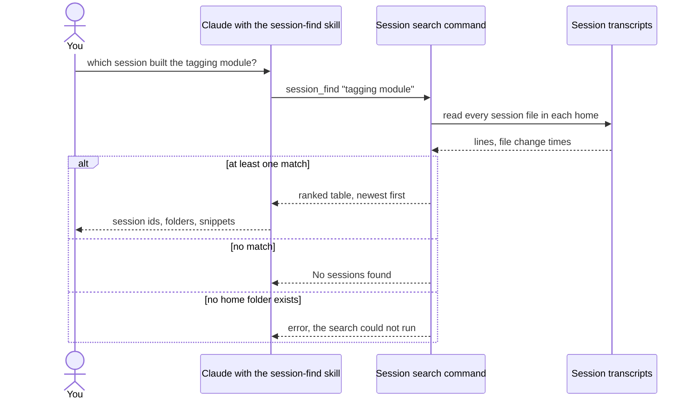

# How session-find finds a past session

> **What:** Tells you which past Claude Code session worked on a topic, so you can resume it instead of starting over.
>
> **How:** It reads every saved session transcript in both home folders, counts only what you or Claude actually said, and lists the matches newest first.
>
> **Watch out:** It is a plain text search: a phrase holding a double quote never matches, and helper agents' own transcripts are not searched.

A part page of the plugin overview (explain/100x-plugin). Think of every past Claude Code chat as a notebook on a shelf: weeks later you remember the topic, not which notebook. session-find leafs through every notebook in both of your Claude Code home folders, counts only the pages where you or Claude actually wrote the phrase, and hands back the notebooks newest first with a line of context, so you can resume the right session instead of starting over. It only reads. For facts you carry forward on purpose, see the work record page (explain/work-record).

| | |
|---|---|
| subject | concept · repo `gauravprwl14/100x-engineer` |
| tier | heavy |
| generated | `100x flow build` from `scenario.json`; regenerate it, do not edit |

## Contents

| section | answers |
|---|---|
| [Before you watch](#before-you-watch) | what the change does for a user, what it covers and where it starts |
| [Terms](#terms) | the words a reader outside the module needs |
| [Diagrams](#diagrams) | the flow at a glance, as diagrams |
| [Workflow outline](#workflow-outline) | the code path as pseudocode, each line linked to its step |
| [Map](#map) | which boxes the scenarios use, their role and where they live in the code |
| ["Which session built the tagging module?"](#which-session-built-the-tagging-module) | happy scenario `happy`: each step, what it changes and its evidence |
| [What if any line holding the phrase counted?](#what-if-any-line-holding-the-phrase-counted) | issue scenario `issue-noise`: each step, what it changes and its evidence |
| [Fix: only the text of your turns and Claude's counts](#fix-only-the-text-of-your-turns-and-claudes-counts) | fix scenario `fix-turns`: each step, what it changes and its evidence |
| [A phrase holding a double quote never matches](#a-phrase-holding-a-double-quote-never-matches) | issue scenario `issue-quote`: each step, what it changes and its evidence |
| [Work done by a helper agent is invisible](#work-done-by-a-helper-agent-is-invisible) | issue scenario `issue-helpers`: each step, what it changes and its evidence |
| [Decision](#decision) | which option was chosen, against what, and when to revisit it |
| [Numbers](#numbers) | every number on the page and what backs it |
| [Code reference](#code-reference) | every function and class in the files behind the page: lines, purpose, who uses it |

## Before you watch

**Weeks after a feature was split across several sessions and worktrees, you ask "which session built the tagging module?" and get the session ids, where each ran, when it was last active and a snippet, ready for claude --resume.**

Why now: Without it, the only way to find the right session was grepping raw transcript files by hand, where hook output and file paths drown the real mentions.

In this PR:

- The skill: when it fires and the steps Claude follows
- Where the command looks: the projects folder of each Claude Code home that exists, or the folders you name
- What counts as a hit: only your turns and Claude's, only their text
- How matches are ranked and cut to a limit
- What it prints, as a table or JSON, and how its exit codes tell no match from broken
- Two real limits: quoted phrases and helper-agent transcripts
- Every function in scripts/session_find.py, in the Code reference

Not in this PR:

- Browsing sessions by date or alias (the separate sessions skill)
- Resuming itself: that is claude --resume, which this page only points to
- The work record, which keeps a feature's facts on purpose (explain/work-record)

| entry point | kind | animated in | note | evidence |
|---|---|---|---|---|
| session-find skill ("which session built X", "find the session for PR …") | command | `happy` ("Which session built the tagging module?") |  | `skills/session-find/SKILL.md:19` |
| 100x session_find <phrase> [--limit N] [--json] [--roots a,b] [--case-sensitive] | command | `happy` ("Which session built the tagging module?") |  | `scripts/session_find.py:185` |

## Terms

| term | means | example |
|---|---|---|
| `session` | One Claude Code conversation, saved as one file named by its id; resuming it reopens that conversation. |  |
| `transcript` | The saved file of a session: one JSON record per line, for each turn and each piece of bookkeeping. | ~/.claude/projects/-work-shop/<session id>.jsonl |
| `home folder` | A Claude Code home such as ~/.claude. This user runs two, so both are searched by default. |  |
| `project folder` | The folder inside a home's projects folder that holds every session started in one working folder. |  |
| `turn` | One record of what you typed (user) or what Claude answered (assistant). Only these are searched. |  |
| `hook output` | Bookkeeping records that hooks and modes write into the transcript; they often echo tool and file names, and never count. |  |
| `prefilter` | A cheap check that the phrase appears anywhere in the raw line, done before the line is parsed. It only decides what to look at closely. |  |
| `snippet` | A short stretch of the first matching turn, around the phrase, so you can tell sessions apart. |  |
| `recency` | When the session file last changed on disk. It is the only ranking key; the hit count is shown but not used to rank. |  |
| `helper-agent transcript` | The separate file a helper agent writes, kept in a subfolder of its parent session's folder. |  |
| `resume` | Reopening a past session by its id, with claude --resume. | claude --resume <session id> |

## Diagrams

### What session-find is made of



Read outward from the centre: where it searches, what it counts, how it orders, what it prints, and the two limits worth knowing.

Evidence: `scripts/session_find.py:34`, `scripts/session_find.py:143`, `scripts/session_find.py:35`, `scripts/session_find.py:52`, `scripts/session_find.py:160`, `scripts/session_find.py:162`, `scripts/session_find.py:207`, `scripts/session_find.py:67`, `scripts/session_find.py:211`, `skills/session-find/SKILL.md:34`, `scripts/session_find.py:135`

### Does this line count as a hit?



Four gates, cheapest first. The first is only a prefilter; the last is what makes a hit real.

Animated in `fix-turns`. Evidence: `scripts/session_find.py:88`, `scripts/session_find.py:91`, `scripts/session_find.py:94`, `scripts/session_find.py:102`, `scripts/session_find.py:104`

### One search, call by call



The three ways a search ends each exit differently, so a script can tell nothing to resume from broken.

Animated in `happy`. Evidence: `skills/session-find/SKILL.md:19`, `skills/session-find/SKILL.md:32`, `scripts/session_find.py:135`, `scripts/session_find.py:115`, `scripts/session_find.py:168`, `scripts/session_find.py:150`, `scripts/session_find.py:211`, `scripts/session_find.py:204`

## Workflow outline

`run(query, roots, limit) and search_session(path): the search`, animated in `happy`:

```
roots = resolve_roots(--roots or [~/.claude/projects, ~/.cc-1/projects])  # step 3
roots = [r for r in roots if r.is_dir()]  # step 3
if not roots: error 'no session directory found'  -> exit 2
for root in roots: for file in iter_sessions(root):  # sorted folders, top-level *.jsonl  # step 4
  for line in file:  # step 5, 6, 7
    if needle not in line.lower(): continue      # prefilter  # step 5
    record = json.loads(line) except: continue
    if record.type not in {user, assistant}: continue  # step 6
    text = extract_text(record.message)          # string, or text blocks only  # step 7
    if needle not in text.lower(): continue
    hits += 1; cwd = record.cwd; snippet = snippet or make_snippet(text)  # step 5, 7
results.sort(key=file mtime, newest first)  # step 8
results = results[:limit]                     # default 20, 0 = all  # step 9
print_table(results) or print(json.dumps(results))  # step 10
exit 0 if results else 1  # step 10
```

## Map

| node | role | code |
|---|---|---|
| You | client |  |
| Claude with the session-find skill | service | `skills/session-find/SKILL.md` |
| Session search command | service | `scripts/session_find.py:147` |
| Session transcripts (both home folders) | store | `scripts/session_find.py:34` |
| Session files to scan, in name order | queue | `scripts/session_find.py:133` |
| Line scanner | worker | `scripts/session_find.py:74` |
| Matches found (hits per session) | store | `scripts/session_find.py:118` |
| claude --resume | external |  |

## "Which session built the tagging module?"

`happy` · happy


| # | what happens | state after | evidence |
|---|---|---|---|
| 1 | **You ask which session built the tagging module** That question is one of the skill's triggers. Browsing by date or alias is a different skill. | no change | `skills/session-find/SKILL.md:19`, `skills/session-find/SKILL.md:23` |
| 2 | **Claude runs the search with the shortest phrase that names it** The match is a literal piece of text, so a short phrase finds more. | no change | `skills/session-find/SKILL.md:32`, `skills/session-find/SKILL.md:34`, `scripts/session_find.py:185` |
| 3 | **The command finds which home folders exist** By default exactly the projects folder of both homes, whichever exist, never more and never fewer; a folder list you pass replaces them. | holds roots = `"both"` | `scripts/session_find.py:34`, `scripts/session_find.py:143`, `scripts/session_find.py:144`, `skills/session-find/SKILL.md:47` |
| 4 | **Every session file lines up, folder by folder, in name order** | files: 3 waiting | `scripts/session_find.py:134`, `scripts/session_find.py:135` |
| 5 | **First file: a cheap text check, then only your turns and Claude's count** A line without the phrase is skipped unread. A line with it is parsed; a broken line is skipped, not fatal. Here two of your turns name the module. | results[s-design] = `2`; files: 2 waiting | `scripts/session_find.py:88`, `scripts/session_find.py:91`, `scripts/session_find.py:92`, `scripts/session_find.py:94`, `scripts/session_find.py:102`, `scripts/session_find.py:104` |
| 6 | **Second file: the phrase is only in hook output, so the session is not listed** | files: 1 waiting | `scripts/session_find.py:94`, `scripts/session_find.py:35`, `skills/session-find/SKILL.md:40` |
| 7 | **Third file: the phrase is in Claude's own answer text** Claude's answers are lists of pieces; only plain text pieces are read, not thinking or tool calls. | results[s-backend] = `1`; files: 0 waiting | `scripts/session_find.py:100`, `scripts/session_find.py:52`, `scripts/session_find.py:43` |
| 8 | **Matches are ranked by when each file last changed, newest first** The hit count is printed but does not change the order. | s-backend changed last, so it ranks first | `scripts/session_find.py:160`, `scripts/session_find.py:115` |
| 9 | **Only the top matches are kept** The default is 20 sessions; a limit of zero keeps them all. | limit applied | `scripts/session_find.py:162`, `scripts/session_find.py:191` |
| 10 | **One line per session: id, home, folder, last active, hits, and a snippet** The snippet is the first matching turn, about 40 characters before the phrase and 80 characters after it. The folder shown is the working folder of the last matching turn. A found result ends with success, which a script can tell apart from no match. | no change | `scripts/session_find.py:173`, `scripts/session_find.py:108`, `scripts/session_find.py:67`, `scripts/session_find.py:68`, `scripts/session_find.py:107`, `scripts/session_find.py:211` |
| 11 | **You pick one, and resume it** | no change | `skills/session-find/SKILL.md:35` |

Step 3:

```
roots = resolve_roots(roots_arg)
```

Step 4:

```
for project_dir in sorted(dirs):
  for f in sorted(project_dir.glob(*.jsonl)): yield f
```

Step 5:

```
if needle not in line.lower(): continue
record = json.loads(line)
if record.type not in {user, assistant}: continue
hits += 1
```

Step 8:

```
results.sort(key=mtime, reverse=True)
```

Step 9:

```
results = results[:limit]
```

Step 10:

```
print(f"{id}  [{root}]  {cwd}  last={last_activity}  hits={hits}")
print(f"    {snippet}")
```

## What if any line holding the phrase counted?

`issue-noise` · issue · origin: what-if · severity medium

> What-if: this is not in the code. It shows why the real design is the way it is.

Fixed by: `fix-turns`.

Steps 1–5 are the same as `happy`; this table starts where it diverges.

| # | what happens | state after | evidence |
|---|---|---|---|
| 6 | **The hook-output line counts as a mention** Hooks echo tool and file names all the time, so the phrase turns up in sessions that never discussed it. | results[s-hooks] = `1`; files: 1 waiting | *inferred* |
| 7 | **That session changed most recently, so it ranks first** | s-hooks ranks first | *inferred* |
| 8 | **You resume a session that never worked on the feature** | no change | *inferred* |

## Fix: only the text of your turns and Claude's counts

`fix-turns` · fix


Steps 1–5 are the same as `issue-noise`; this table starts where it diverges.

| # | what happens | state after | evidence |
|---|---|---|---|
| 6 | **Each candidate line is parsed and its kind checked: hook output is skipped** | files: 1 waiting | `scripts/session_find.py:94`, `scripts/session_find.py:35`, `tests/test_session_find.sh:50` |
| 7 | **A match only in a side field, such as the working folder or branch, does not count either** The prefilter looks at the whole line, so the phrase can sit in a field beside the message; only the message text decides. | a turn whose folder path holds the phrase is not a hit | `scripts/session_find.py:97`, `scripts/session_find.py:102`, `tests/test_session_find.sh:65` |
| 8 | **Only sessions that really discussed it are ranked** | results[s-backend] = `1`; files: 0 waiting | `scripts/session_find.py:104`, `scripts/session_find.py:160` |

Step 6:

```
if record.type not in {user, assistant}: continue
```

Step 7:

```
text = extract_text(record.message)
if needle not in text.lower(): continue
```

## A phrase holding a double quote never matches

`issue-quote` · issue · origin: in-code · severity low

Open: no fix is shown yet.

| # | what happens | state after | evidence |
|---|---|---|---|
| 1 | **Claude searches for a phrase with a double quote in it** For example: tags say "draft", copied from what Claude once wrote. | no change | `scripts/session_find.py:185` |
| 2 | **The cheap check compares the phrase with the raw saved line, where the quote is stored with a backslash** Nothing unescapes the line or escapes the phrase first, so the prefilter never lets the line through, even though the turn's text holds the phrase. Reproduced with a made-up transcript. | no change | `scripts/session_find.py:88`, absent: any unescaping of the raw line, or escaping of the phrase, before the prefilter (`git grep` finds 0 in `scripts/session_find.py`) |
| 3 | **No sessions found: the same answer as a real miss** | no change | `scripts/session_find.py:168`, `scripts/session_find.py:211` |
| 4 | **Workaround: search a shorter phrase without the quote** The skill already says to retry with a shorter phrase when nothing useful comes back. A backslash in the phrase fails the same way. | no change | `skills/session-find/SKILL.md:34` |

Step 2:

```
haystack = line.lower()   # the JSON text: \"draft\"
if needle not in haystack: continue
```

## Work done by a helper agent is invisible

`issue-helpers` · issue · origin: in-code · severity low

Open: no fix is shown yet.

| # | what happens | state after | evidence |
|---|---|---|---|
| 1 | **Claude searches for a word that only a helper agent wrote** | no change | *inferred* |
| 2 | **Only session files at the top of each project folder are scanned** Helper-agent transcripts sit one level deeper, in the parent session's own folder, and nothing looks there. On this machine 68 session folders holding helper-agent transcripts exist. | files: 1 waiting | `scripts/session_find.py:135`, absent: a recursive search into session subfolders (`git grep` finds 0 in `scripts/session_find.py`) |
| 3 | **The parent's file holds the call to the helper and its result, but neither is a text piece** Only plain text pieces of a turn are read, so the helper's task and answer are skipped too. | files: 0 waiting | `scripts/session_find.py:52`, `scripts/session_find.py:43` |
| 4 | **No sessions found, unless the parent's own prose named the word** Workaround: search a word from the parent's request or Claude's summary of the helper's result. | no change | `scripts/session_find.py:168` |

## Decision

| option | solves it | pros | cons |
|---|---|---|---|
| A plain text search over the raw transcripts each time, ranked by recency **(chosen)** | pass | Standard library only, nothing to install<br>Nothing to keep in sync: every session ever saved is searchable<br>Read-only on the transcripts | Literal match only<br>Reads every file on every search |
| Keep a full-text search index of the transcripts | pass | Fast on a very large history<br>Could rank by relevance | A second copy of private transcripts to keep current and protect<br>A build step before the first search |
| Search only curated session summaries | fail | Short, readable results | Misses every session nobody summarised, which is most of them |
| Meaning-based search with an embedding model | fail | Finds a topic phrased differently | Needs a model or a service; the skill is standard library only |

**Deciding factor:** One person's own history, searched now and then: reading it all each time is quick enough and keeps no second copy of private transcripts.
**Revisit when:** A search across the history takes long enough to notice, or phrasing differences make literal matching miss sessions you know exist.
**Source:** no recorded decision (100x decide trace scripts/session_find.py finds none); options implied by skills/session-find/SKILL.md rules and Do-not-fire list

## Numbers

| name | value | tag | backed by |
|---|---|---|---|
| `limit` | 20 sessions | verified | `scripts/session_find.py:191` |
| `snippet_before` | 40 characters | verified | `scripts/session_find.py:67` |
| `snippet_after` | 80 characters | verified | `scripts/session_find.py:68` |
| `helper_dirs` | 68 session folders holding helper-agent transcripts | measured | ls -d ~/.claude/projects/*/*/subagents \| wc -l, plus the same under the second home folder, summed, on this machine on the page's date; names counted only, no content read |

## Code reference

Read from the code by `100x code_ref`: names, lines and docstrings are the code's own; a note is the page author's one-line summary.

### `scripts/session_find.py`

Find which past Claude Code session touched a topic, so it can be resumed

| symbol | lines | what it does | used by | branches |
|---|---|---|---|---|
| `extract_text` | 38–57 | Pull the human-readable text out of a user/assistant `message` field. | `search_session` | 7 |
| `make_snippet` | 60–71 | Collapses whitespace and cuts a window around the first match, a short stretch before and a longer one after, with ellipses; the start of the text when the phrase is not found. | `search_session` | 4 |
| `search_session` | 74–130 | Return a match record for one session file, or None if it has no hit. | `run` | 21 |
| `iter_sessions` | 133–136 | Yields each session file: project folders in name order, then the session files at the top of each; subfolders are never entered. | `run` | 3 |
| `resolve_roots` | 139–144 | The folders to search: the comma-separated list you pass, else the projects folder of each default home; only those that exist. | `run` | 4 |
| `run` | 147–163 | Searches every session file in every folder, sorts matches by file change time, newest first, and applies the limit; returns an error text when no folder exists. | `main` | 8 |
| `print_table` | 166–177 | Prints one line per session (id, home, folder, last active, hits) with its snippet indented below, or No sessions found. | `main` | 4 |
| `main` | 180–211 | Parses the options, refuses an empty phrase or a negative limit, prints a table or JSON, and exits with success on a match, one failing code for no match and another when nothing could be searched. | — | 5 |
