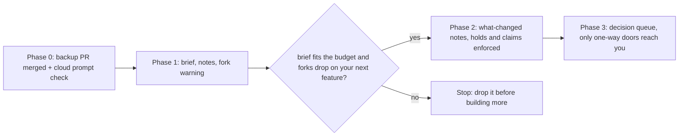
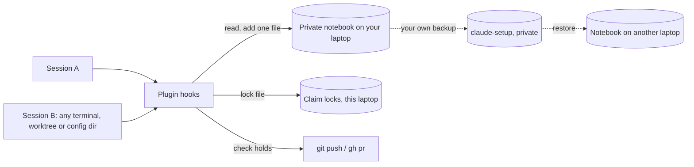

# Work continuity: how sessions share one memory

Today the rules and decisions for a feature live inside one long chat, and every summary loses some. The plan writes them into a private notebook on your laptop, never in the team's repositories, so any session, old, new, any worktree, starts from the same page. Your own backup carries it to a new laptop, and helper agents get a short card instead of a copy of the chat.

| | |
|---|---|
| subject | plan · repo `gauravprwl14/100x-engineer` · pr `10` |
| tier | heavy |
| generated | `100x flow build` from `scenario.json`; regenerate it, do not edit |

## Contents

| section | answers |
|---|---|
| [Before you watch](#before-you-watch) | what the change does for a user, what it covers and where it starts |
| [Terms](#terms) | the words a reader outside the module needs |
| [Diagrams](#diagrams) | the flow at a glance, as diagrams |
| [Workflow outline](#workflow-outline) | the code path as pseudocode, each line linked to its step |
| [Map](#map) | which boxes the scenarios use, their role and where they live in the code |
| [Today: the rules live only in the chat, so a summary loses them](#today-the-rules-live-only-in-the-chat-so-a-summary-loses-them) | issue scenario `today`: each step, what it changes and its evidence |
| [With the work record: the rule is written down in a private notebook every session reads](#with-the-work-record-the-rule-is-written-down-in-a-private-notebook-every-session-reads) | fix scenario `with-record`: each step, what it changes and its evidence |
| [An old session is still open while you give a new session new instructions](#an-old-session-is-still-open-while-you-give-a-new-session-new-instructions) | edge scenario `old-and-new`: each step, what it changes and its evidence |
| [Two sessions try to fix the same PR at the same moment](#two-sessions-try-to-fix-the-same-pr-at-the-same-moment) | race scenario `claim-race`: each step, what it changes and its evidence |
| [Parallel helpers stay fast, but get a task card instead of a copy of the chat](#parallel-helpers-stay-fast-but-get-a-task-card-instead-of-a-copy-of-the-chat) | load scenario `fork-vs-brief`: each step, what it changes and its evidence |
| [Decision](#decision) | which option was chosen, against what, and when to revisit it |
| [Numbers](#numbers) | every number on the page and what backs it |

## Before you watch

**Start any session on a feature and have it already know which PR does what, what is on hold and what was decided, without you repeating it.**

Why now: In one recent session you repeated the same rules about 11.3 times per hundred prompts, and forks used 46% of the tokens.

In this PR:

- Saving decisions, holds and conventions in a private notebook on your laptop
- Briefing every new session at start-up
- Telling an open session what changed
- A lock so two sessions do not fix one PR
- Warning before forking a summarised session

Not in this PR:

- Anything teammates can see in a repository
- Your team's own audit hook
- Choosing a model per task
- Background launchers (separate PRD)

| entry point | kind | animated in | note | evidence |
|---|---|---|---|---|
| Session start | event | `with-record` (With the work record: the rule is written down in a private notebook every session reads) |  | `prds/work-continuity/prd.md:182` |
| Each prompt you send | event | `old-and-new` (An old session is still open while you give a new session new instructions) |  | `prds/work-continuity/prd.md:183` |
| git push, gh pr create | command | `old-and-new` (An old session is still open while you give a new session new instructions) |  | `prds/work-continuity/prd.md:184` |
| Claiming a PR | command | `claim-race` (Two sessions try to fix the same PR at the same moment) |  | `prds/work-continuity/prd.md:107` |
| Starting a helper agent | event | `fork-vs-brief` (Parallel helpers stay fast, but get a task card instead of a copy of the chat) |  | `prds/work-continuity/prd.md:185` |

## Terms

| term | means | example |
|---|---|---|
| `work record` | A private notebook for one feature, kept as files on your laptop, that every session reads and adds notes to. | A hospital patient's chart. |
| `workstream` | One feature family: all the PRs that belong together. | Album comments: backend, frontend and settings PRs. |
| `brief` | A one-page summary of the record, handed to a session when it starts. |  |
| `hold` | A note that blocks a push or PR until it is released. | Do not push PR #3 yet. |
| `claim` | A lock that says which session is working on a PR right now. |  |
| `fork` | A helper agent that starts with a copy of the whole conversation. |  |
| `summary` | What happens when a chat gets too long: the start is replaced by a short summary, and details are lost. |  |
| `hook` | A small script the plugin runs at set moments: session start, each prompt, before a push. |  |
| `backup` | Your claude-setup tool, which copies the notebook to your private backup and restores it on a new laptop. | Nothing manual on a new Mac. |
| `cursor` | The last note a session has seen, so it can be told what is new. |  |
| `phase` | One step of the rollout; each must pass before the next is built. |  |

## Diagrams

### The rollout: each phase must pass before the next is built



Each phase is built only after the one before it passes on a real feature. Phase one works on a single laptop even before the backup change merges.

Evidence: `prds/work-continuity/prd.md:238`, `prds/work-continuity/prd.md:239`, `prds/work-continuity/prd.md:240`, `prds/work-continuity/prd.md:241`

### Who talks to whom



Sessions never talk to each other or to the team's repository. They read and write one private folder, and your own backup carries it to other laptops.

Animated in `with-record`. Evidence: `prds/work-continuity/prd.md:182`, `prds/work-continuity/prd.md:183`, `prds/work-continuity/prd.md:184`, `prds/work-continuity/prd.md:163`

## Workflow outline

`session start, then each prompt, then each push`, animated in `with-record`:

```
on session start:  # step 4
  workstream = lookup(host/owner/repo from git remote, branch)
  inject brief(workstream) read from ~/.config/100x/work  # step 5, 6
on each prompt: inject 'since you last looked' if there are newer notes
before git push / gh pr: refuse if the PR is held or claimed by another session
before a fork after a summary: warn and offer a brief
```

## Map

| node | role | code |
|---|---|---|
| You | client |  |
| Session A (old, still open) | service |  |
| Session B (new: another terminal, worktree or background) | service |  |
| Helper agent | service |  |
| Plugin hooks | edge |  |
| What this session last saw | cache |  |
| Chat memory (inside one session) | store |  |
| Work record (private, on your laptop) | store | `~/.config/100x/work` |
| PR claim lock (this laptop) | store | `~/.cache/100x/claims` |
| Your private backup (claude-setup) (outside the diff) | external |  |

## Today: the rules live only in the chat, so a summary loses them

`today` · issue · origin: found-in-review · severity high

Fixed by: `with-record`.

| # | what happens | state after | evidence |
|---|---|---|---|
| 1 | **You tell Session A where fixes go** Example: fixes to the comment API go on the backend branch. | memory[rule] = `"backend branch"` | `prds/work-continuity/prd.md:50` |
| 2 | **Weeks of work pile up in the same chat** One session in your review carried 752 prompts of your prompts. | prompts = 752; 752 prompts in one session | `bench/work-continuity/README.md:23` |
| 3 | **The chat gets too long and is summarised** The summary keeps the gist and drops details like which branch owns which fix. That session was summarised 28 summaries times. | memory[rule] = absent; rule lost in the summary | `prds/work-continuity/prd.md:47` |
| 4 | **Session A puts a fix on the wrong branch** It no longer knows the rule, so it guesses. | **sess-a failed** (fix on the wrong branch) | *inferred* |
| 5 | **You repeat the rule, again** This happened about 11.3 times per hundred prompts in that session. | memory[rule] = `"backend branch"`; restated = 1 | `prds/work-continuity/prd.md:53` |
| 6 | **A forked helper copies the whole chat** A fork starts with the entire conversation, about 25 million tokens each. Forks were 46% of all tokens. | fork_copies = 1 | `prds/work-continuity/prd.md:49`, `prds/work-continuity/prd.md:215` |

## With the work record: the rule is written down in a private notebook every session reads

`with-record` · fix


Steps 1–1 are the same as `today`; this table starts where it diverges.

| # | what happens | state after | evidence |
|---|---|---|---|
| 2 | **The rule is also saved as a note in the work record** Think of a hospital chart: whoever is on shift reads it and adds a note. The note is one new file in a private folder on your laptop, not in the chat and not in the team's repository. | record[convention] = `"backend branch"` | `prds/work-continuity/prd.md:143`, `prds/work-continuity/prd.md:163` |
| 3 | **The chat is summarised, as before** Chat memory still loses the detail. The notebook does not. | memory[rule] = absent | `prds/work-continuity/prd.md:47` |
| 4 | **Session B starts in another terminal or worktree** It does not need Session A's id: the hook finds the feature from the repository and branch. | no change | `prds/work-continuity/prd.md:182` |
| 5 | **The hook reads the notebook from disk** Local files only, no network, so it never hits the start-up cut-off of 10 s. | copy[convention] = `"backend branch"`; holds conv = `"backend branch"` | `prds/work-continuity/prd.md:182`, `prds/work-continuity/prd.md:112`, `hooks/hooks.json:10` |
| 6 | **Session B gets a short brief at start-up** Goal, which PR does what, merge order, holds, decisions, conventions, and a line saying it is private: never quote it in commits or PR text. | cache hit | `bench/work-continuity/resume/brief-plugin/hooks/brief.py:6`, `prds/work-continuity/prd.md:113` |
| 7 | **Your own backup carries the notebook to a new laptop** Your backup tool copies the folder to your private backup and restores it on a new Mac. The team's repositories never see it. | no change | `prds/work-continuity/prd.md:199`, `prds/work-continuity/prd.md:250` |
| 8 | **Benchmark: the brief answers what the chat forgot** A fresh session got 7 right of 7 questions with the brief and 2 right without, over 3 runs per arm. It was cheaper (0.052 USD per run against 0.065 USD per run) and faster (9 s against 17 s). | with brief 7 right, without 2 right | `bench/work-continuity/README.md:43`, `bench/work-continuity/README.md:44` |

## An old session is still open while you give a new session new instructions

`old-and-new` · edge


| # | what happens | state after | evidence |
|---|---|---|---|
| 1 | **You tell Session B: do not push PR #3 yet** Session B saves it as a hold in the record. | record[hold-pr3] = `"held"` | `prds/work-continuity/prd.md:109`, `bench/work-continuity/resume/brief.md:14` |
| 2 | **Session A sees the new note on disk** Session A never talks to Session B; both read and write the same private folder. | copy[hold-pr3] = `"held"`; holds h = `"held"` | `prds/work-continuity/prd.md:183`, `prds/work-continuity/prd.md:192` |
| 3 | **Session A's next prompt starts with what changed** A hook adds a line before your prompt: since you last looked, PR #3 is on hold. | cache hit | `prds/work-continuity/prd.md:183` |
| 4 | **Session A tries to push PR #3 anyway** Before any push or PR, the hook re-checks the record. | holds now = `"held"` | `prds/work-continuity/prd.md:184` |
| 5 | **The push is refused** | no change | `prds/work-continuity/prd.md:184`, `prds/work-continuity/prd.md:109` |
| 6 | **Teammates see none of this** No file, branch, setting or commit text in the repository comes from the notebook. | nothing written to the repository | `prds/work-continuity/prd.md:202`, `prds/work-continuity/prd.md:250` |

## Two sessions try to fix the same PR at the same moment

`claim-race` · race


| # | what happens | state after | evidence |
|---|---|---|---|
| 1 | **Both sessions ask for the lock on PR #1** Each tries to create the same lock file; the operating system lets only one create succeed. | no change | `prds/work-continuity/prd.md:107`, `prds/work-continuity/prd.md:194` |
| 2 | **Session A's request lands first and wins** | claims[pr1] = `"Session A"` | `prds/work-continuity/prd.md:164`, `prds/work-continuity/prd.md:107` |
| 3 | **Session B is refused, because the lock already exists** Two winners are impossible: the create is atomic. | no change | `prds/work-continuity/prd.md:194` |
| 4 | **Session B waits, works read-only, or takes over on purpose** Taking over is explicit and logged. A claim expires after about 2 h so a crashed session cannot block forever. | takeover is logged | `prds/work-continuity/prd.md:194` |

## Parallel helpers stay fast, but get a task card instead of a copy of the chat

`fork-vs-brief` · load


| # | what happens | state after | evidence |
|---|---|---|---|
| 1 | **Today: a fork helper gets the whole conversation** Like photocopying the whole notebook for every helper: about 25 million tokens each. | no change | `prds/work-continuity/prd.md:215` |
| 2 | **Instead: a fresh helper gets a one-page task card** Goal, files it owns, its worktree, the verify command and the brief: about 5 million tokens each. | no change | `prds/work-continuity/prd.md:215` |
| 3 | **Helpers still run side by side** Independent tasks run at once, each in its own worktree. Nothing about the parallelism changes. | same parallel waves as today | `skills/orchestrate/SKILL.md:63` |
| 4 | **After a summary, a fork gets a warning** Phase one adds a hook: forking from a summarised session warns and offers a brief. | no change | `prds/work-continuity/prd.md:185`, `prds/work-continuity/prd.md:239` |

## Decision

| option | solves it | pros | cons |
|---|---|---|---|
| Private files on your laptop, carried by your own backup **(chosen)** | pass | Nothing in any team repository<br>The plugin never pushes<br>Restored on a new laptop with no manual step | Cloud sessions only get the brief in their first prompt<br>Two laptops agree after each syncs |
| A dedicated private repository the plugin pushes to | pass | Works from the cloud | The plugin would have to push<br>Duplicates your existing backup |
| A hidden ref in each project repository | fail | Cloud sessions could read it | Lives in the team's repository |
| Claude Code's own memory | fail | Already backed up | Each worktree and config dir sees a different copy<br>One file many sessions edit |

**Deciding factor:** It is the only option that keeps everything out of the team's repositories without the plugin pushing, and your existing backup already restores it on a new laptop.
**Revisit when:** Cloud sessions become your main way of working.
**Source:** decisions/ADR-0006-work-record-is-private-plain-files-in-config-100x-work-backed-up-by-the-owner-s-own-setup-the-plugin-never-pushes.md

## Numbers

| name | value | tag | backed by |
|---|---|---|---|
| `compactions` | 28 summaries | measured | python3 bench/work-continuity/transcript_metrics.py on session a94b2d46 |
| `prompts` | 752 prompts | measured | python3 bench/work-continuity/transcript_metrics.py on session a94b2d46 |
| `m1` | 11.3 times per hundred prompts | measured | python3 bench/work-continuity/transcript_metrics.py on session a94b2d46 |
| `m1_target` | 3 times per hundred prompts | verified | `prds/work-continuity/prd.md:53` |
| `fork_share` | 46% | measured | python3 bench/work-continuity/transcript_metrics.py on session a94b2d46 |
| `fork_per` | 25 million tokens | estimated | 8.0 billion fork tokens / 327 fork agents (PRD section 9c) |
| `brief_per` | 5 million tokens | estimated | 1.7 billion tokens / 365 general-purpose agents; different tasks, rough |
| `questions` | 7 questions | verified | `bench/work-continuity/README.md:43` |
| `brief_correct` | 7 right | measured | bash bench/work-continuity/resume/run.sh --yes --runs 3 |
| `none_correct` | 2 right | measured | bash bench/work-continuity/resume/run.sh --yes --runs 3 |
| `brief_cost` | 0.052 USD per run | measured | bash bench/work-continuity/resume/run.sh --yes --runs 3 |
| `none_cost` | 0.065 USD per run | measured | bash bench/work-continuity/resume/run.sh --yes --runs 3 |
| `brief_secs` | 9 s | measured | bash bench/work-continuity/resume/run.sh --yes --runs 3 |
| `none_secs` | 17 s | measured | bash bench/work-continuity/resume/run.sh --yes --runs 3 |
| `runs` | 3 runs per arm | measured | bash bench/work-continuity/resume/run.sh --yes --runs 3 |
| `hook_timeout` | 10 s | verified | `hooks/hooks.json:10` |
| `lease` | 2 h | estimated | PRD Q4 recommendation, renewed on each push or event |
