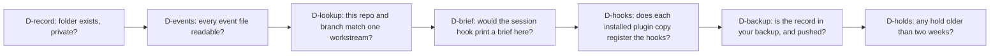
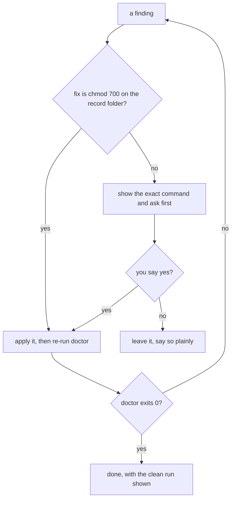
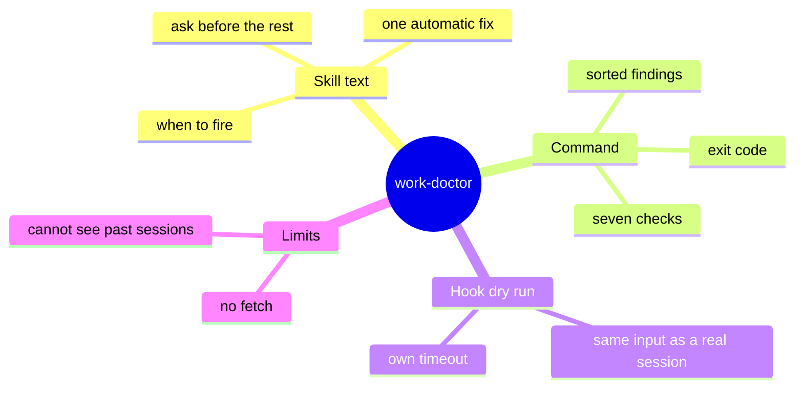

# How the work-doctor skill works

> **What:** Finds out why the session brief is missing, wrong or not backed up, without changing anything.
>
> **How:** One command runs seven checks in order, including a dry run of the session-start hook, and prints each problem with its cause and fix.
>
> **Watch out:** It never repairs anything itself: apart from tightening the record folder's permissions, every fix waits for your yes.

The work record is a private notebook that hands every new session a short brief about your PRs, holds and decisions. When the brief silently stops showing up, guessing why wastes a session. work-doctor is the car's diagnostic port: one command runs seven read-only checks, each naming what broke, the likely cause and the exact command that fixes it. The skill wraps it with rules about which fixes Claude may apply on its own (one) and which it must ask about (all the rest).

| | |
|---|---|
| subject | concept · repo `gauravprwl14/100x-engineer` |
| tier | heavy |
| generated | `100x flow build` from `scenario.json`; regenerate it, do not edit |

## Contents

| section | answers |
|---|---|
| [Before you watch](#before-you-watch) | what the change does for a user, what it covers and where it starts |
| [Terms](#terms) | the words a reader outside the module needs |
| [Diagrams](#diagrams) | the flow at a glance, as diagrams |
| [Workflow outline](#workflow-outline) | the code path as pseudocode, each line linked to its step |
| [Map](#map) | which boxes the scenarios use, their role and where they live in the code |
| ["My brief stopped showing": doctor finds the cause](#my-brief-stopped-showing-doctor-finds-the-cause) | happy scenario `happy`: each step, what it changes and its evidence |
| [One check crashes; the others still report](#one-check-crashes-the-others-still-report) | failure scenario `check-crash`: each step, what it changes and its evidence |
| [What if doctor repaired things itself?](#what-if-doctor-repaired-things-itself) | issue scenario `issue-autofix`: each step, what it changes and its evidence |
| [Fix: the command is read-only, and every fix is a command you approve](#fix-the-command-is-read-only-and-every-fix-is-a-command-you-approve) | fix scenario `fix-ask`: each step, what it changes and its evidence |
| [A hold does not block a push yet](#a-hold-does-not-block-a-push-yet) | issue scenario `issue-hold`: each step, what it changes and its evidence |
| [Decision](#decision) | which option was chosen, against what, and when to revisit it |
| [Numbers](#numbers) | every number on the page and what backs it |
| [Code reference](#code-reference) | every function and class in the files behind the page: lines, purpose, who uses it |

## Before you watch

**When a new session should have received your work brief and did not, you can ask Claude "work doctor" and get the cause and the fix in one reading, instead of debugging hooks by hand.**

Why now: The work record's hook fails open on purpose, so when it breaks it breaks silently; doctor is the only place that says so.

In this PR:

- The skill: when it fires, what Claude may and may not do
- The doctor command: its seven checks, in order, and how it decides the exit code
- The hook dry run that answers "would a session here get the brief?"
- What happens when one check itself crashes
- Every doctor function in scripts/work.py, in the Code reference

Not in this PR:

- How the work record is written (start, decide, hold, handoff)
- PR state such as CI or reviews, which the record never stores
- Finding a past session (the session-find skill)

| entry point | kind | animated in | note | evidence |
|---|---|---|---|---|
| work doctor [--cwd DIR] [--json] | command | `happy` ("My brief stopped showing": doctor finds the cause) |  | `scripts/work.py:1248` |
| work-doctor skill ("brief not showing", "is my record backed up") | command | `happy` ("My brief stopped showing": doctor finds the cause) |  | `skills/work-doctor/SKILL.md:20` |
| SessionStart hook: work_brief.py | event | not animated | doctor runs it as a dry run; it never starts a real session | `scripts/work.py:870` |

## Terms

| term | means | example |
|---|---|---|
| `work record` | A private folder of small event files (one per decision, hold, handoff) that outlives any one chat. | ~/.config/100x/work/<workstream>/ |
| `workstream` | One feature family in the record: a name, the repos and the PR branches it covers. |  |
| `brief` | The short summary of a workstream that the session-start hook injects into a new session. |  |
| `hook dry run` | Doctor feeds the session-start hook the exact input a real session in that folder would send, and reads what it prints. | session brief here: no |
| `finding` | One problem doctor reports: an id, a severity, what is wrong, the likely cause, and the fix as a command. | D-brief.hook-silent (error) |
| `severity` | error and warn fail the run; info is something to accept or act on, and the run still passes. |  |
| `fail open` | When something goes wrong, do nothing rather than block: the hook prints no brief instead of breaking the session. Safe, but silent. |  |
| `hold` | A note on a PR saying "do not push or merge this yet", with a reason. Shown in the brief. |  |
| `backup hint` | The file list your own backup tool uses; doctor checks it names the record folder. |  |
| `config dir` | A Claude Code home such as ~/.claude, or a second one you point CLAUDE_CONFIG_DIR at. Each has its own installed copy of the plugin. |  |

## Diagrams

### The seven checks, in the order they run



Each check is a function registered with a decorator; the loop runs them in source order and collects findings.

Evidence: `scripts/work.py:659`, `scripts/work.py:1215`

### What Claude may do with each finding



The skill's rules on top of the read-only command: one automatic fix, everything else asked, and done means a clean re-run.

Evidence: `skills/work-doctor/SKILL.md:35`, `skills/work-doctor/SKILL.md:58`, `skills/work-doctor/SKILL.md:54`

### What the skill is made of



The skill is rules for Claude; the command is code; the dry run is how doctor sees a hook without starting a session.

Evidence: `skills/work-doctor/SKILL.md:20`, `scripts/work.py:1231`, `scripts/work.py:870`

## Workflow outline

`run_doctor(cwd): the command, as pseudocode`, animated in `happy`:

```
ctx.matches = lookup(cwd)            # which workstream is this folder?  # step 3
for check_id, fn in CHECKS:          # registered by @check, in source order  # step 4
  try: found = fn(ctx)  # step 5, 6, 7, 8, 9
  except: found = [crashed(check_id)]  # one broken check never hides the rest
findings.sort(by severity: error, warn, info)  # step 10
ok = no error and no warn  # step 10
exit 0 if ok else 1  # step 10
```

`check_brief(ctx): the hook dry run, as pseudocode`, animated in `happy`:

```
payload = {SessionStart, cwd, session_id: doctor-dry-run}  # step 7
brief = run(hooks/work_brief.py, payload, timeout=hook's own)  # step 7
if one workstream matches and brief is empty: error hook-silent  # step 7
if brief is over its token budget: warn budget  # inferred
```

## Map

| node | role | code |
|---|---|---|
| You | client |  |
| Claude with the work-doctor skill | service | `skills/work-doctor/SKILL.md` |
| work doctor command | service | `scripts/work.py:1203` |
| Checks to run (in source order) | queue | `scripts/work.py:659` |
| Check runner | worker | `scripts/work.py:1213` |
| Work record folder | store |  |
| Session-start hook (work_brief.py) | edge | `hooks/work_brief.py` |
| Installed plugin copies (each config dir) | external |  |
| Your backup repo (local refs only) | external |  |

## "My brief stopped showing": doctor finds the cause

`happy` · happy


| # | what happens | state after | evidence |
|---|---|---|---|
| 1 | **You say the session brief is not showing** That phrase is one of the skill's triggers, so Claude loads the work-doctor rules before touching anything. | no change | `skills/work-doctor/SKILL.md:20` |
| 2 | **Claude runs the doctor command for this folder** Diagnose first: rule one forbids guessing that the hook is broken from a missing brief alone. | no change | `scripts/work.py:1248`, `skills/work-doctor/SKILL.md:50` |
| 3 | **Doctor works out which workstream this folder belongs to** It matches the repo's origin remote and branch against the record. A crash here becomes a finding, not a stack trace. | holds where = `"exists"` | `scripts/work.py:1209`, `scripts/work.py:832` |
| 4 | **The seven checks line up in source order** Each is a function marked with a decorator that adds it to one list. Adding a check is adding one function. | checks: 7 waiting | `scripts/work.py:659` |
| 5 | **Record checks: is the folder private, and is every event file readable?** A folder other users can read is a warning; a broken event file is reported, never moved or deleted. | checks: 5 waiting | `scripts/work.py:709`, `scripts/work.py:758`, `skills/work-doctor/SKILL.md:60` |
| 6 | **Lookup check: this repo and branch match exactly one workstream?** None or several is the usual reason for a missing brief, and the fix pre-fills the start command. | checks: 4 waiting | `scripts/work.py:832` |
| 7 | **Brief check: doctor dry-runs the session-start hook** It sends the hook the exact input a real session here would send and reads the answer, so "would a session get the brief" is a yes or no, not a guess. | checks: 3 waiting; errors = 1 | `scripts/work.py:870`, `scripts/work.py:874`, `scripts/work.py:909` |
| 8 | **Hooks check: does every installed plugin copy register the work hooks?** A stale copy in one config dir runs old hooks. The fix is the exact reinstall chain, prefixed with that config dir. | checks: 2 waiting | `scripts/work.py:1020`, `scripts/work.py:997` |
| 9 | **Backup and holds checks, from local state only** Commits ahead of upstream are counted from local refs; nothing is fetched. Holds older than 14 days are listed as info. | checks: 0 waiting | `scripts/work.py:1116`, `scripts/work.py:1128`, `scripts/work.py:1173`, absent: a git fetch or gh call anywhere in the doctor checks (`git grep` finds 0 in `scripts/work.py`) |
| 10 | **Doctor sorts findings, worst first, and sets the exit code** An error or a warning makes the run fail; info alone lets it pass. | no change | `scripts/work.py:1220`, `scripts/work.py:1221`, `scripts/work.py:1261` |
| 11 | **Claude explains the finding plainly and asks before fixing** One sentence each: what broke, why, what the fix does. Only a permissions fix on the record folder may be applied without asking. | no change | `skills/work-doctor/SKILL.md:35`, `skills/work-doctor/SKILL.md:58` |
| 12 | **After the fix, Claude re-runs doctor until it exits clean** Done is a clean doctor run, shown, not a claim that the fix worked. | errors = 0 | `skills/work-doctor/SKILL.md:54` |

Step 7:

```
brief = run(work_brief.py, payload)
if matched and not brief: error D-brief.hook-silent
```

## One check crashes; the others still report

`check-crash` · failure


Steps 1–6 are the same as `happy`; this table starts where it diverges.

| # | what happens | state after | evidence |
|---|---|---|---|
| 7 | **The brief check hits a file shape it does not expect, and raises** Doctor exists for broken records, so a broken record must not break doctor. | checks: 3 waiting; **runner failed** (D-brief raised) | `scripts/work.py:1215` |
| 8 | **The crash becomes its own error finding** It says the check could not finish, names the exception, and asks for a report with the JSON output. | errors = 1; D-brief.crashed: could not finish | `scripts/work.py:1195` |
| 9 | **The remaining checks run as normal** | checks: 0 waiting | `scripts/work.py:1215` |
| 10 | **Doctor fails the run with the crash listed first** | no change | `scripts/work.py:1220`, `scripts/work.py:1261` |

## What if doctor repaired things itself?

`issue-autofix` · issue · origin: what-if · severity high

> What-if: this is not in the code. It shows why the real design is the way it is.

Fixed by: `fix-ask`.

Steps 1–4 are the same as `happy`; this table starts where it diverges.

| # | what happens | state after | evidence |
|---|---|---|---|
| 5 | **The events check finds an unreadable event file and deletes it** That file may hold the only copy of a decision; the brief already skips it safely. | record[folder] = `"event deleted"`; checks: 5 waiting | *inferred* |
| 6 | **The hooks check reinstalls the plugin on its own, in the wrong config dir** Uninstall succeeds, install fails: that config dir now has no plugin at all. | **plugins failed** (no plugin installed) | *inferred* |
| 7 | **You find out later, with a decision gone and a session broken** | no change | *inferred* |

## Fix: the command is read-only, and every fix is a command you approve

`fix-ask` · fix


Steps 1–4 are the same as `issue-autofix`; this table starts where it diverges.

| # | what happens | state after | evidence |
|---|---|---|---|
| 5 | **The events check only reports the broken file** Nothing in the doctor checks writes, fetches or calls GitHub; the fix is text. | checks: 5 waiting; D-events.malformed: reported, untouched | `scripts/work.py:623`, `skills/work-doctor/SKILL.md:60` |
| 6 | **The hooks check prints the reinstall chain for the exact config dir** The command carries that config dir, so it cannot land in the wrong one; Claude shows it and asks. | no change | `scripts/work.py:997`, `skills/work-doctor/SKILL.md:58` |
| 7 | **You approve, Claude runs it, and doctor confirms** | no change | `skills/work-doctor/SKILL.md:54` |

## A hold does not block a push yet

`issue-hold` · issue · origin: in-code · severity medium

Open: no fix is shown yet.

| # | what happens | state after | evidence |
|---|---|---|---|
| 1 | **You put a hold on a PR: do not push until the backend lands** | record[folder] = `"hold recorded"` | `skills/work-doctor/SKILL.md:40` |
| 2 | **A later session pushes the PR anyway** The hold is shown in the brief, but no hook checks it before a push; that guard is planned for a later phase. | git push of the held PR goes through | `skills/work-doctor/SKILL.md:40` |
| 3 | **Doctor can only list the hold and its age** | no change | `scripts/work.py:1173`, `skills/work-doctor/SKILL.md:40` |

## Decision

| option | solves it | pros | cons |
|---|---|---|---|
| Read-only diagnosis; every fix is a printed command **(chosen)** | pass | Safe to run any time, on any machine<br>The fix is visible and reviewable before it runs | Takes one more step: someone has to run the fix |
| Doctor repairs what it finds | fail | One step | Can delete the only copy of a decision<br>A half-finished reinstall leaves no plugin |
| No doctor: debug hooks by hand | fail | No code to maintain | The hook fails open, so nothing says it broke<br>Costs a session per incident |

**Deciding factor:** The record is private and some repairs cannot be undone, so the diagnosis must never be the thing that breaks it.
**Revisit when:** A repair proves both common and fully reversible, like the folder permissions fix already is.
**Source:** skills/work-doctor/SKILL.md rules 2 and 4; prds/work-continuity/prd.md §9

## Numbers

| name | value | tag | backed by |
|---|---|---|---|
| `checks_n` | 7 checks | measured | grep -c '^@check(' scripts/work.py (at f2aebfc) |
| `stale_days` | 14 days | verified | `scripts/work.py:628` |

## Code reference

Read from the code by `100x code_ref`: names, lines and docstrings are the code's own; a note is the page author's one-line summary.

### `scripts/work.py`

Private work record: the state of a feature family that outlives any one session.

| symbol | lines | what it does | used by | branches |
|---|---|---|---|---|
| `check` | 659–663 | Decorator: adds a check function to the CHECKS list under its id, in source order. | — | 0 |
| `finding` | 666–667 | Builds one finding: id, severity, what is wrong, the likely cause, the fix. | `backup_git_timeout`, `check_backup`, `check_brief`, `check_events`, `check_holds`, `check_hooks`, `check_lookup`, `check_record`, `crashed`, `mid_operation`, `scan_backup_repo` | 0 |
| `check_record` `@check('D-record')` | 689–714 | D-record: is the record switched off, missing, not a folder, or readable by other users? | — | 4 |
| `check_events` `@check('D-events')` | 752–787 | D-events: reports event files that cannot be read or parsed, and never touches them. | — | 5 |
| `check_lookup` `@check('D-lookup')` | 791–835 | D-lookup: does this folder's repo and branch match exactly one workstream? | — | 10 |
| `run_brief_hook_dry` | 870–895 | Feed hooks/work_brief.py the payload a SessionStart in cwd would send. | `check_brief` | 8 |
| `check_brief` `@check('D-brief')` | 899–933 | D-brief: dry-runs the session hook here; flags a silent hook, a slow one, or a brief over its token budget. | — | 9 |
| `installed_copies` | 970–994 | ([(plugin version dir, marketplace)], whether installed_plugins.json named them). | `check_hooks` | 12 |
| `reinstall_cmd` | 997–1002 | The exact uninstall, marketplace update and install chain, prefixed with the config dir it is for. | `check_events`, `check_hooks`, `plugin_hooks_fix` | 2 |
| `check_hooks` `@check('D-hooks')` | 1016–1053 | D-hooks: do this plugin and each installed copy register the work hooks? | — | 8 |
| `mid_operation` | 1063–1072 | D-backup.mid-operation when a rebase, merge or cherry-pick is waiting, else None. | `scan_backup_repo` | 3 |
| `scan_backup_repo` | 1075–1130 | Findings about the git repo holding the hint file, from local refs only. | `check_backup` | 16 |
| `check_backup` `@check('D-backup')` | 1134–1161 | D-backup: does the backup hint name the record folder, and is the backup repo pushed and not mid-rebase? | — | 4 |
| `check_holds` `@check('D-holds')` | 1165–1192 | D-holds: lists holds older than the stale threshold, as info. | — | 12 |
| `crashed` | 1195–1200 | Turns an exception inside a check into an error finding, so the other checks still report. | `run_doctor` | 0 |
| `run_doctor` | 1203–1222 | Runs the lookup, then every check in order; sorts findings worst first and decides ok. | `cmd_doctor` | 9 |
| `print_doctor` | 1225–1245 | Prints the header (record dir, workstream, dry-run result), each finding with cause and fix, and a summary. | `cmd_doctor` | 11 |
| `cmd_doctor` | 1248–1261 | The command: checks the folder argument, runs doctor, prints text or JSON, and exits with success only when nothing failed. | `build_parser` | 7 |

### `hooks/work_brief.py`

SessionStart: inject the private work brief when this directory belongs to a workstream.

| symbol | lines | what it does | used by | branches |
|---|---|---|---|---|
| `main` | 18–29 | Returns the session-start brief for the folder when it matches exactly one workstream; nothing otherwise. | — | 5 |
