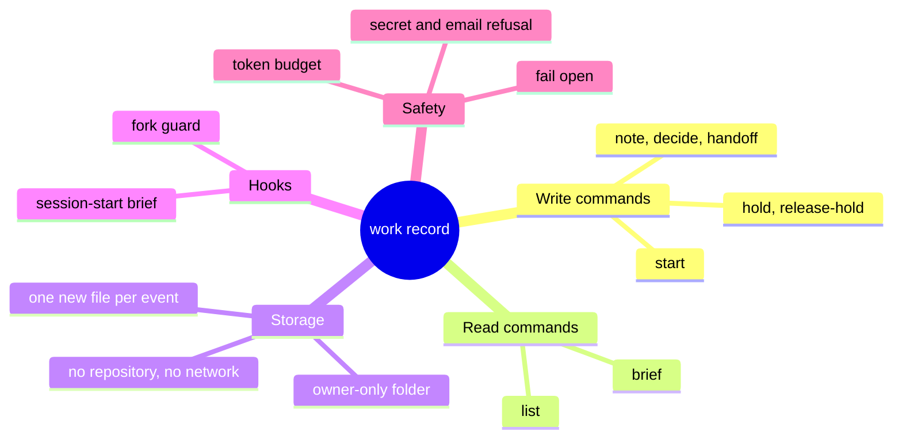
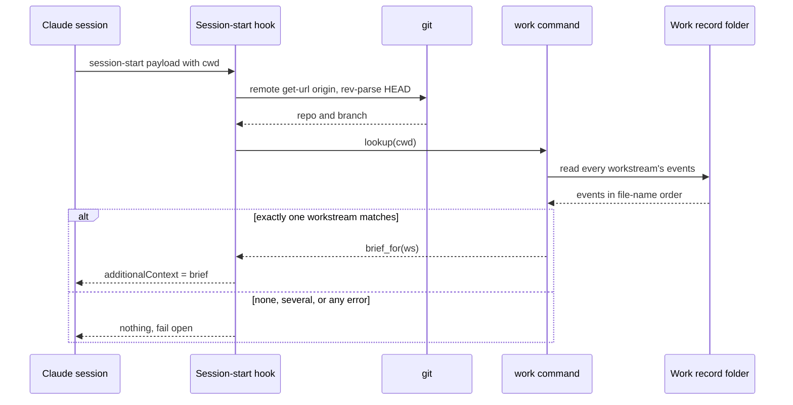
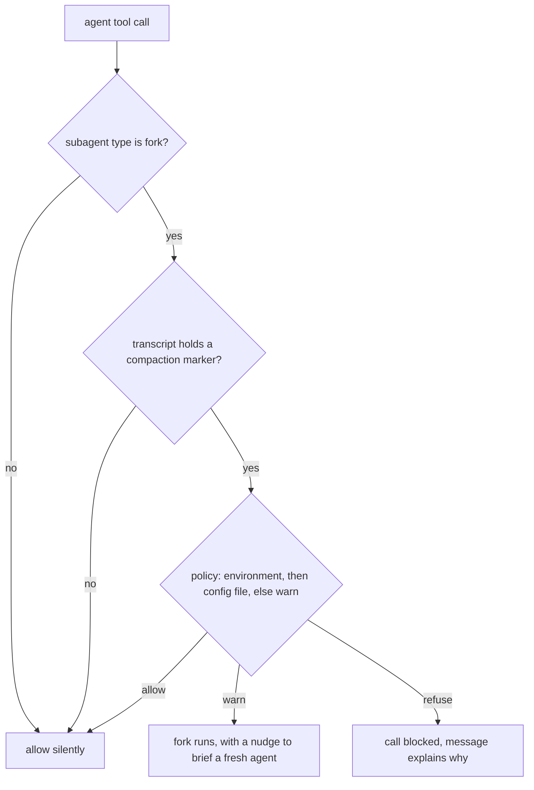

# How the work record works, as built

> **What:** Keeps the facts of a feature that spans several PRs in a private notebook that every new session reads first.
>
> **How:** Each command writes one new small file outside every repository, and a session-start hook rebuilds a short brief from those files for the repo and branch you open.
>
> **Watch out:** Text that looks like a secret or an email address is refused, and a hold only shows in the brief: nothing stops a push yet.

A part page of the plugin overview (explain/100x-plugin). The work record is a ship's logbook for one feature that spans several PRs and many chat sessions: every decision, hold and handoff is a new line written in ink and never erased, kept in a private folder on your laptop and never in a team repository. When a new session opens, a hook reads the logbook and hands the session a short brief. This page shows what shipped in code. The plan behind it is explain/work-continuity, and finding out why a brief is missing is explain/work-doctor.

| | |
|---|---|
| subject | concept · repo `gauravprwl14/100x-engineer` |
| tier | heavy |
| generated | `100x flow build` from `scenario.json`; regenerate it, do not edit |

## Contents

| section | answers |
|---|---|
| [Before you watch](#before-you-watch) | what the change does for a user, what it covers and where it starts |
| [Terms](#terms) | the words a reader outside the module needs |
| [Diagrams](#diagrams) | the flow at a glance, as diagrams |
| [Workflow outline](#workflow-outline) | the code path as pseudocode, each line linked to its step |
| [Map](#map) | which boxes the scenarios use, their role and where they live in the code |
| [Start a workstream, record a decision and a hold, open a new session](#start-a-workstream-record-a-decision-and-a-hold-open-a-new-session) | happy scenario `happy`: each step, what it changes and its evidence |
| [What if the record kept any text it was given?](#what-if-the-record-kept-any-text-it-was-given) | issue scenario `issue-secret`: each step, what it changes and its evidence |
| [Fix: the write is refused before any file exists](#fix-the-write-is-refused-before-any-file-exists) | fix scenario `fix-refuse`: each step, what it changes and its evidence |
| [A long workstream on a tight budget: what the brief cuts](#a-long-workstream-on-a-tight-budget-what-the-brief-cuts) | load scenario `trim`: each step, what it changes and its evidence |
| [A summarised session tries to fork a helper](#a-summarised-session-tries-to-fork-a-helper) | edge scenario `fork-guard`: each step, what it changes and its evidence |
| [Decision](#decision) | which option was chosen, against what, and when to revisit it |
| [Numbers](#numbers) | every number on the page and what backs it |
| [Code reference](#code-reference) | every function and class in the files behind the page: lines, purpose, who uses it |

## Before you watch

**When a feature takes several PRs and many sessions, you record its decisions, holds and handoffs once, and every later session in any worktree of those repos starts already knowing them, instead of you restating them.**

Why now: Summaries and abandoned sessions lose facts, and a forked helper copies a lossy summary; the record keeps the facts in files that no summary can rewrite.

In this PR:

- The commands that write the record: start, note, decide, hold, release-hold, handoff
- The commands that read it: brief and list
- Events as files: one new file per write, never edited, and how the workstream view is rebuilt from them
- Lookup by origin remote and branch, so any worktree of the same repo matches
- How the brief is trimmed to its token budget, and what is never trimmed
- Secret and email refusal, and where the record lives and why (the decision card below, and docs/SAFETY.md)
- The session-start brief hook and the fork guard hook
- Every function behind these, in the Code reference

Not in this PR:

- The doctor command and its checks: see explain/work-doctor
- The plan, its measurements and phases: see explain/work-continuity
- PR state such as CI, reviews or merged, which the record never stores
- Backup itself: your own backup tool carries the folder, the plugin never pushes

| entry point | kind | animated in | note | evidence |
|---|---|---|---|---|
| work start <workstream> --repo … --pr <number>:<branch>:<role> | command | `happy` (Start a workstream, record a decision and a hold, open a new session) |  | `scripts/work.py:1271` |
| work note \| decide \| handoff <text> | command | `fix-refuse` (Fix: the write is refused before any file exists) | same write path as start: one event file each | `scripts/work.py:1282` |
| work hold <pr> --reason … / work release-hold <pr> | command | `happy` (Start a workstream, record a decision and a hold, open a new session) |  | `scripts/work.py:1289` |
| work brief [--max-tokens N] / work list | command | `trim` (A long workstream on a tight budget: what the brief cuts) |  | `scripts/work.py:1298` |
| Session-start hook (startup, resume, clear, compact) | event | `happy` (Start a workstream, record a decision and a hold, open a new session) |  | `hooks/hooks.json:15` |
| Fork guard hook (before an agent tool call) | event | `fork-guard` (A summarised session tries to fork a helper) |  | `hooks/hooks.json:88` |
| work doctor | command | not animated | read-only diagnosis, explained on explain/work-doctor | `scripts/work.py:1303` |

## Terms

| term | means | example |
|---|---|---|
| `work record` | A private folder of small event files that outlives any one chat; by default under your home's config folder, never in a repository. | ~/.config/100x/work/tags/events/ |
| `workstream` | One feature family in the record: a name, a goal, the repos and the PR branches it covers. | tags: backend PR on feat/tags, frontend PR on feat/tags-ui |
| `event` | One fact, written once as its own file: a set (start or update), note, decision, hold, release-hold or handoff. |  |
| `view` | The workstream's current state, rebuilt in memory by replaying every event file in name order; it is never saved. |  |
| `brief` | The short markdown summary of a workstream that a new session receives: PRs, holds, decisions, recent notes. |  |
| `token budget` | The size limit for the brief, counted roughly as characters divided by four; the oldest notes are cut first. |  |
| `hold` | A note on one PR saying do not push or merge it yet, with a reason. It stays in the brief until released. |  |
| `handoff` | A note left for the next session: where you stopped and what comes next. |  |
| `origin remote` | The address git calls origin for a clone. The record matches on it, reduced to host/owner/repo, plus the branch. | git@github.com:acme/shop.git becomes github.com/acme/shop |
| `secret filter` | A set of patterns for access tokens, private keys, passwords and email addresses; a write whose text matches is refused. |  |
| `fork` | A helper agent that starts with a copy of the whole parent conversation, summary included. |  |
| `fail open` | On any error, do nothing rather than block: the hook prints no brief instead of breaking the session. |  |

## Diagrams

### What the work record is made of



Read outward from the centre: what you can run, where it is kept, the two hooks that use it, and the rules that keep it private and small.

Evidence: `scripts/work.py:1271`, `scripts/work.py:1298`, `scripts/work.py:226`, absent: a push, an HTTP call or a requests import in the work record's code and hooks (`git grep` finds 0 in `scripts/work.py hooks/work_brief.py hooks/work_fork_guard.py`), `hooks/hooks.json:15`, `hooks/hooks.json:88`, `scripts/work.py:214`, `scripts/work.py:436`, `hooks/work_brief.py:42`

### A new session opens: how the brief arrives



Top to bottom. The folder path never matters; the origin remote and branch do, which is why every worktree of the repo gets the same brief.

Animated in `happy`. Evidence: `hooks/hooks.json:15`, `scripts/work.py:153`, `hooks/work_brief.py:25`, `scripts/work.py:238`, `hooks/work_brief.py:26`, `hooks/work_brief.py:28`, `hooks/work_brief.py:42`

### The fork guard's decision



Only a fork from a session that has already been summarised is touched. Any error on the way also ends in allow.

Animated in `fork-guard`. Evidence: `hooks/work_fork_guard.py:64`, `hooks/work_fork_guard.py:22`, `hooks/work_fork_guard.py:32`, `hooks/work_fork_guard.py:37`, `hooks/work_fork_guard.py:19`, `hooks/work_fork_guard.py:71`, `hooks/work_fork_guard.py:69`, `hooks/work_fork_guard.py:80`

## Workflow outline

`write_event(ws, kind, fields): every write command ends here`, animated in `happy`:

```
if disabled(): raise WorkError  # HUNDREDX_WORK=off
check_ws_name(ws)
event = {schema, type, ws, session, **fields}  # step 4
refuse_secrets(event)               # every string field, by name  # step 3
mkdir record/<ws>/events             # mode 0o700
for _ in range(NAME_ATTEMPTS):
  name = <utc time>Z-<session>-<random hex>.json  # step 4
  create_exclusive(events / name)     # O_CREAT|O_EXCL, mode 0o600  # step 4, 5
  except FileExistsError: continue    # pick a new name
raise WorkError(could not create a unique event file)
```

`hooks/work_brief.py main(payload): the session-start brief`, animated in `happy`:

```
if work.disabled() or payload is not a dict: return None
cwd = payload.cwd; if not a folder: return None
matches = work.lookup(cwd)  # step 7, 8
  ident = cwd_identity(cwd)   # git remote get-url origin; rev-parse HEAD  # step 7
  match if repo in view.repos and some PR branch == branch  # step 8
if len(matches) != 1: return None  # step 8
brief = work.brief_for(matches[0])  # read_events -> derive -> render_brief  # step 9, 10
return {hookSpecificOutput: {additionalContext: brief}}  # step 11
except Exception: pass   # fail open, exit success
```

`trim_brief(view, newer, max_tokens): fitting the budget`, animated in `trim`:

```
notes = view.notes[-BRIEF_RECENT:]   # older ones become a count  # step 2
decisions = list(view.decisions.values())  # step 2
while True:
  text = brief_text(view, notes, decisions, dropped, newer)  # step 3
  fits = len(text) / CHARS_PER_TOKEN <= max_tokens  # step 3
  if fits or not (notes or decisions): return text  # step 8
  if notes: notes = notes[1:]          # oldest note first  # step 4, 5
  else: decisions = decisions[1:]      # then oldest decision  # step 6, 7
```

## Map

| node | role | code |
|---|---|---|
| You | client |  |
| Claude session (any worktree) | service |  |
| work command | service | `scripts/work.py:1266` |
| Secret filter | edge | `scripts/work.py:165` |
| Work record folder | store | `scripts/work.py:89` |
| git (origin remote, branch) | external | `scripts/work.py:151` |
| Session-start hook | edge | `hooks/work_brief.py:18` |
| Fork guard hook | edge | `hooks/work_fork_guard.py:56` |
| Session transcript | store | `hooks/work_fork_guard.py:43` |
| Brief lines that may be cut, oldest first | queue | `scripts/work.py:428` |
| Budget trimmer | worker | `scripts/work.py:434` |
| Your own backup | external |  |

## Start a workstream, record a decision and a hold, open a new session

`happy` · happy


| # | what happens | state after | evidence |
|---|---|---|---|
| 1 | **You ask Claude to start a workstream for the tags feature** A new workstream needs at least one repo; each PR is given as number, branch and role, so the record knows which branches belong to it. | no change | `scripts/work.py:1271`, `scripts/work.py:517` |
| 2 | **The repo address is reduced to host/owner/repo** Any login, port, scheme and the .git ending are dropped, so a token in a remote URL never reaches a file, and an SSH and an HTTPS address of the same repo match. | git@github.com:acme/shop.git becomes github.com/acme/shop | `scripts/work.py:113`, `scripts/work.py:518` |
| 3 | **The secret filter checks every piece of text in the event** Goal, PR roles and conventions are all walked; this one is clean. | no change | `scripts/work.py:214`, `scripts/work.py:172`, `scripts/work.py:167` |
| 4 | **The event is written as a brand-new file that is never edited** The name holds the time, the session and a random part, and the file is created only if nothing has that name, so two sessions writing at once never collide. The folder is readable by you alone. | record[tags/set] = `"set"` | `scripts/work.py:224`, `scripts/work.py:202`, `scripts/work.py:46`, `scripts/work.py:47`, `scripts/work.py:10` |
| 5 | **A decision and a hold go in the same way, one file each** A hold is refused for a PR the workstream does not list; a decision may carry a short id so a later decision can replace it. | record[tags/decision-D1] = `"decision"`; record[tags/hold] = `"hold"` | `scripts/work.py:548`, `scripts/work.py:536`, `scripts/work.py:554` |
| 6 | **Days later, a new session opens in another worktree of the same repo** The session-start hook runs on startup, resume, clear and compact, and is killed after 10 s. | no change | `hooks/hooks.json:15`, `hooks/hooks.json:20` |
| 7 | **The hook asks git which repo and branch this folder is** Two quick git questions, each given 3 s. A folder outside git, with no origin, or on a detached checkout gets no brief. | no change | `scripts/work.py:153`, `scripts/work.py:154`, `scripts/work.py:56` |
| 8 | **Exactly one workstream lists this repo and branch, so the brief goes ahead** The folder path never matters, which is why every worktree matches. None or several matches means no brief, silently: that is what the doctor page diagnoses. | holds found = `"set"` | `scripts/work.py:399`, `hooks/work_brief.py:26` |
| 9 | **The workstream's state is rebuilt from every event, oldest first** Files are replayed in name order, which is time order. A later set wins field by field, a re-decided id moves to the end, a release removes its hold, and a malformed file is skipped and counted. | holds hold = `"hold"` | `scripts/work.py:238`, `scripts/work.py:344`, `scripts/work.py:348`, `scripts/work.py:369`, `scripts/work.py:358`, `scripts/work.py:363`, `scripts/work.py:245` |
| 10 | **The brief is assembled: privacy line, PRs, holds, decisions, recent notes** It opens by telling the reader never to quote it in commits or PRs, and that PR state must be read live. | no change | `scripts/work.py:449`, `scripts/work.py:63`, `scripts/work.py:64`, `scripts/work.py:461` |
| 11 | **The hook hands the brief to the new session as extra context** | no change | `hooks/work_brief.py:28`, `hooks/work_brief.py:29` |
| 12 | **The new session starts already knowing the hold** You do not restate it. What the session does with it is up to Claude: no hook blocks a push on a held PR yet. | no change | `skills/work-doctor/SKILL.md:40` |

Step 1:

```
if not exists and not args.repo: refuse
prs = [parse_pr(p) for p in args.pr]
```

Step 2:

```
repos = [normalise_repo(r) for r in args.repo]
```

Step 3:

```
refuse_secrets(event)
```

Step 4:

```
name = <time>Z-<session>-<random>.json
create_exclusive(events / name)  # O_EXCL
```

Step 7:

```
ident = cwd_identity(cwd)
```

Step 8:

```
matches = work.lookup(cwd)
if len(matches) != 1: return None
```

Step 9:

```
events = read_events(ws)   # sorted by file name
view = derive(ws, events)  # apply_event per usable event
```

Step 10:

```
lines = [# Workstream ws, PRIVACY, LIVE_STATE, ...]
```

Step 11:

```
return {additionalContext: brief}
```

## What if the record kept any text it was given?

`issue-secret` · issue · origin: what-if · severity high

> What-if: this is not in the code. It shows why the real design is the way it is.

Fixed by: `fix-refuse`.

Steps 1–4 are the same as `happy`; this table starts where it diverges.

| # | what happens | state after | evidence |
|---|---|---|---|
| 5 | **A note with a pasted access token is saved as it is** Someone pastes a command line into a note, and the command line carries a token. | record[tags/note-with-token] = `"note"` | *inferred* |
| 6 | **Your backup refuses that file, so the note is silently never backed up** The owner's backup uses the same secret patterns and skips a matching file without saying so. | no change | `scripts/work.py:68` |
| 7 | **A backup without that filter copies the token to another machine** Erasing it then means rewriting the backup's history, which is why the decision record puts the refusal at write time. | **backup failed** (token copied off the laptop) | `decisions/ADR-0006-work-record-is-private-plain-files-in-config-100x-work-backed-up-by-the-owner-s-own-setup-the-plugin-never-pushes.md:110` |

## Fix: the write is refused before any file exists

`fix-refuse` · fix


Steps 1–4 are the same as `issue-secret`; this table starts where it diverges.

| # | what happens | state after | evidence |
|---|---|---|---|
| 5 | **The secret filter walks every piece of text in the note event** | no change | `scripts/work.py:172`, `scripts/work.py:167`, `scripts/work.py:214` |
| 6 | **A token pattern matches: the command refuses and writes nothing** The message names the field, not the value, and the command ends with a failure exit. | no change | `scripts/work.py:168`, `scripts/work.py:1324` |
| 7 | **An email address is refused the same way** The record leaves the laptop through your backup, so addresses are treated like secrets. | a note naming someone's email address is refused too | `scripts/work.py:69` |
| 8 | **You rewrite the note without the token, and it is saved** | record[tags/note] = `"note"` | `scripts/work.py:548`, `scripts/work.py:202` |
| 9 | **Your own backup copies the clean file like any other** Backup is not the plugin's job: the plugin never pushes, and your setup carries the plain files to a new laptop. | no change | `decisions/ADR-0006-work-record-is-private-plain-files-in-config-100x-work-backed-up-by-the-owner-s-own-setup-the-plugin-never-pushes.md:101`, `decisions/ADR-0006-work-record-is-private-plain-files-in-config-100x-work-backed-up-by-the-owner-s-own-setup-the-plugin-never-pushes.md:23`, absent: a push, an HTTP call or a requests import in the work record's code and hooks (`git grep` finds 0 in `scripts/work.py hooks/work_brief.py hooks/work_fork_guard.py`) |

Step 5:

```
for key, value in walk_strings(event):
  if SECRET.search(value): raise WorkError
```

## A long workstream on a tight budget: what the brief cuts

`trim` · load


| # | what happens | state after | evidence |
|---|---|---|---|
| 1 | **A brief is asked for with a very small token budget** The hook always uses the default of 3,000 tokens; the brief command takes a smaller one, which makes the cutting easy to watch. | no change | `scripts/work.py:1298`, `scripts/work.py:52` |
| 2 | **Only the newest notes are candidates; older ones become a count** The newest 10 notes notes and handoffs are kept as candidates, then every decision; the rest show as a single line saying how many are not shown. | cuttable: 12 waiting; not_shown = 2 | `scripts/work.py:430`, `scripts/work.py:431`, `scripts/work.py:470`, `scripts/work.py:54` |
| 3 | **The brief is measured against the budget** Characters divided by 4 characters per token is the token estimate. It is over. | over budget | `scripts/work.py:436`, `scripts/work.py:53` |
| 4 | **Over budget: the oldest note is cut first** | cuttable: 11 waiting; not_shown = 3 | `scripts/work.py:440`, `scripts/work.py:423` |
| 5 | **Still over: the rest of the notes go, oldest first** Each cut rebuilds the text and measures again. | cuttable: 2 waiting; not_shown = 12 | `scripts/work.py:440`, `scripts/work.py:434` |
| 6 | **No notes left: the oldest decision goes next** | cuttable: 1 waiting | `scripts/work.py:444`, `scripts/work.py:423` |
| 7 | **Still over: the last decision goes too** | cuttable: 0 waiting | `scripts/work.py:444` |
| 8 | **Nothing left to cut: the brief comes back over budget, holds and PRs intact** Holds, the PR table and the privacy line are never cut, so on a tiny budget the brief is returned anyway rather than dropping a hold. With the default budget it stops at the first measure that fits. | no change | `scripts/work.py:437`, `scripts/work.py:424` |

Step 2:

```
notes = view.notes[-BRIEF_RECENT:]
decisions = list(view.decisions.values())
```

Step 3:

```
fits = len(text) / CHARS_PER_TOKEN <= max_tokens
```

Step 4:

```
if notes: notes = notes[1:]
```

Step 6:

```
else: decisions = decisions[1:]
```

Step 8:

```
if fits or not (notes or decisions): return text
```

## A summarised session tries to fork a helper

`fork-guard` · edge


| # | what happens | state after | evidence |
|---|---|---|---|
| 1 | **A session that was summarised earlier asks for a forked helper** A fork copies the parent's whole conversation, lossy summary included; in one measured session forks took about 46 % of the session's tokens. | no change | `hooks/hooks.json:88`, `hooks/work_fork_guard.py:64`, `hooks/work_fork_guard.py:6` |
| 2 | **The guard looks for a compaction marker in the transcript** It reads the file in large chunks with a small overlap, so a marker split across two chunks is still seen, and stops at the first one. | holds marker = `true` | `hooks/work_fork_guard.py:22`, `hooks/work_fork_guard.py:24` |
| 3 | **It picks the policy: environment first, then your config file, else warn** An unknown value counts as warn. | policy = warn (default) | `hooks/work_fork_guard.py:32`, `hooks/work_fork_guard.py:37`, `hooks/work_fork_guard.py:19` |
| 4 | **Warn, the default: the fork runs, with a nudge to brief a fresh agent** | no change | `hooks/work_fork_guard.py:71`, `hooks/work_fork_guard.py:26` |
| 5 | **Refuse, if you set it: the call is blocked and the message says why** | **fork-guard failed** (fork blocked) | `hooks/work_fork_guard.py:69` |
| 6 | **The better path: a fresh helper given the brief and a task card** The card names the goal, owned files, worktree and verify commands; the helper starts small and from recorded facts. | fresh agent + work brief + task card | `hooks/work_fork_guard.py:26` |
| 7 | **Everything else passes untouched: other agent types, record off, any error** The guard reads the transcript and its config file only, writes nothing and runs no other program. | allow silently | `hooks/work_fork_guard.py:58`, `hooks/work_fork_guard.py:80`, absent: a subprocess call in the fork guard (`git grep` finds 0 in `hooks/work_fork_guard.py`), `docs/SAFETY.md:182` |

## Decision

| option | solves it | pros | cons |
|---|---|---|---|
| A private git ref inside each project repository | fail | Travels with the repo | Puts the record in the team's repository, which the owner rules out |
| Claude Code's own auto-memory | fail | Already backed up | One folder per working path and per config home, so worktrees each see a different record<br>A single shared file several sessions edit |
| A dedicated private repository the plugin pushes to | pass | Cloud sessions could read it | The plugin would push off the machine<br>More moving parts than the backup you already have |
| Plain append-only files in your config folder, carried by your own backup **(chosen)** | pass | Nothing in any project repository<br>The plugin never pushes or uses the network<br>A new laptop gets it back with no manual step | A cloud session cannot read it<br>Two laptops agree only after each has synced |

**Deciding factor:** The owner requires that nothing about the record reaches a team repository and that the plugin itself never pushes.
**Revisit when:** Teammates ask to see the record, or a cloud session needs to write back to it.
**Source:** decisions/ADR-0006-work-record-is-private-plain-files-in-config-100x-work-backed-up-by-the-owner-s-own-setup-the-plugin-never-pushes.md; docs/SAFETY.md

## Numbers

| name | value | tag | backed by |
|---|---|---|---|
| `max_tokens` | 3,000 tokens | verified | `scripts/work.py:52` |
| `chars_per_token` | 4 characters per token | verified | `scripts/work.py:53` |
| `brief_recent` | 10 notes | verified | `scripts/work.py:54` |
| `max_text` | 2,000 characters | verified | `scripts/work.py:55` |
| `git_timeout` | 3 s | verified | `scripts/work.py:56` |
| `hook_timeout` | 10 s | verified | `hooks/hooks.json:20` |
| `name_attempts` | 5 tries | verified | `scripts/work.py:57` |
| `fork_share` | 46 % of the session's tokens | measured | prds/work-continuity/prd.md section one, fork subagents row, from bench/work-continuity/transcript_metrics.py; quoted in the fork guard's docstring |

## Code reference

Read from the code by `100x code_ref`: names, lines and docstrings are the code's own; a note is the page author's one-line summary.

### `scripts/work.py`

Private work record: the state of a feature family that outlives any one session.

| symbol | lines | what it does | used by | branches |
|---|---|---|---|---|
| `disabled` | 85–86 | True when HUNDREDX_WORK is set to off; the commands other than doctor then do nothing, and writes refuse. | `check_brief`, `check_record`, `main`, `write_event` | 0 |
| `record_dir` | 89–95 | The record folder: HUNDREDX_WORK_DIR made absolute, else the default work folder under your home config. | `check_events`, `classify_event_files`, `cmd_list`, `cmd_start`, `read_events`, `resolve_ws`, `run_brief_hook_dry`, `run_doctor`, `workstreams`, `write_event` | 1 |
| `session_label` | 98–101 | The session id with anything but letters, digits and dashes removed, or cli when run by hand; it goes into each event's file name. | `write_event` | 2 |
| `normalise_repo` | 112–130 | host/owner/repo from any remote form; credentials, scheme, port and .git dropped, | `cmd_start`, `cwd_identity` | 9 |
| `redact` | 133–135 | The input with any userinfo removed, so an error message never echoes a token. | `check_lookup`, `normalise_repo` | 0 |
| `cwd_identity` | 151–160 | (repo, branch) for a directory, or None outside a repo, without origin, or detached. | `lookup`, `run_doctor` | 4 |
| `refuse_secrets` | 165–169 | Refuses the whole event, naming the field, when any text in it matches a secret pattern or an email address. | `write_event` | 2 |
| `walk_strings` | 172–180 | Yields every string inside the event, nested ones included, with the name of the field that holds it. | `refuse_secrets` | 5 |
| `check_text` | 183–189 | Strips the text and refuses it when it is empty or longer than the per-note character limit. | `cmd_hold`, `cmd_start`, `cmd_text_event`, `parse_pr` | 3 |
| `create_exclusive` | 200–205 | Write a new file; FileExistsError if anything (even a symlink) is already there. | `write_event` | 1 |
| `write_event` | 208–230 | Builds the event, refuses secrets, creates the owner-only folders and writes it as a new uniquely named file, retrying on a name clash. | `cmd_hold`, `cmd_release_hold`, `cmd_start`, `cmd_text_event` | 4 |
| `read_events` | 233–255 | (events in file-name order, count of unreadable files, count of newer-schema events). | `brief_for`, `check_brief`, `check_holds`, `cmd_list`, `load_view` | 8 |
| `clean_event` | 299–327 | (a copy holding only the fields derivation can use, or None to skip the event; what is | `classify_event_files`, `derive` | 17 |
| `derive` | 340–349 | Replays the events in order onto an empty view; a malformed event is listed as skipped instead of applied. | `brief_for`, `check_brief`, `check_holds`, `cmd_list`, `load_view` | 3 |
| `apply_event` | 352–365 | Applies one event: a set merges, a decision replaces its id and moves to the end, a hold adds, a release removes, notes and handoffs append. | `derive` | 6 |
| `merge_set` | 368–382 | A later set wins field by field: goal and merge order replace, repos and conventions | `apply_event` | 10 |
| `lookup` | 390–401 | Workstreams whose repos include cwd's origin and whose PRs include its branch. | `resolve_ws`, `run_doctor` | 5 |
| `resolve_ws` | 404–417 | The named workstream if it exists, else the single one this folder matches; refuses none or several. | `cmd_brief`, `cmd_hold`, `cmd_release_hold`, `cmd_text_event` | 5 |
| `trim_brief` | 428–445 | The brief plus what the budget cut, so doctor can say what a session will not see. | `check_brief`, `render_brief` | 5 |
| `brief_text` | 448–479 | Writes the brief markdown: privacy and live-state lines, goal, repos, PR table, merge order, holds, decisions, conventions, recent notes, skipped count. | `trim_brief` | 19 |
| `brief_for` | 487–489 | Reads a workstream's events and renders its brief at the given or default token budget. | `cmd_brief` | 0 |
| `cmd_start` | 513–531 | start: a new workstream needs a repo; normalises repos, parses PRs, checks the merge order names known PRs, then writes a set event. | `build_parser` | 14 |
| `known_pr` | 534–537 | Refuses a PR number the workstream does not list. | `cmd_hold` | 1 |
| `cmd_text_event` | 540–549 | Makes the note, decide and handoff commands: checks the text and an optional decision id, then writes one event. | `build_parser` | 2 |
| `cmd_hold` | 552–555 | hold: refuses a PR the workstream does not list, then writes a hold with its reason. | `build_parser` | 0 |
| `cmd_release_hold` | 558–563 | release-hold: refuses when the PR has no active hold, then writes a release event. | `build_parser` | 1 |
| `cmd_brief` | 566–569 | brief: prints the brief for the named or matching workstream at the requested token budget. | `build_parser` | 1 |
| `cmd_list` | 572–580 | list: one line per workstream with its event count, PR count, repos and the start of its goal. | `build_parser` | 2 |
| `build_parser` | 1266–1308 | Declares every subcommand and its options. | `main` | 2 |
| `main` | 1311–1325 | Parses the command, does nothing when the record is switched off (doctor excepted), and turns a refusal into a message and a failing exit. | — | 6 |

### `hooks/work_brief.py`

SessionStart: inject the private work brief when this directory belongs to a workstream.

| symbol | lines | what it does | used by | branches |
|---|---|---|---|---|
| `main` | 18–29 | Returns the brief as extra session context when this folder matches exactly one workstream; nothing otherwise. | — | 5 |

### `hooks/work_fork_guard.py`

PreToolUse (Agent|Task): steer away from forking a session that has been summarised.

| symbol | lines | what it does | used by | branches |
|---|---|---|---|---|
| `policy` | 31–40 | The fork policy: HUNDREDX_FORK_POLICY, else fork_policy in your config file, else warn; an unknown value counts as warn. | `evaluate_fork` | 5 |
| `compacted` | 43–53 | True once the transcript contains a compaction boundary; stops at the first one. | `evaluate_fork` | 4 |
| `evaluate_fork` | 56–74 | (exit code, stdout object or None, stderr text or None). | — | 7 |
