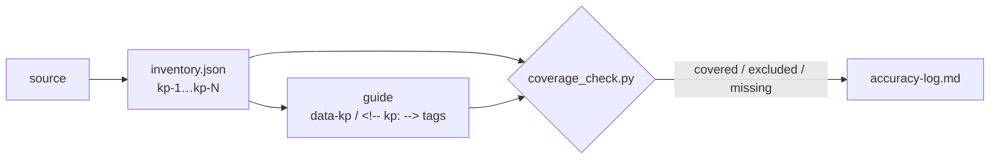

# learn — visual learning guides

A separate plugin in the `100x-engineer` marketplace. It turns a long source (RFC, design doc, finished postmortem, architecture note, talk or lecture transcript, paper) into a scannable HTML or Markdown guide with an accuracy log. It does not depend on the `100x` plugin, and `100x` does not load it.

```bash
claude plugin marketplace add gauravprwl14/100x-engineer   # once, if not added yet
claude plugin install learn@100x-engineer
```

Invoke: `/learn:guide [summary|outline|detail|cheatsheet|…] <source>`. With no command it writes a `summary` for short asks, and an `outline` (then `detail`) when you ask for a full guide.



| Path | What |
|---|---|
| `skills/guide/SKILL.md` | The skill (`/learn:guide`) |
| `skills/guide/references/` | Content types, page template, visual techniques, output formats and escaping, accuracy log and checklist |
| `skills/guide/assets/html-shell.html` | Self-contained HTML starter: nav, routing, print-all, light/dark, a11y |
| `skills/guide/assets/techniques/` | 29 per-technique snippets + `INDEX.md` (read one, not the gallery) |
| `skills/guide/assets/technique-gallery.html` | All 29 techniques live, for a human in a browser |
| `scripts/coverage_check.py` | Stdlib: computes covered / excluded / missing key points from the guide's tags |
| `tests/test_coverage_check.sh` | Good and failing cases for the checker |
| `evals/README.md` | The evaluation protocol (not yet run) |

## Not for

| Ask | Use instead |
|---|---|
| "Summarize this" in chat | No skill; a plain answer |
| A PR | `100x:pr-review` (own diff: `100x:diff-review`) |
| How some code works | `100x:codebase-comprehension` |
| Meeting notes / action items | Not this skill; a decision/action table in chat |
| One diagram | `100x:diagramming` |

## Checks

```bash
bash plugins/learn/tests/test_coverage_check.sh
python3 scripts/lint_skills.py --root plugins/learn     # the 100x skill contract, applied to this skill
```

Both also run from the repo's `bash tests/run_all.sh`. The skill's quality has **not** been benchmarked yet; see `evals/README.md`.
