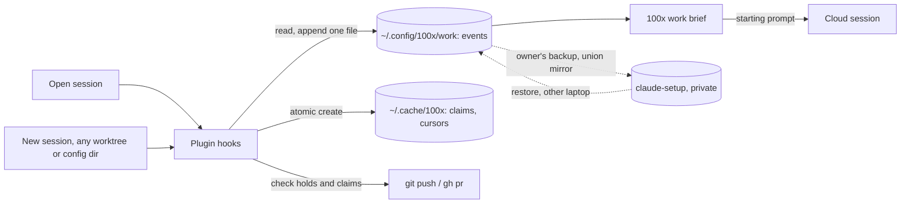

# work-continuity — PRD

**Summary.** Work state should live in a shared record, not in a chat session. Today one session carries weeks of work: in two real sessions that meant 34 context summaries, about 18.4 billion re-read tokens, and the same corrections given dozens of times. This PRD proposes a **private work record**: plain append-only files in `~/.config/100x/work` on the owner's machine (ADR-0006). Nothing reaches any project repository, the plugin never pushes, and the owner's own backup (claude-setup) carries it to a new laptop. Any local session (old, new, background, any worktree, either config dir) resumes from a short brief, sees what changed, and respects holds and claims. Parallel work keeps using subagents, briefed with a short card instead of a copy of the conversation. Cloud sessions get the brief in their starting prompt.

| field | value |
|---|---|
| kind | product |
| stack | Python (100x CLI and hooks), git, Claude Code hooks |
| scale tier | small |
| risk | none |
| linked spec | specs/work-continuity/spec.md (run `100x plan_feature new work-continuity --tier small --risk none --kind ... --work ...` for it) |
| created | 2026-10-30 |
| status | **draft — not ready to hand to a spec** |

Status becomes `ready` only when `100x prd audit` passes. Every number and constraint carries a `source` (user, assumed, default, code); a `ready` PRD may not rest on an `assumed` target or constraint.

**Load tier `small`** (< 10,000 users; low tens of requests/sec at peak), **risk `none`** — declared, never defaulted; see `skills/scale-appropriateness/SKILL.md`. The spec this PRD seeds must carry the same tier (`100x prd align` checks).

Decisions: [ADR-0006](../../decisions/ADR-0006-work-record-is-private-plain-files-in-config-100x-work-backed-up-by-the-owner-s-own-setup-the-plugin-never-pushes.md) (private files, backed up by the owner's setup). ADR-0004 and ADR-0005 are rejected: they put the record in project repositories. Depends on gauravprwl14/claude-setup#1 (union mirror, rebase before push).

## Contents

| section | answers |
|---|---|
| [1. Problem](#1-problem) | what goes wrong today, with numbers from two real sessions |
| [6. Requirements](#6-requirements) | what any session, anywhere, must be able to do |
| [7. Options analysis](#7-options-analysis) | where the private state could live, scored |
| [9. Design overview](#9-design-overview) | the private record, the claim lock, the hooks, how a session resumes |
| [9b. Edge cases](#9b-edge-cases) | open + new session, cloud quick fix, crash, two sessions on one PR, two laptops |
| [9c. Parallel work without forks](#9c-parallel-work-without-forks) | how parallel speed is kept while forks are dropped |
| [11. Phasing](#11-phasing) | prerequisites, then brief and fork warning, then awareness and locks |
| [21. Open questions](#21-open-questions--assumptions) | what is still unverified |

## 1. Problem

| field | answer |
|---|---|
| who has this problem | an engineer who runs Claude Code on one feature family (several related PRs across backend and frontend) for days or weeks, from several sessions, worktrees and config dirs, and sometimes from a second laptop or a cloud session |
| what they do today | keeps one long session open per feature family so the agent "remembers"; restates branch ownership, conventions and decisions after each context summary; asks "what is the status"; answers ad-hoc question lists |
| what "better" means, measurably | M1–M4 below: fewer restated corrections, a fresh session resumes without help, fewer fork tokens, fewer questions reaching the human |

Evidence (session transcripts `7f980c91` over 5 days and `a94b2d46` over 6 weeks, measured on 2026-10-30 with `bench/work-continuity/transcript_metrics.py`; results in `bench/work-continuity/README.md`):

| signal | 7f980c91 | a94b2d46 |
|---|---|---|
| user prompts (excluding injected summaries) | 64 | 752 |
| context summaries (compactions) | 6 | 28 |
| re-read tokens: main thread / subagents | 1.1 B / 0.9 B | 7.2 B / 10.1 B |
| fork subagents: count and share of the session's tokens | 0 | 327 agents, 8.0 B, about 46% |
| restated branch ownership | 11 | 37 |
| "what is the status" | 8 | 48 |
| "I don't understand" | 8 | 39 |
| M1: restated ownership + status asks per 100 prompts | 29.7 | 11.3 |

Audit cost (127 of 156 subagents in 7f980c91) is a separate problem caused by a project's own review hook; it is out of scope here (X5).

## 2. Users

| # | segment | current workaround | why they would adopt this |
|---|---|---|---|
| U1 | solo engineer driving agents across several PRs of one feature | one long session per feature family | resume from any session in under a minute, with no restating |
| U2 | the same engineer on a second laptop, or starting a cloud session | restates everything | the record follows the owner's backup; a cloud session starts with the brief |

## 3. Goals

| # | goal | measured by |
|---|---|---|
| G1 | state outlives sessions: any local session can resume a workstream | M1, M2 |
| G2 | a session that stays open sees what other sessions changed before it acts | M2 |
| G3 | parallel work costs less without losing speed | M3 |
| G4 | the human answers fewer, clearer questions | M4 |
| G5 | teammates see nothing; nothing manual on a new laptop | X4, P0 |

## 4. Success metrics

Every metric needs a number, a way to measure it, and where the number came from. `assumed` is allowed while drafting and rejected once `ready`.

| # | metric | target (must include a number) | baseline | measurement method | source |
|---|---|---|---|---|---|
| M1 | restated corrections (branch ownership, status, conventions) per 100 prompts | ≤ 3 | 11.3 (a94b2d46), 29.7 (7f980c91) | `bench/work-continuity/transcript_metrics.py` (`m1_restated_per_100`) | assumed |
| M2 | a fresh session states a workstream's PRs, holds, open decisions and next step correctly | ≤ 60 s and a brief of ≤ 3,000 tokens | without a brief 2 of 7; with a hand-written brief 7 of 7 in 9 s (resume bench, 3 runs each, 2026-10-30) | resume bench (`bench/work-continuity/resume/`), then a scripted resume on a real workstream | assumed |
| M3 | fork agents' share of a workstream's tokens | ≤ 5% | 46% | `transcript_metrics.py` (`fork_token_share`) | assumed |
| M4 | questions reaching the human per merged PR | ≤ 5 | not measured; prompts containing an approval phrase ("go ahead", "agreed", "yes") are common, but only 9 of 816 are approval alone | question events by class in the record | assumed |

## 5. Constraints

| constraint | value | source |
|---|---|---|
| team size and skills | one owner-maintainer of the plugin; users are engineers on any stack | user |
| existing stack | Python (100x CLI and hooks), git, Claude Code hooks; the owner's backup is claude-setup | code |
| deadline | none stated | user |
| budget | free, local, open-source tools only; no hosted services or billed APIs (G-SCO-06) | user |
| compliance / regulatory | none for the tool; the record must not hold secrets; repository addresses are stored as `host/owner/repo`, never a URL that can carry a token | default |
| data residency | the owner's machine, and the owner's private claude-setup repository on GitHub, which already backs up work memory (claude-setup `tools/sync.py:33-34`) | code |
| data retention | as long as the folder exists; events are never moved or deleted by the plugin (a summary event replaces old ones in the brief) | default |
| what cannot change | nothing in any project repository, branch, ref, git config or PR text; the plugin never pushes and never calls `gh` (ADR-0002, `docs/SAFETY.md`); generic for any project; Python stdlib + git | user |

## 6. Requirements

| # | requirement | why it matters |
|---|---|---|
| R1 | a **workstream** (feature family) holds 0..N PRs, in one or more repos; a session may work on several PRs | one session per PR is too rigid |
| R2 | any local session (open, new, `--bg`, `-p`, any worktree, either config dir) resumes a workstream from the record alone | the old session gets lost, summarised, or sits in another worktree |
| R3 | PR facts (CI, reviews, merged) are never stored; the brief lists PR numbers and branches and tells the agent to read live state itself | stored copies go stale; plugin tools do not call `gh` (ADR-0002) |
| R4 | only non-derivable facts are stored: goal, PR roles and merge order, decisions, open questions, holds, conventions, handoff notes | keeps the record small and true |
| R5 | every write is one new uniquely named file; no file is edited by two writers; the workstream view and the repo/branch → workstream lookup are derived in memory | concurrent sessions and two laptops never conflict |
| R6 | a claim on a PR is an atomic create on this machine: exactly one session holds it | the "fix landed on the wrong branch" class |
| R7 | an open session learns about changes made elsewhere before its next prompt and before any push or PR | old session + new session |
| R8 | holds are enforced by a hook | prose rules were restated 37 times in one session |
| R9 | questions carry class A/B/C, plain-language text, a recommendation and a default; A/B apply and are listed, only C waits | decision fatigue |
| R10 | parallel subagents get a brief built from the record; a fork is warned on (`allow`, `warn`, `refuse`) once the session has been summarised | 46% of tokens went to forks |
| R11 | hooks read local files only and never touch the network | the SessionStart hook is killed at 10 s (`hooks/hooks.json:10`) |
| R12 | the brief tells the agent it is private: never quote it in commits, PR text or review comments | nothing reaches teammates through the agent |
| R13 | configuration is user-level (`HUNDREDX_WORK_DIR`, `~/.config/100x/work.json`); nothing project-specific ships | generic, and nothing in project repos |
| R14 | with no record, or an unreadable one, every hook stays silent or fails open with one warning | must never break work |
| R15 | text matching the backup's secret patterns is refused when an event is written | a blocked file is silently left out of the backup |

## 7. Options analysis

`fit` is a pass/fail FILTER applied first: an option that does not solve the stated problem is out, whatever it scores. Fit-passing options are then scored 1-5 on the `approach-selection` weights (reversibility x3, blast radius x3, moving parts x2, already-in-use x2, exit cost x1); the audit recomputes every weighted score. Always include do-nothing.

| # | option | pros | cons | reversibility x3 | blast radius x3 | moving parts x2 | already-in-use x2 | exit cost x1 | fit (pass/fail) | weighted score |
|---|---|---|---|---|---|---|---|---|---|---|
| O1 | Do nothing / smallest possible change | zero new moving parts; zero new blast radius; ships today | does not solve the problem — mark fit `pass` only if the status quo is now acceptable, which is itself a decision | 5 | 5 | 5 | 5 | 5 | fail | 55 |
| O2 | Claude Code auto-memory | already injected and already backed up | one folder per working path and per config dir, so worktrees see different records; one `MEMORY.md` edited by many sessions (fails R2, R5) | 5 | 5 | 5 | 5 | 5 | fail | 55 |
| O3 | private ref in each project repo (ADR-0004) | readable by cloud sessions | lives in the team's repository (fails a hard constraint) | 4 | 4 | 3 | 2 | 4 | fail | 38 |
| O4 | a dedicated private repo the plugin pushes to | works from the cloud | the plugin would push (`docs/SAFETY.md`); duplicates the owner's backup | 4 | 3 | 2 | 2 | 3 | pass | 32 |
| O5 | local git repo in `~/.config/100x/work` + backup mirror | history per event | the backup re-bundles all history whenever a ref moves (claude-setup `tools/sync.py:209-211`); restore needs the bundle path | 4 | 4 | 3 | 3 | 4 | pass | 40 |
| O6 | plain append-only files in `~/.config/100x/work` + the owner's union backup mirror | nothing in project repos; the plugin never pushes; restore and two-laptop merge are "copy what is missing" | cloud sessions cannot read it; two laptops agree only after each syncs | 5 | 4 | 4 | 4 | 5 | pass | 48 |
| O7 | third-party orchestrator (Vibe Kanban, Claude Squad, Composio AO) | ready-made dashboard | separate database; no holds, claims or decision classes | 3 | 3 | 1 | 1 | 2 | fail | 24 |

## 8. Recommendation

| field | answer |
|---|---|
| chosen option | O6 |
| single deciding factor | it is the only option that keeps everything out of project repositories without the plugin pushing, and the owner's existing backup already restores it on a new laptop |
| what would change it | cloud sessions become the owner's main way of working — then O4, a dedicated private repository, with a superseding ADR for the push |
| override reason (if not the top fit-passing score) | none |

## 9. Design overview

**Analogy.** A hospital patient has a chart; doctors change shifts, and whoever is on duty reads the chart, treats the patient and writes a note. The chart here is a private notebook on your laptop, never in the team's files.

**The record** (`~/.config/100x/work`, or `$HUNDREDX_WORK_DIR`; every file written once, never moved or deleted):

| path | holds |
|---|---|
| `<ws>/events/<utc-ts>-<session>-<rand>.json` | one event, `"schema": 1`: `set` (goal, repos as `host/owner/repo`, PR roles, branches, merge order, conventions), `note`, `decision`, `question`, `answer`, `hold`, `release-hold`, `handoff`, `summary` |
| `~/.cache/100x/claims/<host-owner-repo>/<pr>` | a claim: holder session, expiry; created with `O_CREAT | O_EXCL`; not backed up |
| `~/.cache/100x/cursors/<session>` | the last event this session saw; not backed up |

**Commands** (`100x work …`):

| command | does |
|---|---|
| `start <ws> --repo <host/owner/repo> --pr <n>:<branch>:<role>...` | appends the first `set` event |
| `brief [<ws>]` | at most 3,000 tokens: goal, PRs and branches, holds, claims, open questions, last N events, conventions, and the line "private: never quote in commits, PR text or comments" |
| `note`, `decide`, `ask`, `answer`, `hold`, `release-hold`, `handoff` | append one event |
| `claim <pr> [--ttl 2h] [--steal]`, `release <pr>` | the per-PR lock on this machine |
| `cloud <pr> "<task>"` | starts `claude --cloud` with the brief and the task as its first prompt |
| `doctor` | read-only checks: record found and private, events readable, which workstream this folder maps to, a dry run of the SessionStart hook (would a session here get the brief, and how long it took), installed hooks per config dir, backup coverage and state, stale holds; live claims and a hook timing log are P2 |

**Hooks** (added to `hooks/hooks.json`; local files only; each fails open):

| event | does |
|---|---|
| SessionStart | maps the repo (`host/owner/repo` from `git remote`) and branch to a workstream; injects `brief`; stores the session's cursor |
| UserPromptSubmit | injects "since you last looked: …" when there are newer events (verified to work in `claude -p`: `bench/work-continuity/spike/hook-probe`) |
| PreToolUse on Bash `git push`, `gh pr create`, `gh pr ready` | refuses when the PR is held, or claimed by another live session |
| PreToolUse on Agent | when `subagent_type` is `fork` and the transcript shows a compaction, applies the fork policy (default `warn`) and suggests a brief |
| SessionEnd, or explicit `work handoff` | appends one handoff event; never on Stop, which fires after every reply (`hooks/stop_gate.py:2`) |

## 9b. Edge cases

| # | case | what happens |
|---|---|---|
| E1 | an old session is still open and you start a new one with new instructions | the new session appends events; the old session's next prompt gets "since you last looked: …"; its next push hits the PreToolUse check, which reads the holds and claims fresh from disk |
| E2 | a quick fix from a cloud session | `100x work cloud 1550 "fix the review comment"` starts the cloud session with the brief in its first prompt. It cannot write back; what it does reaches the record through the PR and a later local note |
| E3 | two local sessions claim one PR at once | the atomic create lets exactly one win; the other is told who holds it and until when, and can wait, `--steal` (logged) or work read-only |
| E4 | a session crashes mid-work | its claim expires after the TTL; with no handoff event, `brief` says "session X ended without a handoff" |
| E5 | two sessions append events at the same moment | different file names; nothing to merge |
| E6 | a PR is rebased, renamed, retargeted or merged | only its number, branch and role are stored; the brief tells the agent to check live state |
| E7 | a workstream spans repos | `set` lists each repo as `host/owner/repo`; a session in any of them finds the workstream from its own `git remote` and branch |
| E8 | two laptops | the owner's backup pushes the folder as soon as it changes and copies the other laptop's new files in on its next sync (claude-setup#1); until then each laptop sees only its own events |
| E9 | a secret is typed into a note | `note` refuses it (R15). If one gets through, erasing it means rewriting claude-setup history |
| E10 | the record grows over months | `brief` reads the derived view and the last N events; `work summarise <ws>` appends a `summary` event that the brief uses instead of older events; nothing is moved |
| E11 | a teammate on the same repo | sees nothing: no file, ref, config or commit text comes from the record (R12) |
| E12 | the branch maps to no workstream | hooks stay silent |
| E13 | the agent is tempted to paste the brief into a commit message | the brief says it is private (R12); `prose_check` already flags process narration in commits |
| E14 | an older plugin version reads a newer event | events carry `"schema"`; unknown versions are listed as "newer event, upgrade to read" and ignored |

## 9c. Parallel work without forks

There are two ways to give a helper agent context:

| | fork | fresh agent with a brief |
|---|---|---|
| analogy | photocopy the whole notebook for each helper | hand each helper a one-page task card |
| starts with | the parent's entire conversation, mistakes included | goal, owned files, worktree, verify commands, the workstream brief |
| cost per agent in a94b2d46 | about 25 M tokens (8.0 B / 327) | about 5 M tokens (1.7 B / 365); different tasks, so a rough comparison |
| runs in parallel | yes | yes, the same way |

Speed comes from running independent tasks at the same time. The plugin already does this: `plan_dag waves` groups tasks that can run together, each task gets its own worktree, and a wave is dispatched in one message (`skills/orchestrate/SKILL.md`). This PRD changes only how each helper is briefed. Headless and background launchers are a separate PRD (X7).

## 10. Risks

Likelihood and impact are integers 1-5; the audit recomputes L x I. A risk with no mitigation is a worry, not a plan.

| # | risk | likelihood (1-5) | impact (1-5) | L x I | mitigation | source |
|---|---|---|---|---|---|---|
| RI1 | Adoption is lower than the success metric assumes | 3 | 3 | 9 | hooks surface the brief automatically; phase 1 is used on the next real feature before phase 2 is built | assumed |
| RI2 | Effort estimate is wrong and scope grows mid-build | 3 | 3 | 9 | launchers, model routing and review modes are separate PRDs; phase 1 is the brief, notes and the fork warning only | assumed |
| RI3 | The existing codebase makes the recommended option more expensive than scored | 2 | 3 | 6 | phase 1 reuses `hooks/session_start.py` and the plugin's `~/.config/100x` precedent | code |
| RI4 | the record goes stale because sessions do not write their decisions into it | 4 | 4 | 16 | SessionEnd handoff; `decide` and `hold` are one command; M1 measured on a real feature decides whether phase 2 is worth building | assumed |
| RI5 | hooks slow down prompts | 2 | 3 | 6 | local files only; `doctor` times one dry run of the SessionStart hook and warns past half its timeout; a per-run timing log is P2 | default |
| RI6 | the brief leaks into commit or PR text | 2 | 4 | 8 | R12 line in every brief; reviewed in the phase 1 test plan | default |
| RI7 | the backup loses events (delete guard, secret scan) | 2 | 4 | 8 | union mirror is never pruned (claude-setup#1); secret-like text refused at write (R15) | code |

## 11. Phasing

| # | phase | ships | proves | kill criteria | source |
|---|---|---|---|---|---|
| P0 | Phase 0 — prerequisites | claude-setup#1 merged and pulled once; one manual check that `claude --cloud "<text>"` starts a session with that text as its first prompt | the backup carries the folder between laptops; cloud briefing is possible | union mirror not merged → stop before phase 2 (phase 1 still works on one laptop); cloud check fails → drop `work cloud` | assumed |
| P1 | Phase 1 — brief, notes, fork warning | `100x work start/brief/note/decide/hold/handoff/doctor`; SessionStart injects the brief; PreToolUse on Agent warns on forks after a compaction; secret refusal; a `docs/SAFETY.md` row for `~/.config/100x/work` | a fresh session resumes a real multi-PR workstream unaided (M2) and fork share drops (M3) | the brief needs more than 3,000 tokens to be correct, or M3 does not move on one workstream | assumed |
| P2 | Phase 2 — awareness and locks | UserPromptSubmit "since"; PreToolUse hold and claim check on push and PR; `claim`/`release`; `work cloud`; `doctor` shows live claims and hook timings from `~/.cache/100x/work.log` (one line per hook run: event, time taken, result, fail-open reason) | E1, E3, E5 on one machine; E8 on two laptops; M1 | a hook adds more than 1 s to a prompt at p95, or M1 does not improve | assumed |
| P3 | Phase 3 — decision queue | question events with A/B auto-apply and one batched list | M4 | M4 does not improve on one workstream | assumed |

## 12. Non-goals (out of scope)

| # | explicitly out of scope |
|---|---|
| X1 | a web dashboard or hosted service |
| X2 | storing PR, CI or review state |
| X3 | storing transcripts or code in the record |
| X4 | anything teammates can see: files, refs, config or text in project repositories |
| X5 | any project's own review or audit hook; incremental review is a separate PRD |
| X6 | the plugin pushing or calling `gh` (ADR-0002); backup is the owner's own tool's job |
| X7 | `100x run` headless/background launchers and per-task model routing — separate PRDs |

## 13. Security

Assets: the record (decisions, notes) and the power to block pushes. Trust boundary: only processes running as the owner can write the folder, so events are the owner's own; hooks still act only on structured fields (`type`, `pr`, `expires`) and treat free text as data. Abuse cases: a secret in a note (R15, E9); a stale hold blocking a push (`show` names time and session; `release-hold` and `--override` are logged events).

## 14. Privacy

Personal data touched: session ids and whatever the owner writes in notes. The folder is readable only by the owner (created `0700`). It leaves the machine only through the owner's own backup, to the owner's private repository, as work memory already does.

## 15. Observability

`100x work doctor` is read-only (no write, no fetch, no `gh`) and prints one finding per problem (id, severity, what, cause, fix); exit 1 on any error or warning. Its checks: the record dir exists and is mode 0700; every event file is readable, of this schema and well-formed (a malformed one is named with what is wrong); which workstream the folder maps to; a dry run of the SessionStart hook for that folder (would a session get the brief, and how long the one run took against the hook's timeout); the work hooks registered by each config dir's installed copy (the `installPath` in `plugins/installed_plugins.json`); whether the backup's file list covers the record dir, and whether the backup repo is stopped mid-operation or has unpushed commits (local refs only); holds older than 14 days and workstreams with no recent handoff. Live claims and a hook-run timing log are P2 (§11).

## 16. Rollout / rollback

Off until `100x work start` creates the first workstream; with no record, every hook is silent. Rollback: `HUNDREDX_WORK=off` makes every hook a no-op, or delete the folder. Nothing to undo in any project repository, because nothing was written there.

## 17. Migration

N/A because there is no existing state. `100x work import <board.md>` may seed a workstream from a hand-written board as `set` events.

## 18. Test plan

Unit: event naming and schema, view derivation, repo key from `git remote` (a URL with a token stored as `host/owner/repo`), claim atomic create and expiry, brief token budget, the privacy line in every brief, secret refusal. Integration in a throwaway home: two sessions appending at once (E5), two claimants (E3), held push refused (R8), a fork after a compaction warned (R10), nothing written inside the test repository (X4: `git status` clean and no new refs). Live: the resume bench (`bench/work-continuity/resume/`) with briefs produced by `100x work brief`; M1 and M3 from `transcript_metrics.py` after one real feature. Every hook is tested on a malformed payload.

## 19. Cost

No recurring spend. Per session: one brief (≤ 3,000 tokens) and short "since" notes.

## 20. Dependencies

git (for `git remote` and branch names), Claude Code hook events SessionStart, UserPromptSubmit, PreToolUse, SessionEnd (UserPromptSubmit and SessionEnd verified in `claude -p`), the owner's claude-setup with the union mirror (gauravprwl14/claude-setup#1) for backup.

## 21. Open questions / assumptions

| # | question | recommendation |
|---|---|---|
| Q1 | Does `claude --cloud "<text>"` start a cloud session with that text as its first prompt? (ADR-0006 A3, unverified) | phase 0 checks it by hand |
| Q2 | Do UserPromptSubmit and SessionEnd behave the same in interactive sessions as in `claude -p`? (verified in `-p` only, `spike/hook-probe`) | check in phase 1; explicit `work handoff` stays as the fallback |
| Q3 | Are the M1–M4 targets right? (assumed from two sessions) | accept for now; re-baseline after phase 1 |
| Q4 | Default claim TTL? | 2 h, renewed on each push or event |
| Q5 | Should the fork policy default to `warn` or `refuse`? | `warn` in phase 1; `refuse` if M3 does not move |

## 22. Approvers

Plugin owner (gaurav): chose private local storage backed up by claude-setup, `~/.config/100x/work`, and rebase-before-push in claude-setup on 2026-10-30 (ADR-0006). Solution-architect agent reviewed both designs on 2026-10-30.

## 23. Existing-code note

Written before the code. It reuses: `plan_dag waves` and worktrees for parallel tasks, `agent_report lint/replay` for worker reports, decision classes A/B/C from `docs/OPERATING-MODEL.md` §4–5, `hooks/session_start.py`, and the plugin's user-level `~/.config/100x/` (`hooks/recheck_gate.py:14`, `scripts/verified.py:43`). Constraints taken from code: the SessionStart timeout of 10 s (`hooks/hooks.json:10`), Stop firing on every reply (`hooks/stop_gate.py:2`), PreToolUse matching only Bash today, claude-setup's union mirror and per-area delete guard (gauravprwl14/claude-setup#1). Baselines in §1 come from the transcripts of sessions 7f980c91 and a94b2d46.
