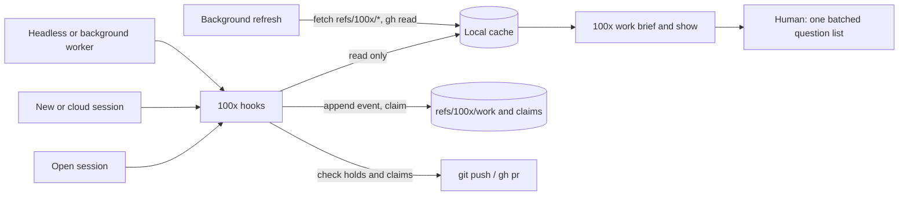

# work-continuity — PRD

**Summary.** Work state should live in a shared record, not in a chat session. Today one session carries weeks of work: in two real sessions that meant 34 context summaries, about 18.4 billion re-read tokens, and the same corrections given dozens of times. This PRD proposes a **work record** kept in an opt-in private git ref (`refs/100x/work`, ADR-0004), plus live PR facts read from GitHub. Any session (an open one, a new one, a background one, a cloud one, a teammate's) can resume, claim a PR, see what changed, and leave notes, without finding the old session. Parallel work keeps using subagents, briefed with a short card instead of a copy of the whole conversation. Phase 0 is a one-day cloud spike; phase 1 needs no network at all.

| field | value |
|---|---|
| kind | product |
| stack | Python (100x CLI and hooks), git, GitHub CLI, Claude Code hooks |
| scale tier | small |
| risk | none |
| linked spec | specs/work-continuity/spec.md (run `100x plan_feature new work-continuity --tier small --risk none --kind ... --work ...` for it) |
| created | 2026-10-30 |
| status | **draft — not ready to hand to a spec** |

Status becomes `ready` only when `100x prd audit` passes. Every number and constraint carries a `source` (user, assumed, default, code); a `ready` PRD may not rest on an `assumed` target or constraint.

**Load tier `small`** (< 10,000 users; low tens of requests/sec at peak), **risk `none`** — declared, never defaulted; see `skills/scale-appropriateness/SKILL.md`. The spec this PRD seeds must carry the same tier (`100x prd align` checks).

Decisions: [ADR-0004](../../decisions/ADR-0004-shared-work-record-lives-in-an-opt-in-private-git-ref-refs-100x-work.md) (where the record lives), [ADR-0005](../../decisions/ADR-0005-plugin-may-fetch-and-push-refs-100x-only-gh-stays-read-only-supersedes-adr-0002-scope.md) (the plugin may push `refs/100x/*` only; `gh` read-only; supersedes ADR-0002).

## Contents

| section | answers |
|---|---|
| [1. Problem](#1-problem) | what goes wrong today, with numbers from two real sessions |
| [6. Requirements](#6-requirements) | what any session, anywhere, must be able to do |
| [7. Options analysis](#7-options-analysis) | where the shared state could live, scored |
| [9. Design overview](#9-design-overview) | the record, the claim lock, the hooks, how a session resumes |
| [9b. Edge cases](#9b-edge-cases) | open + new session, cloud quick fix, crash, two sessions on one PR, no network |
| [9c. Parallel work without forks](#9c-parallel-work-without-forks) | how parallel speed is kept while forks are dropped |
| [11. Phasing](#11-phasing) | the cloud spike first, then a no-network phase 1 |
| [21. Open questions](#21-open-questions--assumptions) | what is still unverified |

## 1. Problem

| field | answer |
|---|---|
| who has this problem | an engineer who runs Claude Code on one feature family (several related PRs across backend and frontend) for days or weeks, sometimes from a laptop, a background session or a cloud session, and sometimes alongside teammates |
| what they do today | keeps one long session open per feature family so the agent "remembers"; restates branch ownership, conventions and decisions after each context summary; asks "what is the status"; answers ad-hoc question lists |
| what "better" means, measurably | M1–M4 below: fewer restated corrections, a fresh session resumes without help, fewer fork tokens, fewer questions reaching the human |

Evidence (session transcripts `7f980c91` over 5 days and `a94b2d46` over 6 weeks, measured on 2026-10-30 with `bench/work-continuity/transcript_metrics.py`; results in `bench/work-continuity/BASELINE.md`):

| signal | 7f980c91 | a94b2d46 |
|---|---|---|
| user prompts (excluding injected summaries) | 64 | 752 |
| context summaries (compactions) | 6 | 28 |
| re-read tokens: main thread / subagents | 1.1 B / 0.9 B | 7.2 B / 10.1 B |
| fork subagents: count and share of the session's tokens | 0 | 327 agents, 8.0 B, about 46% |
| restated branch ownership | 11 | 37 |
| "what is the status" | 8 | 48 |
| "I don't understand" | 8 | 39 |
| M1: restated ownership + status asks per 100 prompts | 29.7 | 11.3 |

Audit cost (127 of 156 subagents in 7f980c91) is a separate problem caused by a project's own review hook; it is out of scope here (X5).

## 2. Users

| # | segment | current workaround | why they would adopt this |
|---|---|---|---|
| U1 | solo engineer driving agents across several PRs of one feature | one long session per feature family | resume from any session in under a minute, with no restating |
| U2 | the same engineer away from the laptop (phone, cloud session) | cannot reach local state, so waits or restates everything | cloud sessions read the same record |
| U3 | a teammate picking up one PR | asks the owner in chat | reads the board; claims the PR; leaves notes |

## 3. Goals

| # | goal | measured by |
|---|---|---|
| G1 | state outlives sessions: any session can resume a workstream | M1, M2 |
| G2 | a session that stays open sees what other sessions changed before it acts | M2 |
| G3 | parallel work costs less without losing speed | M3 |
| G4 | the human answers fewer, clearer questions | M4 |

## 4. Success metrics

Every metric needs a number, a way to measure it, and where the number came from. `assumed` is allowed while drafting and rejected once `ready`.

| # | metric | target (must include a number) | baseline | measurement method | source |
|---|---|---|---|---|---|
| M1 | restated corrections (branch ownership, status, conventions) per 100 prompts | ≤ 3 | 11.3 (a94b2d46), 29.7 (7f980c91) | `bench/work-continuity/transcript_metrics.py` (`m1_restated_per_100`) | assumed |
| M2 | a fresh session states a workstream's PRs, holds, open decisions and next step correctly | ≤ 60 s and a brief of ≤ 3,000 tokens | without a brief 2 of 7; with a hand-written brief 7 of 7 in 9 s (resume bench, 3 runs each, 2026-10-30) | scripted test: new local session, then (phase 2) new cloud session, compared with the record | assumed |
| M3 | fork agents' share of a workstream's tokens | ≤ 5% | 46% | `transcript_metrics.py` (`fork_token_share`) | assumed |
| M4 | questions reaching the human per merged PR | ≤ 5 | not measured; prompts containing an approval phrase ("go ahead", "agreed", "yes") are common, but only 9 of 816 are approval alone | question events by class in the record | assumed |

## 5. Constraints

| constraint | value | source |
|---|---|---|
| team size and skills | one owner-maintainer of the plugin; users are engineers on any stack | user |
| existing stack | Python (100x CLI and hooks), git, GitHub CLI, Claude Code hooks | code |
| deadline | none stated | user |
| budget | free, local, open-source tools only; no hosted services or billed APIs (G-SCO-06) | user |
| compliance / regulatory | none for the tool; the record must not hold secrets or personal data beyond GitHub handles | default |
| data residency | N/A because the record lives in the project's own git remote | default |
| data retention | as long as the ref exists; old events move to an archive folder, never rewritten except to erase a leaked secret | default |
| what cannot change | generic for any project; off unless a repo opts in (ADR-0004); pushes only `refs/100x/*` and `gh` read-only (ADR-0005); never changes branches, PR diffs or CI of the repo; GitHub stays the source of truth for PR facts; Python stdlib + git (+ read-only `gh`) | user |

## 6. Requirements

| # | requirement | why it matters |
|---|---|---|
| R1 | a **workstream** (feature family) holds 0..N PRs and issues, in one or more repos; a session may work on several PRs | one session per PR is too rigid |
| R2 | any session (open, new, `--bg`, `-p`, `--cloud`, teammate) can resume a workstream from the record alone | the old session gets lost, summarised or is on another machine |
| R3 | PR facts (branch, base, state, CI, reviews, conflicts, merged) are read live from GitHub (read-only `gh`), never stored | stored copies go stale |
| R4 | only non-derivable facts are stored: goal, PR roles and merge order, decisions, open questions, holds, workstream conventions, handoff notes | keeps the record small and true |
| R5 | every write is an append of a uniquely named event; no single file is edited by two writers; the workstream view and the branch→workstream index are derived in memory | concurrent sessions never conflict |
| R6 | a claim on a PR is a compare-and-swap: exactly one session holds it at a time | the "fix landed on the wrong branch" class |
| R7 | an open session learns about changes made elsewhere before its next prompt and before any push or PR | open session + new session |
| R8 | holds ("don't push PR #n", "integration worktree is merge-only") are enforced by a hook; with no network, the last fetched holds still apply, and the hook says they may be stale | prose rules were restated 62 times |
| R9 | questions carry class A/B/C, plain-language text, a recommendation and a default; A/B apply and are listed, only C waits | decision fatigue |
| R10 | parallel subagents get a brief built from the record; a fork is warned on (configurable: `allow`, `warn`, `refuse`) once the session has been summarised | 46% of tokens went to forks |
| R11 | hooks never wait on the network at session start or prompt time: they read a local cache, refreshed in the background | the SessionStart hook is killed at 10 s (`hooks/hooks.json:10`) |
| R12 | free text in the brief is shown only from trusted authors (default: the current git user); other events show structured fields only | events are a prompt-injection channel |
| R13 | everything is configurable per repo in `.100x.json`; nothing project-specific ships | generic workflow |
| R14 | with no remote, no push rights or no `gh`, commands fall back to local mode with one warning; hooks never crash a session | must never break work |

## 7. Options analysis

`fit` is a pass/fail FILTER applied first: an option that does not solve the stated problem is out, whatever it scores. Fit-passing options are then scored 1-5 on the `approach-selection` weights (reversibility x3, blast radius x3, moving parts x2, already-in-use x2, exit cost x1); the audit recomputes every weighted score. Always include do-nothing.

| # | option | pros | cons | reversibility x3 | blast radius x3 | moving parts x2 | already-in-use x2 | exit cost x1 | fit (pass/fail) | weighted score |
|---|---|---|---|---|---|---|---|---|---|---|
| O1 | Do nothing / smallest possible change | zero new moving parts; zero new blast radius; ships today | does not solve the problem — mark fit `pass` only if the status quo is now acceptable, which is itself a decision | 5 | 5 | 5 | 5 | 5 | fail | 55 |
| O2 | local files under `~/.100x/work/<workstream>/` | simplest; private; no network | cloud sessions and teammates cannot see it (fails R2); kept as phase 1 and as the fallback mode | 5 | 5 | 5 | 3 | 5 | fail | 51 |
| O3 | board file committed inside each feature branch | visible in the repo | every branch has its own copy, so they diverge (fails R5); shows in PR diffs | 4 | 2 | 4 | 4 | 4 | fail | 38 |
| O4 | branch `100x/work` with event files | easy to inspect | triggers on:push CI in teammates' repos, shows in branch lists, hit by stale-branch bots, public on public repos | 4 | 2 | 2 | 2 | 4 | pass | 30 |
| O5 | GitHub tracking issue as the store | readable on github.com | needs `gh` writes, which ADR-0005 forbids in tools; notes visible to all readers; body edits race | 4 | 3 | 3 | 3 | 3 | fail | 36 |
| O6 | third-party orchestrator (Vibe Kanban, Claude Squad, Composio AO) | ready-made dashboard and worktree management | local database invisible to cloud sessions (fails R2); no claims, holds or decision classes | 3 | 3 | 1 | 1 | 2 | fail | 24 |
| O7 | opt-in private ref `refs/100x/work` for events + one ref per claimed PR, updated with `--force-with-lease` | readable by every kind of session through git; no CI trigger, not in branch lists; per-PR ref is a real compare-and-swap | custom refs are unfamiliar and not shown on github.com; needs an explicit fetch refspec; hosts or proxies may refuse them (phase 0 checks) | 4 | 4 | 3 | 2 | 4 | pass | 38 |

## 8. Recommendation

| field | answer |
|---|---|
| chosen option | O7 |
| single deciding factor | it is the only option that every kind of session can read and write through git without side effects on teammates (no CI runs, no branch noise), and its per-PR claim ref gives a real compare-and-swap |
| what would change it | phase 0 shows a cloud session cannot push `refs/100x/*` or does not load plugin hooks — then local mode (O2) for the owner plus a manual `100x work push` step, and a separate decision on GitHub writes |
| override reason (if not the top fit-passing score) | none |

## 9. Design overview

**Analogy.** A hospital patient has a chart; doctors change shifts, and whoever is on duty reads the chart, treats the patient and writes a note. The patient is not tied to one doctor. The workstream is the patient, the work record is the chart, sessions are the doctors on shift.

**The record** (in ref `refs/100x/work`, one folder per workstream; every file is written once):

| path | holds |
|---|---|
| `<ws>/events/<utc-ts>-<session>-<rand>.json` | one event, `"schema": 1`: `set` (goal, repos, PR roles, merge order, conventions), `note`, `decision`, `question`, `answer`, `hold`, `release-hold`, `handoff` |
| `refs/100x/claims/<owner>/<repo>/<n>` | the current claim on one PR: holder session, author, expiry; changed only with `git push --force-with-lease` |

The workstream view and the branch/PR → workstream index are computed from events in memory (R5).

**How an append works.** Build a commit on top of the fetched `refs/100x/work` with one new file; push. If the push is rejected because someone else appended first, fetch, rebuild on the new tip (the file names never collide) and retry up to 3 times. **How a claim works.** Read the claim ref; if it is free or expired, push the new claim with `--force-with-lease=<ref>:<old sha>`. Only one of two racing claimants succeeds; the loser is told who won. Expiry is the claimer's UTC time plus the TTL, read with a 5-minute skew margin; taking over a live claim is an explicit `--steal`, logged as an event.

**Commands** (`100x work …`; repo and branch come from git):

| command | does |
|---|---|
| `start <ws> --pr <owner/repo#n>...` | appends the first `set` event |
| `brief [<ws>]` | at most 3,000 tokens: goal, live PR table, claims, holds, open questions, last N events, conventions |
| `claim <pr> [--ttl 2h] [--steal]`, `release <pr>` | the per-PR lock |
| `note`, `decide`, `ask`, `answer`, `hold`, `release-hold`, `handoff` | append one event |
| `sync` | the background refresh (fetch `refs/100x/*`, read PR facts with `gh`) into the cache |
| `show` | the board for humans |
| `doctor` | last sync, unpushed events, live claims, hook timings, cloud readiness |

**Hooks** (added to `hooks/hooks.json`; each reads only the cache, has a short timeout and never crashes the session):

| event | does |
|---|---|
| SessionStart | maps branch or PR to a workstream, injects `brief` from cache, starts `work sync` in the background, stores the session's event cursor |
| UserPromptSubmit | injects "since you last looked: …" when the cache holds newer events (support for injecting context here is checked in phase 0) |
| PreToolUse on Bash `git push`, `gh pr create`, `gh pr ready` | refuses when the PR is held or claimed by another session; tries a 3 s fetch first, and on failure uses the cache and says so |
| PreToolUse on Agent | when `subagent_type` is `fork` and the transcript shows a compaction, applies `work.fork_policy` (default `warn`) and suggests a brief |
| SessionEnd, or explicit `work handoff` | appends one handoff event; never on Stop, which fires after every reply (`hooks/stop_gate.py:2`) |

**Config** (`.100x.json`, all optional): `work.mode` (`off` default, `local`, `shared`), `work.remote`, `work.lease_ttl`, `work.fork_policy`, `work.trusted_authors`, `work.brief_tokens`.

## 9b. Edge cases

| # | case | what happens |
|---|---|---|
| E1 | an old session is still open and you start a new one with new instructions | the new session appends events (a decision, a hold) or takes a claim. The old session's next prompt gets "since you last looked: …" from the cache; its next push hits the PreToolUse check, which fetches holds and claims fresh. Neither session needs the other's id. |
| E2 | a quick fix from a cloud session | `claude --cloud "fix review comment on owner/repo#1550"`: SessionStart has no cache yet, so it runs one bounded fetch (within the hook timeout) or tells the agent to run `100x work brief`. The session claims 1550, fixes it, pushes, appends a handoff. Phase 0 checks this path really works. |
| E3 | two sessions claim one PR at once | `--force-with-lease` lets exactly one win; the other is told who holds it and until when, and can wait, `--steal` (logged) or work read-only. |
| E4 | a session crashes mid-work | its claim expires after the TTL; with no handoff event, `brief` says "session X ended without a handoff; uncommitted work may exist in worktree W" (local only). |
| E5 | two sessions append events at the same moment | the second push is rejected, rebuilt on the new tip and retried; file names never collide, so nothing is lost. |
| E6 | a PR is rebased, renamed, retargeted or merged | only its number and role are stored; `brief` shows the live state from GitHub. |
| E7 | a workstream spans repos | the record lives in one home repo (`work.remote`); PRs are `owner/repo#n`. A session in the other repo finds the home repo from its own `.100x.json` (needs a one-line commit there, done only with that repo's agreement) or a user-level setting. |
| E8 | no network, no push rights, no `gh`, or the host refuses custom refs | commands warn once and queue events locally; holds are enforced from the last cache with a "may be stale" note; `doctor` shows what is queued. |
| E9 | a secret or token is written into an event | `note` refuses text matching the secret patterns `appsec_check` uses. If one gets through, the documented erasure is a rewrite of `refs/100x/work` plus asking clones to refetch; this cannot reach copies already fetched (ADR-0004 gap). |
| E10 | the event log grows over months | `brief` reads only the derived view and the last N events; `work compact <ws>` writes a summary event and moves old events to `archive/`. |
| E11 | a teammate without 100x | they keep using GitHub as usual; holds bind only sessions running the plugin (X4). |
| E12 | the branch maps to no workstream | hooks stay silent. |
| E13 | an event from an untrusted author contains instructions | the brief shows only its structured fields (type, PR, time, author), not its text (R12). |
| E14 | an older plugin version reads a newer event | events carry `"schema"`; unknown versions are listed as "newer event, upgrade to read" and ignored. |

## 9c. Parallel work without forks

There are two ways to give a helper agent context:

| | fork | fresh agent with a brief |
|---|---|---|
| analogy | photocopy the whole notebook for each helper | hand each helper a one-page task card |
| starts with | the parent's entire conversation, mistakes included | goal, owned files, worktree, verify commands, the workstream brief |
| cost per agent in a94b2d46 | about 25 M tokens (8.0 B / 327) | about 5 M tokens (1.7 B / 365); different tasks, so a rough comparison |
| runs in parallel | yes | yes, the same way |

Speed comes from running independent tasks at the same time. The plugin already does this: `plan_dag waves` groups tasks that can run together, each task gets its own worktree, and a wave is dispatched in one message (`skills/orchestrate/SKILL.md`). This PRD changes only how each helper is briefed. Opt-in launchers for work that should not hold the main session (`claude -p` with `--max-budget-usd`, which works only with `--print`; `claude --bg`, which has no cost cap) are a separate PRD (X7).

## 10. Risks

Likelihood and impact are integers 1-5; the audit recomputes L x I. A risk with no mitigation is a worry, not a plan.

| # | risk | likelihood (1-5) | impact (1-5) | L x I | mitigation | source |
|---|---|---|---|---|---|---|
| RI1 | Adoption is lower than the success metric assumes | 3 | 3 | 9 | hooks surface the brief automatically; phase 1 is used on the next real feature before phase 2 is built | assumed |
| RI2 | Effort estimate is wrong and scope grows mid-build | 3 | 3 | 9 | launchers, model routing and review modes moved to separate PRDs; phase 1 has no network code | assumed |
| RI3 | The existing codebase makes the recommended option more expensive than scored | 2 | 3 | 6 | phase 0 spike before any sync code | assumed |
| RI4 | the record is stale or wrong and agents trust it over reality | 3 | 4 | 12 | PR facts never stored; every stored fact shows its time and author; verification still runs against code | default |
| RI5 | hooks slow down prompts or get killed by their timeout | 2 | 3 | 6 | hooks read the cache only; network work runs in the background; timings logged and shown by `doctor` | code |
| RI6 | a cloud session cannot load plugin hooks, lacks `gh` auth, or cannot push `refs/100x/*` | 3 | 4 | 12 | phase 0 tests all three before anything else is built; fallback in §8 | assumed |
| RI7 | a forged or careless hold blocks a teammate | 2 | 3 | 6 | `show` names author and time; `release-hold` and `--override` are logged events | default |

## 11. Phasing

| # | phase | ships | proves | kill criteria | source |
|---|---|---|---|---|---|
| P0 | Phase 0 — cloud spike (about 1 day, throwaway) | a test repo; from a `claude --cloud` session: does the plugin load and its SessionStart hook run, is `gh` authenticated, can it fetch and push `refs/100x/test`; locally: does a UserPromptSubmit hook inject context, does SessionEnd fire | the riskiest assumption (RI6) | any of the three cloud checks fails → re-plan per §8 before phase 2 | assumed |
| P1 | Phase 1 — local brief and fork warning | `work.mode=local`: `work start/brief/note/decide/handoff` on local files; SessionStart injects the brief; PreToolUse on Agent warns on forks after a compaction | a fresh local session resumes a real multi-PR workstream unaided (M2, local) and fork share drops (M3) | the brief needs more than 3,000 tokens to be correct, or M3 does not move on one workstream | assumed |
| P2 | Phase 2 — shared record | `work.mode=shared`: events in `refs/100x/work`, per-PR claim refs, background `sync` and cache, UserPromptSubmit "since", PreToolUse hold and claim check, trusted-author filter; `docs/SAFETY.md` revised in the same PR (ADR-0005) | E1–E8 on two machines and one cloud session; M1, M2 (cloud) | a hook adds more than 1 s to a prompt at p95, or a wrong-branch push still happens | assumed |
| P3 | Phase 3 — decision queue | question events with A/B auto-apply and one batched list | M4 | M4 does not improve on one workstream | assumed |

## 12. Non-goals (out of scope)

| # | explicitly out of scope |
|---|---|
| X1 | a web dashboard or hosted service |
| X2 | replacing GitHub as the source of truth for PRs, CI or reviews |
| X3 | storing transcripts or code in the record |
| X4 | enforcing holds on humans or tools outside Claude Code |
| X5 | any project's own review or audit hook; incremental review is a separate PRD |
| X6 | automatic merging, and any GitHub write from tools (ADR-0005) |
| X7 | `100x run` headless/background launchers and per-task model routing — separate PRDs |

## 13. Security

Assets: the record (decisions, notes) and the power to block pushes. Trust boundary: anyone with push rights can write events, so events are data, never instructions. Hooks act only on structured fields (`type`, `pr`, `expires`); free text reaches the model only from `work.trusted_authors` (R12, E13). Abuse cases: a forged hold (RI7); a secret in a note (E9); a forged claim (`show` names the author; `--steal` is logged). Pushes are limited to `refs/100x/*` and `gh` to reads (ADR-0005).

## 14. Privacy

Personal data touched: GitHub handles, git author emails and session ids in events. `note` refuses emails and tokens in free text (E9). The record is readable by anyone with read access to the repo, which is stated in `doctor` and in the opt-in prompt. Retention follows the ref (§5).

## 15. Observability

`100x work doctor`: last sync, queued events, live claims, cloud readiness, and hook timings from `~/.100x/logs/work.log` (one line per hook run: event, time taken, result, fail-open reason).

## 16. Rollout / rollback

Off by default. Phase 1 is `work.mode=local`; phase 2 adds `shared`, turned on per repo by its owner. Rollback: `work.mode=off` makes every hook a no-op. Removing shared state: `git push origin --delete refs/100x/work` and each claim ref; copies teammates already fetched stay on their machines (ADR-0004 gap).

## 17. Migration

N/A because there is no existing state. `100x work import <board.md>` may seed a workstream from a hand-written board as `set` events.

## 18. Test plan

Unit: event naming and schema, view derivation, claim expiry with skew margin, brief token budget, trusted-author filter, secret refusal. Integration against a temporary bare remote: two writers appending at once (E5), two claimants racing (E3), held push refused (R8), cached holds enforced with no remote (E8), unknown schema version (E14). Live: phase 0 spike in a real cloud session; M2 scripted resume. Every hook is tested on a malformed payload and on a timeout.

## 19. Cost

No recurring spend: git and read-only `gh`. Per session: one brief (≤ 3,000 tokens) and short "since" notes.

## 20. Dependencies

git ≥ 2.20 (`--force-with-lease`, custom refspecs), `gh` authenticated (phase 2), Claude Code hook events SessionStart, UserPromptSubmit, PreToolUse, SessionEnd (the last two checked in phase 0), cloud sessions with plugin hooks and git push access (phase 0).

## 21. Open questions / assumptions

| # | question | recommendation |
|---|---|---|
| Q1 | Do cloud sessions load plugin hooks, have `gh` auth, and allow pushing `refs/100x/*`? (ADR-0004 A3, unverified). Locally verified 2026-10-30: GitHub accepts `refs/100x/*`, a default clone does not fetch it, stale appends are rejected, and the claim compare-and-swap lets one claimant win (`bench/work-continuity/spike/probe_ref.sh`, 8 of 8) | run `spike/cloud_probe.sh` in a cloud session; no sync code before |
| Q2 | Can UserPromptSubmit inject context, and does SessionEnd fire? Verified in `claude -p` on 2026-10-30 (`spike/hook-probe`: the model returned the injected marker; SessionEnd logged). Interactive and cloud sessions not yet checked | keep explicit `work handoff` as the fallback |
| Q3 | Are the M1–M4 targets right? (assumed from two sessions) | accept for now; re-baseline after phase 1 |
| Q4 | Default claim TTL? | 2 h, renewed on each push or event |
| Q5 | Should notes default to shared or local in shared mode? | shared, with `--private` for a local-only note |

## 22. Approvers

Plugin owner (gaurav): agreed the storage choice and the safety-promise change on 2026-10-30 (ADR-0004, ADR-0005). Both stay `proposed` until phase 0 passes; they become `accepted`, and ADR-0002 `superseded`, in the PR that first ships code relying on them. Solution-architect agent reviewed the first draft on 2026-10-30; its findings F1–F11 are addressed in this revision.

## 23. Existing-code note

Written before the code. It reuses: `plan_dag waves` and worktrees for parallel tasks, `agent_report lint/replay` for worker reports, decision classes A/B/C from `docs/OPERATING-MODEL.md` §4–5, `hooks/session_start.py` and the `.100x.json` config. Constraints taken from code: the SessionStart timeout of 10 s (`hooks/hooks.json:10`), Stop firing on every reply (`hooks/stop_gate.py:2`), PreToolUse matching only Bash today, `--max-budget-usd` working only with `--print` (`claude --help`, 2.1.308). Baselines in §1 come from the transcripts of sessions 7f980c91 and a94b2d46.
