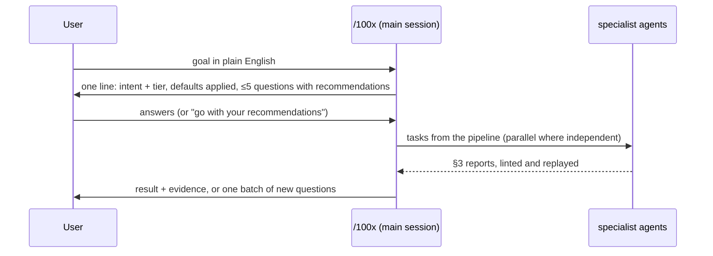

# 100x — the front door

The user should not need to know this plugin has dozens of skills and eleven agents. They
describe the goal; this skill picks the pipeline. Every phase it starts follows the operating model,
`${CLAUDE_PLUGIN_ROOT}/docs/OPERATING-MODEL.md` (in this repo: `docs/OPERATING-MODEL.md`), which wins
any disagreement with this file.

## Trigger

**Fire when:** any engineering request starts — a feature, a bug, an outage, "how does X work", a
review, a PRD, a test plan, a release — and no pipeline is already running for it.

**Do not fire when:** a pipeline from this skill is already in progress for the same goal (continue
it), or the request is a one-line factual question that needs no workflow ("what does this flag do").

## What the user experiences



1. **Restate** the goal in one sentence and name the intent you classified ("This is a *build*,
   tier `small`, touching `api` + `web-ui`").
2. **Ask** at most five questions, only those whose answer changes the plan, each with why it
   matters, options and your recommendation (`requirements-intake`). Zero questions is a fine outcome.
3. **State the defaults** you are applying, briefly: "Applying: authz on every endpoint, pagination
   capped at 100, responsive to 320px, empty/error states, WCAG 2.2 AA." Never ask about these.
4. **Proceed.** Non-blocking questions left unanswered go ahead on the recommendation, marked
   `ASSUMED`. Residency, compliance, retention and money wait for an answer (§5).

## Classify the intent

| intent | signals in the request |
|---|---|
| build | "add", "build", "implement", "support X", a new screen/endpoint/job |
| fix | a defect whose expected behaviour is known: "X returns Y, should be Z" |
| incident | production broken or was broken, outage, intermittent/CI-only failure, cause unknown |
| understand | "how does X work", "explain", "onboard me", "where is", "walk me through this PR", before touching unfamiliar code |
| review-own | "review my changes", before your own commit/PR |
| review-other | a PR number, a teammate's or another agent's diff; a PR URL whose review should be posted as comments |
| plan-PRD | "PRD", "spec", "design doc", "approach", "should we", build-vs-buy, anything bigger than one feature |
| change-untested | modify code with no tests covering the part being touched |
| QA | "test plan", "is this covered", "write tests", regression suite |
| ship | release, deploy, rollout, publish, migration go-live, mobile store submission |

Ambiguous? Choose the most likely intent, say which, and continue. Ask only when two candidates lead
to different pipelines **and** the wrong one would change code or data.

## Pipeline per intent

Skills run in the order listed. Agents are this plugin's subagents (`100x:<name>`).

| intent | skills, in order | agents | gates |
|---|---|---|---|
| build | requirements-intake → scale-appropriateness → feature-planning → approach-selection / decision-records for real choices → orchestrate → per area: api-contract, data-modeling, ui-baseline, accessibility, web-vitals, mobile-release-safety → code-craft → diff-review → verification-gate | requirements-analyst, solution-architect, backend / frontend / mobile-engineer, qa-engineer, code-reviewer, security-reviewer, independent-verifier | `100x plan_feature audit`, `100x plan_dag stamp` + `lint`, `100x agent_report lint` + `replay`, `100x bloat_check`, `100x craft_check`, `100x review_scope`, `100x verified` |
| fix | bug-fix → test-design (regression test first) → minimal-diff → code-craft → diff-review → verification-gate | the engineer for the area, code-reviewer, independent-verifier; security-reviewer if routes, auth, input, tenancy, uploads or infra changed | failing test before the fix, `100x bloat_check`, `100x craft_check`, `100x verified` |
| incident | root-cause-analysis → bug-fix → release-rollout (rollback or flag-off first if users are hurting) → project-learning | rca-investigator, then the engineer for the area, independent-verifier | `100x rca lint`, `100x rca link`, `100x decide drift` |
| understand | codebase-comprehension → diagramming → project-learning; explain only when asked for a visual step-through of a PR or concept; explain-sync to refresh the docs after merges | comprehension-mapper | `100x repo_map`, `100x check_diagrams`, `100x check_index`; for explain `100x flow check`; for explain-sync `100x explain_sync status` |
| review-own | diff-review → minimal-diff → code-craft → verification-gate → pr-description when it opens a PR | code-reviewer; security-reviewer if auth, input, tenancy or uploads changed | `100x review_scope`, `100x bloat_check`, `100x craft_check` |
| review-other | diff-review → stack-reviewer → app-security → untrusted-agent-config before running their code; pr-review when the findings go to GitHub as comments | code-reviewer, security-reviewer, solution-architect for design fit | `100x review_scope`, `100x bloat_check`; for pr-review `100x pr_review_gate` |
| plan-PRD | requirements-intake → scale-appropriateness → solution-architecture → approach-selection → decision-records → feature-planning → orchestrate | requirements-analyst, solution-architect | `100x prd audit`, `100x prd align`, `100x plan_feature audit`, `100x decide lint`, `100x plan_dag stamp` + `lint` |
| change-untested | requirements-intake → codebase-comprehension → legacy-change (characterisation tests first) → test-design → minimal-diff → diff-review | comprehension-mapper, qa-engineer, the engineer for the area, code-reviewer | characterisation tests pass before the change, `100x bloat_check`, `100x verified` |
| QA | requirements-intake → qa-strategy → test-design → accessibility → performance-budgets at growth+ | qa-engineer, independent-verifier | `100x testplan new` + `trace`, `100x test_design_check`, `100x verified` |
| ship | release-rollout → data-lifecycle for migrations or deletions → mobile-release-safety for mobile → observability-design → verification-gate → pr-description when it opens a PR | solution-architect (rollout/rollback), independent-verifier | `100x verified`, the `PreToolUse` receipt gate, the `Stop` hook |

Every intent that builds or reviews runs `100x baseline show --work <type> --tier <tier>` for each
work type touched: its A items are applied, its in-tier B items listed, its C items asked.

## When to orchestrate

| situation | do |
|---|---|
| one specialist, a handful of files | work in the main session with the pipeline's skills; a build or fix touching 2+ files still runs code-reviewer before done, and security-reviewer when routes, auth, input, tenancy, uploads or infra change |
| two or more specialists, or tasks that can run in parallel | `orchestrate`: approved spec → `plan.json` → `100x plan_dag stamp` → `100x plan_dag lint` → `100x plan_dag waves` → one agent per task, each in its own worktree |
| any non-trivial build, before merge | independent-verifier re-runs each task's declared verify commands; code-reviewer and security-reviewer review the merged diff |

Orchestration stays in the main session (§1): agents never talk to the user, and their questions come
back in their reports. Batch every open question from every agent into one message. A task that
returns `needs-decision` pauses only its dependents (§6).

`<root>` below is the records root: `docs/engineering/` by default, or `.100x.json`
`{"root": "..."}` at the git root, or `HUNDREDX_ROOT_DIR` (`docs/OPERATING-MODEL.md` §8).

## Rules

1. Classify the intent and state it, with the tier and work types, before changing any file.
   *Enforced by:* review — the first reply names the intent

2. Build, plan-PRD, change-untested and QA requests go through `requirements-intake` before design.
   *Enforced by:* `100x plan_feature audit <root>/specs/<name>` (blocks implementation on an unfilled spec)

3. Ask at most five questions, only plan-changing ones, each with options and a recommendation.
   *Enforced by:* `100x plan_feature audit <root>/specs/<name>` (rejects a question with no
   recommendation); the count is review

4. Apply baseline defaults without asking, and say which were applied.
   *Enforced by:* `100x baseline show --work <type> --tier <tier>`

5. Orchestrate only from a task graph stamped against an audited, `ready` spec that lints; two
   parallel tasks never own the same files.
   *Enforced by:* `100x plan_dag stamp plan.json`, then `100x plan_dag lint plan.json`

6. No agent result is merged until its report lints against git's real changes and the task's
   declared verify commands replay with the claimed exit codes.
   *Enforced by:* `100x agent_report lint <report.json> --graph plan.json --cwd <wt>` and
   `100x agent_report replay <report.json> --graph plan.json --cwd <wt> --yes`

7. One-way doors (§4) go to the user as questions; neither this router nor any agent decides them.
   *Enforced by:* `100x agent_report lint` (rejects a `door: one-way` decision)

8. Nothing is called done without a fresh receipt for the code being shipped.
   *Enforced by:* `100x verified --name <label> -- <cmd>` and the `PreToolUse` hook

## Verify

```bash
100x list                                          # the plugin's tools resolve (~0.1s)
100x baseline show --work api --tier small         # the defaults this router applies (~0.1s)
100x plan_feature audit <name>                     # intake and spec complete (~0.2s)
100x plan_dag stamp plan.json                      # record the approved spec and base
100x plan_dag lint plan.json                       # task graph valid before agents start
100x agent_report lint report.json --graph plan.json --cwd <wt>          # per agent result
100x agent_report replay report.json --graph plan.json --cwd <wt> --yes  # its declared verify commands
```

## Failure modes

This skill rejects:

- **Starting to code before classifying.** A "fix" that was really a missing feature ships without
  a spec, and nobody asked the retention question.
- **The interrogation.** Twelve questions, half of them defaults ("Should it be accessible?"). Five
  at most, plan-changing only, each with a recommendation.
- **Silent defaults.** Applying authz, pagination and WCAG without saying so; the user cannot
  correct an assumption they never saw.
- **Orchestrating a one-file fix** through six agents, or doing a five-area feature single-threaded
  with no review. The table above decides.
- **Merging on a report's word.** "Tests pass" without `agent_report replay --graph` is a claim.
- **An agent deciding a migration or a new dependency** because nobody routed the question back.

**Honest limitations:** intent classification is judgement; a mixed request ("fix this and add
that") is split into two pipelines, which the router must notice. The router cannot detect a one-way
door no agent reported — `agent_report lint` catches only declared decisions.

## Scale

Every task and tier. At `prototype` most pipelines collapse to a few skills and no agents; the
classification and the defaults statement still happen, because they cost one line.

## Sources

- Roles, agent protocol, report contract, decision and question policies, orchestration rules:
  `docs/OPERATING-MODEL.md` §1–§7.
- Two-way / one-way door split: Amazon 2015 shareholder letter, cited in `docs/OPERATING-MODEL.md` §4.
- Skill order by phase: `skills/INDEX.md`; command sequence per task: `docs/PLAYBOOK.md`.
- Subagent preloading and plugin agent namespacing (`<plugin>:<agent>`):
  https://code.claude.com/docs/en/sub-agents, https://code.claude.com/docs/en/plugins/components.
- A single front door that routes rather than a catalogue the user must browse: SOURCE: original.
