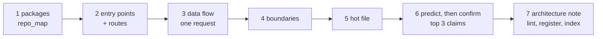

# Codebase comprehension

Reading everything is not a strategy. It does not scale past a few hundred files and
says nothing about which files mattered. The alternative is a fixed order that narrows
fast, ending in a note the next person can read instead of repeating the investigation:
entry points say what the system is *for*, data flow says what actually happens,
boundaries say where it can fail, and the hot file is where the real logic lives.

## Trigger

**Fire when:** asked to explain or understand a feature, module or package you did not
write; about to modify code you do not yet understand; tracing a bug to its cause;
onboarding to a new repo, service or monorepo.

**Do not fire when:** reviewing someone's diff (`diff-review`,
`stack-reviewer`); writing new code from a spec (`feature-planning`);
recording a decision (`decision-records`); something is broken in production and needs a
causal chain (`root-cause-analysis`, which can use this skill's map first); or the code
is one file under ~100 lines with no unfamiliar imports. Just read that one.

## Order of operations



1. **Packages.** `100x repo_map <root>` lists files with `git ls-files`, so gitignored
   build output never enters the map, and detects pnpm/npm/yarn, turbo, nx, lerna,
   go.work, Cargo and Gradle workspaces. In a monorepo, pick the package that owns the
   area and re-run `repo_map <package-dir>` scoped to it.
2. **Entry points and routes.** The ranked entry points and per-framework routes:
   Rails `config/routes.rb`, NestJS decorators, Next.js `app/` and `pages/`,
   Express/Fastify, Django `urls.py`, FastAPI/Flask, Go net/http/chi/gin, Spring.
   Open the top entry for the area, not the file that sounds central. Generated and
   vendored files are marked and ranked last.
3. **Data flow.** From that entry, follow one request through calls and assignments,
   not files in alphabetical order. `100x repo_map <root> --symbol <Name>` jumps from
   an identifier to its definition and every referencing file.
4. **Boundaries.** Name every boundary the flow crosses (network, DB, queue, auth,
   external service, filesystem, clock) before reading implementation inside one.
5. **The hot file.** Read fully only the most-connected file on the flow: the top of
   `repo_map`'s ranking for that package, or the file every boundary calls back into.
6. **Predict, then confirm.** Take the three claims the explanation depends on most.
   For each, write the prediction first, then confirm it by running a test, tracing a
   call, or reading the exact line. Record the result even when the prediction was
   wrong. A wrong prediction is the most valuable line in the note.
7. **Write the note** (next section).

## The durable artifact

Copy `references/architecture-template.md` to `docs/engineering/architecture/<area>.md`
and fill it: L1 context diagram (mermaid), entry points with `file:line`, data flow,
boundaries, the hot file, the predict-then-confirm table, glossary terms, open
questions. End every claim with `verified` (you opened the file, ran it, or traced it)
or `inferred` (deduced, not checked).

Then:

- `100x repo_map --lint-note docs/engineering/architecture/<area>.md` must pass.
- `100x check_index --register docs/engineering/architecture/<area>.md` adds its row to
  `docs/engineering/INDEX.md`.
- `100x check_index --gen-terms --terms-root docs/engineering --terms-out
  docs/engineering/TERMS.md` puts its glossary and section terms in the term index.
- **Commit only when the user asks.** Whether a note joins the repo is the owner's
  decision. Otherwise leave it untracked, and say so with its path.

## Stop condition

Stop when the note can state the inputs, the outputs, the failure modes at each
boundary, the one thing most likely to break, and the three confirmed predictions. Not
when every file on the flow has been read. If the top claims will not confirm after two
attempts, stop and list them under Open questions rather than reading wider.

## Use the repo's own evidence first

- **AGENTS.md / CLAUDE.md / CONTRIBUTING**: what the maintainers say matters. `repo_map`
  lists them under "Read before the code".
- **Test names**, not comments, for intended behaviour. A passing test is at least
  consistent with the code; a comment can drift silently.
- **`git log -S<symbol> --oneline -- <path>`** finds the commit that introduced a
  symbol; **`git log --follow -p <file>`** follows it through renames.
- **`100x decide trace <path>`**: which recorded decision governs this file.
- **`100x ledger find <term>`** and **`100x learn relevant <file>`**: past decisions,
  RCAs and lessons, before you re-derive them.

## Rules

1. Follow the order: packages → entry points → data flow → boundaries → hot file.
   Reading implementation before naming the boundaries is how a fix adds a bug at a
   boundary nobody named.
   *Enforced by:* review

2. Run `repo_map` before opening files by hand. It is deterministic and respects
   `.gitignore`, so two people orienting on the same repo start from the same map.
   *Enforced by:* `100x repo_map <root>`

3. Tag every claim in the note `verified` or `inferred`, and give every entry point a
   `file:line`. An inferred claim presented as fact is the failure this skill prevents.
   *Enforced by:* `100x repo_map --lint-note <note>`

4. Predict, then confirm the top three claims, and record each result, including the
   ones that did not hold.
   *Enforced by:* `100x repo_map --lint-note <note>` (rejects fewer than 3 tagged rows)

5. Write the note to `docs/engineering/architecture/<area>.md` from the template,
   register it, and regenerate the term index.
   *Enforced by:* `100x check_index --check-terms --terms-root docs/engineering --terms-out docs/engineering/TERMS.md`

6. Leave the note untracked unless the user asks for a commit, and say where it is.
   *Enforced by:* convention

7. Check the repo's own evidence (instructions, tests, `git log -S`, `decide trace`,
   `learn relevant`) before calling a shape accidental.
   *Enforced by:* `100x decide trace <path>`

8. Stop at the stop condition, not at exhaustion.
   *Enforced by:* review

## Verify

```bash
# 1. orientation: packages, routes, ranked entry points, hot files (~1s; large repo ~5s)
100x repo_map <root>
100x repo_map <package-dir> --json        # scoped to one monorepo package

# 2. trace a symbol: definition + every referencing file (~1s)
100x repo_map <root> --symbol <Name>

# 3. why it is shaped this way (needs git history; say so if it is shallow)
git log -S<symbol> --oneline -- <path>
100x decide trace <path>
100x learn relevant <path>

# 4. the artifact: structure and tags, catalogue row, term index (~0.5s)
100x repo_map --lint-note docs/engineering/architecture/<area>.md
100x check_index --register docs/engineering/architecture/<area>.md
100x check_index --gen-terms --terms-root docs/engineering --terms-out docs/engineering/TERMS.md
100x check_index --check-terms --terms-root docs/engineering --terms-out docs/engineering/TERMS.md
```

## Failure modes

This skill rejects:

- **A note with an untagged claim**: "the worker retries three times" with neither
  `verified` nor `inferred`. `--lint-note` names the line.
- **An entry point with no `file:line`**: "the photos controller" is not evidence;
  `photos.controller.ts:42` is.
- **A map built from build output.** On a large Rails repo, gitignored
  `app/assets/builds/*` dominated the old file walk and `config/routes.rb` was never
  reported. The listing now comes from `git ls-files`, and routes are detected per
  framework.
- **Only two predictions, or three that were never checked**: the predict-then-confirm
  table needs three tagged rows. An unchecked row stays `inferred`.
- **Reading files in the order they were opened**, ending deeply familiar with a
  utility and vague about the request path.
- **Committing the note on your own initiative** instead of leaving it for the owner.
- **Stopping at "I read it"** instead of the stop condition.

**Honest limitations:**
- Ranking is in-degree over regex-resolved imports (Python, JS/TS, Go, Java/Kotlin, Ruby,
  Rails routes), a cheaper approximation of aider's tree-sitter + PageRank repo-map.
  Other languages are listed but unranked.
- Route detection is regex per framework. Routes built dynamically (loops, config-driven
  registration) are missed; check the framework's own route listing (`rails routes`,
  Nest's startup log) when completeness matters.
- `--lint-note` checks structure and tags, not truth. A claim tagged `verified` that was
  never opened passes; review catches it.

## Next

Modifying the code: `feature-planning` (new behaviour), `bug-fix` (cause now obvious),
or `root-cause-analysis` (still not obvious). A gotcha found on the way goes to
`project-learning`.

## Scale

`solo` and up. Solo, it is how an agent orients without a teammate to ask. At
`small-team` and `org` the note is onboarding material that keeps ramp-up time from
growing with repo size, and the term index is how a newcomer finds the word they just met.

## Sources
- The repo-map ranking this approximates: `Aider-AI/aider@main:aider/aider/repomap.py:233,365,472-511,525,629-710`,
  summarised in `research/22-findings-agent-tool-internals.md` ("Context selection /
  repo-map algorithms").
- The L1 context-diagram level: `reviewers/_diagram-levels.md`.
- Verified/inferred labelling of claims: `reviewers/_evidence-labels.md` and
  `docs/OPERATING-MODEL.md` §4 ("A fact the agent could not verify is labelled `inferred`").
- `docs/engineering/` as the single root for written artifacts, with one `INDEX.md` and
  one `TERMS.md`: `docs/OPERATING-MODEL.md` §8.
- The gitignored-build-output and missing-routes failure: a prior audit of this tool on
  a large Rails repo, reproduced in `tests/test_repo_map.sh`.
- The order of operations, predict-then-confirm, the stop condition, the note template
  and `--lint-note`: `SOURCE: original`.
