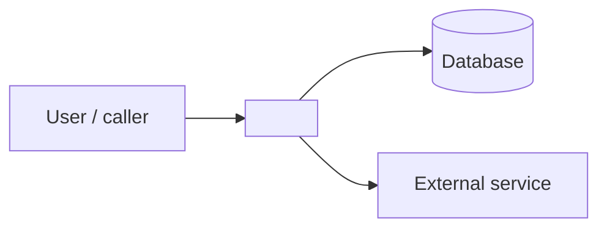

# Architecture: <area>

<!-- One sentence: what this area does for its users. Copy this file to
     docs/engineering/architecture/<area>.md. `100x repo_map --lint-note <file>` checks it.
     Every claim ends with a tag: `verified` (you opened the file at that line, ran it,
     or traced it) or `inferred` (deduced, not checked). Never leave a claim untagged. -->

Scope: <package path(s) from `100x repo_map`>. Mapped at commit `<sha>` on <YYYY-MM-DD>.

## Context

L1 context diagram: this area as one box, plus the people and systems it talks to.

## Entry points

| entry | where | what triggers it | tag |
|---|---|---|---|
| `POST /photos` | `src/photos/photos.controller.ts:42` | browser upload | verified |

## Data flow

One request, followed end to end. Number the steps and cite each hop.

1. `photos.controller.ts:42` validates the DTO and calls `PhotosService.create` — verified
2. `photos.service.ts:88` writes the row, then enqueues processing — verified
3. The worker picks the job up within seconds — inferred (no test covers the latency)

## Boundaries

Every boundary the flow crosses: network, database, queue, auth, external API,
filesystem, clock. Each is where production can diverge from a read-through.

- Postgres through the TypeORM repository at `photos.repository.ts:12`; no retry — verified
- GCS signed-URL upload; the client talks to GCS directly — verified
- Auth guard on the controller class at `photos.controller.ts:20` — verified

## Hot file

- `src/photos/photos.service.ts`: most-connected file in the flow (`repo_map` in-degree
  N); holds the upload state machine — verified

## Predict, then confirm

The three claims the rest of this note depends on. Write the prediction BEFORE checking,
then confirm with a test run, a trace, or the exact line. A wrong prediction is a finding:
record what was true instead.

| # | claim | prediction | confirmed by | result | tag |
|---|---|---|---|---|---|
| 1 | oversize uploads are rejected | returns 413 before hitting GCS | `pnpm test photos -t oversize` | held | verified |
| 2 | a failed enqueue rolls back the row | no orphan row remains | read `photos.service.ts:95-110` | did not hold: row stays | verified |
| 3 | deletion is soft | `deleted_at` set, row kept | not yet checked | — | inferred |

## Glossary

Terms a newcomer will meet in this area. Bold the term and follow it with a dash so
`100x check_index --gen-terms` indexes it.

- **album item** — one photo or video row, with its processing state

## Open questions

- <what is still unknown, who could answer it> (write `none` if there are none)
