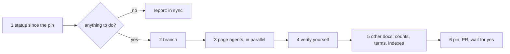

# Explain sync

Explain pages and indexes describe the code at the moment they were written; every merge to
main can move a cited line, rename a function in a Code reference, or add a part no page
covers. This skill is the after-merge tidy-up, run by hand. Think of a bookmark in a
changelog: `explain/.sync.json` holds the last main commit the docs were synced to, so a
sync reads only the merges since then and touches only the pages they affect, instead of
re-checking everything from scratch.



## Trigger

**Fire when:** the user asks to sync, refresh or update the docs or the explain pages after
merges, asks "are the docs stale" or "what changed since the last doc sync", or runs
`/explain-sync`. Manual only: no hook runs it.

**Do not fire when:** the request is a first page for a new part (`explain`), a codebook guide
for another repository (`codebook-sync`), or fixing one stale count by hand.

## Steps

| # | step |
|---|---|
| 1 | `git switch main && git pull --ff-only`, then `100x explain_sync status`. It lists each merge since the pin, the pages citing files those merges changed, every page's `flow check` result, and changed plugin files no page cites. Exit 0: report "in sync" and stop. No pin yet: check every page, then step 6 |
| 2 | Branch from main: `gaurav/docs/explain-sync-<yyyymmdd>` (or the repo's branch convention) |
| 3 | For each page marked `SYNC`, one `comprehension-mapper` agent, all in one message, at most eight. Its brief: the page folder, the merges and changed files `status` names, `git log --first-parent <pin>..main -- <its files>`, and the rules: re-read every cited line in a changed file (never swap in whatever token sits there now), update steps, outline, terms and `reference` for new or renamed functions, then `flow check --tier <its tier> --repo .` until it exits 0 and `flow build`. Write only inside its page folder; no git writes |
| 4 | Verify yourself: re-run `100x explain_sync status` (every page `ok` except the pin line) and `flow check` per changed page; spot-read two cited lines per changed page with `git show HEAD:<file> \| sed -n '<a>,<b>p'`; `git status` shows changes only in those page folders |
| 5 | Uncovered files: for each, say whether it belongs on an existing page (send that page's agent back) or deserves a new page (name it in the PR; write it, and add its row to `explain/INDEX.md`, only if the user asks). Then the other docs: `100x check_index --gen-terms`, `100x check_index --gen-collections` when a skill was added or removed, and `bash "$(100x root)/tests/test_docs_claims.sh"` until the counts in `README.md` and `AGENTS.md` match the repo |
| 6 | `100x explain_sync pin` (refuses while a page fails `flow check`), commit on the branch, open a PR, report: old → new pin, merges covered, pages updated (n of n checking clean), uncovered files and what was done with each. Merge only on the user's explicit yes |

## Rules

1. Start from the pin: only merges since `explain/.sync.json`'s commit are read, and only the
   pages citing what they changed are rewritten.
   *Enforced by:* `100x explain_sync status` (lists exactly those merges and pages)

2. The pin moves only after every page checks clean against the code.
   *Enforced by:* `100x explain_sync pin` (refuses while any page fails `flow check`, unless `--force`)

3. A cited line in a changed file is re-read at the new commit before the page is called synced;
   a moved line is re-cited, never matched to whatever token is there now.
   *Enforced by:* `100x flow check <dir>/scenario.json --repo .` (anchor within two lines); review (re-reading)

4. Agent reports are claims: re-run `status` and each changed page's `flow check` yourself.
   *Enforced by:* convention (step 4)

5. Every change goes on a branch and a PR; merge only on the user's explicit yes.
   *Enforced by:* convention

## Verify

```bash
100x explain_sync status ; echo "exit $?"          # ~0.3s per page; 0 = in sync, 1 = work to do
100x explain_sync status --json | python3 -c 'import json,sys; d=json.load(sys.stdin); print([p["page"] for p in d["pages"] if p["needs_sync"]])'
bash "$(100x root)/tests/test_explain_sync.sh"      # ~10s; drift, pin refusal, folder refs
```

## Failure modes

This skill rejects:

- **Re-checking every page from scratch on every sync** when the pin says which merges are new:
  slow, and it hides which merge broke which page.
- **Moving the pin with a page still failing** `flow check`: the next sync would believe it was
  synced. `pin` refuses.
- **Fixing an anchor by pasting whatever token is now on that line**: the claim may no longer be
  true; re-read and re-word the step.
- **Writing a new page for every uncovered file**: most belong as a line on an existing page;
  a new page is the user's call.
- **Merging the sync PR without a yes.**

**Honest limitations:** dependency is by citation: a page is flagged when a merge rewrote a
line within two of one it cites, changed a file in its Code reference or under a folder its
absences search, or deleted a file a map box names; plus any page `flow check` fails. Behaviour
that changed in a file the page never cites is not seen (the uncovered list is the net for that). A rewritten history (force-push to main) breaks the pin; `status` says so and
`pin --force` resets it after every page is checked.

## Scale

`solo` to `small-team`: one person runs it after a batch of merges. The pin is committed, so
everyone who syncs starts from the same place.

## Sources

`SOURCE: original`, following `codebook-sync`'s pin-then-sync-only-what-changed design (the
codebook plugin's `skills/codebook-sync/SKILL.md`: a pinned commit, first-parent commits since
it, chapters mapped by path, verify, re-pin). Page checks are `flow check`
(`skills/explain/references/schema.md`); counts and indexes are `tests/test_docs_claims.sh`
and `scripts/check_index.py`.
