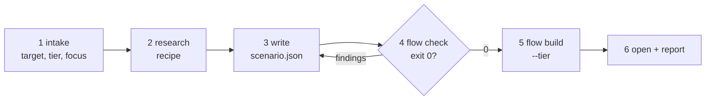

# Explain

A diff says what changed, not what happens when two requests race or what the fix changes on
that timeline. This skill turns a PR, a file or a concept into a step-through mental model that
answers six questions, each claim pinned to a line or a measured absence:

| # | question | where the page answers it |
|---|---|---|
| Q1 | where does it live | the map: one box per node, columns by role |
| Q2 | what happens, step by step | one flow, one card per step, state after each step |
| Q3 | what can go wrong | edge, failure, race and load scenarios, hazards flagged by the reducer |
| Q4 | what fixes it | each fix is its own scenario branched from the issue: before vs after |
| Q5 | which trade-off, and why | the decision card: options, fit, the deciding factor, when to revisit |
| Q6 | how sure are we | an evidence tag on every step and every number |

The agent writes **only** `scenario.json`. A fixed, tested engine (`100x flow`) checks it against
the code and renders it, so a page cannot claim a line that is not there. The JSON shape is
`references/schema.md`; the action vocabulary is `references/actions.md`; how to gather the facts
is `references/research-recipe.md`.



## Trigger

**Fire when:** the user asks to explain, walk through or step through a PR, a change, a file, a
symbol or a concept visually; "show me what happens when…", "what can go wrong and what fixes
it", "before and after the fix", "compare plan A vs plan B step by step"; or `/explain`. On
demand only: no pipeline runs it, and `comprehension-mapper` uses it only for a walkthrough.

**Do not fire when:** the output is long reading material from a doc or talk (`learn:guide`);
one diagram for a spec or PR (`diagramming`); comments to post on GitHub (`pr-review`); a durable
architecture note for the repo (`codebase-comprehension`); reviewing your own diff before pushing
(`diff-review`); or the code is one function with no branch and no shared state. Read it aloud.

## Project rules

The skill holds no knowledge of any project. Before research, read the target project's
`CLAUDE.md` / `AGENTS.md` (repo root, then any nested file on the touched paths; for a PR, from
the head snapshot) for what they say about these, and use the default when they say nothing:

| setting | default |
|---|---|
| folders to ignore | gitignored, generated and vendored files (`100x repo_map` marks them) |
| glossary (terms the page must use) | none; names come from the code |
| language | `en`; `ja` adds `title.ja` and step text in both |
| default tier | `light` |
| output dir | PR: `<CR>/<feature>/PR-<n>__…/explain/`, `CR` from `100x pr_review paths --url <pr-url> --json`; else `<root>/explain/<slug>/` |

`<root>` is the records root (`docs/OPERATING-MODEL.md` §8). The report says which settings came
from the project and which are defaults; on a conflict the project's file wins.

## Steps

1. **Intake.** Resolve the target:
   - **PR** (URL or `#n`): `100x pr_review find "$CR" <pr-url>`. A hit gives the run folder:
     `PINS.md` for base and head SHA, `review.json` for findings and the threads they link. No
     hit: `100x pr_snapshot --repo <clone> --url <pr-url> --pr <n> --dest <scratch>/snap`, and say
     review threads are unavailable. Never call `gh` (rule 10).
   - **path[:symbol]**: the file at `git rev-parse HEAD`, the symbol via `100x repo_map --symbol`.
   - **"concept"**: a plan or idea with no code yet; evidence is ADRs, specs and measured numbers.

   Tier is `light` unless `--heavy` or the project says otherwise. Ask **at most two** questions,
   only when the request does not answer them: the focus ("which part worries you?") and, for
   heavy, which options to compare. Otherwise pick and say what you picked.
2. **Research** with `references/research-recipe.md`: context first (a pr-review run's
   `1-context.md` when present), nodes from changed symbols and one hop, absences by `git grep`,
   scenarios (happy, the focus, the riskiest), a fix per issue, the outline, diagrams, the decision.
3. **Write** `scenario.json` in the output dir (`100x flow new <slug>` writes a starter):
   `context`, `terms` and `outline` first, `tldr` last. Prose numbers go through `{{name}}`; every
   step and outline line lists its evidence ids.
4. **Check.** `100x flow check <dir>/scenario.json --tier <tier> --repo <clone>` until exit 0;
   `--repo` (the cited clone, default `.`) is required when the output dir is outside it, always
   for a PR. A failing anchor means the claim is wrong or the line moved: re-read the line, never
   swap in whatever token is there now.
5. **Build.** `100x flow build <dir>/scenario.json --tier <tier> --out <dir>` writes the HTML
   (self-contained except the diagram renderer) and the `.md` export (tables for a PR comment).
6. **Open and report.** Open the HTML (`open` / `xdg-open`). Report in ≤ 10 lines: the target and
   SHA, tier, scenarios with their worst hazard, issues and their fix or `open`, the decision, the
   count of `inferred` steps, the paths. Leave everything uncommitted.

## Light vs heavy

| | light (default) | heavy (`--heavy`) |
|---|---|---|
| scope | map, 1 flow ≤ 8 steps, ≤ 2 scenarios, issues, fix, decision card | ≤ 12 nodes, ≤ 5 scenarios × ≤ 12 steps |
| rendering | static step cards, one SVG per step, involved boxes highlighted | animation (moving messages, queue chips, worker slots, cache TTL bars, stale hatching) |
| fixes | fix scenario listed after its issue | before/after toggle per fix |
| extras | `.md` export | compare tab (scenarios on one clock), live counters, predict-before-reveal pauses, en + ja, deep links `#<scenario>.<step>` |
| both | a summary first (purpose, TL;DR, at a glance), a Contents index, collapsible sections, offline (all JS/CSS inlined) except diagrams, which fall back to their source; system fonts, dark mode, reduced motion, stacked under 640px |

Heavy extends light's `scenario.json`; the same file upgrades with `--tier heavy`.

## Evidence tags

| tag | meaning | what backs it |
|---|---|---|
| `verified` | read at the pinned SHA | `{"at": "path:line@sha", "anchor": "<token on that line>"}` |
| `verified-absent` | searched for and not there | `{"absent": "<what>", "git_grep": "<pattern>", "path": …, "hits": 0}` |
| `measured` | a number from a run, a log or a metric | the command or dashboard that produced it |
| `estimated` | a number reasoned from others | the inputs and the arithmetic |
| `inferred` | deduced, not read | nothing; drawn dashed, counted in the report |

## Rules

1. Write only `scenario.json`; the HTML and `.md` are build output, regenerated, never edited.
   *Enforced by:* `100x flow build <dir>/scenario.json --tier <tier> --out <dir>`

2. Every `verified` evidence resolves at its SHA and its anchor sits within two lines of the
   cited line.
   *Enforced by:* `100x flow check <dir>/scenario.json`

3. Every absence ("no invalidate", "no lock", "no retry cap") is a `verified-absent` evidence
   whose `git grep` hit count matches the stated count.
   *Enforced by:* `100x flow check <dir>/scenario.json`

4. Every number in prose is a `{{name}}` placeholder backed by `numbers` with a tag; a bare digit
   fails (HTTP statuses in reply labels and ids such as `C3` excepted).
   *Enforced by:* `100x flow check <dir>/scenario.json`

5. Every issue scenario names a fix scenario (`fixed_by`, branched from the issue) or says
   `open: true`.
   *Enforced by:* `100x flow check <dir>/scenario.json`

6. A step's `expect` matches what the reducer computes (cache hit or miss, `stale-writeback`).
   *Enforced by:* `100x flow check <dir>/scenario.json`

7. Stay inside the tier budget in the table above.
   *Enforced by:* `100x flow check <dir>/scenario.json --tier <tier>`

8. A step you did not read at the pinned SHA is tagged `inferred`, never `verified`. The checker
   proves a cited line exists, not that it does what the step says.
   *Enforced by:* review

9. A fix step using `cache.set-if-fresh` cites the code's atomic primitive (CAS, script,
   version column or lock), or the absence of one; the reducer treats the guard as atomic.
   *Enforced by:* `100x flow check <dir>/scenario.json`

10. PR facts come from a pr-review run folder or `pr_snapshot`, never from `gh`.
    *Enforced by:* review (ADR-0002)

11. Ask at most two questions at intake; pick the rest and say what was picked.
    *Enforced by:* convention

12. Project-specific settings come from the target's `CLAUDE.md` / `AGENTS.md`; none are
    written into this skill or its references.
    *Enforced by:* convention

13. Write output only to the output dir (never inside the reviewed repo for a PR) and commit
    nothing unless asked.
    *Enforced by:* convention

14. A PR page has `context`: a `purpose` a person outside the module understands, and a scope
    naming which entry points the page animates (`entry_points[].scenario`) and which it does not.
    *Enforced by:* `100x flow check <dir>/scenario.json` (presence, shape, ids); review (wording)

15. `terms` defines every word a newcomer would stop at; step titles use plain words, and an
    identifier in one (`camelCase`, `snake_case`, `a.b`) must be a term or a node label.
    *Enforced by:* `100x flow check <dir>/scenario.json` (`jargon in step title`)

16. Every issue scenario says its `origin`: `in-code`, `found-in-review` or `what-if`. A what-if
    is labelled as one, never drawn as a real bug, and its fix cites the real design.
    *Enforced by:* `100x flow check <dir>/scenario.json`

17. `outline` is pseudocode of the main entry point, each line citing its real line (`ev`) or
    tagged `inferred`; a step's `code` is the few pseudocode lines that make that step happen.
    *Enforced by:* `100x flow check <dir>/scenario.json`

18. Add one or two `diagrams` where they help (light ≤ 2, heavy ≤ 4): a sequence of the main entry
    point's calls, a flowchart for gate or branch logic, a state diagram for a lifecycle, an er
    diagram for the data model, a mindmap for a concept or module overview (the parts and how they
    group); each lists `ev` or is tagged `inferred`.
    *Enforced by:* `100x flow check <dir>/scenario.json` (shape, cites, mermaid via `check_diagrams`)

19. A PR page has `tldr`: `what`, `how` and `watch_out`, one plain sentence each, with no
    identifier unless it is a term.
    *Enforced by:* `100x flow check <dir>/scenario.json` (length, jargon); review (plainness)

## Verify

```bash
# content vs code: anchors, absences, numbers, fixes, budgets, diagrams (~1s); --repo = cited clone
100x flow check <dir>/scenario.json --tier light --repo <clone>
# render: one HTML (offline, except diagrams, which fall back to their source) + the .md (~1s)
100x flow build <dir>/scenario.json --tier light --out <dir>
# the engine: reducer, golden states, seeded bad scenarios (~5s; node/Chrome smoke SKIP if absent)
bash tests/test_flow.sh
```

## Failure modes

This skill rejects:

- **A step citing a line that moved** (`src/cache.py:42@ab12cd3` is blank): `flow check` names it.
- **"There is no lock" with nothing behind it**, or with a `git grep` that finds 3 hits:
  absences are counted, not asserted.
- **"Retries 3 times, 200ms apart" as bare prose.** Each number needs `{{retries}}` and a tag;
  an `estimated` number never reads as `measured`.
- **An issue with no way out**: a race scenario with neither `fixed_by` nor `open: true`.
- **A fix shown as prose only.** The fix is a scenario branched from the issue where it diverges.
- **`expect: "hit"` on a step whose key was deleted two steps earlier**: the reducer says miss.
- **A light page with 14 steps and 4 scenarios**: over budget; split it or pass `--heavy`.
- **A diagram whose source is not its `kind`**, or uses an undeclared participant: `flow check` names it.
- **A PR page a newcomer cannot place**: no purpose, a TL;DR that needs the glossary, one of eight
  routes animated without saying so, `applyDiff` in a step title with no term, or a what-if race
  that reads as a real bug.
- **Project knowledge baked into the skill**: a folder name, a glossary term or a team's tier
  default written here instead of read from that project's `CLAUDE.md`.

**Honest limitations:** the checker proves that cited lines and counted absences exist and that
the timeline is consistent; not that a step's sentence describes what the line does, or that a
purpose or TL;DR reads plainly (rules 8, 14, 19: review). Hazard detection covers only
`stale-writeback` in v1; other races are scenarios the agent writes and the reader judges.

## Scale

`solo`: replay your fix against the bug's timeline before you push. `small-team`: a risky PR's
review artifact, read in two minutes. `org`: the onboarding page for a flow everyone touches and
nobody drew. `high-blast-radius`: where an outage would start.

## Sources

- The six questions, the scenario/fix/decision model, tiers, evidence tags, the "agent writes only
  data, a tested engine renders it" split, context, terms, origin, outline, diagrams, `tldr`, the
  summary and `flow check`'s rules: `SOURCE: original` (2026-10-22; context, code panes, diagrams
  2026-10-24; `tldr`, summary, mindmap 2026-10-31).
- The engine's structure (plans as data, state as a pure reduce over each step's actions, a player
  over it): a user-supplied local page, not published; `SOURCE: original`.
- `verified` / `inferred` labels, a `file:line` per `verified` claim: `reviewers/_evidence-labels.md`;
  `skills/codebase-comprehension/SKILL.md` rule 3. Diagram type and level: `skills/diagramming/`.
- `gh` only in pr-review's steps: `decisions/ADR-0002-gh-cli-for-pr-review-confined-to-skill-steps.md`.
- The pr-review run folder (`PINS.md`, `review.json`, `CR` resolution): `skills/pr-review/SKILL.md`,
  `skills/pr-review/references/workflow.md` steps 0b, 0d, 2.
- Records root, output outside the reviewed repo: `docs/OPERATING-MODEL.md` §8; `skills/pr-review/SKILL.md` "Where output goes".
