# Research recipe

How the agent gathers the facts a `scenario.json` states. Every fact ends as an evidence entry
(`references/schema.md`); a fact with no entry is a step tagged `inferred`. Pin one SHA first and
read everything at that SHA: `PINS.md` head for a PR, `git rev-parse HEAD` for a path.

```mermaid
flowchart LR
  X[0 context<br/>purpose, scope, terms] --> S[1 symbols<br/>changed or named]
  S --> H[2 one hop<br/>callers + callees]
  H --> N[3 nodes<br/>by role]
  N --> A[4 absences<br/>git grep]
  A --> T[5 threads<br/>to commits]
  T --> P[6 pick scenarios]
  P --> F[7 fix per issue]
  F --> D[8 decision]
  D --> O[9 outline<br/>pseudocode]
  O --> G[10 diagrams]
  G --> L[11 TL;DR<br/>written last]
  L --> R[12 reference<br/>code behind it]
```



## 0. Context first

A reader who knows the product but not this module needs four answers before the first step:
what a user gets, why now, which entry points the page animates, and what the words mean. Write
`context` and `terms` (`references/schema.md`) before any scenario.

**When the output folder sits inside a pr-review run folder** (siblings `1-context.md`,
`4-findings.md`, `README.md`), that review already wrote this down. Reuse it, then verify every
line it cites at the pinned SHA as for any other evidence:

| `1-context.md` | becomes |
|---|---|
| `> **In 10 seconds:**` | `context.purpose`, rewritten so a person outside the module follows it |
| `## Problem` | `context.why_now` |
| `## Terms` | `terms` rows (`term`, `means`, an `example` where the review gave one) |
| `## Before → after` | `context.in_scope` bullets; the happy and fix scenarios replay it |
| `## Author's decisions` | `decision.options` and `deciding_factor` (step 8) |
| `## Not in this PR` | `context.out_of_scope` |

**Otherwise** derive them yourself:

| field | from |
|---|---|
| `purpose` | the PR body, the linked spec or ticket, then the tests' names: what a user can now do or no longer suffers |
| `why_now` | the PR body or the issue it closes; leave it out rather than guess |
| `in_scope` / `out_of_scope` | `git diff --name-only <base>...<head>`, grouped by area; what the spec names that the diff does not touch is out |
| `entry_points` | every route, job, event handler, command or screen the diff adds or changes (`git grep` the router or job registry at the head SHA) |
| `terms` | every identifier or domain word a step title or `d` needs that a newcomer would stop at |

Each entry point the page animates gets `scenario`; the rest get a `note` such as "same gates as
the animated route" or "not changed by this PR". A page that animates one route of several and
does not say so reads as a claim about all of them.

A scenario that shows a failure the code does not have today (a race the design prevents, kept to
show why) is `origin: "what-if"`; one taken from a review thread is `found-in-review`; one you
traced in the code is `in-code`. A what-if's fix scenario is the real design, so at least one of
its own steps cites the line that prevents the failure.

## 1. Symbols

| target | where the symbols come from |
|---|---|
| PR | `git diff --name-only <base>...<head>`, then the functions and methods whose bodies changed (`git diff -U0` hunk headers name them in most languages) |
| path[:symbol] | the named symbol, or the file's exported ones |
| concept | the nouns of the plan: each component, store and queue it names |

Stop at the symbols the user's focus touches plus the ones on the happy path. A PR with 40
changed functions gets a walkthrough of the 3 to 6 that carry the behaviour.

## 2. One hop of callers and callees

```bash
100x repo_map <repo> --symbol <Name>      # definition + every referencing file (~1s)
git grep -n '<Name>(' <head> -- <dir>     # call sites with lines, at the pinned SHA
```

Callers are the referencing files; callees are read from the definition's body. One hop only:
the second hop is where a walkthrough turns into a codebase tour. A caller outside the diff that
matters (the one that now gets a stale value) becomes a node with `outside_diff: true`.

## 3. Nodes by role

Each box on the map is a node with a `role`, which picks its column:
`client | edge | service | queue | worker | cache | store | external`.

| code you found | role | examples across stacks |
|---|---|---|
| browser, mobile app, CLI, another team's caller | client | a React hook, a Kotlin `ViewModel`, a `curl` in a runbook |
| gateway, load balancer, auth middleware | edge | Express middleware, a Rails `before_action`, nginx |
| request handler, service object | service | NestJS controller + service, Django view, Go `http.HandlerFunc`, Spring `@Service` |
| job queue, topic | queue | Sidekiq, BullMQ, Celery, SQS, Pub/Sub |
| job consumer | worker | a Sidekiq job class, a Celery task, a Go consumer loop |
| in-memory or shared cache | cache | Redis/Valkey, `functools.lru_cache`, a Caffeine cache |
| database, object store | store | Postgres, MySQL, S3/GCS |
| a system you do not own | external | a payment API, an auth provider |

Give each node a `ref` evidence (its definition line). Twelve nodes is the heavy ceiling; light
pages read best at five to eight.

## 4. Absences

The bug is often a line that is not there. State each absence as a search with a count, at the
pinned SHA, scoped to the paths that would hold it:

Example patterns; adapt the words and the path to the stack:

```bash
git grep -nE '(del|delete|invalidate|evict)\(' <sha> -- src/cache/           # no invalidation after a write
git grep -nE 'FOR UPDATE|with_lock|\.lock\(|transaction' <sha> -- app/models/  # no lock around read-modify-write
git grep -nE 'set\(.*(None|null|nil)' <sha> -- <cache dir>                    # no negative cache
git grep -nE 'max_?retries|maxAttempts|backoff' <sha> -- <worker dir>         # no retry cap or backoff
git grep -niE 'idempotenc' <sha> -- <handler dir>                             # no idempotency key
git grep -nE 'timeout' <sha> -- <client dir>                                  # no timeout on an outbound call
```

Record the pattern, the path and the hit count exactly as run; `flow check` re-runs it. When the
count is not 0, the hits are the answer: open them, and either the absence claim is wrong or the
hits are unrelated (narrow the path, never the claim's wording).

## 5. Review threads to commits

Only when a pr-review run folder exists (`100x pr_review find "$CR" <pr-url>`). Its `review.json`
holds the review's findings (`items`), each with `dup_of_existing_comment` (the URL of the PR
thread it repeats) when one exists, and `run.existing_comments` (what the review read). This skill
never fetches threads itself: `gh` belongs to the pr-review skill's steps only (AGENTS.md rule 12).
For each finding or thread that changed the code, find the commit that answered it:

```bash
git log --oneline <base>..<head> -- <path>                  # commits touching the thread's file
git log -S'<token from the thread>' --oneline <base>..<head> # the commit that added or removed it
```

A thread with a commit becomes evidence for the fix scenario; a thread with none stays a question
in the report. No run folder: say so, and use commit messages only.

## 6. Picking scenarios

| slot | scenario | why it is on the page |
|---|---|---|
| always | `happy` | the baseline every other scenario is read against |
| always | the user's focus (the intake question) | what they asked about |
| when found | the riskiest: a `race`, `failure` or `load` scenario | the one an outage would start from |

Light allows two scenarios: happy plus the focus, or the focus plus the riskiest when the focus is
already the happy path. The riskiest is the one with the largest blast radius per the evidence
(data loss over a slow page; many users over one), not the most interesting to draw. Each step
lists the evidence ids that back it.

Example (any stack): read-through cache, writer updates the row then deletes the key, a slow
reader read the old row before the write and sets it into the cache after the delete. The steps
are `db.read` → `db.write` → `cache.del` → `cache.set $read`, and the reducer flags
`stale-writeback` on the last one.

## 7. A fix per issue

Every `issue` scenario gets a `fix` scenario with `branch: {from: <issue id>, at: <step>}`: the
same timeline up to the step where the fix changes something, then the fixed steps. The issue
gets `fixed_by: <fix id>`; with no fix in the code or the threads, it gets `open: true` and the
report says so. A fix that exists only as a suggestion is `inferred` until a commit or a line
backs it.

## 8. The decision

Sources, in order: the review threads (step 5), `100x decide trace <path>` for each touched file,
ADRs and specs the PR or the project links, then commit messages. The card names the options,
each option's `fit`, the chosen one, the deciding factor and `revisit_when`. With no recorded
decision, write the options the code implies, tag the card `inferred`, and put
"no recorded decision" in `source`.

## 9. Outline and step code

The `outline` is the main entry point as pseudocode, so a reader sees the whole function before
the timeline splits it into steps. Each step's `code` is the slice of it that step plays.

| rule | why |
|---|---|
| names from the code: the real function, variable and field names | the reader can search for them |
| control flow kept: every `if`, loop, early return, `await` that matters, transaction start and end | the race lives between those lines |
| no invented helpers: a call in the pseudocode is a call in the code | an invented `ensureFresh()` hides the bug |
| drop logging, validation boilerplate and type plumbing | they are not the behaviour |
| ≤ 20 lines an outline, ≤ 8 lines a step's `code` | longer is the code itself; link the real line instead |
| each line has `ev` (its real line) or `tag: "inferred"` | same rule as steps; `flow check` enforces it |
| `steps` lists the visible step indexes (0-based) a line drives | the player highlights the line as it plays |

Worked example, from the made-up notes service in `assets/examples/stale-writeback.json`
(`getNote` and `patchNote` in its `src/notes.js`). The outline of the GET route:

```json
{"title": "GET /notes/:id -> getNote(db, cache, id)", "scenario": "happy", "lines": [
  {"code": "cached = cache.get(cacheKey(id))", "steps": [1], "ev": "e-cache-get"},
  {"code": "if cached: return cached", "steps": [5], "ev": "e-cache-hit"},
  {"code": "note = db.query(SELECT body FROM notes WHERE id)", "steps": [2], "ev": "e-db-read"},
  {"code": "cache.set(cacheKey(id), note, ttl=CACHE_TTL_SECONDS)", "steps": [3], "ev": "e-cache-set"},
  {"code": "return note", "steps": [4], "ev": "e-return-note"}
]}
```

A line with no evidence entry to cite is `"tag": "inferred"` instead of `ev`. The race step "Reader's GET fills
the cache with the old note" then carries one line from the outline,
`"code": ["cache.set(cacheKey(id), note, ttl=CACHE_TTL_SECONDS)  # note read before the PATCH"]`,
nothing the code does not do. A line such as
`if note.isStale(): skip` would be an invented helper; the absence of that check is a
`verified-absent` evidence, not a pseudocode line.

## 10. Diagrams

`diagrams` (`references/schema.md`) gives the reader the shape in one picture before the steps
split it up. Add one or two where they help (light ≤ 2, heavy ≤ 4); none beats a decorative one.
Pick the type and level with `skills/diagramming/SKILL.md`:

| the page needs | `kind` | level |
|---|---|---|
| who calls whom on the main entry point, with its error replies | `sequence` | L2: one participant per node, only calls crossing a node |
| the gates or branches before a write, each failure's status | `flowchart` | L1/L2: one box per decision |
| an entity's lifecycle (job, order, session states) | `state` | L2 |
| the table or document the flow writes (columns, keys, uniqueness) | `er` | L1 for names; L2 for the columns the steps touch |
| a concept or module overview: its parts and how they group (routes, gates, data, risks) | `mindmap` | L1: ≤ 12 nodes; L2 up to the flowchart budget |

**Mind map or flowchart?** A flowchart answers "in what order, and which branch"; a mind map
answers "what is in here, and what belongs with what". Use a mind map when the reader needs the
inventory before the timeline (a module's routes, checks, tables and risks on one screen) and
nothing in it has an order. The moment a branch reads "then", it is a flowchart. Rules for one:
exactly one root (the module or concept), every child indented deeper than its parent, plain
labels (the node labels and terms the page already uses), one branch per group, no edges.

Worked mind map, the made-up notes service in `assets/examples/stale-writeback.json`; each leaf
is something its evidence already cites:

```json
{"id": "notes-parts", "kind": "mindmap", "title": "The notes service at a glance",
 "ev": ["e-route-get", "e-route-patch", "e-cache-get", "e-db-write", "e-cache-del",
        "e-no-version-check", "e-fill-if-fresh"],
 "caption": "Read outward from the centre: what the service offers, where it keeps notes, and the one risk with its fix.",
 "source": "mindmap\n  %% level: 1\n  root((notes-api))\n    Routes\n      read a note\n      edit a note\n    Storage\n      Cache\n      Database\n    Risk\n      old note written back\n      fill only if fresh"}
```

| rule | why |
|---|---|
| sequence participants and flowchart boxes use the node `label`s | the diagram and the map name the same boxes |
| declare every sequence participant (`participant` / `actor`) before its first message | `check_diagrams` rejects an auto-created one |
| arrows only from `-> --> ->> -->> -x --x`; branches as `alt` / `else` | the set `check_diagrams` accepts |
| quote a flowchart label that has parens: `A["check (auth)"]` | an unquoted `(` breaks the parse |
| ≤ 12 nodes or participants; split rather than grow | L1 budget; past it the picture is the code |
| `ev` lists the lines each arrow or box rests on, or `tag: "inferred"` | same rule as steps and outline lines |
| `scenario` names the scenario that animates it | the page links "Watch it animated" |
| `caption` says how to read it in one or two sentences, numbers as `{{name}}` | the source is code; the caption is prose |

Worked example, the PATCH route of the made-up notes service in
`assets/examples/stale-writeback.json`; the participants are its node labels (`Editor`,
`notes-api`, `Database`, `Cache`) and every arrow is a line its evidence already cites:

```json
{"id": "patch-calls", "kind": "sequence", "title": "PATCH /notes/:id, call by call",
 "scenario": "race", "ev": ["e-route-patch", "e-db-write", "e-cache-del", "e-status-204"],
 "caption": "Top to bottom: the database write lands first, then the cache key is deleted.",
 "source": "sequenceDiagram\n  %% level: 2\n  actor Editor\n  participant API as notes-api\n  participant DB as Database\n  participant Cache\n  Editor->>API: PATCH /notes/:id\n  API->>DB: UPDATE notes SET body\n  API->>Cache: del(cacheKey(id))\n  API-->>Editor: 204"}
```

No `alt` branch here because the code has none; a branch the code does not have is invention,
drawn or written.

Check a source before writing it into the JSON: put it in a ```mermaid fence in a scratch `.md`
and run `100x check_diagrams <file>`; `flow check` runs the same check on every diagram.

## 11. The TL;DR, written last

`tldr` (`references/schema.md`) is three sentences at the top of the page, written after the
scenarios, fixes and decision, because only then is the top risk known. Write it for the reader
of `context.purpose`: someone who knows the product but not this module.

| key | says | from |
|---|---|---|
| `what` | the outcome a user sees, not the code that changed | `context.purpose`, the happy scenario's last step |
| `how` | the mechanism in one line: the checks in order, then the write | the outline, the gate flowchart |
| `watch_out` | the top risk or the decision a reviewer must accept | the riskiest issue scenario and its fix or `open`, or `decision.deciding_factor` |

One sentence each, plain words, no numbers (they need `{{name}}` here too) and no identifier
unless it is in `terms`. Notes-service example: what "Editing a note shows the new text to
everyone who opens it next"; how "Every edit saves the note, then clears the saved copy so the
next reader fetches it fresh"; watch out "A slow reader can put the old note back right after an
edit, so the cache fill checks the note is still current".

## 12. Drilling down: part pages and the code reference

A big target reads best as a stack of pages, the way a map app zooms: an overview page for the
whole system, one page per part (a skill, a hook, a subsystem) whose lede points back to the
overview, and on each part page a `reference` (`schema.md`, Code reference): every function in
the files behind it. Pick the files a reader would open next and the symbols that run the flow
the page animates; `100x code_ref build <file> --md` shows what is there. Write a `note` only
where the docstring is missing or misleading, after reading the function. Names, lines and
who-uses-what come from the parse tree, so the list cannot skip or invent a function. Keep one
output dir per page under `<root>/explain/` and list every page in that folder's `INDEX.md`.

## Numbers

A number is `measured` only with the command, log or metric it came from; `estimated` with its
inputs; a constant read in code is `verified` with its line. Never round a source number to make
prose read better.
