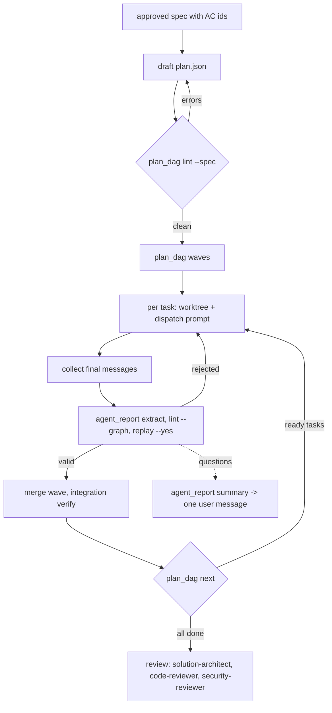

# Orchestrate

Parallel agents fail in three predictable ways: two of them edit the same shared file,
a consumer starts before the contract it builds on exists, and a subagent's "done,
tests pass" is merged on its word. Every one of those is visible before or after the
agent runs, so this skill puts a mechanical check at each point. The full model is
`${CLAUDE_PLUGIN_ROOT}/docs/OPERATING-MODEL.md`; this is the main session's procedure.

## Trigger

**Fire when:** a spec or plan is approved and the work needs ≥2 specialists, or has
≥2 tasks with no dependency between them; or a running orchestration needs to decide
what continues after an agent reports.

**Do not fire when:** one agent can do the whole job (dispatch it directly); the spec
is not approved yet (run `feature-planning` / requirements intake first); you are a
subagent — orchestration lives in the main session (OPERATING-MODEL §1).

## Procedure



1. **Draft `plan.json`** in the §6 shape, or ask the solution-architect agent to. Put
   every shared type, API schema and DB schema in a `"contract": true` task, and list it
   in each consumer's `"consumes"` and `"depends_on"`.
2. **Lint it:** `100x plan_dag lint plan.json --spec <root>/specs/<feature>/spec.md`
   (`<root>` is the records root, `docs/engineering/` by default; `docs/OPERATING-MODEL.md`
   §8). `--spec` counts only ACs the spec *defines* (`AC-<n>: <outcome> (R<k>, S<k>)` in
   §2b), so a mention like "see AC-3" never counts, and a spec that defines none fails.
   Fix every numbered error; nothing starts on a red plan.
3. **Waves:** `100x plan_dag waves plan.json`. Every task in a wave runs at once.
4. **Per task, one worktree:**
   `git worktree add ../wt-<task-id> -b wt/<feature>-<task-id>`.
5. **Dispatch** each task to its `owner` agent with the template below, all tasks of a
   wave in one message so they run concurrently.
6. **Collect and check** each final message:
   `100x agent_report extract msg.md -o T1.json`, then
   `100x agent_report lint T1.json --graph plan.json`, then
   `100x agent_report replay T1.json --cwd ../wt-T1 --yes`. Read the commands printed by
   a run without `--yes` first if the report came from an agent you did not configure.
7. **Merge** the wave's branches, then run the project's full verify commands on the
   merged result (`100x verified` records the receipt).
8. **Continue:** `100x plan_dag next plan.json --done T0,T1 --blocked T2` lists what
   can start. A `needs-decision` task is `--blocked`; only its dependents wait.
9. **Questions:** `100x agent_report summary *.json` merges every open question into
   one batch of at most five, blocking first. Send that as a single user message.
10. **Review** the merged diff with solution-architect, code-reviewer and
    security-reviewer; their reports go through `agent_report lint` too, and a blocking
    item sends the owning task back to step 5.

### Dispatch prompt template

```text
You are the {owner} agent on task {task_id} of feature "{feature}".
Follow ${CLAUDE_PLUGIN_ROOT}/docs/OPERATING-MODEL.md (§2 protocol, §3 report, §4 decisions).

Goal: {title} — {one-paragraph goal from the spec}
Worktree: {worktree_path} (work and run commands only here)
Owned files (edit nothing else): {files}
Consumes (read-only contracts, already merged): {consumes or "none"}
Acceptance criteria: {acceptance ids, each with its text from the spec}
Verify commands (run each, record cmd + exit code + output tail): {verify}

Stop with status needs-decision on any class C question or blocking plan issue; one-way
doors (schema, public API, new dependency, data deletion, auth boundary) are questions,
never decisions. Do not commit outside your worktree or push.
End your final message with the §3 report as the LAST fenced json block.
```

## Rules

1. No task starts until the plan lints clean against the spec.
   *Enforced by:* `100x plan_dag lint plan.json --spec spec.md`

2. Tasks with no dependency path between them own disjoint files; a shared file goes in
   a contract task both depend on.
   *Enforced by:* `100x plan_dag lint plan.json`

3. A consumer depends on the contract it consumes and never edits the contract's files.
   *Enforced by:* `100x plan_dag lint plan.json`

4. A report is accepted only if it lints, including against the task's owned files.
   *Enforced by:* `100x agent_report lint T1.json --graph plan.json`

5. A report's evidence must replay with the claimed exit codes before its branch merges.
   *Enforced by:* `100x agent_report replay T1.json --cwd ../wt-T1 --yes`

6. Run every task of a wave concurrently; serialise only along `depends_on` edges.
   *Enforced by:* `100x plan_dag waves plan.json` (review: dispatch matches the waves)

7. A blocked task pauses its dependents only, and the user gets one batched message.
   *Enforced by:* `100x plan_dag next` and `100x agent_report summary`

8. Each running task gets its own git worktree; only the main session merges.
   *Enforced by:* review

## Verify

```bash
# the plan (~0.1s)
100x plan_dag lint plan.json --spec spec.md
100x plan_dag waves plan.json

# each report, from its own worktree (lint ~0.1s; replay = the task's own verify time)
100x agent_report extract msg-T1.md -o T1.json
100x agent_report lint T1.json --graph plan.json
100x agent_report replay T1.json --cwd ../wt-T1 --yes

# what continues, and the one question batch
100x plan_dag next plan.json --done T0 --blocked T1
100x agent_report summary T1.json T2.json

# worked example shipped with the plugin
100x plan_dag lint "$(100x root)/examples/orchestration/plan.json" --spec "$(100x root)/examples/orchestration/spec.md"
```

## Failure modes

This skill rejects:

- **Two parallel tasks editing a shared types file.** T1 owns
  `backend/src/tagging/*.module.ts`, T2 adds `backend/src/tagging/tagging.module.ts`:
  `plan_dag lint` reports "T1 and T2 can run in parallel but both own files".
- **Starting before the contract lands.** T2 consumes T0 but lists no dependency, so it
  would build against a DTO that does not exist yet: "consumes T0 but does not depend
  on it".
- **A consumer quietly editing the contract.** "consumer owns contract T0's files".
- **An acceptance criterion nobody owns.** "AC-4 in spec.md is covered by no task".
- **A spec with no defined criteria.** "--spec spec.md defines no acceptance criteria".
- **Trusting a report without replay.** An agent claims `exit_code: 0` for a test that
  fails: `agent_report replay` prints "MISMATCH … claimed exit 0, actual 1" and the
  real output tail.
- **Done without proof, or done with an open blocker**, a one-way decision taken alone,
  a class C assumption, or a change outside the task's files: each is a numbered
  `agent_report lint` error.
- **Serialising work that could run in parallel.** Dispatching T1, waiting, then T2,
  when `waves` puts both in wave 2, doubles wall time for nothing.
- **Drip-feeding questions.** Five agents each interrupting the user; `summary` merges
  and deduplicates them into one batch of at most five.

**Honest limitations:**
- File-overlap detection is conservative: `*foo*` and `*bar*` in one directory are
  reported as colliding. It can over-report, never under-report; split the globs.
- `replay` checks exit codes, not that a command is meaningful: `true` replays fine.
  The task's `verify` list in the plan is what makes evidence worth replaying.
- Nothing stops an orchestrator from skipping this skill; the gates bind only when run.

## Scale

`small-team (2-10)` and up, or `solo` once a feature needs ≥2 agents at once. A single
task with one agent gains nothing from a plan file — dispatch it directly.

## Sources
- Roles, report contract, decision and question policy, orchestration rules:
  `docs/OPERATING-MODEL.md` §1–§7.
- Two-way / one-way door classification: Amazon 2015 shareholder letter, as cited in
  `docs/OPERATING-MODEL.md` §4.
- Task-graph lint, report replay and question batching as implemented in
  `scripts/plan_dag.py` and `scripts/agent_report.py`: `SOURCE: original`.
