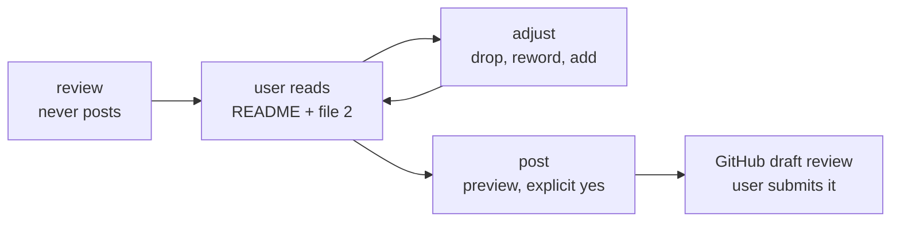

# PR review

A stateful GitHub workflow around a stateless judgement. `diff-review` (rules 9–16) and
`stack-reviewer` decide *what* is wrong; this skill turns that into one `review.json` per PR,
renders everything a person reads from it, gates it, lets the user change it, and posts it as a
draft review only when they say yes. Three commands, always in this order, plus `init`:

| command | does | writes to GitHub? | detail |
|---|---|---|---|
| `/pr-review init [--repo <dir>\|--url <pr-url>]` | scaffold `CR` and fill `CONTEXT.md` without reviewing a PR | never | `references/workflow.md` step 0 |
| `/pr-review <pr>…` | init (no-op if done), snapshot, fan out reviewers, render, gate, report | never | `references/workflow.md` |
| `/pr-review adjust <pr-url>` | drop, reword, add, change blocking — in `review.json` `user` blocks | never | `references/adjust-and-post.md` |
| `/pr-review post <pr-url> [draft\|submit]` | SHA guard, preview, one explicit yes, then a **draft** review | yes, once, after yes | `references/adjust-and-post.md` |

| arg | meaning | default |
|---|---|---|
| `<pr>…` | PR URL (`…/pull/<n>`, also `…/pull/<n>/changes`), `owner/repo#n`, or `n` (+ `--repo`) | required |
| `<folder>` | first word when it is not a PR; same as `--feature <slug>` | found prior review, else the head branch's last segment |
| `--repo <dir>` | local clone; its matching remote resolves bare numbers | the current repo if a remote matches, else ask |
| `--out <dir>` | review root `CR` | `100x pr_review out-dir` (below) |
| `--security` | always add the Security agent | off |
| `--lang` | language of author-facing comments | `auto` = the PR body's language |

**Where output goes.** `CR` comes from `100x pr_review paths --url <pr-url> --json`, first match:
`--out` → env `PR_REVIEW_OUT` → `git config pr-review.out` → `~/.config/pr-review/config.json`
`out` → `<parent of the main clone>/code-review/<repo>/`; with no clone, or a parent that is
itself inside a git repo, `~/.config/pr-review/reviews/<host>/<owner>/<repo>/`. Never inside the
reviewed repo, never inside the plugin. `100x pr_review init` scaffolds it idempotently:
`CONTEXT.md`, `INDEX.md`, `_meta/{focus.md,decisions.md,settings.json}`; feature folders sit
directly under `CR` (`<CR>/<feature>/PR-<n>__…/`).

**What is loaded, in order** (on a conflicting code convention the repo's own files win over
`CONTEXT.md`, which only summarises them):

1. `<CR>/CONTEXT.md` — the repo in under 150 lines: architecture and layering, auth/security
   boundaries, its own review rubric and severity labels (e.g. `.github/skills/code-review/SKILL.md`),
   sibling repos and how they interact;
2. the reviewed repo's `CLAUDE.md` / `AGENTS.md`, read from the head snapshot;
3. `<CR>/_meta/focus.md` and `<CR>/_meta/decisions.md`, if present (per repo, user-owned);
4. `~/.config/pr-review/profile.md`, if present (per user: how comments should read).

`CONTEXT.md` is filled by the orchestrator when it still has `<!-- fill: … -->` placeholders, is
older than ~30 days, or the default branch moved a lot since it was written; then
`100x pr_review context --refresh <CR>` rewrites only its `<!-- auto:start/end -->` section.

Plus `references/focus-generic.md` and the `reviewers/<stack>.md` that `stack-reviewer` routes to.
`<CR>/_meta/settings.json` may name `typecheck`, `links` and `lang` for step 9, and `post_mode`
(`draft`/`submit`) and `body_max` for `post`.



**Reading this diagram**
- Boxes are steps, arrows mean "then"; `adjust` loops as often as the user likes.
- Only `post` writes to GitHub, and only after the user has read the exact text and said yes.

## Trigger

**Fire when:** the user runs `/pr-review`, or gives a pull request URL or number and wants a
review they can read, adjust and post as GitHub comments — one PR, several PRs of a feature, or a
spec PR plus its implementation; `/pr-review adjust` or `/pr-review post` on a reviewed PR; a
GitHub Enterprise PR as well as github.com.

**Do not fire when:** reviewing your own uncommitted or unpushed diff (`diff-review`, own-diff
mode); a quick verbal opinion on a diff with no comments to post (`diff-review` alone); merge
machinery — CODEOWNERS, required checks, PR templates (`review-gates`); the repo is not on GitHub.

## Rules

1. Read-only until `post`: in any repo only `git fetch` and reads; files only under `CR` and the
   scratchpad; no `gh` command that writes (`pr comment`, `pr review`, `api -X POST`) outside `post`.
   *Enforced by:* `100x safety_audit` (no script runs `gh` or `git push`) + review of the skill steps
2. Never type a host, owner or repo: parse `HOST/OWNER/REPO` from each PR URL; `gh pr`/`gh issue`
   get `-R HOST/OWNER/REPO`, `gh api` gets `--hostname HOST`, so GitHub Enterprise works unchanged.
   *Enforced by:* `100x pr_review_gate <run-root>` (G7: every link on this repo and the pinned SHA)
3. Every point is one item in `review.json`; README, comments, questions and `github-review.json`
   are rendered from it and never hand-edited.
   *Enforced by:* `100x pr_review_gate <run-root>` (G11: rendered == fresh render)
4. Every link pins the 40-hex head SHA from `100x pr_snapshot`; line claims are checked against the
   snapshot, not the moving branch.
   *Enforced by:* `100x pr_review_gate <run-root> --snap <snap>` (G7, G10)
5. Judge with `diff-review` rules 9–16 and the matching `reviewers/<stack>.md`; this skill adds the
   record and the workflow, not a second rubric. No failure scenario → not `blocks: merge`.
   *Enforced by:* review — `references/rubric.md` §3 maps the labels
6. Read existing PR comments, review threads and bot reviews before writing items; a point already
   raised becomes a reply, not a duplicate.
   *Enforced by:* `100x pr_review_gate <run-root>` (G4)
7. Label evidence honestly (`ran`/`read`/`inferred`/`assumption`); anything not opened at the pinned
   SHA carries a `confirm_by`.
   *Enforced by:* `100x pr_review_gate <run-root>` (G2)
8. A suggestion or diff claims "applies" or "typecheck ok" only with proof in
   `suggestion-checks.json`; a failing one is downgraded to `pseudo`.
   *Enforced by:* `100x pr_suggest <pr-dir> --repo <clone> --write` + gate G5
9. The gate exits 0 before the review is reported and again before anything is posted.
   *Enforced by:* `100x pr_review_gate <run-root> --snap <snap>`
10. A review run never posts and never offers to post in the same turn; it ends with the
    read → adjust → post loop.
    *Enforced by:* review
11. `adjust` edits only `review.json` `user` blocks; on a re-review every `user` and `posted` block
    is copied forward unchanged, so the user's wording wins over the reviewer's.
    *Enforced by:* `100x pr_review_gate <run-root>` (G9, G14)
12. `post` defaults to a **draft**, stops if the head SHA moved, shows the exact payload, and sends
    only after one explicit yes per PR; never `APPROVE`/`REQUEST_CHANGES` unless named.
    *Enforced by:* the SHA-guard command in `references/adjust-and-post.md` step 3 + review
13. Load conventions in the stated order and only from sources that exist; never invent a focus
    file or a profile.
    *Enforced by:* `100x pr_review paths --json` (reports which exist, including `context`)
14. Every review starts with `init`; a `CONTEXT.md` with an unfilled `<!-- fill: … -->` placeholder,
    or one older than ~30 days, is filled from the repo before any reviewer agent starts, and kept
    under ~150 lines with tables over prose.
    *Enforced by:* `! grep -q '<!-- fill:' <CR>/CONTEXT.md` before fan-out + review

## Verify

```bash
# prerequisites (under 5s)
gh auth status --hostname <host>                    # GitHub Enterprise: one login per host
100x pr_review init --url <pr-url> --json           # scaffold CR (idempotent)
100x pr_review paths --url <pr-url> --json          # CR, CONTEXT.md, _meta files present, profile
! grep -q '<!-- fill:' <CR>/CONTEXT.md              # no unfilled placeholder before reviewers start

# after a review, an adjust, or before a post (under 10s per run root; mermaid render optional)
100x pr_review_gate <run-root> --snap <snap>
100x pr_review index <CR>

# before post only: nothing moved, and see exactly what would be sent
gh pr view <n> -R <host>/<owner>/<repo> --json headRefOid -q .headRefOid   # == review.json pr.head_sha
100x pr_review preview <pr-dir>
```

## Failure modes

This skill rejects:

- **A comment posted the moment the review finished**, before the user read it — review never
  posts; `post` needs an explicit yes on the exact payload.
- **A link to `…/blob/main/src/x.ts#L42`** — the line moves on the next push; G7 requires the
  pinned head SHA.
- **A README that disagrees with the comment file**, because one was hand-edited — G11 re-renders
  and diffs.
- **A suggestion block marked "typecheck ok" that does not apply** to the head — G5 needs the
  `pr_suggest` proof.
- **A re-review that silently restores comments the user skipped or reworded** — G14 and the
  copy-forward rule keep the `user` block.
- **A duplicate of a point a teammate or bot already raised** — G4.
- **`gh api repos/acme/widgets/...` typed by hand on a GHE PR** — wrong host; G7 and rule 2.
- **"Consider validating input"** with no value — G2 wants a code span, number or quoted text.

**Honest limitations:** the gate checks shape, links, rendering and evidence labels, not whether a
finding is true; step 10 re-verifies only the top ~8 claims by hand. Posting depends on `gh` and
its per-host login, which no script here checks. A draft's general comments can be dropped by
GitHub's *Finish review* box; `post` detects and offers to re-send them, it cannot prevent it.

## Scale

`solo` and up. At `solo` it turns an agent's review into something you can check before your name
goes on it. At `small-team` the draft-only post and the `user` blocks are what keep a long review
from being pasted unread. At `org` and on GitHub Enterprise, SHA pinning and host-parsed `gh` calls
matter most: many PRs move while they are reviewed.

## Sources

- Read-only reviewing, the render-from-one-record design, the G0–G14 gate, draft-only posting and
  the adjust loop: `SOURCE: original`, ported from a private review engine used on real PRs.
- GitHub REST "create a review for a pull request": a review sent without `event` stays
  `PENDING` (a draft only its author sees), and a user may hold one pending review per PR —
  https://docs.github.com/en/rest/pulls/reviews.
- `kind` labels (issue, suggestion, question, nit, praise) follow Conventional Comments —
  https://conventionalcomments.org.
- Judgement (intent first, failure scenario, blast radius, labels): `skills/diff-review/SKILL.md`
  and its sources.
- The `gh` dependency and the GitHub-write exception: `decisions/ADR-0002-gh-cli-for-pr-review-confined-to-skill-steps.md`,
  `docs/SAFETY.md`.
