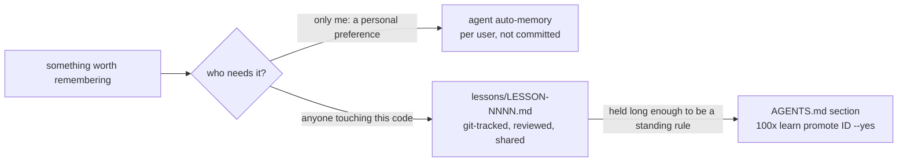

# Project learning

A conversation ends and everything it learned evaporates. The next session rediscovers
that the test suite needs a running Postgres, that a generated file must never be hand
edited, that this service's clock is UTC while its neighbour's is local. Each
rediscovery costs the same hour.

A lesson is the cheapest artifact in this plugin and the one with the longest half-life.

## Trigger

**Fire when:** something surprised you and will surprise the next person; a convention
was discovered rather than documented; a failure mode was hit; you are about to edit a
file you do not know well.

**Do not fire when:** the thing is already recorded — in the code, in git history, in
`CLAUDE.md`, or in an existing lesson. Duplicating what the repo already says makes the
lesson store noise, and a noisy store stops being read.

## Where it goes: the memory split



| store | what goes there | example | written by |
|---|---|---|---|
| auto-memory | the user's own preferences, not facts about the code | "Gaurav wants plain-language explanations" | the agent's memory, never this plugin |
| `lessons/` | project facts and gotchas any teammate or session would hit | "`make proto` reverts hand edits to `src/gen/`" | `100x learn add` |
| `AGENTS.md` | a lesson that is stable and applies broadly enough to read every session | the same gotcha, after it keeps mattering | `100x learn promote <id> --yes` |

A project fact kept in personal memory is invisible to the next teammate. A personal
preference committed to `lessons/` puts one person's taste on the whole team. Promotion
is the only path into `AGENTS.md`, so that file stays short and every line in it traces
back to a lesson with a source.

## What a lesson is, and is not

| this is a lesson | this is not |
|---|---|
| "The integration suite needs `docker compose up db` first; it fails with a confusing DNS error otherwise" | "We use Postgres" — that is in the code |
| "`src/generated/` is rebuilt by `make proto`; hand edits are silently reverted" | "Don't edit generated code" — that is a convention for `AGENTS.md` |
| "Rate limiter counts per-IP, so local testing from one machine trips it after 5 requests" | "We chose Redis over Memcached" — that is a decision, use `decide.py` |
| "Migration 0042 must run before 0043 despite the numbering, because it backfills a column 0043 indexes" | "The deploy broke on Tuesday" — that is an RCA |

The test: **would this have saved you time if you had read it first?** If not, it is not
a lesson.

## Rules

1. Record a lesson the moment it costs you time. Not at the end of the task, when the
   specific detail has blurred into a general feeling.
   *Enforced by:* `100x learn add "<lesson>" --kind <k> --affects "<glob>"`

2. Every lesson needs an `--affects` glob. A lesson nobody can find from the file it
   applies to will never be read again.
   *Enforced by:* `100x learn lint`

3. Every lesson needs a source — an ADR id, an RCA id, or a `file:line`. An unsourced
   lesson cannot be re-checked when the code moves.
   *Enforced by:* `100x learn lint`

4. State the observable trigger, not a preference. "Prefer clean code" is unusable;
   "the linter fails with X unless Y is set first" is actionable.
   *Enforced by:* `100x learn lint` (rejects a vague preference with no
   observable trigger)

5. Before editing a file, run `100x learn relevant <file>` and apply what it returns.
   This is the half of the loop that pays; writing lessons nobody reads is a diary.
   *Enforced by:* `100x learn relevant <path>`

6. Do not record what the repo already records. Code structure, git history and
   `CLAUDE.md` are not lessons.
   *Enforced by:* review

7. Delete a lesson that stops being true. A stale lesson is worse than none, because it
   is trusted.
   *Enforced by:* `100x learn lint` rejects a lesson whose source path no longer exists

8. Put personal preferences in the agent's auto-memory and project facts in `lessons/`,
   never the reverse.
   *Enforced by:* review

9. Promote a lesson into `AGENTS.md` only through `learn promote`, which refuses a
   lesson that fails lint, prints the exact snippet and target section, and writes only
   with `--yes`. Review the printed snippet before confirming.
   *Enforced by:* `100x learn promote <id>` (no write without `--yes`)

## Verify

```bash
# record it, with where it applies and where it came from
100x learn add \
  "Integration suite needs docker compose up db first; otherwise it fails with a DNS error" \
  --kind gotcha --affects "tests/integration/**" --source "tests/integration/conftest.py:14"

# recall it — run this before editing a file with prior lessons
100x learn relevant tests/integration/test_orders.py

# a lesson that keeps mattering: show the AGENTS.md snippet, then write it
100x learn promote LESSON-0001
100x learn promote LESSON-0001 --yes

# browse and audit
100x learn list --kind gotcha
100x learn lint          # no affects, no source, stale source path, vague preference
100x learn index         # regenerates lessons/INDEX.md

# lessons appear in the ledger alongside decisions and RCAs
100x ledger find "docker compose"
```

Kinds: `gotcha` (it will bite again), `convention` (discovered, not documented),
`failure` (what broke and why), `preference` (a team choice with no stronger backing).

## Failure modes

This skill rejects:

- **A lesson with no `--affects`** — unreachable from the code it concerns, so it is
  write-only.
- **A lesson with no source** — cannot be re-verified when the code moves, so it decays
  into folklore.
- **"Prefer descriptive names"** — a preference with no observable trigger. Not a lesson.
- **"We use NestJS"** — already in `package.json`.
- **A design choice with alternatives** — that is `decision-records`; a lesson has no
  rejected options.
- **A production incident** — that is `root-cause-analysis`, which also demands a
  timeline and a regression test.
- **A lesson whose source file no longer exists**, rejected by `lint` as stale.
- **A hand-written `AGENTS.md` line with no lesson behind it**, when the same fact is
  in `lessons/`: `promote` writes the snippet with its `(LESSON-NNNN)` id so the line
  can be traced and re-verified.

**Honest limitations:**
- **Nothing forces recall.** `learn.py relevant` must be run; no hook injects lessons
  into context automatically. That is the biggest weakness of this design, and it is
  why rule 5 exists rather than a mechanism.
- **Matching is glob-based.** A lesson tagged `src/auth/**` will not surface for a
  caller in `src/api/` that depends on it.
- **This is not the agent's auto-memory.** It is a project-local, git-tracked,
  reviewable store that travels with the repository. Auto-memory is per user; this
  plugin never writes to it, and nothing mechanical stops a project fact from being
  saved there instead (rule 8 is review only).
- **Promotion is not automatic.** Nothing decides a lesson is "stable"; `promote`
  checks only that it passes lint. Age and how often it mattered are the reviewer's call.

## Scale

`solo` and up, and the value is highest at `solo` — there is no colleague who remembers
the gotcha. At `small-team` the store becomes onboarding material. At `org` rule 7
matters most: an unmaintained lesson store is trusted and wrong.

## Sources
- The personal-memory / shared-lesson / AGENTS.md split and `learn promote`:
  `SOURCE: original`. That instruction files are mostly canonical `AGENTS.md` files
  with pointers, so one shared file is where standing rules belong:
  `research/21-findings-agent-instruction-corpus.md`.
- Lesson records use the same `json meta` fence as decisions and RCAs so `ledger.py`
  discovers them: `scripts/learn.py`, `scripts/ledger.py` — `SOURCE: original`.
- The rule against storing what the repo already records is the memory discipline in
  `research/21-findings-agent-instruction-corpus.md` (rule 12: defer to authoritative
  docs rather than duplicating them).
- Repro-as-permanent-artifact, the same idea applied to tests:
  `research/35-findings-security-reliability.md`.
