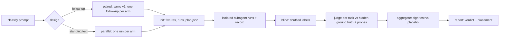

# Prompt bench

Most prompt advice is judged by reading the answer it produced and liking it. Two manual
studies behind this skill (`references/worked-example.md`) show why that misleads: on easy
tasks every arm scores 8+ and nothing separates (ceiling); on hard tasks a plain *"Please
double-check your answer."* recovered most of the gain the elaborate prompt got, so without a
placebo the wording gets credit for what the second pass did. This skill turns that method into
a repeatable bench: classify, design, run isolated arms, blind, judge, test against placebo,
recommend a placement.



Engine: `100x prompt_bench` (`scripts/prompt_bench.py`, stdlib, no network, writes only inside
the bench folder). It never calls a model: the main session runs every arm as an in-session
subagent. Free and local; no paid API is ever called.

## Trigger

**Fire when:** someone asks whether a prompt, instruction, follow-up or re-check question,
CLAUDE.md/AGENTS.md rule, persona or system prompt, task template, output-format rule or
skill text actually changes answers; "is this prompt better", "A/B test my prompt", "does
this instruction help", "should this go in CLAUDE.md".

**Do not fire when:** choosing test cases for code (`test-design`) or a test plan for a
feature (`qa-strategy`); checking whether a skill *loads* for a prompt (routing is
`skill_triggers.py` in this plugin); writing an instruction file (`agent-instructions`);
re-checking one answer in place (just ask the follow-up).

## Workflow

| step | who | does |
|---|---|---|
| 1 classify | main | pick the category in `references/categories.md`; it fixes design and placement |
| 2 tasks | main | 3–5 hard tasks with a hidden trap each, per `references/task-design.md`; write the spec |
| 3 init | tool | `100x prompt_bench init <bench> --spec spec.json` |
| 4 run v1 | main | one fresh subagent per run in `plan.json`, all in parallel, prompt sent verbatim |
| 5 record | main | `record --run <id> --phase v1 --tokens N --ms N` from each completion notice; `snapshot --run <id>` for code tasks before any follow-up |
| 6 run v2 | main | paired only: `SendMessage` the run's `prompt_v2` to the same subagent, then `record --phase v2` |
| 7 blind | tool | `blind <bench> --seed <n>`; fix any `WARN possible arm leak` before judging |
| 8 judge | main | one fresh subagent per task with the prompt `judge-plan` prints; writes `scores/<task>.json` |
| 9 result | tool | `aggregate`, then `report` → `REPORT.md` + `INDEX.md`; relay the summary table and verdict |

Spec shape (`fixture_dir` relative to the spec):

```json
{"category": "follow-up", "design": "paired-followup", "reps": 2,
 "arms": {"placebo": "Please double-check your answer.", "audit": "<prompt under test>"},
 "tasks": [{"id": "money-fix", "fixture_dir": "fx/money", "task_prompt": "Make test_money pass.",
            "ground_truth": "Naive comma strip breaks import_eu.py ...",
            "probes": ["from money import parse_amount as p; assert p('1.234,50', decimal_sep=',') == 123450"]}]}
```

Subagents cannot launch subagents, so steps 4, 6 and 8 run from the main session only. In a
subagent, stop after `init` and hand `plan.json` back.

## Rules

1. **Every bench has a `placebo` arm** — a neutral prompt of the same kind (a plain "Please
   double-check your answer." for follow-ups; a neutral line of similar length for standing
   text). Without it the effect of a second pass or of any extra text is credited to the wording.
   *Enforced by:* `100x prompt_bench init` (refuses a spec with no `placebo` arm)

2. **Pick the design from the category, not by habit.** A follow-up is tested *paired*: the same
   first answer, then one follow-up per arm, scored on v1→v2. Standing text (CLAUDE.md rule,
   persona, template, format rule, skill text) is tested as *parallel arms* on the same tasks.
   *Enforced by:* review (`init` prints a note when design and category disagree)

3. **Tasks must leave room to improve.** Each hides a trap a careful first answer usually
   misses (caller it breaks, version-specific behaviour, concurrency), with the answer in
   `ground_truth`, never in the fixture. A task whose baseline mean is ≥ 8.5 measures nothing.
   *Enforced by:* `100x prompt_bench aggregate` (ceiling warning; rebuild the task)

4. **Runs are isolated and identical except for the arm.** One fresh subagent per run, the
   prompt from `plan.json` sent verbatim; it works only inside its run folder, no network,
   never sees `GROUND_TRUTH.md`, `ARMS.md` or another run.
   *Enforced by:* review (`init` writes the isolation clause into every runner prompt)

5. **Snapshot code after v1, before the follow-up.** A follow-up edits the same files; without
   the snapshot the v1 code is gone and a code task cannot be scored paired.
   *Enforced by:* `100x prompt_bench blind` (refuses a paired code task with no snapshot)

6. **Judges are blind and scoped to one task.** Shuffled labels, no arm names, no version; each
   judge sees only its task's blind folder, fixture and ground truth, and penalises
   process-leakage sections ("Changed after re-check") that do not help the reader.
   *Enforced by:* `100x prompt_bench blind` (warns on an arm name or prompt in a blind file) and `judge-plan`

7. **Code answers are executed, not read.** Every code task carries probes that fail on the
   trap; a failing probe caps correctness at 4.
   *Enforced by:* `100x prompt_bench probe <bench> --label <L>` (exit 1 on any failing probe)

8. **Report the verdict the numbers allow.** "Better than placebo" needs sign-test p < 0.05 and
   ≥ 0.5 points; anything else is "no better than placebo (within noise)", even when the mean is
   higher. Fewer than 6 runs per arm is directional only. Cost and length change go in the report.
   *Enforced by:* `100x prompt_bench aggregate` (computes verdict, n<6 and length >25% warnings)

9. **Free and local only.** Runs and judges are in-session subagents; never call a paid model
   API or an external eval service from this workflow.
   *Enforced by:* convention

## Verify

```bash
# after init (under 1s): one run per arm x rep x task, isolation clause in every prompt
100x prompt_bench init <bench> --spec spec.json
python3 -c 'import json,sys; p=json.load(open(sys.argv[1])); assert all("do not use the network" in r["prompt_v1"] for r in p["runs"])' <bench>/plan.json
# before judging (under 2s): every answer present, labels shuffled, no arm leak warning
100x prompt_bench blind <bench> --seed 20261013
100x prompt_bench probe <bench> --label T1-01     # code tasks; exit 1 = a probe failed
# result (under 1s)
100x prompt_bench aggregate <bench>
100x prompt_bench report <bench> && test -f <bench>/REPORT.md
# the engine itself (under 10s)
bash tests/test_prompt_bench.sh
```

## Failure modes

- **Wording credited for the second pass.** Round 2 without its placebo would read "the audit
  prompt adds +2.42 points". With it: placebo +1.50, so the wording adds +0.92, sign test
  p = 0.375 — within noise. `aggregate` reports "no better than placebo (within noise)".
- **Ceiling.** Round 1's four easy tasks: first answers already 6.9–7.1 mean, a fix task at
  8.5; every arm "improved" and nothing separated. `aggregate` warns `ceiling: task t3 baseline
  mean 9 >= 8.5` and the task is rebuilt with a trap.
- **Volume mistaken for quality.** Checklist arm A made answers 32% longer for the same
  +1.50 as placebo. `aggregate` warns `length: arm A answers are +32.4% longer`.
- **A follow-up that silently loses the v1 code.** Rejected: `blind` refuses with
  `snapshots/<run>/v1 (run snapshot after v1)`.
- **Unblinded judging.** An answer that quotes its arm's prompt or name; `blind` prints
  `WARN possible arm leak` naming the label to edit before any judge runs.
- **Small-n victory lap.** 2 runs per arm reported as "B wins". `aggregate` warns `n=2 scored
  runs for arm B (< 6)`; the report says directional only.

## Scale

`solo` and up, whenever a prompt is about to become permanent: a line in CLAUDE.md is paid on
every turn by everyone, so a 30-minute bench (≈ 24 runs + 3–5 judges) pays for itself at
`small-team`. Skip it for a one-off prompt you will not reuse.

## Sources

- Method (placebo arm, paired follow-ups, blind shuffled labels, per-task judges with hidden
  ground truth and executable probes, sign test, ceiling and length warnings): `SOURCE: original`,
  from two in-session studies summarised with their numbers in `references/worked-example.md`.
- Exact two-sided sign test: standard binomial test on matched pairs, ties dropped.
- Routing (does a skill load) is a different measurement: `scripts/skill_triggers.py`.
