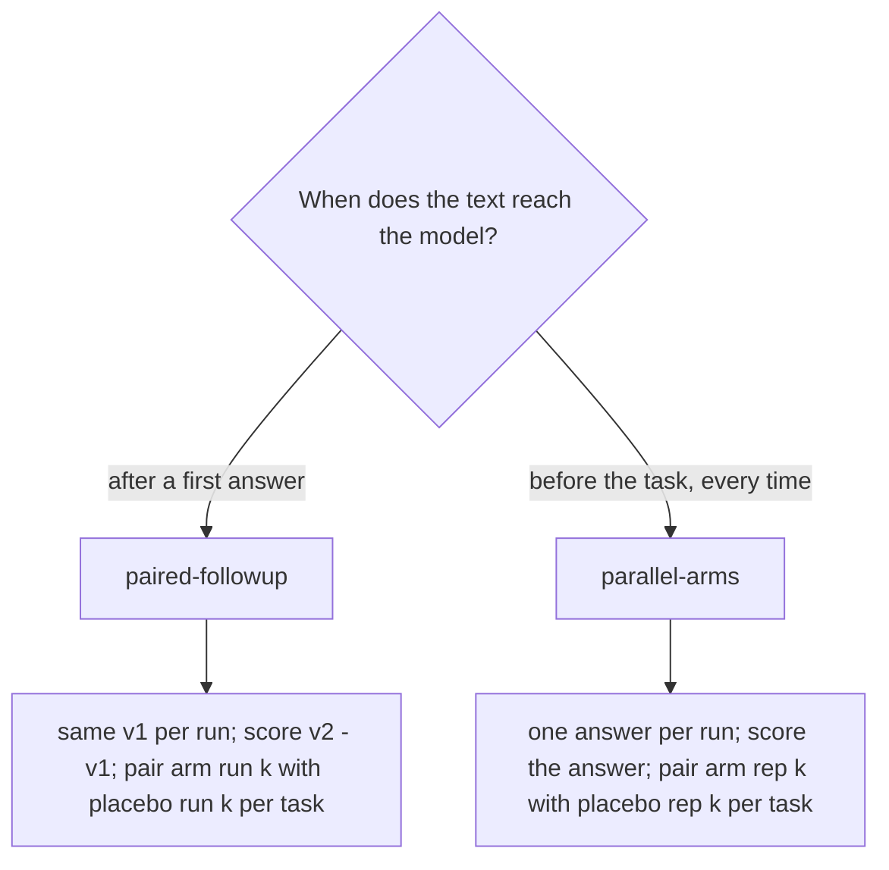

# Prompt categories: design and placement

Classify first: the category decides how the prompt is tested and where it lives if it wins.
`prompt_bench init` takes the category in the spec; `report` prints the placement for the verdict.

| category | examples | design | the arm text is… | placebo | place it, if better than placebo |
|---|---|---|---|---|---|
| `follow-up` | "are you sure?", re-check checklist, "audited a few times over" | `paired-followup` | sent after the first answer, to the same subagent | `Please double-check your answer.` | a manual follow-up, slash command or Stop-hook re-check — not CLAUDE.md |
| `always-on` | a CLAUDE.md / AGENTS.md rule, a standing "be surgical" line | `parallel-arms` | prepended as standing instructions | a neutral line of similar length ("Keep the existing project conventions.") | AGENTS.md, only if the gain covers its per-turn token cost |
| `task-template` | a "fix-bug" prompt template, a review checklist prompt | `parallel-arms` | a template with `{task}` where the task goes | `{task}` alone | a slash command or prompt template |
| `skill-description` | a SKILL.md body or a reference it loads | `parallel-arms` | the skill text as standing instructions | same length of neutral text | the skill body; routing checked separately with `skill_triggers.py` |
| `output-format` | "answer with a table first", "no preamble" | `parallel-arms` | standing instructions | empty, or a neutral line | the skill or command that produces that output, not global |
| `persona` | "You are a senior SRE…" | `parallel-arms` | standing instructions | empty, or "You are a helpful assistant." | the subagent's `agents/<name>.md` system prompt |

## Why the designs differ

- **Paired** removes first-answer luck: each arm's improvement is measured on the run's own
  v1. Round 2's bug-fix task had 0/8 safe first answers; comparing v2 alone across arms would
  mostly measure which runs got lucky at v1.
- **Parallel** is the only honest option for standing text: there is no "before" answer,
  because the text shaped the first answer.
- **Placebo text matters.** For a follow-up the placebo is a minimal second pass. For standing
  text it is text of similar length and kind, so "any extra context" is not credited to the
  specific wording.

## Multiple candidates

Put several candidate wordings in one bench as separate arms; each is tested against the same
placebo. Do not compare candidates to each other with the same sign test unless one of them
first beat placebo: with 3–4 arms, one "win" at p ≈ 0.2 is expected by chance.

## Not this skill

- Does the skill *load* for a prompt: `skill_triggers.py` (lexical routing) and the trigger
  fixtures in `evals/`.
- Writing the instruction file itself: `agent-instructions`.
