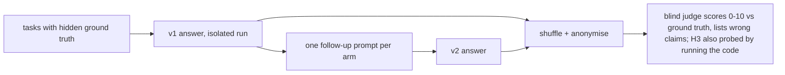

# Re-check evidence: two blind A/B rounds

Reference for `recheck` (loaded on demand).

**Verdict:** doing a second pass is the big effect; its wording is a small one. On a silent
money bug no first answer was safe (0/8) and 7/8 were safe after any follow-up, a plain
"Please double-check your answer" included. Between wordings the differences sit inside the
noise of n=6–8 runs per arm, so the shipped prompt is chosen for its side effects (fewer wrong
claims, no added length), not for a proven score win. The exact shipped wording was not itself
an arm; it combines B, the user's prompt and A's staleness item ([recheck-prompt.md](recheck-prompt.md)).

## Method

Raw runs, blind keys, judge scores and `aggregate.py` were kept in the authoring session's
scratchpad (`prompt-ab/`, `prompt-ab2/`), not in this repository. `SOURCE: original`.

## Round 1 — 4 tasks, n=8 per arm

Tasks: PR review with 3 seeded bugs and a decoy, stale README vs a pnpm repo, rounding bug fix,
over-engineering bait. Arms: `generic` = "Please double-check your answer"; `audit` = the user's
"highest confidence … audited a few times over" prompt.

| arm | overall v1 → v2 | Δ | wrong claims v1 → v2 | chars v1 → v2 | runs improved / same / worse | follow-up time |
|---|---|---|---|---|---|---|
| generic | 7.12 → 8.38 | +1.26 | 2.0 → 1.5 | 2577 → 2933 | 5 / 3 / 0 | 58 s |
| audit | 6.88 → 8.25 | +1.37 | 2.0 → 1.25 | 2298 → 2657 | 7 / 1 / 0 | 64 s |

Seen: `audit` was more consistent and more surgical, but its "beyond the request" framing could
suppress a needed addition.

## Round 2 — 3 harder tasks, n=6 per arm

Tasks: H1 coupon-redemption review (race, Date-vs-string expiry, missing transaction, unenforced
once-per-user), H2 adding a NOT NULL column to a 50M-row PostgreSQL 11 table, H3 a money parser
whose obvious fix passes the test and silently turns `"12,50"` into 125000 cents.

| arm | follow-up | overall v1 → v2 | Δ | wrong claims v1 → v2 | chars v1 → v2 | follow-up time |
|---|---|---|---|---|---|---|
| placebo | "Please double-check your answer." | 5.92 → 7.42 | +1.50 | 2.17 → 1.83 | 5176 → 6026 | 91 s |
| user | the user's prompt, verbatim | 5.50 → 7.92 | +2.42 | 2.50 → 1.33 | 6057 → 6478 | 110 s |
| A | 5-point checklist + "Changed after re-check" list | 6.00 → 7.50 | +1.50 | 2.00 → 1.50 | 5788 → 7664 | 118 s |
| B | assume a mistake, name 3, check against files | 5.92 → 7.83 | +1.91 | 2.17 → 1.00 | 5821 → 5743 | 104 s |

H3 (the silent money bug), probed by running each answer's code:

| | placebo | user | A | B | all |
|---|---|---|---|---|---|
| v1 safe | 0/2 | 0/2 | 0/2 | 0/2 | **0/8** |
| v2 safe | 2/2 | 2/2 | 1/2 | 2/2 | **7/8** |

Rubric means, v1 → v2: A's concision fell 6.67 → 4.83 (answers +32% longer) and it was the one
arm that left the money bug in once; B's correctness rose 5.5 → 9.0 with the fewest wrong claims.

## What this does and does not show

| claim | status |
|---|---|
| a second pass improves answers on tasks with a hidden defect | supported in both rounds: no run got worse, H3 0/8 → 7/8 |
| one wording beats another | not shown; gaps of 0.1–0.9 points on n=6–8 are within noise |
| a checklist with a "what changed" section costs length and readability | observed once (A, round 2); consistent with graders marking down process sections |
| the cost | follow-up adds ~1–2 min and a few thousand tokens per turn (round 2 v2 ran 90–118 s) |
| the shipped prompt specifically | untested as a unit; it is a synthesis of measured arms |
