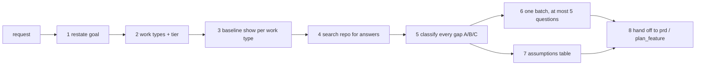

# Requirements intake

Users describe outcomes, not requirements. "Add tagging to albums" silently contains authorization,
tenant scoping, pagination, a responsive layout, empty states, an audit question and a retention
question. A senior engineer applies the first five without asking and asks about the last two. An
agent tends to do the opposite: it interrogates the user about defaults and silently assumes the
decisions that were genuinely theirs.

This skill fixes the split mechanically. The baseline (`100x baseline show`) holds the defaults
with their class; the operating model's question policy (`docs/OPERATING-MODEL.md` §5) decides what
is asked; the repo answers whatever it can before the user is asked anything.

## Trigger

**Fire when:** a request arrives in plain English and will become a PRD, a spec, a task graph or a
non-trivial change; the `100x` router classifies intent as build, plan-PRD, change-untested or QA.

**Do not fire when:** the request is a bug with known expected behaviour (`bug-fix`), an incident
(`root-cause-analysis`), a question about existing code (`codebase-comprehension`), or a change so
local it has no requirements — a copy fix, a rename. Intake on a typo is ceremony.

## The procedure



| step | output |
|---|---|
| 1 restate | outcome, actor, success signal, out of scope — at most three sentences plus a list |
| 2 work types + tier | one or more of `web-ui`, `mobile`, `api`, `worker`, `data-pipeline`, `cli`, `iac`; one tier of `prototype`, `small`, `growth`, `scale` |
| 3 baseline | `100x baseline show --work <type> --tier <tier>` per work type: A items, B items on at this tier, C items |
| 4 repo search | existing auth, tenancy, error shape, i18n, design system, test stack, deploy model, each with the path that answered it |
| 5 classify | every gap tagged A, B or C with its basis |
| 6 questions | at most five, ordered by how much the answer changes the plan |
| 7 assumptions | one row per applied default, with a source |
| 8 hand-off | `100x prd new <name> --scale <tier>` or `100x plan_feature new <name> --kind <kinds> --scale <tier>` |

### Tier

Infer it from evidence — user counts in the request, the existing deployment, a regulated domain
(regulated data is `scale` regardless of volume, per `scale-appropriateness`). An inferred tier is
**confirmed** in the question batch ("I've assumed `small`; say if this serves more than 10k users").
When nothing points to one, the tier is itself a question.

### Question format

| field | rule |
|---|---|
| question | one decision, answerable in a word or a choice |
| why it matters | what in the plan changes with the answer |
| options | two or three, concrete |
| recommendation | the one you would pick, and the basis |
| blocking | `true` for residency, compliance regime, retention, money; otherwise `false` |

A non-blocking question left unanswered proceeds on its recommendation, marked `ASSUMED`. A blocking
one stops the `ready` audit until answered (§5).

### Assumptions table

| id | assumption | class | source | basis |
|---|---|---|---|---|
| A1 | every tag endpoint checks album ownership | A | default | baseline `api.authz-every-endpoint` |
| A2 | lists capped at 100 per page | A | code | `backend/src/album/dto/list.dto.ts` |
| A3 | no load test | B | default | tier `small` |
| A4 | tags are visible to album viewers | — | user | "anyone who can see the album" |

`source` is exactly one of `user` (they said it), `code` (the repo answers it, with a path),
`default` (the baseline or a cited standard), `assumed` (your inference — every one of these is a
candidate question). A C item appears here only once the user has answered it (source `user`). An
unanswered non-blocking C item stays in the question list, marked `ASSUMED` with its recommendation,
because `100x agent_report lint` rejects a class C assumption.

## Rules

1. Restate the goal before listing anything else, and state what is out of scope.
   *Enforced by:* `100x prd audit prds/<name>` (rejects an empty problem or out-of-scope section)

2. Detect every work type and declare one tier; an inferred tier is confirmed in the question batch,
   never silently used.
   *Enforced by:* `100x plan_feature audit specs/<name>` (rejects an unfilled tier / NFR table)

3. Pull implicit requirements from the baseline for each work type, not from memory.
   *Enforced by:* `100x baseline show --work <type> --tier <tier>` — its output is cited as the basis
   of every `default` row

4. Search the repo before asking; a question the code answers is not asked.
   *Enforced by:* review — every `code` row carries a path, and a question whose answer is in the
   repo is a defect in the intake

5. Apply A and in-tier B items silently and list them; never ask about them.
   *Enforced by:* review, against the baseline's class column

6. Never default a C item. Residency, compliance regime, retention and money block until answered.
   *Enforced by:* `100x agent_report lint` (rejects a class C assumption)

7. Ask at most five questions, in one batch, ordered by impact, each with why it matters, options and
   a recommendation.
   *Enforced by:* `100x plan_feature audit specs/<name>` (rejects an open question with no
   recommendation); the count of five is review

8. Every assumption carries a source: `user`, `assumed`, `default` or `code`.
   *Enforced by:* review — the table has a `source` column and an empty cell is a defect

## Verify

```bash
# the defaults, by class, for each work type at the declared tier (~0.1s)
100x baseline show --work api --tier small
100x baseline show --work web-ui --tier small

# the intake landed in a spec/PRD that audits clean (~0.2s each)
100x plan_feature new album-tagging --kind crud,multi-tenancy --scale small --dry-run
100x plan_feature audit specs/album-tagging
100x prd audit prds/album-tagging

# no more than five open questions in the spec's §6 table (rows are `| Q1 |`, `| Q2 |`, ...)
test "$(grep -cE '^\| Q[0-9]+ \|' specs/album-tagging/spec.md)" -le 5
```

## Failure modes

This skill rejects:

- **Interrogating the user about defaults.** "Should the page work on mobile? Should the API check
  permissions? Do you want input validation?" Each is class A: apply it, list it, move on.
- **Silently assuming a C item.** A spec that says "logs retained 30 days" when nobody asked the user
  about retention. That number is a question with options, not a default.
- **A sixth question**, or questions dribbled across several turns. One batch, at most five, the
  rest proceed on recommendations marked `ASSUMED`.
- **Asking what the repo answers.** "Which auth system do you use?" when `backend/src/auth/` exists.
  Search first; record the path as the source.
- **A question with no recommendation** — it hands the user your homework.
- **An inferred tier used without confirmation**, so the user never learns the design assumed 100
  users.
- **An assumption with no source**, which the next reader cannot tell apart from a requirement.

**Honest limitations:** the baseline is a floor, not domain knowledge; a novel domain still needs the
user's judgement on what counts as a C item. The five-question cap can hide a sixth question that
mattered — when more than five C items exist, ask the five with the largest blast radius and list the
rest as `ASSUMED` with recommendations, visibly.

## Scale

Every tier. At `prototype` most B items are off and the intake is a few lines; at `scale` the C items
(residency, compliance, SLO numbers) dominate and are the reason the skill exists.

## Sources

- Question policy (A/B/C, five-question batch, blocking C items): `docs/OPERATING-MODEL.md` §5.
- Tie-break order between user, repo precedent, baseline and standards: `docs/OPERATING-MODEL.md` §4.
- Tiers and their required / not-required lists: `skills/scale-appropriateness`,
  `scripts/data/scale_tiers.json`.
- Verifiable, testable requirement statements: ISO/IEC/IEEE 29148:2018, §5.2.5 (characteristics of
  individual requirements).
- Pre-answered decisions with a default, so the agent asks only what changes the design:
  `scripts/plan_feature.py` and `scripts/data/decisions_required.json`.
- The split between asking and defaulting as a tool, not a habit: SOURCE: original.
