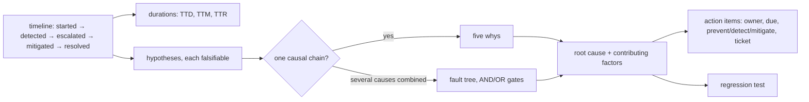

# Root cause analysis

Most "root cause analyses" stop at the trigger: "it broke because we deployed." A
deploy is never a root cause; it is what exposed one. This skill forces the chain one
step further and gates on what an incident review actually owes the organisation:
quantified impact, a timeline you can measure response against, action items somebody
owns, a regression test, and a check of whether a documented decision's assumption
quietly stopped being true.

## Trigger

**Fire when:** production is or was broken; an incident was declared; a postmortem is
requested; a test fails intermittently or only in CI; the cause of a bug is not obvious
after one reproduction attempt. Google's SRE book lists the usual postmortem triggers:
user-visible downtime or degradation past a threshold, any data loss, on-call
intervention such as a rollback, resolution time past a threshold, or a monitoring
failure where a human found the problem first.

**Do not fire when:** the bug is understood after one reproduction and the fix is local.
That is `bug-fix`. Running this on every one-line bug turns a diagnostic tool into
ceremony, and ceremony is what gets incident reviews abandoned.

## Severity

`rca.py lint` rejects any value outside this enum.

| level | definition |
|---|---|
| SEV1 | critical: broad outage, data loss or a security breach; warrants executive and public communication |
| SEV2 | major: a core function unavailable or badly degraded for many users |
| SEV3 | minor: limited or partial impact, a workaround exists; needs prompt owner attention |
| SEV4 | low: no user-facing impact, a near miss, or cosmetic |

## The record



| field | shape | lint rejects |
|---|---|---|
| `severity` | `SEV1`…`SEV4` | free text such as `high` |
| `impact` | `users_affected`, `duration_minutes` (number), `data_impact`, `revenue_or_sla_impact` | the block or any field missing |
| `timeline[]` | `{at, type, event}`; `type` ∈ started, detected, escalated, mitigated, resolved, note | `at` without a timezone or not ISO-8601; no `detected`; `fixed`/`closed` with no `mitigated`/`resolved`; impossible order |
| `five_whys[]` or `fault_tree` | ≥ 2 levels, or a tree with ≥ 2 leaf causes and AND/OR gates | neither |
| `contributing_factors[]` | the conditions that let it reach production | empty |
| `lucky[]` | what limited the damage by chance | warns when empty |
| `action_items[]` | `{what, owner, due: YYYY-MM-DD, type: prevent\|detect\|mitigate, ticket}` | none, or any item missing owner, due or type; warns on no ticket |

`100x rca durations` computes time to detect (started→detected), time to mitigate
(detected→mitigated), time to resolve (detected→resolved) and the impact window from
the first event of each type, across mixed timezones.

## Rules

1. Reproduce before theorising. An RCA built on an assumed mechanism is fiction with a
   timeline attached.
   *Enforced by:* `100x rca lint` rejects a record with no reproduction

2. Classify severity with the SEV1-SEV4 enum and quantify impact: users affected,
   minutes, data, revenue or SLO budget. An estimate is fine and says so; a severity
   word nobody defined is not.
   *Enforced by:* `100x rca lint` rejects free-text severity and missing impact

3. Build the timeline from typed events with ISO-8601 timestamps that carry a timezone.
   A naive `14:02` read in another region is wrong by hours, and response times cannot
   be measured from it. Put commit shas and deploy ids in the event text.
   *Enforced by:* `100x rca lint` rejects naive or non-ISO timestamps and untyped events

4. Separate **symptom**, **trigger**, **mechanism** and **root cause** into four
   statements. A root cause that restates the symptom means the chain never ran.
   *Enforced by:* `100x rca lint` rejects a root cause identical to the symptom

5. State each hypothesis with what evidence would **falsify** it, before collecting that
   evidence. The first story that fits is usually only confirmed, never tested.
   *Enforced by:* `100x rca lint` rejects hypotheses with no falsifying evidence

6. Use five whys for one causal chain and a fault tree when several conditions had to
   hold at once. Forcing parallel causes into one chain hides all but one of them.
   *Enforced by:* `100x rca lint` rejects fewer than 2 whys and no valid fault tree

7. Record contributing factors and where you got lucky. Luck that limited the damage is
   a latent failure waiting for a worse day.
   *Enforced by:* `100x rca lint` rejects empty contributing factors and warns on empty `lucky`

8. Every action item has one owner, a due date, a type (prevent, detect or mitigate)
   and a ticket. An unowned item is a wish, and the workbook's rule is that a
   user-affecting outage gets at least one high-priority tracked bug.
   *Enforced by:* `100x rca lint` rejects items missing owner, due or type

9. Name the regression test, and check whether an existing decision's assumption was
   violated.
   *Enforced by:* `100x rca lint` rejects no regression test; `100x rca link` records the check

10. Write blamelessly. Assume everyone acted in good faith on the information they had,
    and name the system gap: "the deploy pipeline has no canary stage", not "X pushed
    without checking".
    *Enforced by:* review (`100x rca lint` warns on phrases such as "human error", "should have")

## Verify

```bash
# open a record (legacy words critical/high/medium/low map to SEV1-SEV4)
100x rca new "Sessions dropped after deploy" --affects "src/auth/**" --severity SEV2

# reconstruct the timeline from evidence (~1s each)
git log --oneline --since="2026-09-28" -- src/auth
100x decide drift              # decisions whose governed code moved since recorded

# draw the real path once the mechanism is hypothesised
100x diagram_from_code src/auth --kind sequence --level 3

# completeness gate, which prints the computed durations (~0.2s)
100x rca lint
100x rca durations RCA-0001

# if an existing decision's assumption turns out to be the cause
100x rca link RCA-0001 --decision ADR-0001 --assumption A1

# regenerate the index, never hand-maintained
100x rca index
```

## Failure modes

This skill rejects:

- **`"severity": "high"`**: undefined across teams; one team's high is another's SEV3.
- **`"at": "2026-09-28 14:02"`**: no timezone, so TTD and TTM are unmeasurable.
- **`{"what": "improve monitoring"}`** with no owner, date or type: the vague,
  unowned item the workbook warns against.
- **No impact block**: "some users were affected" cannot be prioritised against
  anything.
- **A root cause identical to the symptom**, or a stop at the trigger.
- **One five-whys chain for an incident that needed three conditions at once.**
- **An empty contributing-factors list**, implying a single clean cause.
- **"The on-call engineer should have noticed"**: blame instead of the missing alert.

**Honest limitations:**
- Lint checks structure and non-placeholder content, not truth. A `falsify_with` can
  claim a reproduction that never happened.
- Severity is checked against the enum, not against the impact numbers. A SEV4 with
  10,000 affected users passes; review catches it.
- The blame check is a phrase list and only warns. "Alice skipped review" contains no
  listed phrase and passes. Only a reader can tell a process finding from blame.

## Next

Once `rca.py lint` passes: `bug-fix` for the patch, with the RCA's regression test as
the failing test it commits first. If the root cause needs a redesign, go to
`feature-planning` or `solution-architecture`. Stable gotchas found along the way go to
`project-learning`.

## Scale

`small-team (2-10)` and up. A solo maintainer often holds the timeline in their head and
`bug-fix` is enough. Essential at `high-blast-radius` (outages, security incidents,
payments), where impact, durations and owned action items are what leadership and
customers ask for, and the decision-link check is often the real finding.

## Sources
- Postmortem triggers, the blameless definition ("assumes that everyone involved in an
  incident had good intentions and did the right thing with the information they had"),
  and preventive action plans: Google SRE book, ch. 15 "Postmortem Culture: Learning
  from Failure", https://sre.google/sre-book/postmortem-culture/
- Impact, trigger and root causes, detection and resolution, lessons learned including
  "where we got lucky", action items with a single owner, priority and a tracked bug,
  and the rule against vague verbs like "improve": Google SRE workbook, "Postmortem
  Culture: Learning from Failure", https://sre.google/workbook/postmortem-culture/
- Severity levels, adapted from SEV-1..SEV-5 to four by folding SEV-5 into SEV4:
  `PagerDuty/incident-response-docs` (https://response.pagerduty.com/before/severity_levels/).
- A required blameless retrospective after a security release, citing the SRE
  postmortem chapter: `envoyproxy/envoy@72e8b00:SECURITY.md`, described in
  `research/35-findings-security-reliability.md`.
- The regression test as the deliverable:
  `google/oss-fuzz@2cc3fa4:docs/advanced-topics/ideal_integration.md`,
  `sqlite/sqlite@86876d2:test/fuzzcheck.c`, in `research/35-findings-security-reliability.md`.
- The symptom/trigger/mechanism/root-cause split, the decide.py-drift link, the typed
  event enum, the fault-tree shape and the mechanical lint: `SOURCE: original`.
