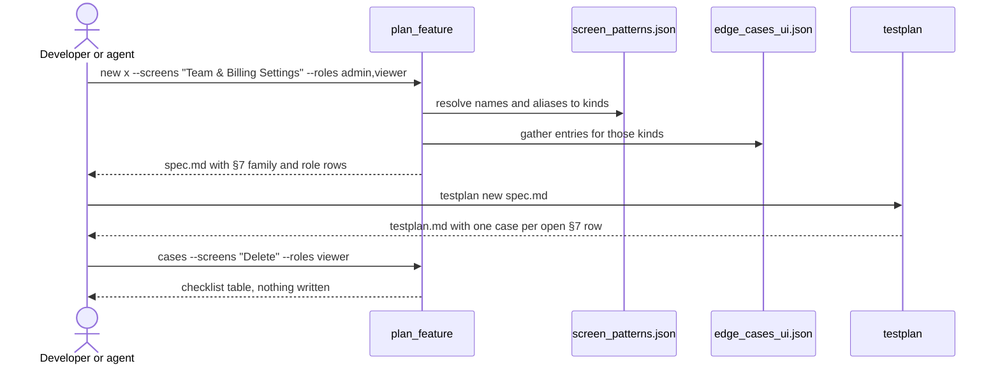

# screen-patterns — spec

| field | value |
|---|---|
| feature | screen-patterns |
| kinds | universal |
| stack | unspecified |
| prd | none |
| baseline | 1 |
| created | 2026-10-30 |
| status | ready |

Status becomes `ready` only when `100x plan_feature audit` passes. Until then the spec is incomplete by definition, not by opinion.

## 0. Non-functional requirements

Load tier and risk are DECLARED here, never defaulted — see `skills/scale-appropriateness/SKILL.md`. Risk adds security and compliance items without adding capacity items. Changing either after this spec is written is a re-plan: it needs an ADR (`100x decide new`).

| field | value |
|---|---|
| scale tier | small |
| risk | none |
| work types | cli |
| expected users / requests | < 10,000 users; low tens of requests/sec at peak |
| data volume | up to low millions of rows per table / tens of GB total |
| p95 latency budget | 300ms — STARTING POINT, not an SLO: the end-to-end user-facing budget. Basis: reviewers/_latency-numbers.md 'A worked budget example' (300 ms p95 save action: browser -> gateway -> app -> DB). |
| availability target | single-region uptime; manual or semi-automated failover is fine, not automatic |
| required at this tier | indexes on the query paths actually used; EXPLAIN before merging a new query against a non-trivial table; bounded/paginated list queries (unbounded pagination is a correctness bug at any size, not a growth-tier nicety); a deliberately sized connection pool, not the driver default; a stated p95 budget split across hops; basic uptime/error-rate monitoring |
| explicitly NOT required at this tier | multi-region deployment; a dedicated cache layer (Redis/Memcached) unless a measured hot path needs it; horizontal autoscaling or Kubernetes; a dedicated search index (OpenSearch/Meilisearch/Typesense); a 24/7 on-call rotation; a capacity or soak-testing regime |

## 0b. Implicit requirements

12 baseline item(s) for work=cli, tier=small, risk=none (`100x baseline show --work cli --tier small --risk none`). Status is one of covered, applied, accepted, deferred, waived(<reason or ADR>), n/a(<reason>), ASK(<answer>), ASSUMED(<recommendation>). Class C rows are asked, never defaulted; residency, retention, compliance regime and cost must be answered with ASK(<answer>) before the spec is ready.

| id | default | status | evidence |
|---|---|---|---|
| api.boundary-validation | every input is validated at the trust boundary for type, range, length and format, with explicit size limits | applied | V2 (`tests/test_screen_patterns.sh`) |
| cli.conventions | --help works, failure exits non-zero, data goes to stdout and diagnostics to stderr, NO_COLOR disables colour | applied | V2 (`tests/test_screen_patterns.sh`) |
| cli.semver-changelog | releases are versioned with SemVer and recorded in a CHANGELOG | applied | `CHANGELOG.md` row; checked by V6 |
| cli.minimal-deps-lockfile | minimal dependencies, each vetted, with a committed lockfile | n/a(stdlib only, AGENTS.md rule 12; no package added) | — |
| all.no-secrets-in-code | no secrets in code or config files; secrets come from the environment or a secret manager, and secret scanning runs on every push | n/a(data and instruction text only; no credentials involved) | — |
| all.sast-deps-pinned-actions | SAST in CI, automated dependency update PRs, and third-party CI actions pinned by commit SHA | n/a(no CI or workflow file changes) | — |
| all.threat-model-paragraph | the spec's security section names the assets, the trust boundaries crossed and the top abuse cases | covered | `specs/screen-patterns/spec.md` §10 |
| all.tests-in-same-change | tests ship in the same change as the code, and they are deterministic (no sleeps, no wall-clock, no network) | covered | tests/test_screen_patterns.sh, tests/test_testplan.sh, bench/test_bench.sh |
| all.small-changes | work lands as small, self-contained changes | applied | V6 (`tests/run_all.sh`) plus the PR diff stat |
| all.readme-adrs | the README states how to run and test; architecturally significant choices are recorded as ADRs | covered | ADR-0003 |
| all.time-unicode | timestamps stored in UTC (RFC 3339 on the wire), zones from the IANA tz database, DST transitions tested, text handled as Unicode with normalisation where compared | n/a(no timestamps; pattern names are compared case-insensitively after Unicode NFKC) | — |
| all.copyleft-review | a dependency under a copyleft licence (GPL, AGPL, LGPL, MPL, EPL family) is flagged for licence review before adoption | n/a(no dependency added) | — |

## 1. Outcome

A developer, QA engineer or reviewer can name the screens a feature has, in the product team's own vocabulary ("Team & Billing Settings", "Close & Remove Workspace", "Basket & Pay"), and the roles that use it, and get the checklist of what users expect from those screens: confirm before an irreversible change, warn on unsaved edits, what a viewer may and may not do. The same checklist reaches the spec, the generated test plan, the code reviewer and the PR review's Scenario lens, so a missing confirmation dialog is caught at planning, at QA or at review rather than by a user.

## 2. In scope / out of scope

| # | in scope | | # | explicitly OUT of scope |
|---|---|---|---|---|
| S1 | `scripts/data/edge_cases_ui.json`: 9 screen-behaviour families (settings, destructive-action, form, list-table, detail-view, auth-screens, scheduling, checkout, money-transfer), 6-10 entries each, same [what, why missed, test] shape as the other catalogues | | O1 | the other 15 families (feed-browse, modal-drawer, onboarding, consent, file-transfer, subscription, social-actions, user-content, invite-share, messaging, notifications, dashboard, location, media-device, search-filter-ui): their names map to `planned` and are reported, not checked |
| S2 | `scripts/data/screen_patterns.json`: a generic screen-pattern vocabulary with aliases, each mapped to families, `baseline` (already covered by ui-baseline) or `none`; a project's own taxonomy in `<records root>/screen_patterns.json` adds to it and wins on a clash; `plan_feature new --screens` resolves names to kinds | | O2 | a platform (web/mobile) tag per entry: no first-batch item is platform-specific, and a 4th field would break every catalogue reader |
| S3 | `plan_feature cases --kind/--screens [--roles] [--json]`: read-only print of the checklist for QA, review and build agents | | O3 | the product team's own 152-name taxonomy in this public repo; the industry, app-type, example-app and tag columns of the taxonomy; industry risk already flows through the existing `payment`/`pii-compliance` kinds |
| S4 | `plan_feature new --roles a,b`: per-role rows in §7 (sees / hidden-or-disabled / refused on direct URL and API), recorded in the header and protected by the audit's deleted-row rule | | O4 | domain checklists for the product modules (appointments, prescriptions, bank transfer) |
| S5 | `testplan new`: one case per open UI-family or role §7 row, so the QA plan carries the checklist | | O5 | changing `testplan trace` (it still traces AC tags only) |
| S6 | instructions: ui-baseline, diff-review, feature-planning and qa-strategy (numbered rules), qa-engineer, code-reviewer, frontend-engineer and the pr-review Scenario lens pull `plan_feature cases` for the screens and roles in play | | O6 | a new agent or skill |
| S7 | bench cases 13-15 (build a settings screen, write its test plan, review its diff), offline-tested, plus `run.sh --old-ref` so OLD can be current main | | O7 | rewriting the existing 12 bench cases |

Out-of-scope is load-bearing: it is the difference between a gap and a decision.

## 2b. Acceptance criteria

One line per criterion, `AC-<n>: <observable outcome> (R<k>, S<k>)`. The outcome is something a test can observe (a response, a stored state, what a screen shows), not an implementation step. `R<k>` names the PRD requirement it satisfies and is required when the feature has a PRD; `S<k>` names the in-scope row(s) above it delivers, and every in-scope row needs at least one criterion. Ids are unique and never renumbered: tests and `plan.json` reference them (`100x testplan trace`, `100x plan_dag lint --spec`), so a removed criterion leaves a gap and its id is not reused.

AC-1: `plan_feature new x --kind settings` seeds every settings entry into §7 with source `settings`; each of the 9 families has 6-10 entries of three non-empty strings (S1)
AC-2: `plan_feature new x --screens "settings, Shopping Cart"` resolves to kinds `settings,form,checkout,payment`, records `kinds` and `screens` in the header, and stderr states that `payment` raised the risk to elevated (S2)
AC-3: names match exactly after normalising (NFKC, casefold, `&` as `and`, collapsed spaces) against a pattern name or alias; an unknown name exits 2 and stderr names up to 3 closest names (S2)
AC-4: a screen mapped only to planned families, `baseline` or `none` still succeeds, and stderr lists it as not yet checked (S2)
AC-5: the plugin's `screen_patterns.json` and a project's `<records root>/screen_patterns.json` each have unique normalised names and aliases (a project entry wins a clash with the plugin's), malformed project files exit 2, none containing `,` or `|`; every family is a catalogue kind or in `_planned`, or the list is exactly `["baseline"]` or `["none"]`; every checkout or money-transfer name also lists `payment`, every auth-screens name also lists `auth` (S2)
AC-6: `plan_feature cases --kind settings` and `plan_feature cases --screens delete` print the checklist as a markdown table, `--json` prints a JSON list, `--roles viewer` appends the role rows, and no file is written (S3)
AC-7: `plan_feature new x --roles admin,viewer` seeds 3 role rows per role after the family rows, source `role:<name>`, records `roles` in the header, and `plan_feature audit` fails when one is deleted; a role name outside `^[a-z][a-z0-9-]{0,31}$` exits 2 (S4)
AC-8: `testplan new` adds case `TC-E<n>-1` with AC column `<feature>/E<n>` for each §7 row whose status is TODO or covered and whose source is a UI family or `role:*`; `--all-edge-cases` includes the other sources; a spec without such rows produces the same plan as before (S5)
AC-9: ui-baseline, diff-review, feature-planning and qa-strategy carry a numbered rule enforced by `100x plan_feature cases`; qa-engineer, code-reviewer, frontend-engineer and the pr-review Scenario lens name it; `python3 scripts/lint_skills.py` passes (S6)
AC-10: `bash bench/test_bench.sh` passes: cases 13-15 scaffold without git inside the agent's task, their deterministic checks pass the good samples and fail the bad ones, and `compare.py` reports per arm how many runs called `plan_feature` (S7)
AC-11: `bash bench/run.sh --old-ref main` prints the OLD ref and its sha in the cost warning and exits before any session; an unknown ref exits 2; without the flag OLD stays `4c1cd93` (S7)
AC-12: no UI kind name collides with `edge_cases.json` or `edge_cases_infra.json`, no `what` text repeats across the three catalogues, and `baseline.py` `KNOWN_KINDS` includes the UI kinds (S1)

## 3. Interfaces touched

| # | surface | change | backward compatible? |
|---|---|---|---|
| I1 | `plan_feature new` | new optional `--screens`, `--roles` | yes: without them output is unchanged |
| I2 | `plan_feature cases` | new read-only subcommand | yes: additive |
| I3 | spec header table | optional `screens`, `roles` rows | yes: audit treats a missing row as empty |
| I4 | `testplan new` output | extra rows for open UI-family and role §7 rows | yes: a spec with no such rows gets the same plan; other sources only with `--all-edge-cases` |
| I5 | `scripts/data/*.json`, `scripts/baseline.py` | two new data files; `KNOWN_KINDS` reads the third catalogue | yes |
| I6 | `bench/run.sh` | new optional `--old-ref` | yes: default unchanged |

## 4. Sequence



`100x design_drift` checks that every participant and message here has a counterpart in the implementation, and reports what drifted.

## 5. Decisions required

Each row has a recommended DEFAULT. Accept it by leaving `chosen` as `default`, or write your choice. Anything still marked `default` at audit time is recorded as an accepted default, not as an open question.

| # | decision | options | deciding factor | default (recommended) | chosen | ADR |
|---|---|---|---|---|---|---|
| D1 | checklist unit | per screen pattern / per behaviour family with a name map | 152 names share about 25 behaviours; one copy per behaviour cannot drift | family + name map | default | decisions/ADR-0003 |
| D2 | where role checks live | new spec section + audit rule / rows in the existing §7 table | §7 already has status, evidence and deleted-row rules | §7 rows with source `role:<name>` | default | decisions/ADR-0003 |

Record any decision that departs from the default, or that is architecturally load-bearing, with:

```bash
100x decide new "<decision>" --affects "<glob>" --tag universal
```

## 6. Open questions

At most 5, ordered by impact. `type` is `must-ask` (a class C item: the user's call) or `default` (proceeding on the recommendation). Every question carries a recommendation so work continues while it is unanswered. The class C rows of §0b are seeded here, blocking first, then one-way doors (docs/OPERATING-MODEL.md §5).

| # | type | question | why it matters | recommendation (proceeding with this) | answered |
|---|---|---|---|---|---|
| Q1 | default | first batch of families | sets the PR size | the 9 families in S1 plus roles, chosen from the product's modules | yes (user, 2026-10-30) |
| Q2 | must-ask | may the 152 taxonomy names be committed to this public repo? | publishing cannot be undone; AGENTS.md rule 1 needs a source | ASK(no: the plugin ships a generic vocabulary; the product taxonomy lives in the project's own `screen_patterns.json`) | yes (user, 2026-10-30) |
| Q3 | default | test-plan rows for universal §7 rows | universal rows are seeded on every spec and would grow every plan | UI-family and role rows only; `--all-edge-cases` for the rest | yes (architect review, 2026-10-30) |

## 7. Edge cases

10 seeded from the catalogue for kinds: universal. Every row needs a `status` of `covered` (with a test reference), `accepted`, `deferred` (with a follow-up reference), `n/a(<reason>)` or `waived(<reason or ADR>)`.

| # | source | edge case | why it gets missed | status | test / reference |
|---|---|---|---|---|---|
| E1 | universal | Concurrent duplicate request (double-click, retried POST) | happy path is single-threaded in the author's head | n/a(read-only CLI and file generation; no concurrent requests) | — |
| E2 | universal | Partial failure mid-operation | multi-step writes are written as if atomic | n/a(plan_feature new writes one file; an error before write leaves nothing) | — |
| E3 | universal | Downstream dependency times out | local dev is always fast | n/a(no downstream dependency; local JSON files only) | — |
| E4 | universal | Downstream returns malformed or unexpected shape | the type says it cannot happen | covered | tests/test_screen_patterns.sh: catalogue shape check rejects malformed entries |
| E5 | universal | Empty, single-item, and very large collections | examples always have 3 items | covered | tests/test_screen_patterns.sh: empty --screens, one name, every plugin pattern, a project map |
| E6 | universal | Unauthorized and wrong-tenant access | only the authorized path is exercised | n/a(local developer tool; no tenants or authorisation) | — |
| E7 | universal | Clock skew, DST boundary, timezone of the caller | the author's machine is UTC | n/a(no time handling) | — |
| E8 | universal | Input at boundary sizes and with unicode/emoji/RTL | tests use ascii names | covered | tests/test_screen_patterns.sh: names with '&', '/', mixed case and extra spaces resolve |
| E9 | universal | Rate limit or quota exhausted | quota is never hit in dev | n/a(no rate limits or quotas) | — |
| E10 | universal | Rollback path actually works | rollback is written, never run | covered | tests/test_screen_patterns.sh: a spec created without --screens or --roles matches main's output apart from the date |

## 8. Verification plan

`covers` lists the acceptance criteria a row proves (`—` for a row that proves none, such as types); every AC needs at least one row.

| # | check | command | gate | covers |
|---|---|---|---|---|
| V1 | skill lint | `python3 scripts/lint_skills.py` | pre-commit | AC-9 |
| V7 | catalogue and CLI | `bash tests/test_screen_patterns.sh` | pre-commit | AC-12 |
| V2 | unit | `bash tests/test_screen_patterns.sh` | pre-commit | AC-1, AC-2, AC-3, AC-4, AC-5, AC-6, AC-7 |
| V3 | integration | `bash tests/test_testplan.sh` | pre-commit | AC-8 |
| V4 | the edge cases above | `bash tests/test_screen_patterns.sh` | pre-PR | — |
| V5 | bench offline | `bash bench/test_bench.sh` | pre-PR | AC-10, AC-11 |
| V6 | whole suite | `bash tests/run_all.sh` | pre-PR | AC-9 |

Bind these to the code with `100x verified` so a passing result cannot be reused after an edit.

## 9. Rollout and reversal

| aspect | plan |
|---|---|
| feature flag | none: every behaviour is opt-in through `--screens`, `--roles` or `cases` |
| migration | none; existing specs are not rewritten |
| rollback | `git revert` the merge commit, then reinstall the plugin (`claude plugin uninstall 100x@100x-engineer && claude plugin marketplace update 100x-engineer && claude plugin install 100x@100x-engineer`) |
| blast radius if wrong | specs and test plans created with the new flags carry a wrong or noisy checklist row; reviewers may raise a non-issue. No user data or production system is touched |

## 10. Security

Assets: none beyond the repository's own files. Trust boundary: command-line arguments (`--screens`, `--roles`) cross from the user into a generated markdown file. Abuse case: a role or screen name containing `|` or a newline corrupts the spec table; control: role names must match `^[a-z][a-z0-9-]{0,31}$`, screen names must match a catalogue entry exactly (so nothing user-typed reaches the table), and every cell passes through the existing `esc()`. No network, no credentials, no code execution from data.

## 11. Privacy

N/A because no personal data is read, stored or sent; the catalogue is generic product guidance.

## 12. Observability

N/A because this is a local CLI with no production runtime; quality is measured by the bench (cases 13-15 against OLD = current main), whose results are reported in the PR.

## 13. Migration

N/A because no schema or stored data changes; older specs without `screens`/`roles` rows still audit.

## 14. Cost

N/A for runtime. One-off: the bench run, about $0.16-0.25 per agent session, capped with `--max-cost-usd`.
